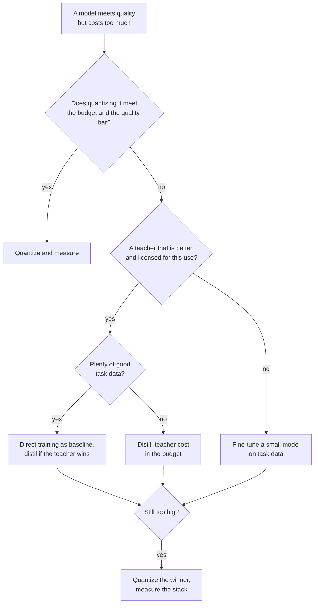

# Distillation Review Checklist: चुनना, समीक्षा और Rollout

चरण 9 का संक्षिप्त रूप, खोजने के लिए। [पाठ 24](../lessons/0024-distill-quantize-or-fine-tune.md) तीन लीवरों में से चुनना कवर करता है, [पाठ 25](../lessons/0025-reviewing-a-distillation-claim.md) दावे की समीक्षा, [पाठ 26](../lessons/0026-replacing-a-model-others-depend-on.md) rollout, और [पाठ 27](../lessons/0027-when-the-usual-answer-is-wrong.md) जब आम जवाब ग़लत हो और स्रोत से विवाद का निपटारा।

## लीवरों में से चुनना

इसी क्रम में पूछें। हर सवाल अगले से पहले विकल्प हटा देता है।

| # | सवाल | अगर हाँ | अगर नहीं |
|---|---|---|---|
| 1 | क्या model जैसा है वैसा बजट में फ़िट होता है? | जैसा है वैसा रहने दें | आगे बढ़ें |
| 2 | क्या उसे quantize करने से बजट और गुणवत्ता की सीमा पूरी होती है? | Quantize करें, फिर मूल के विरुद्ध मापें ([Quantization Review Checklist शीट](../../quantization/reference/quantization-review-checklist.md)) | आगे बढ़ें |
| 3 | क्या आपके task पर कोई teacher छोटे model से साफ़ बेहतर है, और क्या आप उसके outputs पर train कर सकते हैं? | आगे बढ़ें | छोटे model को अपने task data पर fine-tune करें ([Fine-tuning ट्रैक](../../finetuning/)) |
| 4 | क्या बहुत सारा अच्छा task data है? | छोटे model को baseline के रूप में सीधे train करें, distil तभी करें जब teacher उसे हराए | Distil करें, teacher की लागत गिनकर |
| 5 | क्या अब भी बहुत बड़ा है? | विजेता को quantize करें और जोड़ को मापें | हो गया |

## सबूत क्या कहता है, और उसकी सीमाएँ

| खोज | स्रोत | सीमा |
|---|---|---|
| पर्याप्त student compute या tokens दिए जाने पर distillation, supervised training को नहीं हरा सकता, और ऐसे बजट के भीतर जीतता है जो student के आकार के साथ बढ़ता है | Busbridge et al., abstract और section 1 | C4 पर language models, cross-entropy |
| एक student और ऐसे teacher के साथ जिसे train करना पड़े, supervised learning आम तौर पर बेहतर है | Busbridge et al., abstract | वही |
| 800,000 R1 samples पर SFT ने Qwen2.5-32B पर 10K-से-ज़्यादा RL steps को हराया: AIME 2024 pass@1 72.6 बनाम 47.0 | DeepSeek-R1 पेपर, appendix F.1, Table 16 | एक base model, मानव-data SFT वाली कोई arm नहीं |
| 15B को prune करके distil करना: हर निकाले गए model के लिए 40 गुना कम tokens, परिवार के लिए 1.8 गुना बचत | Minitron, abstract और appendix | एक परिवार, पहले से train किया हुआ 15B |
| 4B pruned और distilled: MMLU 37.81, random init के 24.36 के मुक़ाबले | Minitron Table 11 | बराबर compute पर 150B के मुक़ाबले 100B tokens, एक परिवार |
| Students अक्सर teachers से असहमत होते हैं, तब भी जब मेल बिठा सकते हों | Stanton et al., abstract | ज़्यादातर image classification |
| Raters ने imitation models को ChatGPT के क़रीब आँका, असमर्थित tasks पर फ़ासला कम पटा | Gudibande et al., sections 4.2 से 4.4 | ChatGPT की नक़ल, 13B तक के models |

## किसी और के दावे के लिए सवाल

| दावे का हिस्सा | पूछें |
|---|---|
| "X% बनाए रखता है" | किसका अनुपात, किस suite पर, किस teacher के विरुद्ध? उसे तालिका से दोबारा निकालें (DistilBERT: 77.0 भाग 79.5 है 96.9%, CoLA 91.1% और RTE 86.4% के साथ) |
| Tasks | क्या औसत कमज़ोर tasks को छिपा रहा है? |
| आबादी | Held-out, या distillation distribution से? |
| Baseline | Teacher, उसके बिना train हुआ उसी आकार का model, base model? |
| Contamination | Test inputs को distillation prompts से बाहर किसने रखा? |
| Rater | मानव, judge model या metric, और क्या वे तथ्य जाँच सकते थे? |
| Decoding | Greedy या sampled, दोनों models के लिए एक-सा? |
| Noise | कितने seeds, और फैलाव के मुक़ाबले फ़ासला कितना बड़ा है? |
| लागत | Teacher inference, data generation और filtering गिने गए? |

यह भी बताएँ कि क्या ठीक है और रहना चाहिए। जो समीक्षा सिर्फ़ दोष गिनाती है वह आधी हुई है। हर छिपे हिस्से को एक लागत की तरह कहें और वह माप बताएँ जो मामला निपटा देगा, उसकी क़ीमत के साथ।

## Student को rollout करना

| चरण | क्या करें |
|---|---|
| Baseline को pin करें | Teacher checkpoint, harness और prompt set का नाम लें, और उसे serve करते रहें |
| Offline eval | Accuracy, teacher से agreement और बदले हुए उत्तर, प्रति slice |
| Gates तय करें | Run से पहले लिखी thresholds, standard error से ज़्यादा कसी नहीं ([Go/No-Go शीट](../../evals/reference/go-no-go.md)) |
| जाँचें कि निर्भर लोग किस पर भरोसा करते हैं | उनके अपने parsers के साथ output format, refusal दर, confidence thresholds, लंबे outputs, long-tail inputs, latency |
| Shadow | Student teacher के बग़ल में चलता है, कोई उपयोगकर्ता उसे नहीं देखता, agreement और नमूने की समीक्षा से आँकें |
| Canary, फिर चरणबद्ध | Live traffic का छोटा हिस्सा, हर चरण पर gates जाँचें |
| Version | Checkpoint, prompt template, decoding settings और serving stack साथ में |
| Rollback | Teacher तब तक deployable रहता है जब तक canary ने वह traffic न देख लिया हो जिसकी आपको परवाह है |
| निर्भर लोगों को बताएँ | तारीख़, दोनों तरफ़ के versions, जो slices हिले, जाँचे गए व्यवहार, teacher कितने समय तक रहेगा |

## जब आम जवाब ग़लत हो

| आम जवाब | ग़लत कब | स्रोत |
|---|---|---|
| बड़े model को distil करें | कोई teacher आपके task पर student को नहीं हराता | R1 पेपर appendix F.1, Gudibande et al. |
| सबसे अच्छा teacher इस्तेमाल करें | Terms या license मना करते हैं | OpenAI Terms of Use, Llama 3.1 license: मौजूदा text पढ़ें |
| बड़ा teacher बेहतर है | Capacity gap: ImageNet student error शून्य से 30.24, और 30.24, 26.70 और 23.85 error वाले teachers के तहत 30.57, 30.79 और 30.95 | Cho और Hariharan Table 1 |
| Student इसे सोख सकता है | Task को ऐसा ज्ञान चाहिए जो वह रख नहीं सकता | Gudibande et al. |
| Teacher outputs पर fine-tune करें | On-policy training बेहतर करती है | Agarwal et al. sections 4.1 और 4.3 |
| Forward KL मानक है | Metric instruction-following की गुणवत्ता है, text पर loss नहीं | Busbridge et al. Table 7, Minitron Table 16, MiniLLM, Agarwal et al. section 4.4 |
| Quantize नहीं, distil करें | Quantize करने से बजट पूरा होता है | [Quantization Review Checklist शीट](../../quantization/reference/quantization-review-checklist.md) |

## स्रोत से विवाद का निपटारा

1. पेपर ढूँढें, उसका हवाला देने वाली post नहीं।
2. Models, आकार और साल जाँचें।
3. जाँचें कि क्या मापा गया बनाम क्या दावा किया गया।
4. तालिका के पीछे की setup पढ़ें: baselines, trials, बताया गया नंबर कैसे चुना गया।
5. फ़ासले की run-to-run noise से तुलना करें।
6. उसे अपने task पर चलाएँ।
