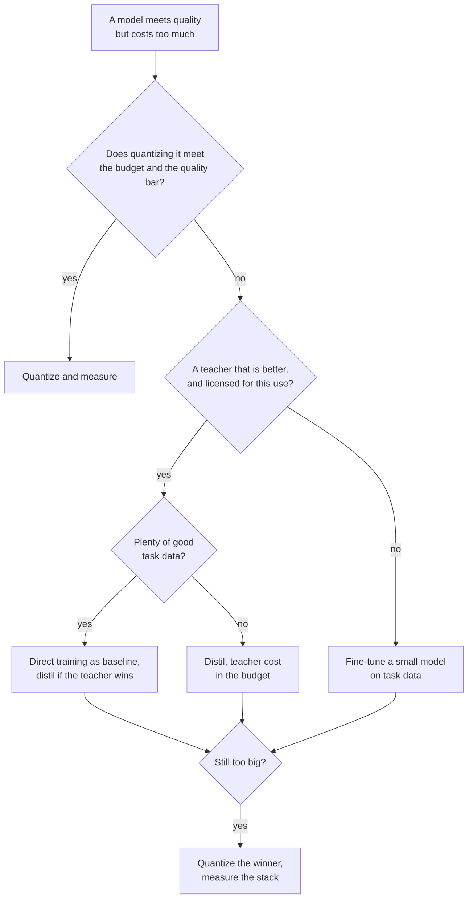

# Distillation Review Checklist: Choosing, Reviewing and Rolling Out

Stage 9 compressed for lookup. [Lesson 24](../lessons/0024-distill-quantize-or-fine-tune.md) covers choosing between the three levers, [lesson 25](../lessons/0025-reviewing-a-distillation-claim.md) covers reviewing a claim, [lesson 26](../lessons/0026-replacing-a-model-others-depend-on.md) covers the rollout, and [lesson 27](../lessons/0027-when-the-usual-answer-is-wrong.md) covers when the usual answer is wrong and settling a dispute from the source.

## Choosing between the levers

Ask in this order. Each question removes options before the next.

| # | Question | If yes | If no |
|---|---|---|---|
| 1 | Does the model fit the budget as it is? | Stay as it is | Continue |
| 2 | Does quantizing it meet the budget and the quality bar? | Quantize, then measure against the original ([quantization checklist](../../quantization/reference/quantization-review-checklist.md)) | Continue |
| 3 | Is there a teacher clearly better than a small model on your task, and may you train on its outputs? | Continue | Fine-tune a small model on your task data ([finetuning track](../../finetuning/)) |
| 4 | Is there plenty of good task data? | Train the small model directly as the baseline, distil only if the teacher beats it | Distil, with the teacher's cost counted |
| 5 | Still too big? | Quantize the winner and measure the stack | Done |

## What the evidence says, and its limits

| Finding | Source | Limit |
|---|---|---|
| Distillation cannot beat supervised training given enough student compute or tokens, and wins within a budget that grows with student size | Busbridge et al., abstract and section 1 | Language models on C4, cross-entropy |
| With one student and a teacher that must be trained, supervised learning is generally preferable | Busbridge et al., abstract | Same |
| SFT on 800,000 R1 samples beat 10K-plus RL steps on Qwen2.5-32B: AIME 2024 pass@1 72.6 against 47.0 | DeepSeek-R1 paper, appendix F.1, Table 16 | One base model, no human-data SFT arm |
| Pruning 15B then distilling: 40 times fewer tokens per derived model, 1.8 times saving for the family | Minitron, abstract and appendix | One family, an already trained 15B |
| 4B pruned and distilled: MMLU 37.81 against 24.36 for random init | Minitron Table 11 | 100B against 150B tokens at equal compute, one family |
| Students often disagree with teachers even when able to match them | Stanton et al., abstract | Mostly image classification |
| Imitation models rated near ChatGPT by raters, little gap closed on unsupported tasks | Gudibande et al., sections 4.2 to 4.4 | Imitating ChatGPT, models up to 13B |

## Questions for someone else's claim

| Part of the claim | Ask |
|---|---|
| "Retains X%" | A ratio of what, on which suite, against which teacher? Recompute it from the table (DistilBERT: 77.0 over 79.5 is 96.9%, with CoLA at 91.1% and RTE at 86.4%) |
| Tasks | Is the average hiding the weak tasks? |
| Population | Held out, or from the distillation distribution? |
| Baseline | The teacher, a same-size model trained without it, the base model? |
| Contamination | What kept the test inputs out of the distillation prompts? |
| Rater | Humans, a judge model or a metric, and could they check facts? |
| Decoding | Greedy or sampled, the same for both models? |
| Noise | How many seeds, and how large is the gap against the spread? |
| Cost | Teacher inference, data generation and filtering counted? |

Also say what is fine and should stay. A review that only lists faults is half done. State each hidden part as a cost and name the measurement that would settle it, with its price.

## Rolling out a student

| Step | What to do |
|---|---|
| Pin the baseline | Name the teacher checkpoint, the harness and the prompt set, and keep serving it |
| Offline eval | Accuracy, agreement with the teacher and flipped answers, per slice |
| Set the gates | Thresholds written before the run, no tighter than the standard error ([go/no-go sheet](../../evals/reference/go-no-go.md)) |
| Check what dependents rely on | Output format with their own parsers, refusal rate, confidence thresholds, long outputs, long-tail inputs, latency |
| Shadow | The student runs beside the teacher, no user sees it, judge by agreement and sampled review |
| Canary, then staged | A small share of live traffic, gates checked at each step |
| Version | Checkpoint, prompt template, decoding settings and serving stack together |
| Rollback | The teacher stays deployable until the canary has seen the traffic you care about |
| Tell dependents | Date, versions on both sides, slices that moved, behaviours checked, how long the teacher stays |

## When the usual answer is wrong

| Usual answer | Wrong when | Source |
|---|---|---|
| Distil the big model | No teacher beats the student on your task | R1 paper appendix F.1, Gudibande et al. |
| Use the best teacher | Terms or license forbid it | OpenAI Terms of Use, Llama 3.1 license: read the current text |
| A bigger teacher is better | Capacity gap: ImageNet student error 30.24 from scratch, 30.57, 30.79 and 30.95 under teachers of error 30.24, 26.70 and 23.85 | Cho and Hariharan Table 1 |
| The student can absorb it | The task needs knowledge it cannot hold | Gudibande et al. |
| Fine-tune on teacher outputs | On-policy training does better | Agarwal et al. sections 4.1 and 4.3 |
| Forward KL is standard | The metric is instruction-following quality, not loss on text | Busbridge et al. Table 7, Minitron Table 16, MiniLLM, Agarwal et al. section 4.4 |
| Distil, not quantize | Quantizing meets the budget | [Quantization checklist](../../quantization/reference/quantization-review-checklist.md) |

## Settling a dispute from the source

1. Find the paper, not the post that cites it.
2. Check the models, sizes and year.
3. Check what was measured against what was claimed.
4. Read the setup behind the table: baselines, trials, how the reported number was chosen.
5. Compare the gap with the run-to-run noise.
6. Run it on your own task.
