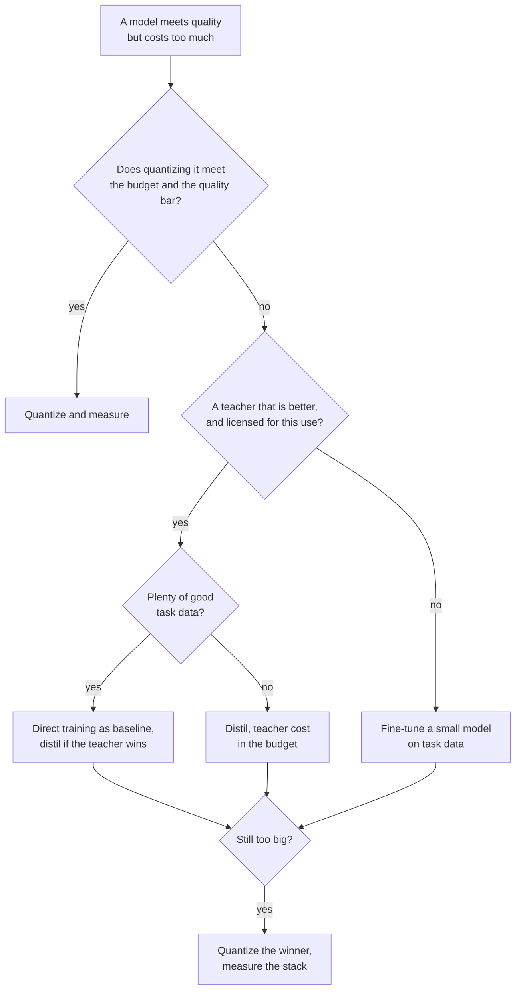

# Checklist de Revisão de Destilação: Escolher, Revisar e Fazer o Rollout

A etapa 9 condensada para consulta. A [lição 24](../lessons/0024-distill-quantize-or-fine-tune.md) cobre a escolha entre as três alavancas, a [lição 25](../lessons/0025-reviewing-a-distillation-claim.md) cobre a revisão de uma alegação, a [lição 26](../lessons/0026-replacing-a-model-others-depend-on.md) cobre o rollout, e a [lição 27](../lessons/0027-when-the-usual-answer-is-wrong.md) cobre quando a resposta de sempre está errada e como resolver uma disputa a partir da fonte.

## Escolhendo entre as alavancas

Pergunte nesta ordem. Cada pergunta remove opções antes da próxima.

| # | Pergunta | Se sim | Se não |
|---|---|---|---|
| 1 | O modelo cabe no orçamento como está? | Fique como está | Continue |
| 2 | Quantizá-lo atende o orçamento e a barra de qualidade? | Quantize e depois meça contra o original ([Checklist de Revisão de Quantização](../../quantization/reference/quantization-review-checklist.md)) | Continue |
| 3 | Existe um professor claramente melhor do que um modelo pequeno na sua tarefa, e você pode treinar nas suas saídas? | Continue | Faça fine-tuning de um modelo pequeno nos dados da sua tarefa ([Fine-Tuning com Adapters](../../finetuning/)) |
| 4 | Há muitos dados bons da tarefa? | Treine o modelo pequeno diretamente como baseline, destile só se o professor o superar | Destile, com o custo do professor contado |
| 5 | Ainda grande demais? | Quantize o vencedor e meça a pilha | Pronto |

## O que a evidência diz, e os seus limites

| Achado | Fonte | Limite |
|---|---|---|
| A destilação não consegue superar o treinamento supervisionado dados compute ou tokens de aluno suficientes, e vence dentro de um orçamento que cresce com o tamanho do aluno | Busbridge et al., resumo e seção 1 | Modelos de linguagem no C4, cross-entropy |
| Com um aluno e um professor que precisa ser treinado, o aprendizado supervisionado geralmente é preferível | Busbridge et al., resumo | Mesmo |
| SFT em 800.000 amostras do R1 superou mais de 10K passos de RL no Qwen2.5-32B: AIME 2024 pass@1 72,6 contra 47,0 | Artigo do DeepSeek-R1, apêndice F.1, Tabela 16 | Um base model, sem braço de SFT em dados humanos |
| Podar o 15B e depois destilar: 40 vezes menos tokens por modelo derivado, economia de 1,8 vez para a família | Minitron, resumo e apêndice | Uma família, um 15B já treinado |
| 4B podado e destilado: MMLU 37,81 contra 24,36 da inicialização aleatória | Minitron Tabela 11 | 100B contra 150B tokens com compute igual, uma família |
| Os alunos muitas vezes discordam dos professores mesmo quando conseguem igualá-los | Stanton et al., resumo | Principalmente classificação de imagens |
| Modelos de imitação avaliados por avaliadores como próximos do ChatGPT, pouca lacuna fechada em tarefas sem suporte | Gudibande et al., seções 4.2 a 4.4 | Imitando o ChatGPT, modelos de até 13B |

## Perguntas para a alegação de outra pessoa

| Parte da alegação | Pergunte |
|---|---|
| "Retém X%" | Uma razão de quê, em qual conjunto, contra qual professor? Recalcule a partir da tabela (DistilBERT: 77,0 sobre 79,5 é 96,9%, com o CoLA em 91,1% e o RTE em 86,4%) |
| Tarefas | A média está escondendo as tarefas fracas? |
| População | Held-out, ou da distribuição de destilação? |
| Baseline | O professor, um modelo do mesmo tamanho treinado sem ele, o base model? |
| Contaminação | O que manteve as entradas de teste fora dos prompts de destilação? |
| Avaliador | Humanos, um modelo juiz ou uma métrica, e eles conseguiam checar fatos? |
| Decodificação | Greedy ou amostrada, a mesma para os dois modelos? |
| Ruído | Quantas seeds, e qual o tamanho da diferença contra a dispersão? |
| Custo | Inferência do professor, geração de dados e filtragem contadas? |

Diga também o que está bom e deve ficar. Uma revisão que só lista falhas está pela metade. Enuncie cada parte escondida como um custo e nomeie a medição que resolveria a questão, com o seu preço.

## Fazendo o rollout de um aluno

| Passo | O que fazer |
|---|---|
| Fixe o baseline | Nomeie o checkpoint do professor, o harness e o conjunto de prompts, e continue servindo-o |
| Eval offline | Acurácia, concordância com o professor e respostas trocadas, por fatia |
| Defina os gates | Limiares escritos antes da execução, não mais apertados do que o erro padrão (folha [Go/No-Go](../../evals/reference/go-no-go.md)) |
| Verifique em que os dependentes se apoiam | Formato de saída com os parsers deles, taxa de recusa, limiares de confiança, saídas longas, entradas de cauda longa, latência |
| Shadow | O aluno roda ao lado do professor, nenhum usuário o vê, julgue por concordância e revisão amostrada |
| Canary, depois em etapas | Uma pequena parcela do tráfego real, gates conferidos em cada passo |
| Versão | Checkpoint, template de prompt, configurações de decodificação e stack de serving juntos |
| Rollback | O professor continua implantável até o canary ter visto o tráfego que importa para você |
| Avise os dependentes | Data, versões dos dois lados, fatias que se moveram, comportamentos verificados, por quanto tempo o professor continua |

## Quando a resposta de sempre está errada

| Resposta de sempre | Errada quando | Fonte |
|---|---|---|
| Destile o modelo grande | Nenhum professor supera o aluno na sua tarefa | Artigo do R1 apêndice F.1, Gudibande et al. |
| Use o melhor professor | Os termos ou a licença o proíbem | Terms of Use da OpenAI, licença do Llama 3.1: leia o texto atual |
| Um professor maior é melhor | Lacuna de capacidade: erro do aluno no ImageNet 30,24 do zero, 30,57, 30,79 e 30,95 sob professores de erro 30,24, 26,70 e 23,85 | Cho e Hariharan Tabela 1 |
| O aluno consegue absorver | A tarefa exige conhecimento que ele não consegue guardar | Gudibande et al. |
| Faça fine-tuning em saídas do professor | O treinamento on-policy se sai melhor | Agarwal et al. seções 4.1 e 4.3 |
| O forward KL é o padrão | A métrica é a qualidade de seguimento de instruções, não a loss em texto | Busbridge et al. Tabela 7, Minitron Tabela 16, MiniLLM, Agarwal et al. seção 4.4 |
| Destile, não quantize | Quantizar atende o orçamento | [Checklist de Revisão de Quantização](../../quantization/reference/quantization-review-checklist.md) |

## Resolvendo uma disputa a partir da fonte

1. Encontre o artigo, não o post que o cita.
2. Verifique os modelos, os tamanhos e o ano.
3. Verifique o que foi medido contra o que foi alegado.
4. Leia a configuração por trás da tabela: baselines, tentativas, como o número relatado foi escolhido.
5. Compare a diferença com o ruído entre execuções.
6. Rode na sua própria tarefa.
