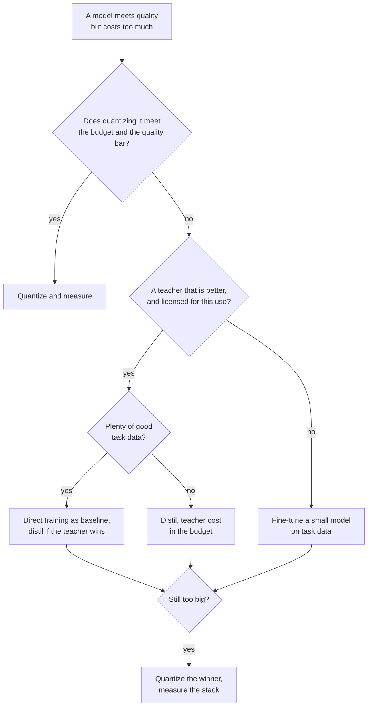

# Чек-лист ревью дистилляции: выбор, ревью и выкатка

Этап 9 в сжатом виде для быстрого поиска. [Урок 24](../lessons/0024-distill-quantize-or-fine-tune.md) охватывает выбор между тремя рычагами, [урок 25](../lessons/0025-reviewing-a-distillation-claim.md) охватывает ревью заявления, [урок 26](../lessons/0026-replacing-a-model-others-depend-on.md) охватывает выкатку, а [урок 27](../lessons/0027-when-the-usual-answer-is-wrong.md) охватывает случаи, когда обычный ответ неверен, и разрешение спора по источнику.

## Выбор между рычагами

Спрашивайте в таком порядке. Каждый вопрос убирает варианты до следующего.

| # | Вопрос | Если да | Если нет |
|---|---|---|---|
| 1 | Укладывается ли модель в бюджет как есть? | Оставить как есть | Продолжать |
| 2 | Укладывается ли квантизация в бюджет и планку качества? | Квантизовать, затем измерить относительно исходной ([Чек-лист ревью квантизации](../../quantization/reference/quantization-review-checklist.md)) | Продолжать |
| 3 | Есть ли учитель, явно лучший малой модели на вашей задаче, и можно ли обучать на его выходах? | Продолжать | Дообучить малую модель на данных вашей задачи ([Адаптерное дообучение](../../finetuning/)) |
| 4 | Много ли хороших данных задачи? | Обучить малую модель напрямую как базовый уровень, дистиллировать, только если учитель её превосходит | Дистиллировать, с учётом стоимости учителя |
| 5 | Всё ещё слишком велика? | Квантизовать победителя и измерить стопку | Готово |

## Что говорят свидетельства и их пределы

| Вывод | Источник | Предел |
|---|---|---|
| Дистилляция не может превзойти контролируемое обучение при достаточных вычислениях или токенах ученика и выигрывает внутри бюджета, растущего с размером ученика | Busbridge et al., аннотация и раздел 1 | Языковые модели на C4, кросс-энтропия |
| При одном ученике и учителе, которого нужно обучать, контролируемое обучение, как правило, предпочтительнее | Busbridge et al., аннотация | То же |
| SFT на 800 000 сэмплов R1 превзошло более 10K шагов RL на Qwen2.5-32B: AIME 2024 pass@1 72.6 против 47.0 | Статья DeepSeek-R1, приложение F.1, таблица 16 | Одна базовая модель, нет ветви SFT на данных людей |
| Прунинг 15B и затем дистилляция: в 40 раз меньше токенов на производную модель, экономия в 1.8 раза для семейства | Minitron, аннотация и приложение | Одно семейство, уже обученная 15B |
| 4B после прунинга и дистилляции: MMLU 37.81 против 24.36 при случайной инициализации | Minitron, таблица 11 | 100B против 150B токенов при равных вычислениях, одно семейство |
| Ученики часто расходятся с учителями, даже когда способны с ними совпасть | Stanton et al., аннотация | В основном классификация изображений |
| Имитирующие модели оценены оценщиками как близкие к ChatGPT, малый разрыв закрыт на не поддержанных задачах | Gudibande et al., разделы с 4.2 по 4.4 | Имитация ChatGPT, модели до 13B |

## Вопросы к чужому заявлению

| Часть заявления | Спросите |
|---|---|
| «Сохраняет X%» | Отношение чего, на каком наборе, относительно какого учителя? Пересчитайте по таблице (DistilBERT: 77.0 от 79.5 это 96.9%, при CoLA на 91.1% и RTE на 86.4%) |
| Задачи | Не скрывает ли среднее слабые задачи? |
| Популяция | Отложены или из распределения дистилляции? |
| Базовый уровень | Учитель, модель того же размера, обученная без него, базовая модель? |
| Загрязнение | Что не допустило тестовые входы в промпты дистилляции? |
| Оценщик | Люди, модель-судья или метрика, и могли ли они проверить факты? |
| Декодирование | Жадное или с сэмплированием, одинаковое для обеих моделей? |
| Шум | Сколько seed и насколько велик разрыв по сравнению с разбросом? |
| Стоимость | Учтены ли инференс учителя, генерация данных и фильтрация? |

Скажите также, что в порядке и должно остаться. Ревью, которое только перечисляет недостатки, сделано наполовину. Формулируйте каждую скрытую часть как цену и называйте измерение, которое это разрешило бы, с его ценой.

## Выкатка ученика

| Шаг | Что делать |
|---|---|
| Зафиксировать базовый уровень | Назвать контрольную точку учителя, обвязку и набор промптов и продолжать его обслуживать |
| Офлайн-оценка | Точность, согласие с учителем и перевернувшиеся ответы, по срезам |
| Задать пороги | Пороги записаны до запуска, не жёстче стандартной ошибки (лист [Выпускать или нет](../../evals/reference/go-no-go.md)) |
| Проверить, на что полагаются зависящие | Формат вывода их собственными парсерами, доля отказов, пороги по уверенности, длинные выходы, входы длинного хвоста, задержка |
| Тень | Ученик работает рядом с учителем, пользователи его не видят, судить по согласию и выборочному просмотру |
| Канарейка, затем поэтапно | Небольшая доля живого трафика, пороги проверяются на каждом шаге |
| Версия | Контрольная точка, шаблон промпта, настройки декодирования и стек обслуживания вместе |
| Откат | Учитель остаётся готовым к развёртыванию, пока канарейка не увидит нужный вам трафик |
| Сообщить зависящим | Дата, версии с обеих сторон, срезы, которые сдвинулись, проверенные поведения, как долго остаётся учитель |

## Когда обычный ответ неверен

| Обычный ответ | Неверен, когда | Источник |
|---|---|---|
| Дистиллируй большую модель | Ни один учитель не превосходит ученика на вашей задаче | Статья R1, приложение F.1, Gudibande et al. |
| Используй лучшего учителя | Условия или лицензия это запрещают | Условия использования OpenAI, лицензия Llama 3.1: читайте актуальный текст |
| Больший учитель лучше | Разрыв в ёмкости: ошибка ученика ImageNet 30.24 с нуля, 30.57, 30.79 и 30.95 при учителях с ошибкой 30.24, 26.70 и 23.85 | Cho and Hariharan, таблица 1 |
| Ученик может это усвоить | Задаче нужны знания, которые он не может удержать | Gudibande et al. |
| Дообучить на выходах учителя | On-policy-обучение работает лучше | Agarwal et al., разделы 4.1 и 4.3 |
| Прямая KL стандартна | Метрика это качество следования инструкциям, а не потеря на тексте | Busbridge et al., таблица 7, Minitron, таблица 16, MiniLLM, Agarwal et al., раздел 4.4 |
| Дистиллируй, а не квантизуй | Квантизация укладывается в бюджет | [Чек-лист ревью квантизации](../../quantization/reference/quantization-review-checklist.md) |

## Разрешение спора по источнику

1. Найдите статью, а не запись, которая её цитирует.
2. Проверьте модели, размеры и год.
3. Сверьте, что измерялось, с тем, что заявлено.
4. Прочитайте устройство эксперимента за таблицей: базовые уровни, испытания, как выбиралось приводимое число.
5. Сравните разрыв с шумом между запусками.
6. Запустите на собственной задаче.
