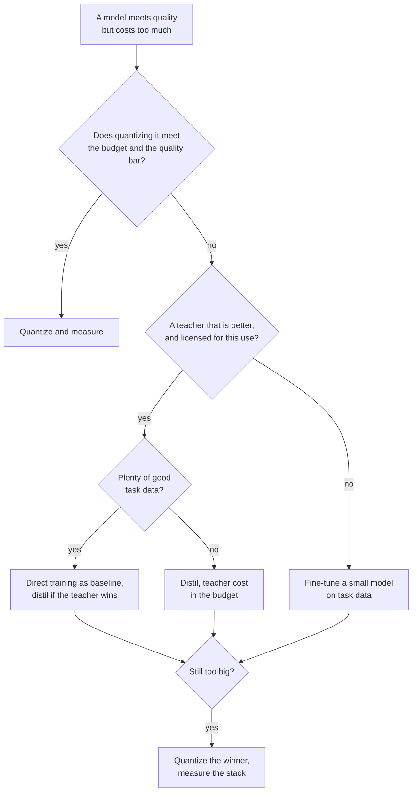

# 蒸馏评审检查清单：选择、评审与上线

第 9 阶段，压缩成便于查阅的形式。[第 24 课](../lessons/0024-distill-quantize-or-fine-tune.md)讲在三个杠杆之间做选择，[第 25 课](../lessons/0025-reviewing-a-distillation-claim.md)讲评审一项声明，[第 26 课](../lessons/0026-replacing-a-model-others-depend-on.md)讲上线，[第 27 课](../lessons/0027-when-the-usual-answer-is-wrong.md)讲惯常答案何时出错，以及从来源裁定争议。

## 在杠杆之间做选择

按这个顺序提问。每个问题都会在下一个问题之前排除一些选项。

| # | 问题 | 如果是 | 如果否 |
|---|---|---|---|
| 1 | 模型按现状就符合预算吗？ | 保持现状 | 继续 |
| 2 | 量化它能满足预算和质量要求吗？ | 量化，然后对照原始模型度量（[量化评审检查清单](../../quantization/reference/quantization-review-checklist.md)） | 继续 |
| 3 | 有没有一个在你的任务上明显优于小模型的教师，并且你可以在它的输出上训练？ | 继续 | 在你的任务数据上微调一个小模型（[适配器微调系列](../../finetuning/)） |
| 4 | 有大量好的任务数据吗？ | 直接训练小模型作为基线，只有当教师胜过它时才蒸馏 | 蒸馏，并把教师的成本计入 |
| 5 | 还是太大？ | 量化胜出的那个，并度量叠加后的整体 | 完成 |

## 证据说明了什么，以及它的局限

| 发现 | 出处 | 局限 |
|---|---|---|
| 给定足够的学生算力或 token，蒸馏无法胜过监督训练，而在一个随学生规模增长的预算之内，蒸馏胜出 | Busbridge 等，摘要和第 1 节 | C4 上的语言模型，交叉熵 |
| 只有一个学生、教师必须训练时，监督学习通常更可取 | Busbridge 等，摘要 | 同上 |
| 在 Qwen2.5-32B 上，800,000 条 R1 样本的监督微调，胜过 10K 多步的强化学习：AIME 2024 pass@1 为 72.6 对 47.0 | DeepSeek-R1 论文，附录 F.1，表 16 | 一个基础模型，没有人类数据的监督微调分支 |
| 把 15B 剪枝后再蒸馏：每个推导出来的模型少用 40 倍 token，整个家族节省 1.8 倍 | Minitron，摘要和附录 | 一个家族，一个已经训练好的 15B |
| 4B 剪枝后蒸馏：MMLU 为 37.81，随机初始化为 24.36 | Minitron 表 11 | 相同算力下是 100B 对 150B token，一个家族 |
| 学生常常与教师不一致，即使它们有能力匹配 | Stanton 等，摘要 | 主要是图像分类 |
| 模仿模型被评分者评为接近 ChatGPT，在没有支持的任务上缩小的差距很少 | Gudibande 等，第 4.2 至 4.4 节 | 模仿 ChatGPT，最大 13B 的模型 |

## 对别人的声明要问的问题

| 声明的部分 | 问 |
|---|---|
| “保留了 X%” | 是什么的比值，在哪个基准套件上，对照哪个教师？从表里重新计算（DistilBERT：77.0 除以 79.5 是 96.9%，其中 CoLA 是 91.1%，RTE 是 86.4%） |
| 任务 | 平均值是否掩盖了较弱的任务？ |
| 总体 | 是留出的，还是来自蒸馏的分布？ |
| 基线 | 教师、一个不带它训练的同样大小的模型、基础模型？ |
| 污染 | 是什么把测试输入挡在蒸馏提示词之外？ |
| 评分者 | 人类、评判模型，还是某个指标？他们能核查事实吗？ |
| 解码 | 贪心还是采样，两个模型是否相同？ |
| 噪声 | 有多少个随机种子？差距相对波动范围有多大？ |
| 成本 | 教师推理、数据生成和过滤是否计入？ |

同样要说出哪些是没问题、应该保留的。只列缺点的评审只做了一半。把每个被隐藏的部分表述成一种代价，并点出能裁定它的那项度量，连同它的价格。

## 让学生上线

| 步骤 | 做什么 |
|---|---|
| 固定基线 | 写明教师的检查点、运行框架和提示词集，并保持它继续提供服务 |
| 离线评测 | 逐切片检查准确率、与教师的一致率和翻转的答案 |
| 设定关卡 | 阈值在运行之前写好，不比标准误差更严（[上线与否](../../evals/reference/go-no-go.md)参考表） |
| 检查依赖方所依赖的东西 | 用他们自己的解析器检查输出格式、拒答率、置信度阈值、长输出、长尾输入、延迟 |
| 影子 | 学生与教师并行运行，没有用户看到它，靠一致率和抽样审查来判断 |
| 金丝雀，然后分阶段 | 一小部分线上流量，每一步都检查关卡 |
| 版本 | 检查点、提示词模板、解码设置和服务栈放在一起管理 |
| 回滚 | 在金丝雀看到你关心的流量之前，教师保持可部署 |
| 告知依赖方 | 日期、两边的版本、有变动的切片、检查过的行为、教师还会保留多久 |

## 惯常答案何时出错

| 惯常的答案 | 错在什么时候 | 出处 |
|---|---|---|
| 蒸馏大模型 | 在你的任务上没有哪个教师胜过学生 | R1 论文附录 F.1，Gudibande 等 |
| 使用最好的教师 | 条款或许可禁止这样做 | OpenAI 使用条款，Llama 3.1 许可：请读当前的文本 |
| 更大的教师更好 | 容量差距：ImageNet 学生的错误率，从零训练是 30.24，在错误率为 30.24、26.70 和 23.85 的教师下，分别是 30.57、30.79 和 30.95 | Cho 和 Hariharan 表 1 |
| 学生能吸收它 | 任务需要它容纳不了的知识 | Gudibande 等 |
| 在教师输出上微调 | 在策略训练做得更好 | Agarwal 等，第 4.1 和第 4.3 节 |
| 前向 KL 是标准的 | 度量的是指令遵循质量，不是文本上的损失 | Busbridge 等表 7，Minitron 表 16，MiniLLM，Agarwal 等第 4.4 节 |
| 蒸馏，而不是量化 | 量化就能满足预算 | [量化评审检查清单](../../quantization/reference/quantization-review-checklist.md) |

## 从来源裁定争议

1. 找到论文，而不是引用它的帖子。
2. 检查模型、规模和年份。
3. 检查度量的是什么，与所声称的是否一致。
4. 读表格背后的设置：基线、试验次数、报告的数字是怎么选的。
5. 把差距与运行之间的噪声比较。
6. 在你自己的任务上运行。
