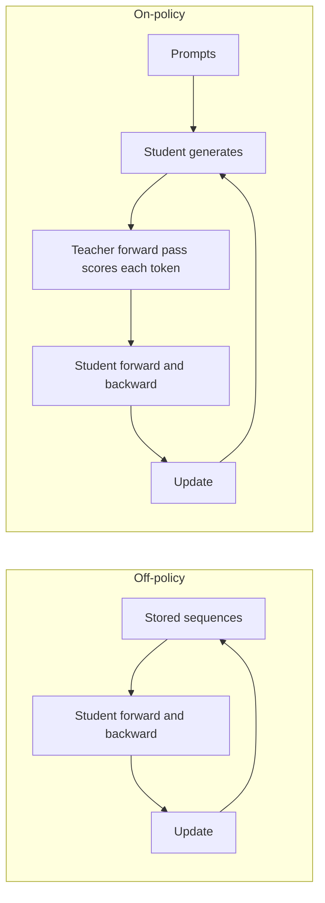
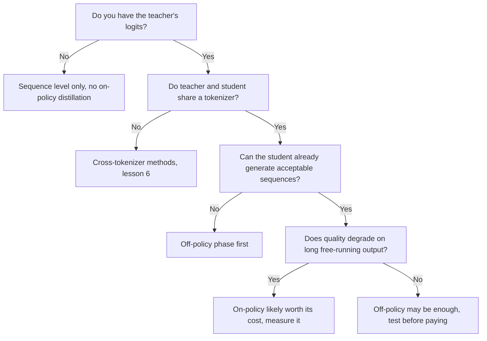

# Destilación on-policy: exposure bias, GKD y MiniLLM comparados

La etapa 5 comprimida para consulta. La [lección 14](../lessons/0014-exposure-bias.md) cubre el exposure bias, la [lección 15](../lessons/0015-gkd-and-minillm.md) GKD y MiniLLM, y la [lección 16](../lessons/0016-on-policy-distillation-in-practice.md) el costo y la comparación de Qwen3.

## Off-policy frente a on-policy

| | Off-policy | On-policy |
|---|---|---|
| Quién escribió el prefijo en el que se condiciona el estudiante | Un humano o el profesor, fijado antes del entrenamiento | El estudiante, durante el entrenamiento |
| Qué hace el profesor | Escribe el texto, o aporta una distribución sobre texto almacenado | Puntúa cada token que el estudiante eligió |
| Qué debe aportar el profesor | Solo texto a nivel de secuencia, logits a nivel de token | Su distribución en cada posición de la secuencia del estudiante, así que el modelo debe ejecutarse durante el entrenamiento |
| Exposure bias | No se aborda | Se aborda, ya que el entrenamiento ve los prefijos propios del estudiante |
| Costo extra por paso | Ninguno más allá del forward y backward pass del estudiante (el almacenamiento de logits aparte) | Decodificación del estudiante más un forward pass del profesor sobre el resultado |
| Condición de partida | Cualquier estudiante | Un estudiante que ya produce secuencias aceptables (GKD parte de estudiantes con supervised fine-tuning) |

Lo que hace on-policy a un método es quién escribió el prefijo. Tener los logits del profesor no hace on-policy a un corpus fijo.

## Los dos bucles

## GKD y MiniLLM lado a lado

| | GKD (Agarwal et al., 2023) | MiniLLM (Gu et al., 2023) |
|---|---|---|
| Objetivo | Divergencia a nivel de token promediada sobre las posiciones de la secuencia | KL inversa sobre secuencias completas |
| Divergencia | A elegir: KL directa, KL inversa o JSD(beta) generalizada | Solo KL inversa |
| Datos | Fracción lambda del estudiante, el resto de un conjunto fijo | Muestras de una mezcla de profesor y estudiante, alfa 0.2 |
| Gradiente | A través de la divergencia, no a través del muestreo | Policy gradient, como en el aprendizaje por refuerzo |
| Estabilizadores | Sin gradiente a través del muestreo, que según el paper mantiene el entrenamiento estable y barato | Descomposición de un solo paso, muestreo mezclado con el profesor, normalización por longitud, recorte (clipping), más una pérdida de LM de preentrenamiento |
| Estudiantes probados | T5-small, base, large (77M a 800M), profesor T5-XL (unos 3B) | GPT-2 120M a 760M, OPT 1.3B a 6.7B, LLaMA 7B, profesores de 1.5B a 13B |
| Tareas | XSum, WMT14 en a de, GSM8K, instruction tuning con FLAN | Seguimiento de instrucciones en Dolly, cinco conjuntos de prueba |
| Partida | Estudiante con supervised fine-tuning | Estudiante afinado con los datos de la tarea, menor pérdida de validación |

Cada paper afinó su propio método con sus propios modelos, así que los números no clasifican a los dos.

## Qué encontró GKD, por tarea

| Tarea | Mejor configuración informada | Nota |
|---|---|---|
| XSum | On-policy con JSD(0.9) frente a ImitKD y f-distill | Las que buscan modos, mejor con muestreo con temperatura, poca diferencia con decodificación voraz |
| WMT14 en a de | JSD generalizada sobre KL directa o inversa, solo datos del estudiante | La brecha se encoge para el estudiante mayor. La Figura 1 usó JSD(0.1) |
| GSM8K | Solo cadenas generadas por el estudiante, KL directa y KL inversa ambas buenas | Las mejoras se mantienen cuando al menos el 25% de los datos es on-policy |
| Instruction tuning con FLAN | On-policy con KL inversa, claramente por encima de la KL directa | El tamaño del estudiante se enuncia de forma inconsistente en el paper |

La divergencia que depende de la tarea es el resumen de los propios autores. Las mejoras sobre el estudiante inicial fueron 2.1 veces, 1.7 veces y 1.9 veces las mejoras de la KD baseline en resumen, traducción y razonamiento aritmético, promediadas sobre los tamaños de estudiante.

## Las soluciones de MiniLLM

| Problema | Solución |
|---|---|
| Varianza alta | Descomposición de un solo paso: sumar el término por token sobre el vocabulario |
| Reward hacking, como frases repetidas que le gustan al profesor | Muestreo mezclado con el profesor, muestreando de alfa por el profesor más (1 menos alfa) por el estudiante |
| Respuestas cortas o vacías | Normalización por longitud de la recompensa acumulada |

## Parámetros del GKDTrainer de TRL

| Parámetro | Significado | Valor por defecto |
|---|---|---|
| `lmbda` | Fracción de datos del estudiante. 0.0 es JSD supervisada, 1.0 es JSD on-policy, en medio es aleatorio por batch | 0.5 |
| `beta` | Interpolación de la JSD generalizada. 0.0 aproxima la KL directa, 1.0 la KL inversa | 0.5 |
| `seq_kd` | Entrenar con secuencias generadas por el profesor, aún con la retroalimentación por token del profesor | False |
| `temperature` | Temperatura de muestreo para la generación del estudiante | 0.9 |
| `max_new_tokens` | Máximo de tokens generados por completion | 128 |

Fuente: la documentación del GKD trainer de TRL. El trainer toma al profesor como `teacher_model`, espera un dataset "messages", y la documentación lo sitúa bajo `trl.experimental.gkd`.

## Qué cuesta un paso on-policy

| Elemento | Presente en off-policy con texto almacenado | Presente en on-policy |
|---|---|---|
| Forward y backward pass del estudiante | Sí | Sí |
| Generación de cada secuencia por el estudiante | No | Sí |
| Forward pass del profesor sobre la secuencia | No | Sí |
| Modelo profesor residente durante el entrenamiento | No | Sí |

## Qwen3: on-policy frente a RL (Tabla 21)

Qwen3-8B, ambos métodos partiendo del mismo checkpoint destilado off-policy, solo consultas de matemáticas y de código. Pass@64 entre paréntesis donde se informa.

| Método | AIME'24 | AIME'25 | MATH500 | LiveCodeBench v5 | MMLU-Redux | GPQA-Diamond | Horas de GPU |
|---|---|---|---|---|---|---|---|
| Destilación off-policy | 55.0 (90.0) | 42.8 (83.3) | 92.4 | 42.0 | 86.4 | 55.6 | no se da |
| más RL | 67.6 (90.0) | 55.5 (83.3) | 94.8 | 52.9 | 86.9 | 61.3 | 17,920 |
| más destilación on-policy | 74.4 (93.3) | 65.5 (86.7) | 97.0 | 60.3 | 88.3 | 63.3 | 1,800 |

Léelo con cuidado: un informe, un tamaño de estudiante, el profesor de esta comparación no se indica, y no se encontró ninguna declaración de si las horas de GPU incluyen al profesor. El pipeline del informe para los modelos pequeños es destilación off-policy primero, luego destilación on-policy con un profesor Qwen3-32B o Qwen3-235B-A22B.

## Cuándo compensa el on-policy, una lectura de las fuentes

Este flujo es un resumen de las lecciones, no una regla de ningún paper.

Punto discutido: el exposure bias puede no ser crítico (He et al. 2019, citado por Agarwal et al.), así que mide la mejora en tu propia tarea.
