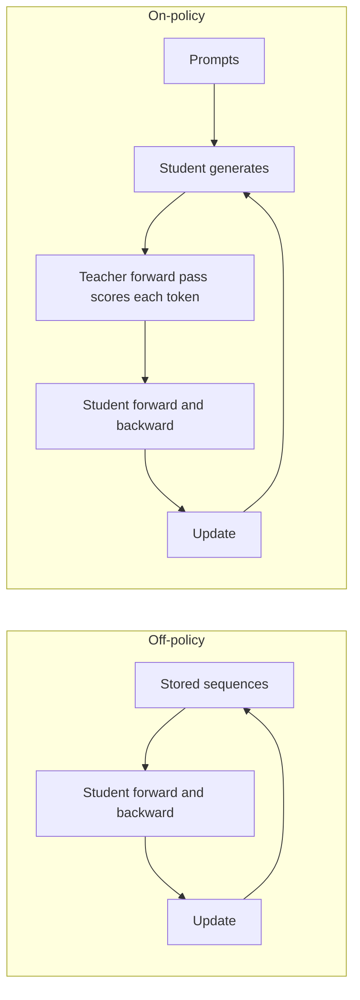
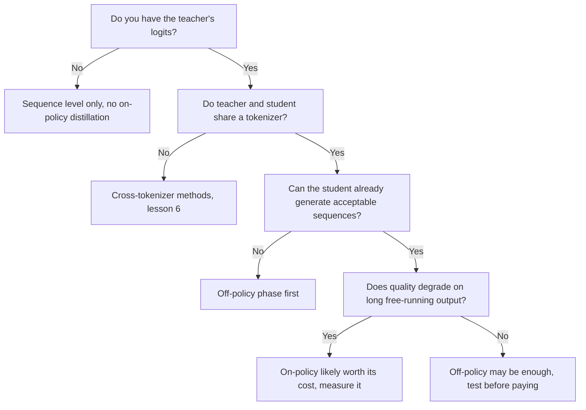

# Distillation on-policy : biais d'exposition, GKD et MiniLLM comparés

L'étape 5 condensée pour la consultation. La [leçon 14](../lessons/0014-exposure-bias.md) couvre le biais d'exposition, la [leçon 15](../lessons/0015-gkd-and-minillm.md) GKD et MiniLLM, et la [leçon 16](../lessons/0016-on-policy-distillation-in-practice.md) le coût et la comparaison de Qwen3.

## Off-policy contre on-policy

| | Off-policy | On-policy |
|---|---|---|
| Qui a écrit le préfixe sur lequel l'élève se conditionne | Un humain ou l'enseignant, fixé avant l'entraînement | L'élève, pendant l'entraînement |
| Ce que fait l'enseignant | Écrit le texte, ou fournit une distribution sur du texte stocké | Évalue chaque token que l'élève a choisi |
| Ce que l'enseignant doit fournir | Seulement du texte au niveau de la séquence, des logits au niveau du token | Sa distribution à chaque position de la séquence de l'élève, donc le modèle doit tourner pendant l'entraînement |
| Biais d'exposition | Non traité | Traité, puisque l'entraînement voit les propres préfixes de l'élève |
| Coût supplémentaire par pas | Aucun au-delà de la passe avant et arrière de l'élève (stockage des logits mis à part) | Décodage de l'élève plus une passe avant de l'enseignant sur le résultat |
| Condition de départ | N'importe quel élève | Un élève qui produit déjà des séquences acceptables (GKD part d'élèves affinés de façon supervisée) |

Ce qui rend une méthode on-policy, c'est qui a écrit le préfixe. Avoir les logits de l'enseignant ne rend pas on-policy un corpus fixe.

## Les deux boucles

## GKD et MiniLLM côte à côte

| | GKD (Agarwal et al., 2023) | MiniLLM (Gu et al., 2023) |
|---|---|---|
| Objectif | Divergence au niveau du token moyennée sur les positions de la séquence | KL inverse sur des séquences entières |
| Divergence | Au choix : KL directe, KL inverse ou JSD(beta) généralisée | KL inverse seulement |
| Données | Fraction lambda venant de l'élève, le reste d'un jeu fixe | Échantillons d'un mélange d'enseignant et d'élève, alpha 0.2 |
| Gradient | À travers la divergence, pas à travers l'échantillonnage | Gradient de politique, comme en apprentissage par renforcement |
| Stabilisateurs | Pas de gradient à travers l'échantillonnage, ce qui, dit l'article, garde l'entraînement stable et peu coûteux | Décomposition en une seule étape, échantillonnage mêlé à l'enseignant, normalisation par la longueur, écrêtage, plus une loss LM de pré-entraînement |
| Élèves testés | T5-small, base, large (77M à 800M), enseignant T5-XL (environ 3B) | GPT-2 120M à 760M, OPT 1.3B à 6.7B, LLaMA 7B, enseignants de 1.5B à 13B |
| Tâches | XSum, WMT14 en vers de, GSM8K, instruction tuning FLAN | Suivi d'instructions sur Dolly, cinq jeux de test |
| Départ | Élève affiné de façon supervisée | Élève affiné sur les données de la tâche, plus basse loss de validation |

Chaque article a réglé sa propre méthode sur ses propres modèles, donc les nombres ne classent pas les deux.

## Ce qu'a trouvé GKD, par tâche

| Tâche | Meilleur réglage rapporté | Note |
|---|---|---|
| XSum | On-policy avec JSD(0.9) contre ImitKD et f-distill | Recherche de mode meilleure sous échantillonnage à température, peu de différence en décodage glouton |
| WMT14 en vers de | JSD généralisée plutôt que KL directe ou inverse, données de l'élève seules | L'écart se réduit pour l'élève plus grand. La figure 1 utilisait JSD(0.1) |
| GSM8K | Chaînes générées par l'élève seules, KL directe et KL inverse toutes deux bonnes | Les gains tiennent quand au moins 25 % des données sont on-policy |
| Instruction tuning FLAN | On-policy avec KL inverse, nettement au-dessus de la KL directe | La taille de l'élève est indiquée de façon incohérente dans l'article |

La divergence dépendant de la tâche est le résumé des auteurs eux-mêmes. Les gains par rapport à l'élève initial étaient de 2.1 fois, 1.7 fois et 1.9 fois les gains du KD de référence sur le résumé, la traduction et le raisonnement arithmétique, en moyenne sur les tailles d'élève.

## Les correctifs de MiniLLM

| Problème | Correctif |
|---|---|
| Variance élevée | Décomposition en une seule étape : sommer le terme par token sur le vocabulaire |
| Détournement de la récompense, comme des phrases répétées que l'enseignant aime | Échantillonnage mêlé à l'enseignant, en échantillonnant à partir de alpha fois l'enseignant plus (1 moins alpha) fois l'élève |
| Réponses courtes ou vides | Normalisation par la longueur de la récompense cumulée |

## Paramètres du GKDTrainer de TRL

| Paramètre | Signification | Valeur par défaut |
|---|---|---|
| `lmbda` | Fraction de données de l'élève. 0.0 est la JSD supervisée, 1.0 est la JSD on-policy, entre les deux c'est aléatoire par batch | 0.5 |
| `beta` | Interpolation de la JSD généralisée. 0.0 approche la KL directe, 1.0 la KL inverse | 0.5 |
| `seq_kd` | Entraîner sur des séquences générées par l'enseignant, toujours avec le retour par token de l'enseignant | False |
| `temperature` | Température d'échantillonnage pour la génération de l'élève | 0.9 |
| `max_new_tokens` | Nombre maximal de tokens générés par complétion | 128 |

Source : la documentation du trainer GKD de TRL. Le trainer prend l'enseignant comme `teacher_model`, attend un jeu de données « messages », et la documentation le place sous `trl.experimental.gkd`.

## Ce que coûte un pas on-policy

| Élément | Présent en off-policy sur texte stocké | Présent en on-policy |
|---|---|---|
| Passe avant et arrière de l'élève | Oui | Oui |
| Génération de chaque séquence par l'élève | Non | Oui |
| Passe avant de l'enseignant sur la séquence | Non | Oui |
| Modèle enseignant résident pendant l'entraînement | Non | Oui |

## Qwen3 : on-policy contre RL (tableau 21)

Qwen3-8B, les deux méthodes partant du même checkpoint distillé off-policy, requêtes de maths et de code seulement. Pass@64 entre parenthèses là où il est rapporté.

| Méthode | AIME'24 | AIME'25 | MATH500 | LiveCodeBench v5 | MMLU-Redux | GPQA-Diamond | Heures GPU |
|---|---|---|---|---|---|---|---|
| Distillation off-policy | 55.0 (90.0) | 42.8 (83.3) | 92.4 | 42.0 | 86.4 | 55.6 | non indiqué |
| plus RL | 67.6 (90.0) | 55.5 (83.3) | 94.8 | 52.9 | 86.9 | 61.3 | 17,920 |
| plus distillation on-policy | 74.4 (93.3) | 65.5 (86.7) | 97.0 | 60.3 | 88.3 | 63.3 | 1,800 |

À lire avec précaution : un rapport, une taille d'élève, l'enseignant de cette comparaison non indiqué, et aucune indication trouvée sur le fait que les heures GPU incluent l'enseignant. Le pipeline du rapport pour les petits modèles est de la distillation off-policy d'abord, puis de la distillation on-policy avec un enseignant Qwen3-32B ou Qwen3-235B-A22B.

## Quand l'on-policy est rentable, une lecture des sources

Ce diagramme est un résumé des leçons, pas une règle d'un article particulier.

Point contesté : le biais d'exposition pourrait ne pas être critique (He et al. 2019, tels que cités par Agarwal et al.), mesurez donc le gain sur votre propre tâche.
