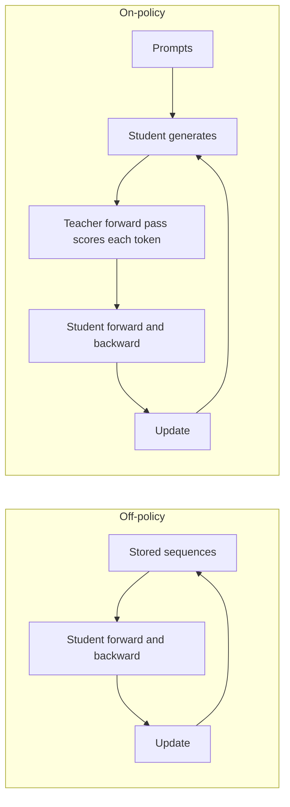
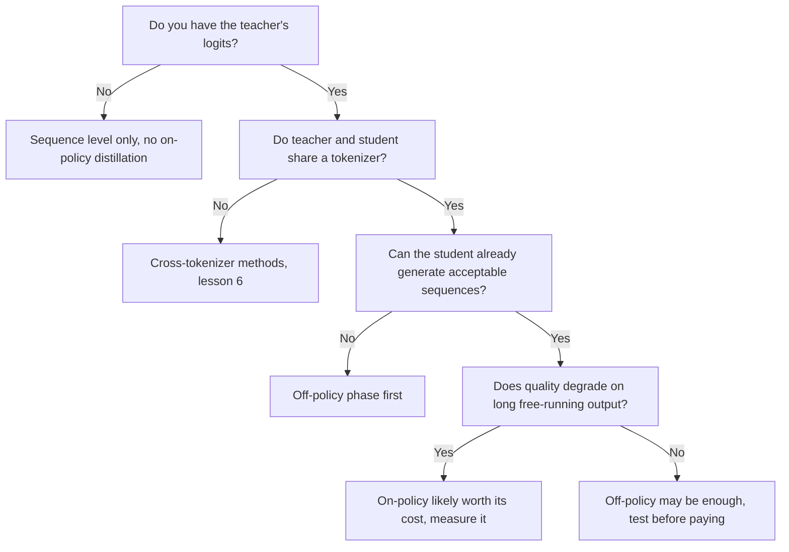

# On-Policy Distillation: Exposure Bias, GKD और MiniLLM की तुलना

चरण 5 का संक्षिप्त रूप, खोजने के लिए। [पाठ 14](../lessons/0014-exposure-bias.md) exposure bias को कवर करता है, [पाठ 15](../lessons/0015-gkd-and-minillm.md) GKD और MiniLLM को, और [पाठ 16](../lessons/0016-on-policy-distillation-in-practice.md) लागत और Qwen3 की तुलना को।

## Off-policy बनाम on-policy

| | Off-policy | On-policy |
|---|---|---|
| जिस prefix पर student condition होता है उसे किसने लिखा | मानव या teacher, training से पहले तय | Student, training के दौरान |
| Teacher क्या करता है | Text लिखता है, या संग्रहीत text पर distribution देता है | Student के चुने हर token को score करता है |
| Teacher को क्या देना होगा | Sequence level पर सिर्फ़ text, token level पर logits | Student के sequence के हर position पर उसका distribution, इसलिए model को training के दौरान चलना होगा |
| Exposure bias | संबोधित नहीं | संबोधित, क्योंकि training student के अपने prefixes देखती है |
| प्रति step अतिरिक्त लागत | Student के forward और backward pass के अलावा कुछ नहीं (logits के भंडारण को छोड़कर) | Student की decoding और नतीजे पर teacher का forward pass |
| शुरुआती शर्त | कोई भी student | ऐसा student जो पहले से स्वीकार्य sequences बनाता हो (GKD supervised fine-tuned students से शुरू होता है) |

किसी विधि को on-policy बनाता है यह कि prefix किसने लिखा। Teacher के logits होने से तय corpus on-policy नहीं हो जाता।

## दो loops

## GKD और MiniLLM आमने-सामने

| | GKD (Agarwal et al., 2023) | MiniLLM (Gu et al., 2023) |
|---|---|---|
| Objective | Sequence के positions पर औसत लिया token-level divergence | पूरे sequences पर reverse KL |
| Divergence | चुना हुआ: forward KL, reverse KL या generalized JSD(beta) | सिर्फ़ reverse KL |
| Data | Fraction lambda student से, बाक़ी तय सेट से | Teacher और student के मिश्रण से samples, alpha 0.2 |
| Gradient | Divergence के ज़रिए, sampling के ज़रिए नहीं | Policy gradient, जैसे reinforcement learning में |
| स्थिर करने वाले उपाय | Sampling के आर-पार कोई gradient नहीं, जो पेपर के अनुसार training को स्थिर और सस्ता रखता है | Single-step decomposition, teacher-mixed sampling, length normalisation, clipping, साथ में pretraining LM loss |
| परखे गए students | T5-small, base, large (77M से 800M), teacher T5-XL (लगभग 3B) | GPT-2 120M से 760M, OPT 1.3B से 6.7B, LLaMA 7B, teachers 1.5B से 13B |
| Tasks | XSum, WMT14 en से de, GSM8K, FLAN instruction tuning | Dolly पर instruction following, पाँच test sets |
| शुरुआत | Supervised fine-tuned student | Task data पर fine-tune किया student, सबसे कम validation loss वाला |

हर पेपर ने अपनी विधि को अपने models पर tune किया, इसलिए संख्याएँ दोनों को क्रमबद्ध नहीं करतीं।

## GKD ने क्या पाया, task के हिसाब से

| Task | बताई गई सबसे अच्छी setting | टिप्पणी |
|---|---|---|
| XSum | ImitKD और f-distill के विरुद्ध JSD(0.9) वाला on-policy | Temperature sampling में mode-seeking बेहतर, greedy में थोड़ा अंतर |
| WMT14 en से de | Forward या reverse KL के ऊपर generalized JSD, सिर्फ़ student data | बड़े student के लिए फ़ासला घटता है। Figure 1 ने JSD(0.1) इस्तेमाल किया |
| GSM8K | सिर्फ़ student-generated chains, forward KL और reverse KL दोनों अच्छे | फ़ायदे तब बने रहते हैं जब कम से कम 25% data on-policy हो |
| FLAN instruction tuning | Reverse KL वाला on-policy, forward KL से साफ़ ऊपर | पेपर में student का आकार असंगत रूप से बताया गया है |

Task-निर्भर divergence लेखकों का अपना सार है। Student आकारों पर औसत लेने पर, शुरुआती student के मुक़ाबले फ़ायदे summarization, translation और अंकगणितीय reasoning पर baseline KD के फ़ायदों के 2.1 गुना, 1.7 गुना और 1.9 गुना थे।

## MiniLLM के उपाय

| समस्या | उपाय |
|---|---|
| ऊँचा variance | Single-step decomposition: प्रति-token term का vocabulary पर योग लें |
| Reward hacking, जैसे दोहराए वाक्यांश जो teacher को पसंद हैं | Teacher-mixed sampling, alpha गुणा teacher जमा (1 घटा alpha) गुणा student से sampling |
| छोटे या ख़ाली उत्तर | जमा हुए reward का length normalisation |

## TRL GKDTrainer के parameters

| Parameter | मतलब | Default |
|---|---|---|
| `lmbda` | Student data fraction। 0.0 supervised JSD है, 1.0 on-policy JSD, बीच में हर batch पर random | 0.5 |
| `beta` | Generalized JSD interpolation। 0.0 लगभग forward KL है, 1.0 reverse KL | 0.5 |
| `seq_kd` | Teacher-generated sequences पर train करें, फिर भी teacher की token प्रतिक्रिया के साथ | False |
| `temperature` | Student generation के लिए sampling temperature | 0.9 |
| `max_new_tokens` | प्रति completion generate हुए अधिकतम tokens | 128 |

स्रोत: TRL GKD trainer का दस्तावेज़। Trainer teacher को `teacher_model` के रूप में लेता है, "messages" dataset की अपेक्षा करता है, और docs उसे `trl.experimental.gkd` के अंतर्गत रखते हैं।

## On-policy step की लागत

| मद | Off-policy संग्रहीत text में मौजूद | On-policy में मौजूद |
|---|---|---|
| Student का forward और backward pass | हाँ | हाँ |
| हर sequence की Student generation | नहीं | हाँ |
| Sequence पर Teacher का forward pass | नहीं | हाँ |
| Training के दौरान Teacher model का memory में रहना | नहीं | हाँ |

## Qwen3: on-policy बनाम RL (Table 21)

Qwen3-8B, दोनों तरीक़े उसी off-policy distilled checkpoint से शुरू होते हुए, सिर्फ़ math और code queries। जहाँ बताया गया वहाँ कोष्ठक में pass@64।

| विधि | AIME'24 | AIME'25 | MATH500 | LiveCodeBench v5 | MMLU-Redux | GPQA-Diamond | GPU hours |
|---|---|---|---|---|---|---|---|
| Off-policy distillation | 55.0 (90.0) | 42.8 (83.3) | 92.4 | 42.0 | 86.4 | 55.6 | दिया नहीं गया |
| साथ में RL | 67.6 (90.0) | 55.5 (83.3) | 94.8 | 52.9 | 86.9 | 61.3 | 17,920 |
| साथ में on-policy distillation | 74.4 (93.3) | 65.5 (86.7) | 97.0 | 60.3 | 88.3 | 63.3 | 1,800 |

सावधानी से पढ़ें: एक report, एक student आकार, इस तुलना का teacher नहीं बताया गया, और यह कथन नहीं मिला कि GPU hours में teacher शामिल है या नहीं। छोटे models के लिए report की pipeline पहले off-policy distillation है, फिर Qwen3-32B या Qwen3-235B-A22B teacher के साथ on-policy distillation।

## On-policy कब फ़ायदेमंद है, स्रोतों की एक पढ़त

यह flow पाठों का सार है, किसी एक पेपर का नियम नहीं।

विवादित बिंदु: exposure bias शायद निर्णायक न हो (He et al. 2019, जैसा Agarwal et al. ने उद्धृत किया), इसलिए फ़ायदा अपने task पर मापें।
