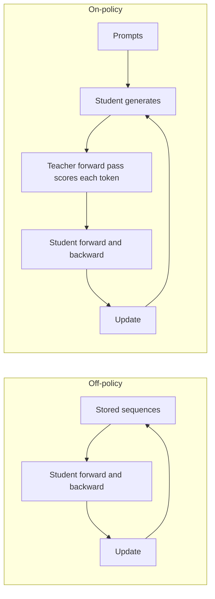
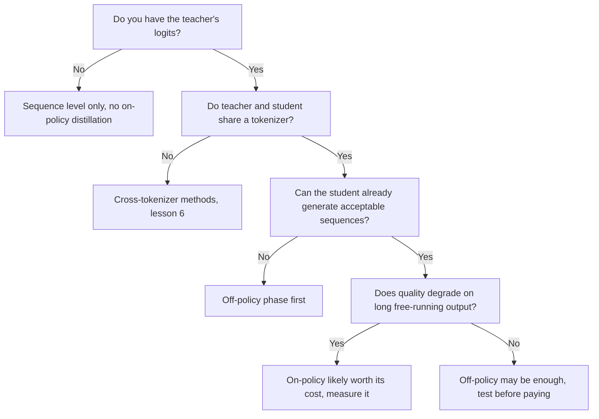

# On-Policy Distillation: Exposure Bias, GKD and MiniLLM Compared

Stage 5 compressed for lookup. [Lesson 14](../lessons/0014-exposure-bias.md) covers exposure bias, [lesson 15](../lessons/0015-gkd-and-minillm.md) GKD and MiniLLM, and [lesson 16](../lessons/0016-on-policy-distillation-in-practice.md) the cost and the Qwen3 comparison.

## Off-policy against on-policy

| | Off-policy | On-policy |
|---|---|---|
| Who wrote the prefix the student conditions on | A human or the teacher, fixed before training | The student, during training |
| What the teacher does | Writes the text, or supplies a distribution over stored text | Scores every token the student chose |
| What the teacher must provide | Text only at sequence level, logits at token level | Its distribution at every position of the student's sequence, so the model must run during training |
| Exposure bias | Not addressed | Addressed, since training sees the student's own prefixes |
| Extra cost per step | None beyond the student's forward and backward pass (logits storage aside) | Student decoding plus a teacher forward pass over the result |
| Start condition | Any student | A student that already produces acceptable sequences (GKD starts from supervised fine-tuned students) |

What makes a method on-policy is who wrote the prefix. Having the teacher's logits does not make a fixed corpus on-policy.

## The two loops

## GKD and MiniLLM side by side

| | GKD (Agarwal et al., 2023) | MiniLLM (Gu et al., 2023) |
|---|---|---|
| Objective | Token-level divergence averaged over positions of the sequence | Reverse KL over whole sequences |
| Divergence | Chosen: forward KL, reverse KL or generalized JSD(beta) | Reverse KL only |
| Data | Fraction lambda from the student, the rest from a fixed set | Samples from a mix of teacher and student, alpha 0.2 |
| Gradient | Through the divergence, not through the sampling | Policy gradient, as in reinforcement learning |
| Stabilisers | No gradient through the sampling, which the paper says keeps training stable and cheap | Single-step decomposition, teacher-mixed sampling, length normalisation, clipping, plus a pretraining LM loss |
| Students tested | T5-small, base, large (77M to 800M), teacher T5-XL (about 3B) | GPT-2 120M to 760M, OPT 1.3B to 6.7B, LLaMA 7B, teachers 1.5B to 13B |
| Tasks | XSum, WMT14 en to de, GSM8K, FLAN instruction tuning | Instruction following on Dolly, five test sets |
| Start | Supervised fine-tuned student | Student fine-tuned on the task data, lowest validation loss |

Each paper tuned its own method on its own models, so the numbers do not rank the two.

## What GKD found, by task

| Task | Best setting reported | Note |
|---|---|---|
| XSum | On-policy with JSD(0.9) against ImitKD and f-distill | Mode-seeking better under temperature sampling, little difference under greedy |
| WMT14 en to de | Generalized JSD over forward or reverse KL, student data only | Gap shrinks for the larger student. Figure 1 used JSD(0.1) |
| GSM8K | Student-generated chains only, forward KL and reverse KL both good | Gains hold when at least 25% of data is on-policy |
| FLAN instruction tuning | On-policy with reverse KL, clearly above forward KL | Student size is stated inconsistently in the paper |

Task-dependent divergence is the authors' own summary. Gains over the initial student were 2.1 times, 1.7 times and 1.9 times the baseline KD gains on summarization, translation and arithmetic reasoning, averaged over student sizes.

## MiniLLM's fixes

| Problem | Fix |
|---|---|
| High variance | Single-step decomposition: sum the per-token term over the vocabulary |
| Reward hacking, such as repeated phrases the teacher likes | Teacher-mixed sampling, sampling from alpha times teacher plus (1 minus alpha) times student |
| Short or empty answers | Length normalisation of the accumulated reward |

## TRL GKDTrainer parameters

| Parameter | Meaning | Default |
|---|---|---|
| `lmbda` | Student data fraction. 0.0 is supervised JSD, 1.0 is on-policy JSD, in between is random per batch | 0.5 |
| `beta` | Generalized JSD interpolation. 0.0 approximates forward KL, 1.0 reverse KL | 0.5 |
| `seq_kd` | Train on teacher-generated sequences, still with the teacher's token feedback | False |
| `temperature` | Sampling temperature for student generation | 0.9 |
| `max_new_tokens` | Maximum tokens generated per completion | 128 |

Source: the TRL GKD trainer documentation. The trainer takes the teacher as `teacher_model`, expects a "messages" dataset, and the docs place it under `trl.experimental.gkd`.

## What an on-policy step costs

| Item | Present in off-policy stored text | Present in on-policy |
|---|---|---|
| Student forward and backward pass | Yes | Yes |
| Student generation of each sequence | No | Yes |
| Teacher forward pass over the sequence | No | Yes |
| Teacher model resident during training | No | Yes |

## Qwen3: on-policy against RL (Table 21)

Qwen3-8B, both methods starting from the same off-policy distilled checkpoint, math and code queries only. Pass@64 in parentheses where reported.

| Method | AIME'24 | AIME'25 | MATH500 | LiveCodeBench v5 | MMLU-Redux | GPQA-Diamond | GPU hours |
|---|---|---|---|---|---|---|---|
| Off-policy distillation | 55.0 (90.0) | 42.8 (83.3) | 92.4 | 42.0 | 86.4 | 55.6 | not given |
| plus RL | 67.6 (90.0) | 55.5 (83.3) | 94.8 | 52.9 | 86.9 | 61.3 | 17,920 |
| plus on-policy distillation | 74.4 (93.3) | 65.5 (86.7) | 97.0 | 60.3 | 88.3 | 63.3 | 1,800 |

Read with care: one report, one student size, the teacher for this comparison not stated, and no statement found on whether the GPU hours include the teacher. The report's pipeline for the small models is off-policy distillation first, then on-policy distillation with a Qwen3-32B or Qwen3-235B-A22B teacher.

## When on-policy pays, a reading of the sources

This flow is a summary of the lessons, not a rule from any one paper.

Contested point: exposure bias may not be critical (He et al. 2019, as cited by Agarwal et al.), so measure the gain on your own task.
