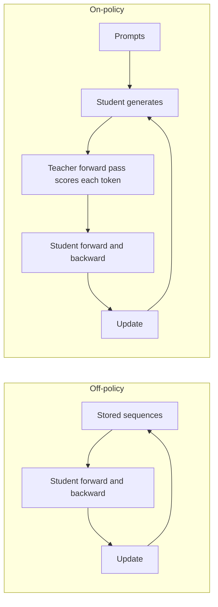
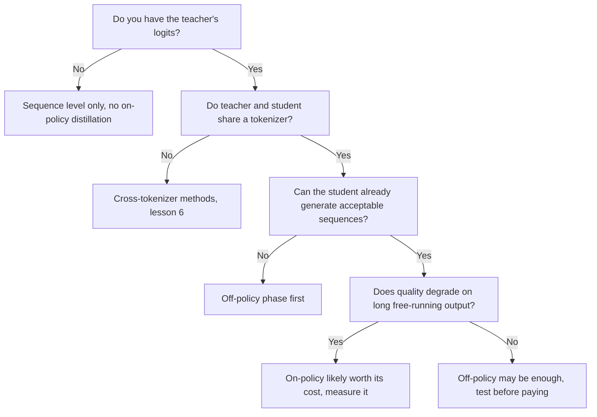

# Destilação On-Policy: Exposure Bias, GKD e MiniLLM Comparados

A etapa 5 condensada para consulta. A [lição 14](../lessons/0014-exposure-bias.md) cobre o exposure bias, a [lição 15](../lessons/0015-gkd-and-minillm.md) o GKD e o MiniLLM, e a [lição 16](../lessons/0016-on-policy-distillation-in-practice.md) o custo e a comparação do Qwen3.

## Off-policy contra on-policy

| | Off-policy | On-policy |
|---|---|---|
| Quem escreveu o prefixo em que o aluno condiciona | Um humano ou o professor, fixado antes do treinamento | O aluno, durante o treinamento |
| O que o professor faz | Escreve o texto, ou fornece uma distribuição sobre um texto armazenado | Pontua cada token que o aluno escolheu |
| O que o professor precisa fornecer | Apenas texto em nível de sequência, logits em nível de token | A sua distribuição em cada posição da sequência do aluno, então o modelo precisa rodar durante o treinamento |
| Exposure bias | Não tratado | Tratado, já que o treinamento vê os prefixos do próprio aluno |
| Custo extra por passo | Nenhum além do forward e do backward pass do aluno (armazenamento de logits à parte) | Decodificação do aluno mais um forward pass do professor sobre o resultado |
| Condição de partida | Qualquer aluno | Um aluno que já produz sequências aceitáveis (o GKD parte de alunos com supervised fine-tuning) |

O que torna um método on-policy é quem escreveu o prefixo. Ter os logits do professor não torna on-policy um corpus fixo.

## Os dois loops

## GKD e MiniLLM lado a lado

| | GKD (Agarwal et al., 2023) | MiniLLM (Gu et al., 2023) |
|---|---|---|
| Objetivo | Divergência em nível de token com média sobre as posições da sequência | Reverse KL sobre sequências inteiras |
| Divergência | Escolhida: forward KL, reverse KL ou JSD(beta) generalizada | Apenas reverse KL |
| Dados | Fração lambda do aluno, o resto de um conjunto fixo | Amostras de uma mistura de professor e aluno, alpha 0,2 |
| Gradiente | Pela divergência, não pela amostragem | Policy gradient, como em reinforcement learning |
| Estabilizadores | Sem gradiente pela amostragem, o que o artigo diz manter o treinamento estável e barato | Decomposição em passo único, amostragem mista com o professor, normalização por comprimento, clipping, mais uma loss de LM de pré-treinamento |
| Alunos testados | T5-small, base, large (77M a 800M), professor T5-XL (cerca de 3B) | GPT-2 120M a 760M, OPT 1,3B a 6,7B, LLaMA 7B, professores de 1,5B a 13B |
| Tarefas | XSum, WMT14 en para de, GSM8K, instruction tuning do FLAN | Seguimento de instruções no Dolly, cinco conjuntos de teste |
| Partida | Aluno com supervised fine-tuning | Aluno com fine-tuning nos dados da tarefa, menor loss de validação |

Cada artigo ajustou o seu próprio método nos seus próprios modelos, então os números não classificam os dois.

## O que o GKD encontrou, por tarefa

| Tarefa | Melhor configuração relatada | Observação |
|---|---|---|
| XSum | On-policy com JSD(0.9) contra ImitKD e f-distill | As divergências que buscam modos se saem melhor com amostragem por temperatura, pouca diferença com greedy |
| WMT14 en para de | JSD generalizada em vez de forward ou reverse KL, apenas dados do aluno | A diferença encolhe para o aluno maior. A Figura 1 usou JSD(0.1) |
| GSM8K | Apenas cadeias geradas pelo aluno, forward KL e reverse KL ambos bons | Os ganhos se mantêm quando pelo menos 25% dos dados são on-policy |
| Instruction tuning do FLAN | On-policy com reverse KL, claramente acima do forward KL | O tamanho do aluno é declarado de forma inconsistente no artigo |

A divergência dependente da tarefa é o resumo dos próprios autores. Os ganhos sobre o aluno inicial foram 2,1 vezes, 1,7 vezes e 1,9 vezes os ganhos do KD baseline em resumo, tradução e raciocínio aritmético, tirada a média sobre os tamanhos de aluno.

## As correções do MiniLLM

| Problema | Correção |
|---|---|
| Alta variância | Decomposição em passo único: somar o termo por token sobre o vocabulário |
| Reward hacking, como frases repetidas de que o professor gosta | Amostragem mista com o professor, amostrando de alpha vezes professor mais (1 menos alpha) vezes aluno |
| Respostas curtas ou vazias | Normalização por comprimento da recompensa acumulada |

## Parâmetros do GKDTrainer do TRL

| Parâmetro | Significado | Padrão |
|---|---|---|
| `lmbda` | Fração de dados do aluno. 0.0 é JSD supervisionada, 1.0 é JSD on-policy, entre os dois é aleatório por batch | 0.5 |
| `beta` | Interpolação da JSD generalizada. 0.0 aproxima o forward KL, 1.0 o reverse KL | 0.5 |
| `seq_kd` | Treinar em sequências geradas pelo professor, ainda com o feedback por token do professor | False |
| `temperature` | Temperatura de amostragem para a geração do aluno | 0.9 |
| `max_new_tokens` | Máximo de tokens gerados por completion | 128 |

Fonte: a documentação do GKD trainer do TRL. O trainer recebe o professor como `teacher_model`, espera um dataset "messages", e a documentação o coloca em `trl.experimental.gkd`.

## O que um passo on-policy custa

| Item | Presente no off-policy com texto armazenado | Presente no on-policy |
|---|---|---|
| Forward e backward pass do aluno | Sim | Sim |
| Geração de cada sequência pelo aluno | Não | Sim |
| Forward pass do professor sobre a sequência | Não | Sim |
| Modelo professor residente durante o treinamento | Não | Sim |

## Qwen3: on-policy contra RL (Tabela 21)

Qwen3-8B, ambos os métodos partindo do mesmo checkpoint destilado off-policy, apenas consultas de matemática e código. Pass@64 entre parênteses onde relatado.

| Método | AIME'24 | AIME'25 | MATH500 | LiveCodeBench v5 | MMLU-Redux | GPQA-Diamond | Horas de GPU |
|---|---|---|---|---|---|---|---|
| Destilação off-policy | 55,0 (90,0) | 42,8 (83,3) | 92,4 | 42,0 | 86,4 | 55,6 | não informado |
| mais RL | 67,6 (90,0) | 55,5 (83,3) | 94,8 | 52,9 | 86,9 | 61,3 | 17.920 |
| mais destilação on-policy | 74,4 (93,3) | 65,5 (86,7) | 97,0 | 60,3 | 88,3 | 63,3 | 1.800 |

Leia com cuidado: um relatório, um tamanho de aluno, o professor desta comparação não declarado e nenhuma afirmação encontrada sobre se as horas de GPU incluem o professor. O pipeline do relatório para os modelos pequenos é destilação off-policy primeiro, depois destilação on-policy com um professor Qwen3-32B ou Qwen3-235B-A22B.

## Quando o on-policy compensa, uma leitura das fontes

Este fluxo é um resumo das lições, não uma regra de nenhum artigo isolado.

Ponto contestado: o exposure bias pode não ser crítico (He et al. 2019, como citados por Agarwal et al.), então meça o ganho na sua própria tarefa.
