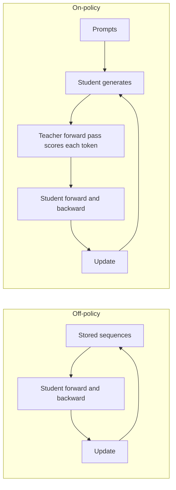
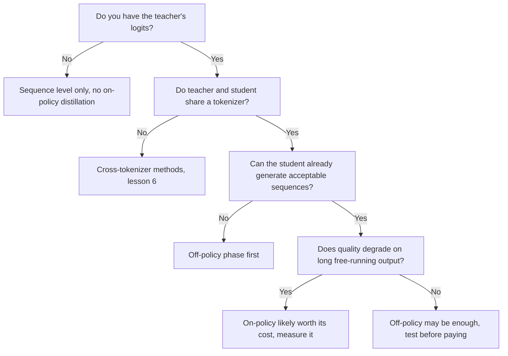

# On-policy-дистилляция: сравнение смещения экспозиции, GKD и MiniLLM

Этап 5 в сжатом виде для быстрого поиска. [Урок 14](../lessons/0014-exposure-bias.md) охватывает смещение экспозиции, [урок 15](../lessons/0015-gkd-and-minillm.md) GKD и MiniLLM, а [урок 16](../lessons/0016-on-policy-distillation-in-practice.md) стоимость и сравнение Qwen3.

## Off-policy против on-policy

| | Off-policy | On-policy |
|---|---|---|
| Кто написал префикс, на который опирается ученик | Человек или учитель, зафиксирован до обучения | Ученик, во время обучения |
| Что делает учитель | Пишет текст или поставляет распределение по сохранённому тексту | Оценивает каждый выбранный учеником токен |
| Что должен предоставлять учитель | Только текст на уровне последовательностей, логиты на уровне токенов | Своё распределение в каждой позиции последовательности ученика, так что модель должна работать во время обучения |
| Смещение экспозиции | Не устраняется | Устраняется, поскольку обучение видит собственные префиксы ученика |
| Дополнительная стоимость на шаг | Никакой сверх прямого и обратного прохода ученика (хранение логитов не считая) | Декодирование учеником плюс прямой проход учителя по результату |
| Условие старта | Любой ученик | Ученик, уже порождающий приемлемые последовательности (GKD стартует с учеников после контролируемого дообучения) |

Что делает метод on-policy, так это то, кто написал префикс. Наличие логитов учителя не делает фиксированный корпус on-policy.

## Два цикла

## GKD и MiniLLM рядом

| | GKD (Agarwal et al., 2023) | MiniLLM (Gu et al., 2023) |
|---|---|---|
| Цель | Токенная дивергенция, усреднённая по позициям последовательности | Обратная KL по целым последовательностям |
| Дивергенция | Выбираемая: прямая KL, обратная KL или обобщённая JSD(beta) | Только обратная KL |
| Данные | Доля lambda от ученика, остальное из фиксированного набора | Сэмплы из смеси учителя и ученика, alpha 0.2 |
| Градиент | Через дивергенцию, не через сэмплирование | Градиент политики, как в обучении с подкреплением |
| Стабилизаторы | Нет градиента через сэмплирование, что, по словам статьи, сохраняет обучение устойчивым и дешёвым | Одношаговая декомпозиция, сэмплирование со смесью учителя, нормировка по длине, отсечение, плюс потеря LM предобучения |
| Проверенные ученики | T5-small, base, large (от 77M до 800M), учитель T5-XL (около 3B) | GPT-2 от 120M до 760M, OPT от 1.3B до 6.7B, LLaMA 7B, учителя от 1.5B до 13B |
| Задачи | XSum, WMT14 en в de, GSM8K, инструктивная настройка FLAN | Следование инструкциям на Dolly, пять тестовых наборов |
| Старт | Ученик после контролируемого дообучения | Ученик, дообученный на данных задачи, с наименьшей потерей на валидации |

Каждая статья настраивала свой метод на собственных моделях, так что числа два метода не ранжируют.

## Что нашёл GKD, по задачам

| Задача | Лучшая сообщённая настройка | Примечание |
|---|---|---|
| XSum | On-policy с JSD(0.9) против ImitKD и f-distill | Ищущие моду лучше при сэмплировании по температуре, малая разница при жадном |
| WMT14 en в de | Обобщённая JSD над прямой или обратной KL, только данные ученика | Разрыв сокращается для большего ученика. Рисунок 1 использовал JSD(0.1) |
| GSM8K | Только цепочки, сгенерированные учеником, прямая KL и обратная KL обе хороши | Выигрыш сохраняется, когда как минимум 25% данных on-policy |
| Инструктивная настройка FLAN | On-policy с обратной KL, явно выше прямой KL | Размер ученика в статье указан непоследовательно |

Зависимость дивергенции от задачи это собственный итог авторов. Прирост относительно исходного ученика составил 2.1, 1.7 и 1.9 раза от прироста базовой KD на резюмировании, переводе и арифметических рассуждениях, в среднем по размерам ученика.

## Исправления MiniLLM

| Проблема | Исправление |
|---|---|
| Высокая дисперсия | Одношаговая декомпозиция: суммировать слагаемое на токен по словарю |
| Взлом награды, например повторяющиеся фразы, которые нравятся учителю | Сэмплирование со смесью учителя, сэмплирование из alpha, умноженной на учителя, плюс (1 минус alpha), умноженная на ученика |
| Короткие или пустые ответы | Нормировка накопленной награды по длине |

## Параметры GKDTrainer в TRL

| Параметр | Значение | По умолчанию |
|---|---|---|
| `lmbda` | Доля данных ученика. 0.0 это контролируемая JSD, 1.0 это on-policy JSD, между ними случайно на батч | 0.5 |
| `beta` | Интерполяция обобщённой JSD. 0.0 приближает прямую KL, 1.0 обратную KL | 0.5 |
| `seq_kd` | Обучение на сгенерированных учителем последовательностях, всё равно с токенной обратной связью учителя | False |
| `temperature` | Температура сэмплирования при генерации учеником | 0.9 |
| `max_new_tokens` | Максимум токенов, генерируемых на завершение | 128 |

Источник: документация по тренеру GKD в TRL. Тренер принимает учителя как `teacher_model`, ожидает датасет «messages», а документация размещает его в `trl.experimental.gkd`.

## Сколько стоит on-policy-шаг

| Пункт | Есть ли в off-policy на сохранённом тексте | Есть ли в on-policy |
|---|---|---|
| Прямой и обратный проход ученика | Да | Да |
| Генерация учеником каждой последовательности | Нет | Да |
| Прямой проход учителя по последовательности | Нет | Да |
| Модель учителя в памяти во время обучения | Нет | Да |

## Qwen3: on-policy против RL (таблица 21)

Qwen3-8B, оба метода стартуют с одной и той же off-policy-дистиллированной контрольной точки, только запросы по математике и коду. Pass@64 в скобках там, где сообщён.

| Метод | AIME'24 | AIME'25 | MATH500 | LiveCodeBench v5 | MMLU-Redux | GPQA-Diamond | GPU-часы |
|---|---|---|---|---|---|---|---|
| Off-policy-дистилляция | 55.0 (90.0) | 42.8 (83.3) | 92.4 | 42.0 | 86.4 | 55.6 | не указано |
| плюс RL | 67.6 (90.0) | 55.5 (83.3) | 94.8 | 52.9 | 86.9 | 61.3 | 17 920 |
| плюс on-policy-дистилляция | 74.4 (93.3) | 65.5 (86.7) | 97.0 | 60.3 | 88.3 | 63.3 | 1 800 |

Читайте осторожно: один отчёт, один размер ученика, учитель для этого сравнения не указан, и утверждения о том, включают ли GPU-часы учителя, не найдено. Конвейер отчёта для малых моделей это сначала off-policy-дистилляция, затем on-policy-дистилляция с учителем Qwen3-32B или Qwen3-235B-A22B.

## Когда on-policy окупается, прочтение источников

Эта схема это итог уроков, а не правило из какой-либо одной статьи.

Спорный пункт: смещение экспозиции может быть не критичным (He et al. 2019, как цитируют Agarwal и соавторы), так что измеряйте прирост на собственной задаче.
