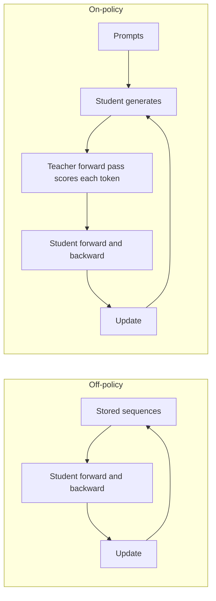
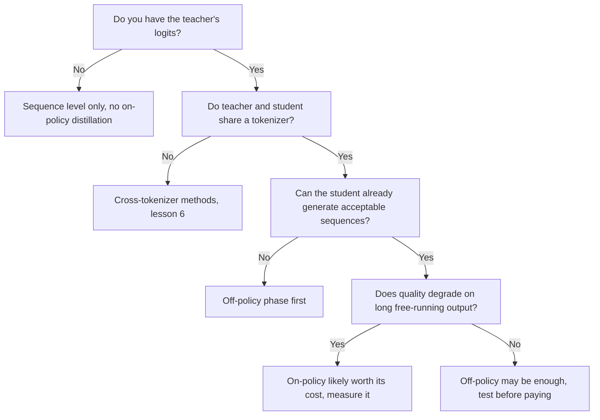

# 在策略蒸馏：暴露偏差、GKD 与 MiniLLM 的对比

第 5 阶段，压缩成便于查阅的形式。[第 14 课](../lessons/0014-exposure-bias.md)讲暴露偏差，[第 15 课](../lessons/0015-gkd-and-minillm.md)讲 GKD 与 MiniLLM，[第 16 课](../lessons/0016-on-policy-distillation-in-practice.md)讲成本和 Qwen3 的比较。

## 离策略对在策略

| | 离策略 | 在策略 |
|---|---|---|
| 学生所依赖的前缀是谁写的 | 人类或教师，在训练之前就已固定 | 学生，在训练期间 |
| 教师做什么 | 写文本，或者为存储的文本提供分布 | 给学生选出的每个 token 打分 |
| 教师必须提供什么 | 序列级只需要文本，token 级需要 logit | 它在学生序列每个位置上的分布，所以训练期间这个模型必须运行 |
| 暴露偏差 | 没有解决 | 已解决，因为训练看到的是学生自己的前缀 |
| 每一步的额外成本 | 除了学生的前向和反向传播之外没有（logit 的存储另算） | 学生的解码，加上教师对结果的一次前向传播 |
| 起始条件 | 任何学生 | 已经能产出可接受序列的学生（GKD 从经过监督微调的学生开始） |

让一种方法成为在策略的，是前缀由谁来写。拥有教师的 logit，并不会让一份固定的语料变成在策略的。

## 两个循环

## GKD 与 MiniLLM 并排对比

| | GKD（Agarwal 等，2023） | MiniLLM（Gu 等，2023） |
|---|---|---|
| 目标 | 在序列各位置上取平均的 token 级散度 | 整条序列上的反向 KL |
| 散度 | 可选：前向 KL、反向 KL 或广义 JSD(beta) | 只有反向 KL |
| 数据 | 占比 lambda 来自学生，其余来自固定数据集 | 来自教师与学生混合的样本，alpha 为 0.2 |
| 梯度 | 通过散度，不通过采样 | 策略梯度，如同强化学习 |
| 稳定措施 | 不通过采样求梯度，论文说这让训练稳定且便宜 | 单步分解、教师混合采样、长度归一化、截断，外加预训练的语言建模损失 |
| 测试过的学生 | T5-small、base、large（77M 到 800M），教师 T5-XL（约 3B） | GPT-2 120M 到 760M、OPT 1.3B 到 6.7B、LLaMA 7B，教师 1.5B 到 13B |
| 任务 | XSum、WMT14 英语到德语、GSM8K、FLAN 指令微调 | 在 Dolly 上的指令遵循，五个测试集 |
| 起点 | 经过监督微调的学生 | 在任务数据上微调、验证损失最低的学生 |

每篇论文都是在自己的模型上调整自己的方法，所以这些数字并没有给两者排名。

## GKD 按任务发现了什么

| 任务 | 报告的最佳设置 | 说明 |
|---|---|---|
| XSum | 使用 JSD(0.9) 的在策略，对比 ImitKD 和 f-distill | 温度采样下寻找模式的更好，贪心解码下差别不大 |
| WMT14 英语到德语 | 广义 JSD 优于前向或反向 KL，只用学生数据 | 对较大的学生，差距缩小。图 1 用的是 JSD(0.1) |
| GSM8K | 只用学生生成的思维链，前向 KL 和反向 KL 都不错 | 只要至少 25% 的数据是在策略的，收益就能保持 |
| FLAN 指令微调 | 使用反向 KL 的在策略，明显高于前向 KL | 论文对学生规模的表述前后不一致 |

散度取决于任务，是作者自己的总结。对各个学生规模取平均，相对初始学生的提升，在摘要、翻译和算术推理上，分别是基线 KD 提升的 2.1 倍、1.7 倍和 1.9 倍。

## MiniLLM 的修复

| 问题 | 修复 |
|---|---|
| 方差大 | 单步分解：对词表求和得到每个 token 的项 |
| 奖励投机，比如教师喜欢的重复短语 | 教师混合采样，从 alpha 乘教师加 (1 减 alpha) 乘学生的分布中采样 |
| 简短或空的答案 | 对累积的奖励做长度归一化 |

## TRL GKDTrainer 的参数

| 参数 | 含义 | 默认值 |
|---|---|---|
| `lmbda` | 学生数据占比。0.0 是监督 JSD，1.0 是在策略 JSD，介于两者之间则每个批次随机决定 | 0.5 |
| `beta` | 广义 JSD 的插值。0.0 近似前向 KL，1.0 近似反向 KL | 0.5 |
| `seq_kd` | 在教师生成的序列上训练，仍然带有教师的 token 反馈 | False |
| `temperature` | 学生生成时的采样温度 | 0.9 |
| `max_new_tokens` | 每个补全生成的最大 token 数 | 128 |

来源：TRL 的 GKD 训练器文档。训练器接收教师作为 `teacher_model`，期望一个 “messages” 数据集，文档把它放在 `trl.experimental.gkd` 之下。

## 在策略一步的成本

| 项目 | 在存储文本的离策略中是否存在 | 在在策略中是否存在 |
|---|---|---|
| 学生的前向和反向传播 | 是 | 是 |
| 学生生成每条序列 | 否 | 是 |
| 教师对序列的前向传播 | 否 | 是 |
| 训练期间教师模型常驻 | 否 | 是 |

## Qwen3：在策略对强化学习（表 21）

Qwen3-8B，两种方法都从同一个离策略蒸馏出来的检查点开始，只用数学和代码查询。报告给出 pass@64 的地方，括号里写的就是它。

| 方法 | AIME'24 | AIME'25 | MATH500 | LiveCodeBench v5 | MMLU-Redux | GPQA-Diamond | GPU 小时 |
|---|---|---|---|---|---|---|---|
| 离策略蒸馏 | 55.0 (90.0) | 42.8 (83.3) | 92.4 | 42.0 | 86.4 | 55.6 | 未给出 |
| 加上强化学习 | 67.6 (90.0) | 55.5 (83.3) | 94.8 | 52.9 | 86.9 | 61.3 | 17,920 |
| 加上在策略蒸馏 | 74.4 (93.3) | 65.5 (86.7) | 97.0 | 60.3 | 88.3 | 63.3 | 1,800 |

请谨慎解读：一份报告，一个学生规模，这次比较所用的教师没有说明，也没有找到关于 GPU 小时是否包含教师的说明。报告中小模型的流水线，是先做离策略蒸馏，再用 Qwen3-32B 或 Qwen3-235B-A22B 教师做在策略蒸馏。

## 在策略何时划算，对各来源的一种解读

这张流程图是对各课的总结，不是出自任何一篇论文的规则。

有争议的一点：暴露偏差可能并不关键（He 等，2019，由 Agarwal 等人引用），所以要在你自己的任务上度量收益。
