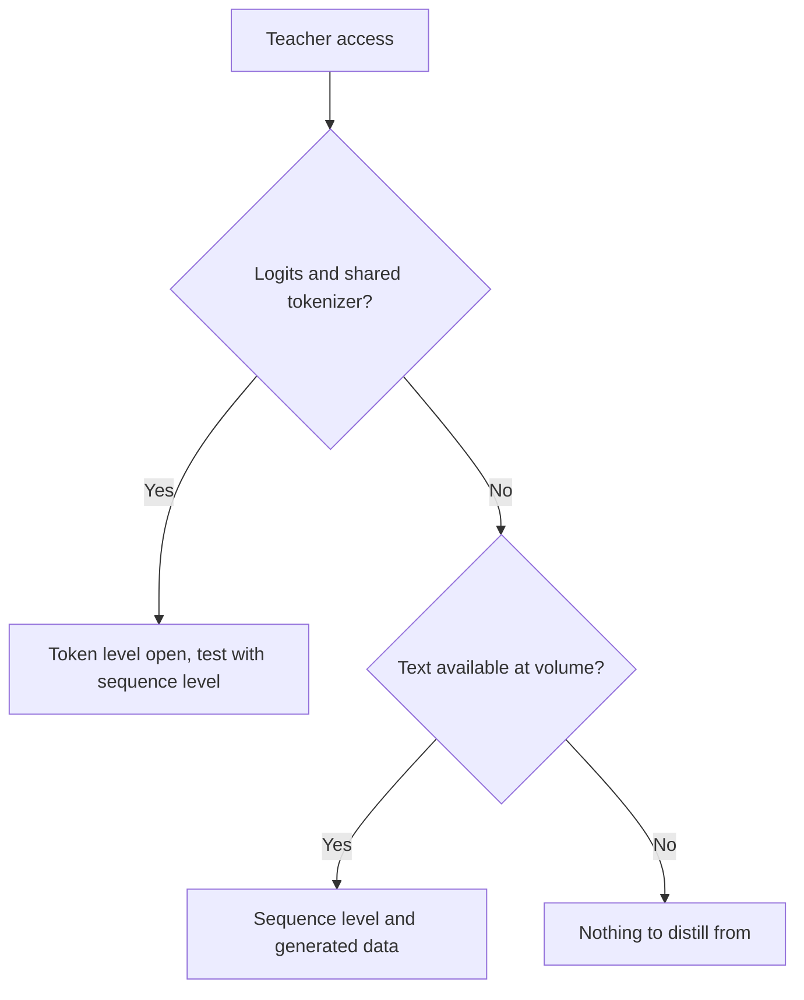

# Secuencia y datos sintéticos: niveles, pipelines, filtros y términos

Las etapas 3 y 4 comprimidas para consulta. La [lección 8](../lessons/0008-sequence-level-distillation.md) cubre la destilación a nivel de secuencia, la [lección 9](../lessons/0009-token-or-sequence.md) la elección entre niveles, la [lección 10](../lessons/0010-distilling-from-generated-data.md) los datos generados, la [lección 11](../lessons/0011-rationales-and-explanation-traces.md) los rationales y las trazas de explicación, la [lección 12](../lessons/0012-filtering-synthetic-data.md) el filtrado, y la [lección 13](../lessons/0013-licensing-and-terms.md) las licencias y los términos.

## Nivel de token frente a nivel de secuencia

| | Nivel de token | Nivel de secuencia |
|---|---|---|
| Qué lee el estudiante | La distribución del profesor en cada posición | Una secuencia decodificada por entrada |
| Pérdida | Una divergencia por posición | Entropía cruzada sobre el texto |
| Qué necesita del profesor | Logits y un vocabulario compartido | Texto |
| Qué conserva | Cómo ordena el profesor las alternativas | La elección global del profesor |
| Qué descarta | Nada en una posición, pero solo sobre los prefijos que le das | Las probabilidades de las alternativas |

## Kim y Rush, inglés a alemán (Tabla 1)

BLEU con decodificación voraz / beam 5. Profesor LSTM de 4×1000, 221m de parámetros. Un paper, una tarea.

| Modelo | BLEU, K=1 / K=5 |
|---|---|
| Profesor | 17.7 / 19.5 |
| Estudiante 2×500 (84m), datos originales | 14.7 / 17.6 |
| Estudiante 2×500, a nivel de palabra | 15.4 / 17.7 |
| Estudiante 2×500, a nivel de secuencia | 18.9 / 19.0 |
| Estudiante 2×500, a nivel de secuencia y de palabra | 18.7 / 18.9 |

| Dato | Número |
|---|---|
| Masa en la mejor oración, estudiante 2×500 a nivel de secuencia | 16.9% (baseline 0.9%) |
| Masa que el profesor pone en su propia mejor oración, beam 1 | 1.3% alemán a inglés, 2.3% tailandés a inglés |
| Velocidad en GPU, estudiante voraz frente a profesor con beam 5 | 1051.3 frente a 101.9 palabras por segundo (Tabla 2) |
| Perplejidad, 2×500 a nivel de secuencia frente al baseline | 22.7 frente a 8.2, con mayor BLEU |

## Qué construyó cada fuente

| Fuente | Profesor | Entradas | Objetivo | Tamaño y costo, según lo declarado |
|---|---|---|---|---|
| Self-Instruct | GPT-3 `davinci` | 175 tareas semilla ampliadas por bootstrapping | Instrucción, entrada, salida | 52,445 instrucciones, 82,439 instancias; fine-tuning $338 |
| Alpaca | text-davinci-003 | Los mismos 175 pares semilla | Instrucción y salida | 52K pares, menos de $500; ejecución por menos de $100 en 8 A100 de 80GB durante 3 horas |
| Distilling Step-by-Step | PaLM de 540B con few-shot prompts | Entradas de entrenamiento de benchmarks | Etiqueta y un rationale aparte | El 12.5% de e-SNLI superó al fine-tuning con todos los datos (T5 de 220M) |
| Orca | ChatGPT, luego GPT-4 | Consultas de FLAN-v2 con 16 system messages | Respuestas al estilo de explicación | 5M de ChatGPT, luego 1M de GPT-4 |
| phi-1 | GPT-3.5 | Temas y públicos restringidos | Libros de texto y ejercicios | Menos de 1B de tokens de libros de texto, unos 180M de tokens de ejercicios |
| Destilación de DeepSeek-R1 | R1 y su checkpoint de RL | Prompts de razonamiento curados | Muestras de razonamiento filtradas | Unas 800k (600k de razonamiento, 200k de otro tipo) |

## Filtros en los pipelines anteriores

| Filtro | Ejemplo | Qué detecta | Qué se pierde |
|---|---|---|---|
| Regla de casi duplicados | Self-Instruct: ROUGE-L por debajo de 0.7 frente a cada miembro del conjunto | Reformulaciones que comparten palabras | Paráfrasis con pocas palabras compartidas |
| Heurísticas | Self-Instruct: palabras clave, longitud, la salida repite la entrada | Basura obvia | Respuestas fluidas pero erróneas |
| Clasificador de calidad | phi-1: etiquetas de GPT-4 sobre unos 100k archivos, random forest sobre embeddings | Bajo valor educativo a escala | Los propios errores del juez |
| Verificador o rejection sampling | R1: conservar solo muestras correctas, por reglas o juzgadas por DeepSeek-V3 | Respuestas finales erróneas | Estilo, tareas abiertas |
| Filtro de formato | R1: descartar idiomas mezclados, párrafos largos, bloques de código | Cadenas de pensamiento ilegibles | Respuestas erróneas pero ordenadas |
| Descontaminación | phi-1: coincidencia de embeddings y AST frente a HumanEval, podando de 42.5K a 354K de 879.5K | Variantes cercanas de elementos de eval | Fugas que la medida de similitud no puede ver |

## Diseños de rationales

| Diseño | El rationale es | Necesita al profesor en el momento de prueba | Resultado en el paper |
|---|---|---|---|
| Rationale como entrada | Una entrada | Sí | No lo usa Distilling Step-by-Step |
| Tarea única | Parte de una secuencia objetivo con la etiqueta | No | Por debajo del fine-tuning estándar en ANLI y CQA (Tabla 2) |
| Multitarea | Una segunda salida con su propio prefijo | No | Por encima del fine-tuning estándar en los cuatro (Tabla 2) |

## Preguntas de licencia, con citas tal como se leyeron en octubre de 2026

Las citas pueden estar desactualizadas. Lee el texto vigente antes de apoyarte en ellas, y trata esta tabla como una lista de lectura, no como asesoría.

| Fuente | Documento | Qué dice, citado |
|---|---|---|
| Terms of Use de OpenAI (resto del mundo), vigentes desde el 1 de enero de 2026 | [Terms](https://openai.com/policies/row-terms-of-use/) | No se puede "Use Output to develop models that compete with OpenAI." |
| Llama 3.1 Community License, sección 1.b.i | [License](https://github.com/meta-llama/llama-models/blob/main/models/llama3_1/LICENSE) | Usar las salidas "to create, train, fine tune, or otherwise improve an AI model, which is distributed or made available" significa que "shall also include “Llama” at the beginning of any such AI model name." |
| Llama 3.1, misma sección | Igual | Distribuir los materiales o un producto que incluya otro modelo de IA exige mostrar "Built with Llama" y proporcionar una copia del acuerdo |
| Blog de Alpaca | [Alpaca](https://crfm.stanford.edu/2023/03/13/alpaca.html) | Pensado solo para investigación académica; los autores dan tres razones, una de ellas los términos del profesor |

## Antes de generar con un profesor

| Paso | Registro |
|---|---|
| Términos del profesor | Documento, URL, fecha de lectura, fecha de vigencia |
| Licencia de pesos abiertos | Nombre, versión, obligaciones de nombre y atribución, política de uso |
| Prompts y datos semilla | Fuente y licencia |
| Uso previsto | Investigación, interno, distribuido o comercial |
| Procedencia | Profesor, versión y fecha de generación en cada ejemplo |

## Decisión: qué expone el profesor

