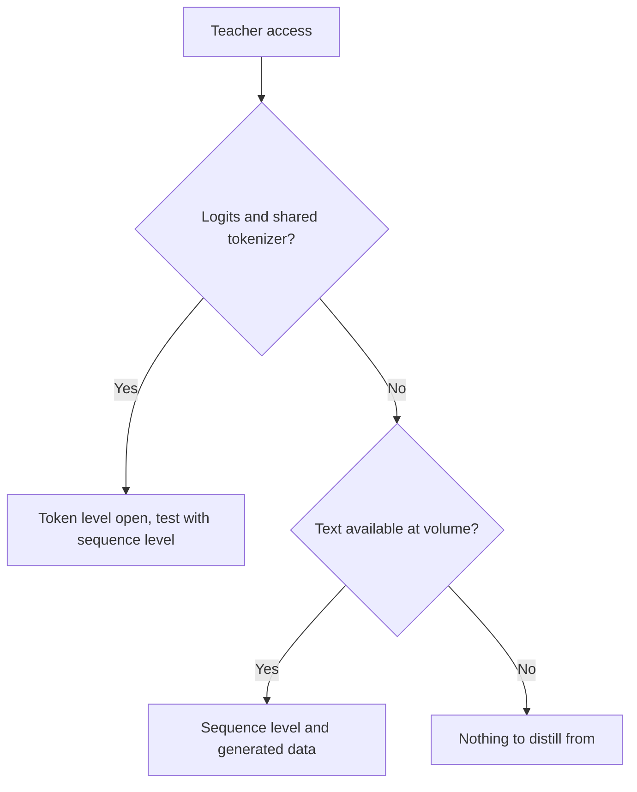

# Séquences et données synthétiques : niveaux, pipelines, filtres et conditions

Les étapes 3 et 4 condensées pour la consultation. La [leçon 8](../lessons/0008-sequence-level-distillation.md) couvre la distillation au niveau de la séquence, la [leçon 9](../lessons/0009-token-or-sequence.md) le choix entre les niveaux, la [leçon 10](../lessons/0010-distilling-from-generated-data.md) les données générées, la [leçon 11](../lessons/0011-rationales-and-explanation-traces.md) les rationales et les traces d'explication, la [leçon 12](../lessons/0012-filtering-synthetic-data.md) le filtrage, et la [leçon 13](../lessons/0013-licensing-and-terms.md) les licences et les conditions d'utilisation.

## Niveau du token contre niveau de la séquence

| | Niveau du token | Niveau de la séquence |
|---|---|---|
| Ce que l'élève lit | La distribution de l'enseignant à chaque position | Une séquence décodée par entrée |
| Loss | Une divergence par position | Entropie croisée sur le texte |
| Ce qu'il faut de l'enseignant | Des logits et un vocabulaire partagé | Du texte |
| Ce qu'il garde | Comment l'enseignant classe les alternatives | Le choix d'ensemble de l'enseignant |
| Ce qu'il abandonne | Rien à une position, mais seulement sur les préfixes qu'on lui donne | Les probabilités des alternatives |

## Kim et Rush, anglais vers allemand (tableau 1)

BLEU avec décodage glouton / faisceau de 5. Enseignant LSTM 4×1000, 221m de paramètres. Un article, une tâche.

| Modèle | BLEU, K=1 / K=5 |
|---|---|
| Enseignant | 17.7 / 19.5 |
| Élève 2×500 (84m), données d'origine | 14.7 / 17.6 |
| Élève 2×500, niveau du mot | 15.4 / 17.7 |
| Élève 2×500, niveau de la séquence | 18.9 / 19.0 |
| Élève 2×500, niveau de la séquence et niveau du mot | 18.7 / 18.9 |

| Fait | Nombre |
|---|---|
| Masse sur la meilleure phrase, élève 2×500 au niveau de la séquence | 16.9 % (référence 0.9 %) |
| Masse que l'enseignant met sur sa propre meilleure phrase, faisceau de 1 | 1.3 % allemand vers anglais, 2.3 % thaï vers anglais |
| Vitesse sur GPU, élève glouton contre enseignant à faisceau de 5 | 1051.3 contre 101.9 mots par seconde (tableau 2) |
| Perplexité, 2×500 au niveau de la séquence contre référence | 22.7 contre 8.2, avec un BLEU plus élevé |

## Ce qu'a construit chaque source

| Source | Enseignant | Entrées | Cible | Taille et coût, tels qu'indiqués |
|---|---|---|---|---|
| Self-Instruct | GPT-3 `davinci` | 175 tâches de départ étendues par amorçage | Instruction, entrée, sortie | 52,445 instructions, 82,439 instances ; fine-tuning 338 $ |
| Alpaca | text-davinci-003 | Les mêmes 175 paires de départ | Instruction et sortie | 52K paires, moins de 500 $ ; run à moins de 100 $ sur 8 A100 de 80 Go pendant 3 heures |
| Distilling Step-by-Step | PaLM 540B avec prompts few-shot | Entrées d'entraînement de benchmarks | Label et une rationale séparée | 12.5 % d'e-SNLI ont battu le fine-tuning sur données complètes (T5 220M) |
| Orca | ChatGPT, puis GPT-4 | Requêtes FLAN-v2 avec 16 messages système | Réponses de style explication | 5M de ChatGPT, puis 1M de GPT-4 |
| phi-1 | GPT-3.5 | Sujets et publics contraints | Manuels et exercices | Moins de 1B tokens de manuels, environ 180M tokens d'exercices |
| Distillation DeepSeek-R1 | R1 et son checkpoint RL | Prompts de raisonnement triés | Échantillons de raisonnement filtrés | Environ 800k (600k de raisonnement, 200k autres) |

## Filtres dans les pipelines ci-dessus

| Filtre | Exemple | Ce qu'il attrape | Ce qu'il rate |
|---|---|---|---|
| Règle de quasi-doublon | Self-Instruct : ROUGE-L inférieur à 0.7 par rapport à chaque membre du pool | Reformulations partageant des mots | Paraphrases partageant peu de mots |
| Heuristiques | Self-Instruct : mots-clés, longueur, sortie qui répète l'entrée | Déchets évidents | Réponses fausses mais fluides |
| Classifieur de qualité | phi-1 : labels GPT-4 sur environ 100k fichiers, random forest sur embeddings | Faible valeur éducative à grande échelle | Les propres erreurs du juge |
| Vérificateur ou échantillonnage par rejet | R1 : ne garder que les échantillons corrects, par règles ou jugés par DeepSeek-V3 | Réponses finales fausses | Style, tâches ouvertes |
| Filtre de format | R1 : écarter les langues mêlées, les longs paragraphes, les blocs de code | Chaînes de raisonnement illisibles | Réponses fausses mais soignées |
| Décontamination | phi-1 : correspondance par embedding et AST contre HumanEval, élagage de 42.5K à 354K sur 879.5K | Variantes proches d'éléments d'eval | Fuites que la mesure de similarité ne voit pas |

## Schémas de rationale

| Schéma | La rationale est | Exige l'enseignant au moment du test | Résultat dans l'article |
|---|---|---|---|
| Rationale comme entrée | Une entrée | Oui | Non utilisé par Distilling Step-by-Step |
| Tâche unique | Une partie d'une seule séquence cible avec le label | Non | Sous le fine-tuning standard sur ANLI et CQA (tableau 2) |
| Multitâche | Une seconde sortie avec son propre préfixe | Non | Au-dessus du fine-tuning standard sur les quatre (tableau 2) |

## Questions de licence, avec des citations telles que lues en octobre 2026

Les citations peuvent être périmées. Lisez le texte actuel avant de vous y fier, et traitez ce tableau comme une liste de lecture, pas comme un conseil.

| Source | Document | Ce qu'elle dit, en citation |
|---|---|---|
| OpenAI Terms of Use (reste du monde), en vigueur au 1er janvier 2026 | [Conditions](https://openai.com/policies/row-terms-of-use/) | Ne peut pas "Use Output to develop models that compete with OpenAI." |
| Llama 3.1 Community License, section 1.b.i | [Licence](https://github.com/meta-llama/llama-models/blob/main/models/llama3_1/LICENSE) | Utiliser les sorties "to create, train, fine tune, or otherwise improve an AI model, which is distributed or made available" signifie que vous "shall also include “Llama” at the beginning of any such AI model name." |
| Llama 3.1, même section | Idem | Distribuer les matériaux ou un produit incluant un autre modèle d'IA exige d'afficher "Built with Llama" et de fournir une copie de l'accord |
| Billet d'Alpaca | [Alpaca](https://crfm.stanford.edu/2023/03/13/alpaca.html) | Destiné uniquement à la recherche académique ; les auteurs donnent trois raisons, dont l'une est les conditions de l'enseignant |

## Avant de générer à partir d'un enseignant

| Étape | À consigner |
|---|---|
| Conditions de l'enseignant | Document, URL, date de lecture, date d'entrée en vigueur |
| Licence de poids ouverts | Nom, version, obligations de nom et d'attribution, politique d'usage |
| Prompts et données de départ | Source et licence |
| Usage prévu | Recherche, interne, distribué ou commercial |
| Provenance | Enseignant, version et date de génération sur chaque exemple |

## Décision : ce que l'enseignant expose

