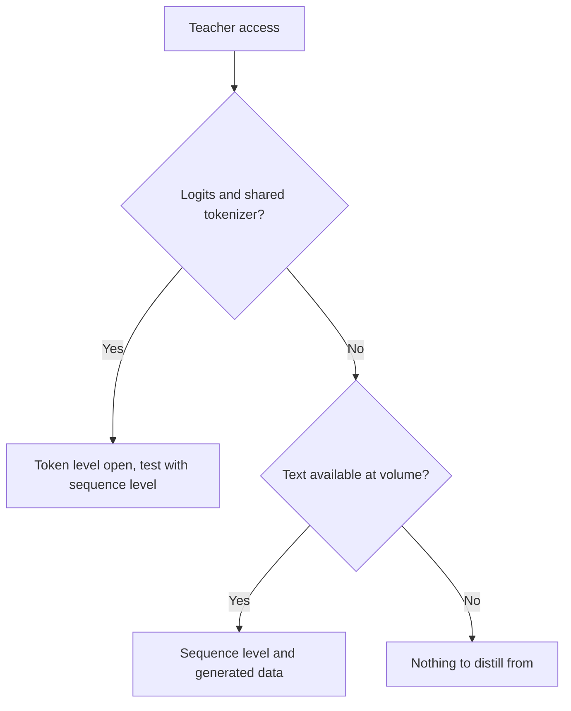

# Sequence और Synthetic Data: Levels, Pipelines, Filters और Terms

चरण 3 और 4 का संक्षिप्त रूप, खोजने के लिए। [पाठ 8](../lessons/0008-sequence-level-distillation.md) sequence-level distillation को कवर करता है, [पाठ 9](../lessons/0009-token-or-sequence.md) levels के बीच चुनाव को, [पाठ 10](../lessons/0010-distilling-from-generated-data.md) generated data को, [पाठ 11](../lessons/0011-rationales-and-explanation-traces.md) rationales और explanation traces को, [पाठ 12](../lessons/0012-filtering-synthetic-data.md) filtering को, और [पाठ 13](../lessons/0013-licensing-and-terms.md) licenses और terms को।

## Token level बनाम sequence level

| | Token level | Sequence level |
|---|---|---|
| Student क्या पढ़ता है | हर position पर teacher का distribution | हर input के लिए एक decode किया हुआ sequence |
| Loss | हर position पर एक divergence | Text पर cross-entropy |
| Teacher से क्या चाहिए | Logits और साझा vocabulary | Text |
| क्या रखता है | Teacher विकल्पों को कैसे क्रम में रखता है | Teacher का समग्र चुनाव |
| क्या छोड़ता है | एक position पर कुछ नहीं, पर सिर्फ़ उन prefixes पर जो आप उसे दें | विकल्पों की probabilities |

## Kim और Rush, अंग्रेज़ी से जर्मन (Table 1)

Greedy decoding / beam 5 के साथ BLEU। Teacher 4×1000 LSTM, 221m parameters। एक पेपर, एक task।

| Model | BLEU, K=1 / K=5 |
|---|---|
| Teacher | 17.7 / 19.5 |
| Student 2×500 (84m), मूल data | 14.7 / 17.6 |
| Student 2×500, word-level | 15.4 / 17.7 |
| Student 2×500, sequence-level | 18.9 / 19.0 |
| Student 2×500, sequence-level और word-level | 18.7 / 18.9 |

| तथ्य | संख्या |
|---|---|
| शीर्ष वाक्य पर mass, 2×500 sequence-level student | 16.9% (baseline 0.9%) |
| Teacher अपने शीर्ष वाक्य पर जो mass रखता है, beam 1 | जर्मन से अंग्रेज़ी 1.3%, थाई से अंग्रेज़ी 2.3% |
| GPU पर गति, student greedy बनाम teacher beam 5 | 1051.3 बनाम 101.9 शब्द प्रति सेकंड (Table 2) |
| Perplexity, 2×500 sequence-level बनाम baseline | 22.7 बनाम 8.2, ऊँचे BLEU के साथ |

## हर स्रोत ने क्या बनाया

| स्रोत | Teacher | Inputs | Target | बताया गया आकार और लागत |
|---|---|---|---|---|
| Self-Instruct | GPT-3 `davinci` | Bootstrapping से बढ़ाए गए 175 seed tasks | Instruction, input, output | 52,445 instructions, 82,439 instances; fine-tune $338 |
| Alpaca | text-davinci-003 | वही 175 seed जोड़े | Instruction और output | 52K जोड़े, $500 से कम; 8 80GB A100s पर 3 घंटे का run $100 से कम |
| Distilling Step-by-Step | Few-shot prompts के साथ 540B PaLM | Benchmark के training inputs | Label और अलग rationale | e-SNLI के 12.5% ने full-data fine-tuning को हराया (220M T5) |
| Orca | ChatGPT, फिर GPT-4 | 16 system messages के साथ FLAN-v2 queries | Explanation-शैली के responses | 5M ChatGPT, फिर 1M GPT-4 |
| phi-1 | GPT-3.5 | बाँधे गए विषय और दर्शक | Textbooks और exercises | Textbooks के 1B tokens से कम, exercises के लगभग 180M tokens |
| DeepSeek-R1 distillation | R1 और उसका RL checkpoint | चुने हुए reasoning prompts | Filter किए reasoning samples | लगभग 800k (600k reasoning, 200k अन्य) |

## ऊपर की pipelines में filters

| Filter | उदाहरण | क्या पकड़ता है | क्या चूकता है |
|---|---|---|---|
| Near-duplicate नियम | Self-Instruct: pool के हर सदस्य के विरुद्ध ROUGE-L 0.7 से नीचे | साझा शब्दों वाले दोबारा कहे रूप | कम साझा शब्दों वाले paraphrases |
| Heuristics | Self-Instruct: keywords, लंबाई, output जो input दोहराए | साफ़ कचरा | धाराप्रवाह ग़लत उत्तर |
| Quality classifier | phi-1: लगभग 100k files पर GPT-4 labels, embeddings पर random forest | बड़े पैमाने पर कम शैक्षिक मूल्य | Judge की अपनी ग़लतियाँ |
| Checker या rejection sampling | R1: सिर्फ़ सही samples रखें, नियम-आधारित या DeepSeek-V3 द्वारा आँके हुए | ग़लत अंतिम उत्तर | Style, खुले-अंत वाले tasks |
| Format filter | R1: मिली-जुली भाषाएँ, लंबे paragraphs, code blocks हटाएँ | पढ़ने में कठिन chains of thought | ग़लत पर सुव्यवस्थित उत्तर |
| Decontamination | phi-1: HumanEval के विरुद्ध embedding और AST मेल, 879.5K में से 42.5K से 354K की pruning | Eval items के क़रीबी रूप | वे leaks जिन्हें समानता माप नहीं देख सकता |

## Rationale के डिज़ाइन

| डिज़ाइन | Rationale क्या है | Test के समय teacher चाहिए | पेपर में नतीजा |
|---|---|---|---|
| Input के रूप में rationale | एक input | हाँ | Distilling Step-by-Step ने इस्तेमाल नहीं किया |
| Single task | Label के साथ एक target sequence का हिस्सा | नहीं | ANLI और CQA पर standard fine-tuning से नीचे (Table 2) |
| Multi-task | अपने prefix के साथ दूसरा output | नहीं | चारों पर standard fine-tuning से ऊपर (Table 2) |

## License के सवाल, अक्टूबर 2026 में पढ़े गए उद्धरणों के साथ

उद्धरण पुराने हो सकते हैं। उन पर भरोसा करने से पहले मौजूदा text पढ़ें, और इस तालिका को पढ़ने की सूची मानें, सलाह नहीं। उद्धरण मूल अंग्रेज़ी में हैं।

| स्रोत | दस्तावेज़ | वह क्या कहता है, उद्धृत |
|---|---|---|
| OpenAI Terms of Use (बाक़ी दुनिया), 1 जनवरी 2026 से प्रभावी | [शर्तें](https://openai.com/policies/row-terms-of-use/) | Cannot "Use Output to develop models that compete with OpenAI." |
| Llama 3.1 Community License, section 1.b.i | [License](https://github.com/meta-llama/llama-models/blob/main/models/llama3_1/LICENSE) | Using outputs "to create, train, fine tune, or otherwise improve an AI model, which is distributed or made available" means you "shall also include “Llama” at the beginning of any such AI model name." |
| Llama 3.1, वही section | वही | Distributing the materials or a product including another AI model requires displaying "Built with Llama" and providing a copy of the agreement |
| Alpaca blog | [Alpaca](https://crfm.stanford.edu/2023/03/13/alpaca.html) | सिर्फ़ academic research के लिए; लेखक तीन कारण देते हैं, उनमें से एक teacher के terms है |

## Teacher से generate करने से पहले

| चरण | क्या दर्ज करें |
|---|---|
| Teacher के terms | दस्तावेज़, URL, पढ़ने की तारीख़, प्रभावी तारीख़ |
| Open weights license | नाम, version, नामकरण और attribution की ज़िम्मेदारियाँ, use policy |
| Prompt और seed data | स्रोत और license |
| इरादा किया उपयोग | Research, internal, distributed या commercial |
| Provenance | हर example पर teacher, version और generation की तारीख़ |

## निर्णय: teacher क्या उपलब्ध कराता है

