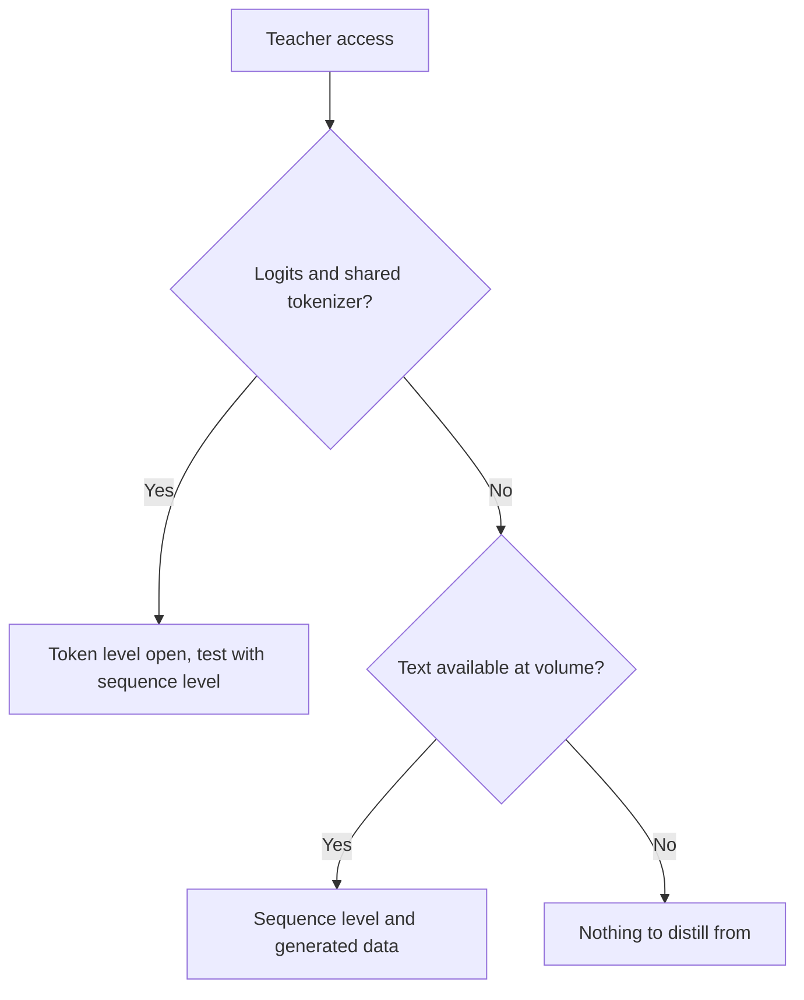

# Sequence and Synthetic Data: Levels, Pipelines, Filters and Terms

Stages 3 and 4 compressed for lookup. [Lesson 8](../lessons/0008-sequence-level-distillation.md) covers sequence-level distillation, [lesson 9](../lessons/0009-token-or-sequence.md) the choice between levels, [lesson 10](../lessons/0010-distilling-from-generated-data.md) generated data, [lesson 11](../lessons/0011-rationales-and-explanation-traces.md) rationales and explanation traces, [lesson 12](../lessons/0012-filtering-synthetic-data.md) filtering, and [lesson 13](../lessons/0013-licensing-and-terms.md) licenses and terms.

## Token level against sequence level

| | Token level | Sequence level |
|---|---|---|
| Student reads | The teacher's distribution at each position | One decoded sequence per input |
| Loss | A divergence per position | Cross-entropy on the text |
| Needs from the teacher | Logits and a shared vocabulary | Text |
| Keeps | How the teacher ranks alternatives | The teacher's overall choice |
| Drops | Nothing at a position, but only on the prefixes you give it | Probabilities of the alternatives |

## Kim and Rush, English to German (Table 1)

BLEU with greedy decoding / beam 5. Teacher 4×1000 LSTM, 221m parameters. One paper, one task.

| Model | BLEU, K=1 / K=5 |
|---|---|
| Teacher | 17.7 / 19.5 |
| Student 2×500 (84m), original data | 14.7 / 17.6 |
| Student 2×500, word-level | 15.4 / 17.7 |
| Student 2×500, sequence-level | 18.9 / 19.0 |
| Student 2×500, sequence-level and word-level | 18.7 / 18.9 |

| Fact | Number |
|---|---|
| Mass on the top sentence, 2×500 sequence-level student | 16.9% (baseline 0.9%) |
| Mass the teacher puts on its own top sentence, beam 1 | 1.3% German to English, 2.3% Thai to English |
| Speed on GPU, student greedy against teacher beam 5 | 1051.3 against 101.9 words per second (Table 2) |
| Perplexity, 2×500 sequence-level against baseline | 22.7 against 8.2, with higher BLEU |

## What each source built

| Source | Teacher | Inputs | Target | Size and cost, as stated |
|---|---|---|---|---|
| Self-Instruct | GPT-3 `davinci` | 175 seed tasks grown by bootstrapping | Instruction, input, output | 52,445 instructions, 82,439 instances; fine-tune $338 |
| Alpaca | text-davinci-003 | The same 175 seed pairs | Instruction and output | 52K pairs, under $500; run under $100 on 8 80GB A100s for 3 hours |
| Distilling Step-by-Step | 540B PaLM with few-shot prompts | Benchmark training inputs | Label and a separate rationale | 12.5% of e-SNLI beat full-data fine-tuning (220M T5) |
| Orca | ChatGPT, then GPT-4 | FLAN-v2 queries with 16 system messages | Explanation-style responses | 5M ChatGPT, then 1M GPT-4 |
| phi-1 | GPT-3.5 | Constrained topics and audiences | Textbooks and exercises | Under 1B tokens of textbooks, about 180M tokens of exercises |
| DeepSeek-R1 distillation | R1 and its RL checkpoint | Curated reasoning prompts | Filtered reasoning samples | About 800k (600k reasoning, 200k other) |

## Filters in the pipelines above

| Filter | Example | What it catches | What it misses |
|---|---|---|---|
| Near-duplicate rule | Self-Instruct: ROUGE-L below 0.7 against every pool member | Rephrasings sharing words | Paraphrases with few shared words |
| Heuristics | Self-Instruct: keywords, length, output repeats input | Obvious junk | Fluent wrong answers |
| Quality classifier | phi-1: GPT-4 labels on about 100k files, random forest on embeddings | Low educational value at scale | The judge's own mistakes |
| Checker or rejection sampling | R1: keep only correct samples, rule-based or judged by DeepSeek-V3 | Wrong final answers | Style, open-ended tasks |
| Format filter | R1: drop mixed languages, long paragraphs, code blocks | Unreadable chains of thought | Wrong but tidy answers |
| Decontamination | phi-1: embedding and AST match against HumanEval, pruning 42.5K to 354K of 879.5K | Close variants of eval items | Leaks the similarity measure cannot see |

## Rationale designs

| Design | Rationale is | Needs the teacher at test time | Result in the paper |
|---|---|---|---|
| Rationale as input | An input | Yes | Not used by Distilling Step-by-Step |
| Single task | Part of one target sequence with the label | No | Below standard fine-tuning on ANLI and CQA (Table 2) |
| Multi-task | A second output with its own prefix | No | Above standard fine-tuning on all four (Table 2) |

## License questions, with quotes as read in October 2026

Quotes can be stale. Read the current text before relying on them, and treat this table as a reading list, not advice.

| Source | Document | What it says, quoted |
|---|---|---|
| OpenAI Terms of Use (rest of world), effective January 1, 2026 | [Terms](https://openai.com/policies/row-terms-of-use/) | Cannot "Use Output to develop models that compete with OpenAI." |
| Llama 3.1 Community License, section 1.b.i | [License](https://github.com/meta-llama/llama-models/blob/main/models/llama3_1/LICENSE) | Using outputs "to create, train, fine tune, or otherwise improve an AI model, which is distributed or made available" means you "shall also include “Llama” at the beginning of any such AI model name." |
| Llama 3.1, same section | Same | Distributing the materials or a product including another AI model requires displaying "Built with Llama" and providing a copy of the agreement |
| Alpaca blog | [Alpaca](https://crfm.stanford.edu/2023/03/13/alpaca.html) | Intended only for academic research; the authors give three reasons, one of them the teacher's terms |

## Before generating from a teacher

| Step | Record |
|---|---|
| Teacher's terms | Document, URL, date read, effective date |
| Open weights license | Name, version, naming and attribution duties, use policy |
| Prompt and seed data | Source and license |
| Intended use | Research, internal, distributed or commercial |
| Provenance | Teacher, version and generation date on every example |

## Decision: what the teacher exposes

