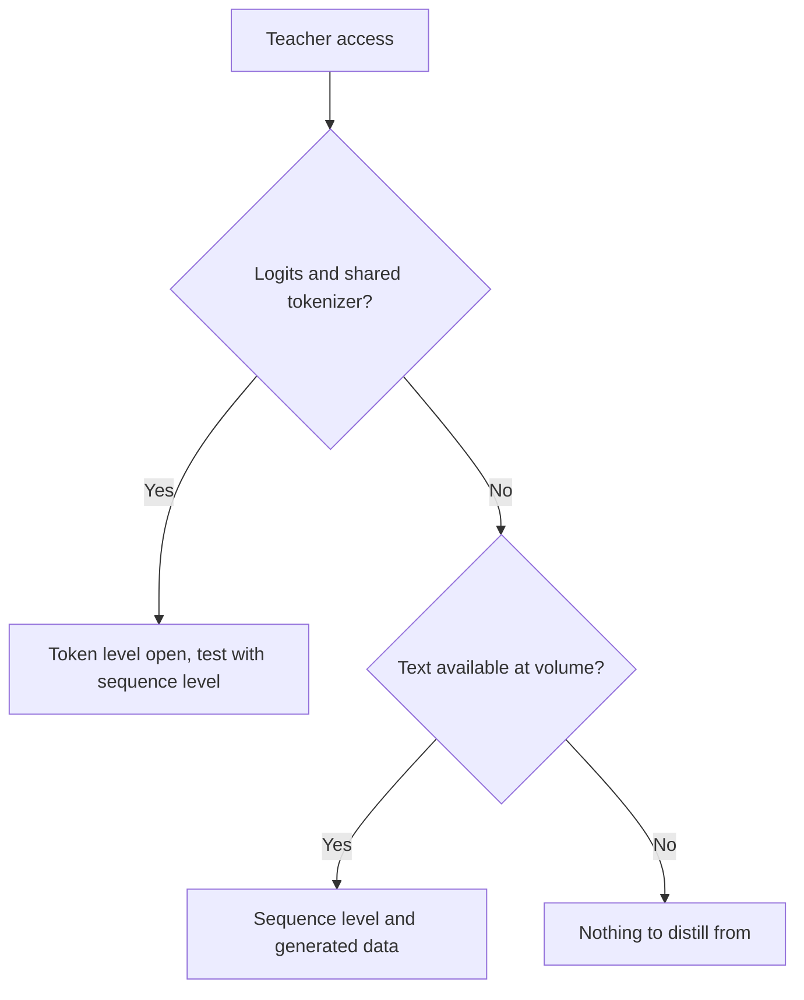

# Sequência e Dados Sintéticos: Níveis, Pipelines, Filtros e Termos

As etapas 3 e 4 condensadas para consulta. A [lição 8](../lessons/0008-sequence-level-distillation.md) cobre a destilação em nível de sequência, a [lição 9](../lessons/0009-token-or-sequence.md) a escolha entre os níveis, a [lição 10](../lessons/0010-distilling-from-generated-data.md) os dados gerados, a [lição 11](../lessons/0011-rationales-and-explanation-traces.md) os rationales e traces de explicação, a [lição 12](../lessons/0012-filtering-synthetic-data.md) a filtragem e a [lição 13](../lessons/0013-licensing-and-terms.md) licenças e termos.

## Nível de token contra nível de sequência

| | Nível de token | Nível de sequência |
|---|---|---|
| O aluno lê | A distribuição do professor em cada posição | Uma sequência decodificada por entrada |
| Loss | Uma divergência por posição | Cross-entropy no texto |
| O que precisa do professor | Logits e um vocabulário compartilhado | Texto |
| Mantém | Como o professor classifica as alternativas | A escolha geral do professor |
| Descarta | Nada em uma posição, mas apenas nos prefixos que você fornece | As probabilidades das alternativas |

## Kim e Rush, inglês para alemão (Tabela 1)

BLEU com decodificação greedy / beam 5. Professor LSTM 4×1000, 221m de parâmetros. Um artigo, uma tarefa.

| Modelo | BLEU, K=1 / K=5 |
|---|---|
| Professor | 17,7 / 19,5 |
| Aluno 2×500 (84m), dados originais | 14,7 / 17,6 |
| Aluno 2×500, nível de palavra | 15,4 / 17,7 |
| Aluno 2×500, nível de sequência | 18,9 / 19,0 |
| Aluno 2×500, nível de sequência e nível de palavra | 18,7 / 18,9 |

| Fato | Número |
|---|---|
| Massa na melhor frase, aluno 2×500 em nível de sequência | 16,9% (baseline 0,9%) |
| Massa que o professor põe na sua própria melhor frase, beam 1 | 1,3% alemão para inglês, 2,3% tailandês para inglês |
| Velocidade na GPU, aluno greedy contra professor com beam 5 | 1051,3 contra 101,9 palavras por segundo (Tabela 2) |
| Perplexidade, 2×500 em nível de sequência contra baseline | 22,7 contra 8,2, com BLEU maior |

## O que cada fonte construiu

| Fonte | Professor | Entradas | Alvo | Tamanho e custo, como declarados |
|---|---|---|---|---|
| Self-Instruct | GPT-3 `davinci` | 175 tarefas-semente ampliadas por bootstrapping | Instrução, entrada, saída | 52.445 instruções, 82.439 instâncias; fine-tuning $338 |
| Alpaca | text-davinci-003 | Os mesmos 175 pares-semente | Instrução e saída | 52K pares, menos de $500; execução abaixo de $100 em 8 A100 de 80GB por 3 horas |
| Distilling Step-by-Step | PaLM de 540B com few-shot prompts | Entradas de treinamento de benchmarks | Rótulo e um rationale separado | 12,5% do e-SNLI superaram o fine-tuning com todos os dados (T5 de 220M) |
| Orca | ChatGPT, depois GPT-4 | Consultas do FLAN-v2 com 16 mensagens de sistema | Respostas em estilo de explicação | 5M do ChatGPT, depois 1M do GPT-4 |
| phi-1 | GPT-3.5 | Tópicos e públicos restritos | Livros-texto e exercícios | Menos de 1B tokens de livros-texto, cerca de 180M tokens de exercícios |
| Destilação do DeepSeek-R1 | R1 e o seu checkpoint de RL | Prompts de raciocínio curados | Amostras de raciocínio filtradas | Cerca de 800k (600k de raciocínio, 200k de outros tipos) |

## Filtros nos pipelines acima

| Filtro | Exemplo | O que pega | O que deixa passar |
|---|---|---|---|
| Regra de quase duplicata | Self-Instruct: ROUGE-L abaixo de 0,7 contra todo membro do pool | Reformulações com as mesmas palavras | Paráfrases com poucas palavras em comum |
| Heurísticas | Self-Instruct: palavras-chave, comprimento, saída que repete a entrada | Lixo óbvio | Respostas erradas e fluentes |
| Classificador de qualidade | phi-1: rótulos do GPT-4 em cerca de 100k arquivos, random forest em embeddings | Baixo valor educacional em escala | Os próprios erros do juiz |
| Verificador ou rejection sampling | R1: manter apenas amostras corretas, por regra ou julgadas pelo DeepSeek-V3 | Respostas finais erradas | Estilo, tarefas abertas |
| Filtro de formato | R1: descartar idiomas misturados, parágrafos longos, blocos de código | Chains of thought ilegíveis | Respostas erradas mas arrumadas |
| Descontaminação | phi-1: correspondência por embedding e AST contra o HumanEval, podando de 42,5K a 354K de 879,5K | Variantes próximas de itens de eval | Vazamentos que a medida de similaridade não enxerga |

## Designs de rationale

| Design | O rationale é | Precisa do professor na hora do teste | Resultado no artigo |
|---|---|---|---|
| Rationale como entrada | Uma entrada | Sim | Não usado pelo Distilling Step-by-Step |
| Tarefa única | Parte de uma única sequência-alvo com o rótulo | Não | Abaixo do fine-tuning padrão no ANLI e no CQA (Tabela 2) |
| Multitarefa | Uma segunda saída com o seu próprio prefixo | Não | Acima do fine-tuning padrão nos quatro (Tabela 2) |

## Questões de licença, com citações como lidas em outubro de 2026

As citações podem ficar desatualizadas. Leia o texto atual antes de depender delas e trate esta tabela como uma lista de leitura, não como aconselhamento.

| Fonte | Documento | O que diz, citado |
|---|---|---|
| Terms of Use da OpenAI (resto do mundo), em vigor desde 1º de janeiro de 2026 | [Termos](https://openai.com/policies/row-terms-of-use/) | Não pode "Use Output to develop models that compete with OpenAI." |
| Llama 3.1 Community License, seção 1.b.i | [Licença](https://github.com/meta-llama/llama-models/blob/main/models/llama3_1/LICENSE) | Usar saídas "to create, train, fine tune, or otherwise improve an AI model, which is distributed or made available" significa que você "shall also include “Llama” at the beginning of any such AI model name." |
| Llama 3.1, mesma seção | Mesmo | Distribuir os materiais ou um produto que inclua outro modelo de IA exige exibir "Built with Llama" e fornecer uma cópia do acordo |
| Blog do Alpaca | [Alpaca](https://crfm.stanford.edu/2023/03/13/alpaca.html) | Destinado apenas à pesquisa acadêmica; os autores dão três razões, uma delas os termos do professor |

## Antes de gerar a partir de um professor

| Passo | Registre |
|---|---|
| Termos do professor | Documento, URL, data de leitura, data de vigência |
| Licença dos pesos abertos | Nome, versão, exigências de nome e atribuição, política de uso |
| Prompts e dados-semente | Fonte e licença |
| Uso pretendido | Pesquisa, interno, distribuído ou comercial |
| Proveniência | Professor, versão e data de geração em cada exemplo |

## Decisão: o que o professor expõe

