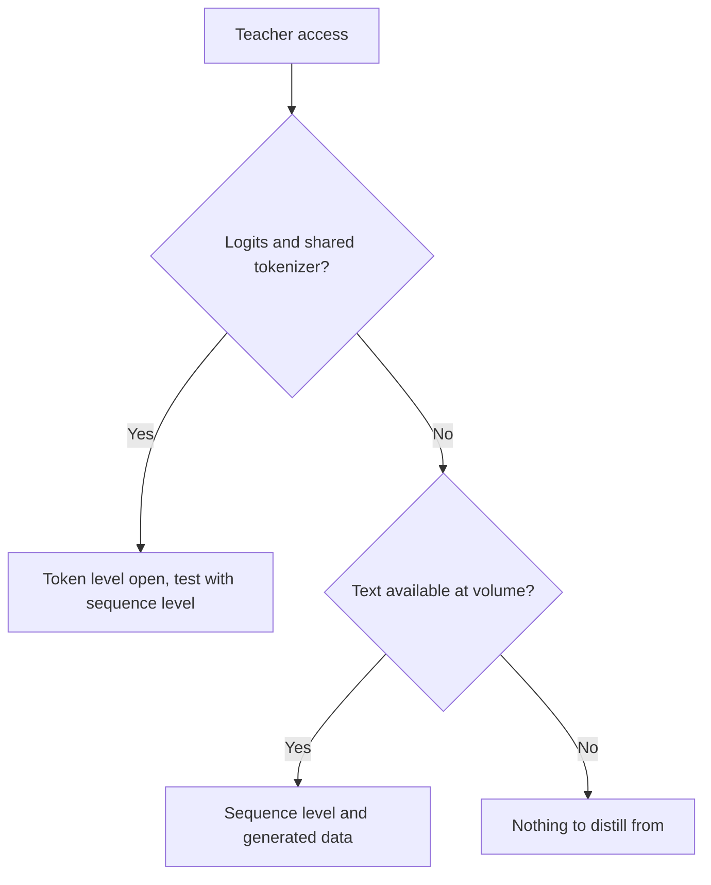

# Последовательности и синтетические данные: уровни, конвейеры, фильтры и условия

Этапы 3 и 4 в сжатом виде для быстрого поиска. [Урок 8](../lessons/0008-sequence-level-distillation.md) охватывает дистилляцию на уровне последовательностей, [урок 9](../lessons/0009-token-or-sequence.md) выбор между уровнями, [урок 10](../lessons/0010-distilling-from-generated-data.md) сгенерированные данные, [урок 11](../lessons/0011-rationales-and-explanation-traces.md) обоснования и трассы объяснений, [урок 12](../lessons/0012-filtering-synthetic-data.md) фильтрацию, а [урок 13](../lessons/0013-licensing-and-terms.md) лицензии и условия.

## Уровень токенов и уровень последовательностей

| | Уровень токенов | Уровень последовательностей |
|---|---|---|
| Что читает ученик | Распределение учителя в каждой позиции | Одну декодированную последовательность на вход |
| Функция потерь | Дивергенция на позицию | Кросс-энтропия на тексте |
| Что нужно от учителя | Логиты и общий словарь | Текст |
| Что сохраняет | Как учитель ранжирует альтернативы | Общий выбор учителя |
| Что отбрасывает | Ничего в позиции, но только на тех префиксах, которые вы подаёте | Вероятности альтернатив |

## Kim и Rush, английский в немецкий (таблица 1)

BLEU при жадном декодировании / луче 5. Учитель LSTM 4×1000, 221m параметров. Одна статья, одна задача.

| Модель | BLEU, K=1 / K=5 |
|---|---|
| Учитель | 17.7 / 19.5 |
| Ученик 2×500 (84m), исходные данные | 14.7 / 17.6 |
| Ученик 2×500, уровень слов | 15.4 / 17.7 |
| Ученик 2×500, уровень последовательностей | 18.9 / 19.0 |
| Ученик 2×500, уровень последовательностей и уровень слов | 18.7 / 18.9 |

| Факт | Число |
|---|---|
| Масса на лучшем предложении, ученик 2×500 на уровне последовательностей | 16.9% (базовый уровень 0.9%) |
| Масса, которую учитель ставит на собственное лучшее предложение, луч 1 | 1.3% с немецкого на английский, 2.3% с тайского на английский |
| Скорость на GPU, ученик жадно против учителя с лучом 5 | 1051.3 против 101.9 слова в секунду (таблица 2) |
| Перплексия, ученик 2×500 на уровне последовательностей против базового уровня | 22.7 против 8.2, при более высоком BLEU |

## Что построил каждый источник

| Источник | Учитель | Входы | Цель | Размер и стоимость, как заявлено |
|---|---|---|---|---|
| Self-Instruct | GPT-3 `davinci` | 175 затравочных задач, выращенных раскруткой | Инструкция, вход, выход | 52 445 инструкций, 82 439 экземпляров; дообучение $338 |
| Alpaca | text-davinci-003 | Те же 175 затравочных пар | Инструкция и выход | 52K пар, менее $500; запуск менее $100 на 8 A100 по 80 ГБ в течение 3 часов |
| Distilling Step-by-Step | PaLM 540B с few-shot-промптами | Обучающие входы бенчмарков | Метка и отдельное обоснование | 12.5% e-SNLI превзошли дообучение на полных данных (T5 на 220M) |
| Orca | ChatGPT, затем GPT-4 | Запросы FLAN-v2 с 16 системными сообщениями | Ответы в стиле объяснений | 5M от ChatGPT, затем 1M от GPT-4 |
| phi-1 | GPT-3.5 | Ограниченные темы и аудитории | Учебники и упражнения | Менее 1B токенов учебников, около 180M токенов упражнений |
| Дистилляция DeepSeek-R1 | R1 и её контрольная точка RL | Отобранные промпты для рассуждений | Отфильтрованные сэмплы рассуждений | Около 800 тысяч (600 тысяч рассуждений, 200 тысяч остальных) |

## Фильтры в конвейерах выше

| Фильтр | Пример | Что ловит | Что пропускает |
|---|---|---|---|
| Правило почти-дубликатов | Self-Instruct: ROUGE-L ниже 0.7 относительно каждого члена пула | Перефразировки с теми же словами | Парафразы с малым числом общих слов |
| Эвристики | Self-Instruct: ключевые слова, длина, выход повторяет вход | Очевидный мусор | Беглые неверные ответы |
| Классификатор качества | phi-1: метки GPT-4 на около 100 тысяч файлов, случайный лес на эмбеддингах | Низкую образовательную ценность в масштабе | Собственные ошибки судьи |
| Проверяющий или отбраковочная выборка | R1: оставлять только верные сэмплы, по правилам или по оценке DeepSeek-V3 | Неверные итоговые ответы | Стиль, открытые задачи |
| Фильтр формата | R1: отбрасывать смешанные языки, длинные абзацы, блоки кода | Нечитаемые цепочки рассуждений | Неверные, но аккуратные ответы |
| Деконтаминация | phi-1: совпадение по эмбеддингам и AST относительно HumanEval, сокращение от 42.5K до 354K из 879.5K | Близкие варианты оценочных элементов | Утечки, которых мера сходства не видит |

## Дизайны обоснований

| Дизайн | Обоснование это | Нужен ли учитель на тесте | Результат в статье |
|---|---|---|---|
| Обоснование как вход | Вход | Да | Distilling Step-by-Step не использует |
| Одна задача | Часть одной целевой последовательности вместе с меткой | Нет | Ниже стандартного дообучения на ANLI и CQA (таблица 2) |
| Многозадачный | Второй выход со своим префиксом | Нет | Выше стандартного дообучения на всех четырёх (таблица 2) |

## Вопросы лицензий, с цитатами в том виде, как их читали в октябре 2026 года

Цитаты могут устареть. Читайте актуальный текст, прежде чем на них полагаться, и считайте эту таблицу списком для чтения, а не советом.

| Источник | Документ | Что говорит, цитата |
|---|---|---|
| Условия использования OpenAI (остальной мир), действуют с 1 января 2026 года | [Условия](https://openai.com/policies/row-terms-of-use/) | Нельзя «Use Output to develop models that compete with OpenAI.» |
| Llama 3.1 Community License, раздел 1.b.i | [Лицензия](https://github.com/meta-llama/llama-models/blob/main/models/llama3_1/LICENSE) | Использование выходов «to create, train, fine tune, or otherwise improve an AI model, which is distributed or made available» означает, что вы «shall also include “Llama” at the beginning of any such AI model name.» |
| Llama 3.1, тот же раздел | То же | Распространение материалов или продукта, включающего другую ИИ-модель, требует показывать «Built with Llama» и предоставлять копию соглашения |
| Блог Alpaca | [Alpaca](https://crfm.stanford.edu/2023/03/13/alpaca.html) | Предназначена только для академических исследований; авторы приводят три причины, одна из них условия учителя |

## Перед генерацией из учителя

| Шаг | Что записать |
|---|---|
| Условия учителя | Документ, URL, дата прочтения, дата вступления в силу |
| Лицензия на открытые веса | Название, версия, обязанности по именованию и указанию авторства, политика использования |
| Промпты и затравочные данные | Источник и лицензия |
| Предполагаемое использование | Исследования, внутреннее, распространение или коммерческое |
| Происхождение | Учитель, версия и дата генерации у каждого примера |

## Решение: что открывает учитель

