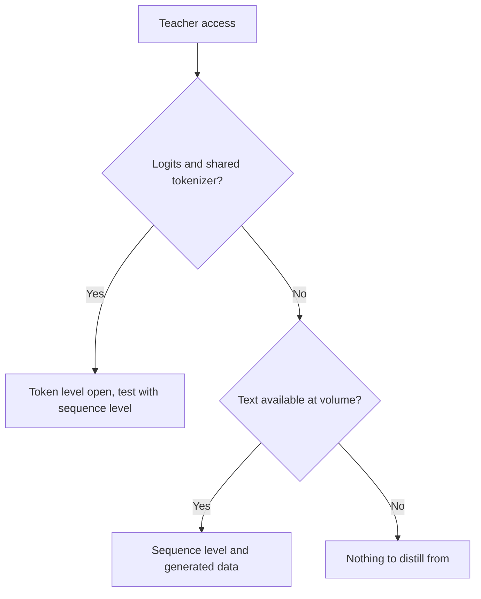

# 序列与合成数据：层级、流水线、过滤器与条款

第 3 和第 4 阶段，压缩成便于查阅的形式。[第 8 课](../lessons/0008-sequence-level-distillation.md)讲序列级蒸馏，[第 9 课](../lessons/0009-token-or-sequence.md)讲层级之间的选择，[第 10 课](../lessons/0010-distilling-from-generated-data.md)讲生成数据，[第 11 课](../lessons/0011-rationales-and-explanation-traces.md)讲推理依据与解释轨迹，[第 12 课](../lessons/0012-filtering-synthetic-data.md)讲过滤，[第 13 课](../lessons/0013-licensing-and-terms.md)讲许可与条款。

## token 级对序列级

| | token 级 | 序列级 |
|---|---|---|
| 学生读取 | 教师在每个位置上的分布 | 每个输入对应一条解码出的序列 |
| 损失 | 每个位置一个散度 | 针对文本的交叉熵 |
| 需要教师提供 | logit 和共享的词表 | 文本 |
| 保留 | 教师如何给备选项排序 | 教师整体的选择 |
| 丢掉 | 在某个位置上什么都不丢，但只限于你给它的那些前缀 | 备选项的概率 |

## Kim 和 Rush，英语到德语（表 1）

BLEU，贪心解码 / 束宽 5。教师是 4×1000 的 LSTM，2.21 亿参数。一篇论文，一个任务。

| 模型 | BLEU，K=1 / K=5 |
|---|---|
| 教师 | 17.7 / 19.5 |
| 学生 2×500（8400 万），原始数据 | 14.7 / 17.6 |
| 学生 2×500，词级 | 15.4 / 17.7 |
| 学生 2×500，序列级 | 18.9 / 19.0 |
| 学生 2×500，序列级加词级 | 18.7 / 18.9 |

| 事实 | 数字 |
|---|---|
| 2×500 序列级学生放在得分最高句子上的质量 | 16.9%（基线 0.9%） |
| 教师放在它自己得分最高句子上的质量，束宽 1 | 德语到英语 1.3%，泰语到英语 2.3% |
| GPU 上的速度，学生贪心对教师束宽 5 | 每秒 1051.3 个词对 101.9 个词（表 2） |
| 困惑度，2×500 序列级对基线 | 22.7 对 8.2，而 BLEU 更高 |

## 各个来源构建了什么

| 来源 | 教师 | 输入 | 目标 | 规模与成本，按其所述 |
|---|---|---|---|---|
| Self-Instruct | GPT-3 `davinci` | 175 个种子任务，通过自举扩展 | 指令、输入、输出 | 52,445 条指令，82,439 个实例；微调 338 美元 |
| Alpaca | text-davinci-003 | 同样的 175 个种子配对 | 指令和输出 | 5.2 万个配对，不到 500 美元；在 8 块 80GB A100 上运行 3 小时，不到 100 美元 |
| Distilling Step-by-Step | 540B PaLM，带少样本提示 | 基准的训练输入 | 标签和单独的推理依据 | e-SNLI 的 12.5% 就胜过了全数据微调（220M T5） |
| Orca | ChatGPT，然后 GPT-4 | 带 16 条系统消息的 FLAN-v2 查询 | 解释风格的回复 | 500 万条 ChatGPT，然后 100 万条 GPT-4 |
| phi-1 | GPT-3.5 | 受限的主题和读者 | 教科书和习题 | 不到 10 亿 token 的教科书，约 1.8 亿 token 的习题 |
| DeepSeek-R1 蒸馏 | R1 及其强化学习检查点 | 精选的推理提示词 | 过滤后的推理样本 | 约 80 万（60 万推理，20 万其他） |

## 上述流水线中的过滤器

| 过滤器 | 例子 | 它能抓住什么 | 它会漏掉什么 |
|---|---|---|---|
| 近似重复规则 | Self-Instruct：与池中每个成员的 ROUGE-L 低于 0.7 | 共享词语的换种说法 | 共享词很少的释义 |
| 启发式规则 | Self-Instruct：关键词、长度、输出重复输入 | 明显的垃圾 | 流畅的错误答案 |
| 质量分类器 | phi-1：对约 10 万个文件的 GPT-4 标注，在嵌入上的随机森林 | 大规模上教育价值低的内容 | 评判者自己的错误 |
| 检查器或拒绝采样 | R1：只保留正确的样本，由规则判定或由 DeepSeek-V3 评判 | 错误的最终答案 | 风格、开放式任务 |
| 格式过滤器 | R1：去掉混杂语言、长段落、代码块 | 不可读的思维链 | 错误但整齐的答案 |
| 去污染 | phi-1：对照 HumanEval 做嵌入和 AST 匹配，在 879.5K 里剪掉 42.5K 到 354K | 评测条目的相近变体 | 相似度度量看不见的泄漏 |

## 推理依据的设计

| 设计 | 推理依据是 | 测试时是否需要教师 | 论文中的结果 |
|---|---|---|---|
| 推理依据作为输入 | 一个输入 | 需要 | Distilling Step-by-Step 没有采用 |
| 单任务 | 与标签一起构成一条目标序列的一部分 | 不需要 | 在 ANLI 和 CQA 上低于标准微调（表 2） |
| 多任务 | 带有自己前缀的第二个输出 | 不需要 | 在全部四个上高于标准微调（表 2） |

## 许可问题，引文为 2026 年 10 月所读

引文可能过时。依赖它们之前，请阅读当前的文本，并把这张表当作阅读清单，而不是建议。

| 来源 | 文件 | 它所说的，引文 |
|---|---|---|
| OpenAI 使用条款（世界其他地区），2026 年 1 月 1 日生效 | [条款](https://openai.com/policies/row-terms-of-use/) | Cannot "Use Output to develop models that compete with OpenAI." |
| Llama 3.1 社区许可，第 1.b.i 条 | [许可](https://github.com/meta-llama/llama-models/blob/main/models/llama3_1/LICENSE) | Using outputs "to create, train, fine tune, or otherwise improve an AI model, which is distributed or made available" means you "shall also include “Llama” at the beginning of any such AI model name." |
| Llama 3.1，同一条 | 同上 | 分发这些材料，或包含另一个 AI 模型的产品，要求显示 "Built with Llama"，并提供协议的副本 |
| Alpaca 博客 | [Alpaca](https://crfm.stanford.edu/2023/03/13/alpaca.html) | 仅用于学术研究；作者给了三个理由，其中之一是教师的条款 |

## 从教师生成数据之前

| 步骤 | 记录 |
|---|---|
| 教师的条款 | 文件、URL、阅读日期、生效日期 |
| 开放权重的许可 | 名称、版本、命名和署名义务、使用政策 |
| 提示词和种子数据 | 来源和许可 |
| 打算的用途 | 研究、内部、分发或商业 |
| 来源出处 | 每个样本上的教师、版本和生成日期 |

## 决策：教师暴露什么

