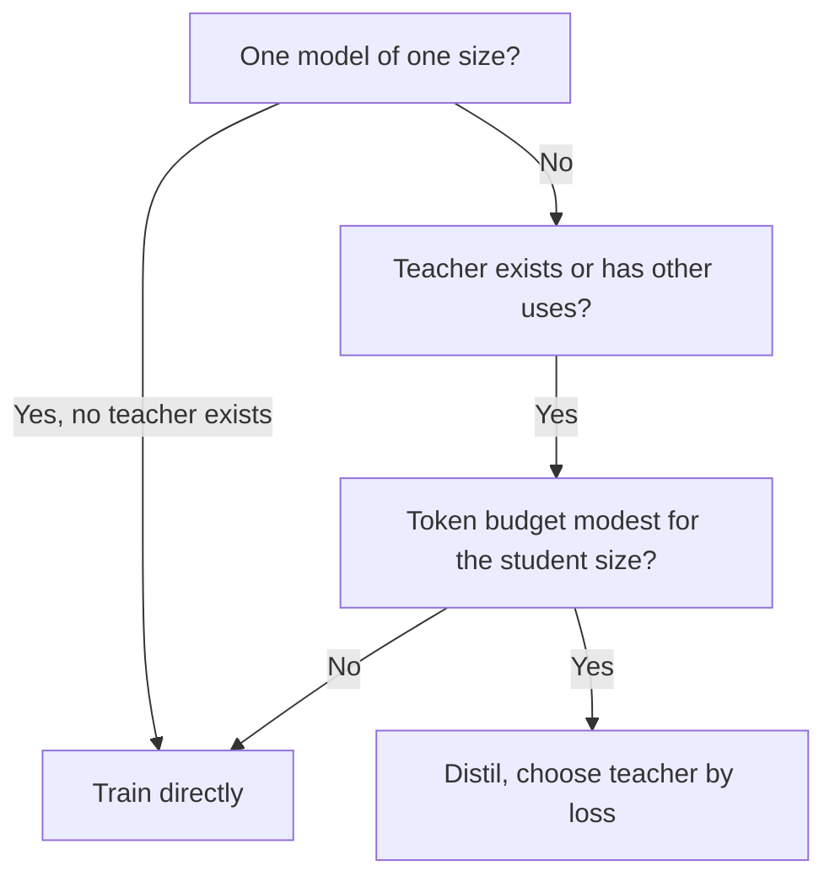

# Dimensionar y medir: tamaño del estudiante, costo del profesor y una eval honesta

Las etapas 7 y 8 comprimidas para consulta. La [lección 20](../lessons/0020-choosing-student-size.md) cubre cuándo destilar supera a entrenar directamente, la [lección 21](../lessons/0021-data-volume-and-teacher-cost.md) el costo del profesor y el volumen de datos, la [lección 22](../lessons/0022-student-against-teacher.md) el acuerdo frente a la calidad en la tarea, y la [lección 23](../lessons/0023-an-honest-distillation-eval.md) los baselines y las comprobaciones de una eval honesta.

## Cuándo la destilación supera a entrenar directamente al estudiante

Busbridge et al. 2025, resultados de un paper sobre transformers de 143M a 12.6B de parámetros y hasta 512B de tokens, medidos en entropía cruzada.

| Condición | Fuente |
|---|---|
| La destilación no puede superar al aprendizaje supervisado cuando ambos reciben suficientes datos o cómputo | Sección 1 |
| Es más eficiente cuando el cómputo o los tokens totales del estudiante se mantienen bajo un umbral que depende del tamaño del estudiante | Secciones 1 y 5.1 |
| Y ya existe un profesor, o el profesor tiene usos más allá de una destilación | Secciones 1 y 5.3 |
| Un estudiante, el profesor hay que entrenarlo: el aprendizaje supervisado suele ser preferible | Resumen y sección 5.3 |
| Destilar una familia, o el profesor además atiende tráfico: la destilación puede ser más barata | Sección 5.3 |

## La brecha de capacidad en la ley

| Hallazgo | Fuente |
|---|---|
| La pérdida del estudiante depende del tamaño y de los tokens del profesor solo a través de la entropía cruzada del profesor | Sección 1, Figura 3b |
| La pérdida del estudiante baja al mejorar el profesor, alcanza un óptimo y luego sube | Figura 4 |
| La brecha trata de la capacidad de aprendizaje, no solo del tamaño relativo | Sección 1 |
| Para un presupuesto de tokens fijo, la pérdida del mejor profesor baja al crecer el estudiante | Sección 5.2 |
| No te lleves del paper una razón concreta de tamaño profesor a estudiante | Consejo de esta hoja |

## Las cuatro configuraciones de cómputo

| Configuración | Inferencia del profesor | Preentrenamiento del profesor | Encaja con |
|---|---|---|---|
| Mejor caso, totalmente amortizado | No cargada | No cargado | El profesor existe, usado en otro sitio |
| Inferencia del profesor | Cargada | No cargado | Profesor existente ejecutado sobre tus datos |
| Preentrenamiento del profesor | No cargada | Cargado | Entrenar una vez, almacenar logits, muchos estudiantes |
| Preentrenamiento más inferencia | Cargada | Cargado | Entrenar un profesor para un estudiante |

De la Tabla 2 del paper. Basada en logits, así que pone precio a la puntuación y no a la generación.

## Aritmética del costo

Aproximaciones. Ignoran la atención, que crece con la longitud de contexto, y cuentan cada parámetro por igual. El paper no usa 2N para modelos pequeños y contextos largos (sección 5).

| Cantidad | Fórmula | Notas |
|---|---|---|
| Entrenamiento del estudiante | 6 × N_student × D | Unos 2 de forward más 4 de backward por parámetro por token |
| Puntuación del profesor (logits) | 2 × N_teacher × D | Solo forward, sobre los mismos D tokens |
| Generación del profesor (a nivel de secuencia) | 2 × N_teacher × G | G son los tokens generados. Una extensión, no está en el paper |
| Costo del profesor / costo del estudiante | N_teacher / (3 × N_student) | La misma D en ambos lados |

| Caso resuelto | Profesor | Estudiante | Razón |
|---|---|---|---|
| Estudiante de 1B, 100B de tokens, puntuación con profesor de 7B | 1.4e21 | 6.0e20 | 2.3 |
| Igual, puntuación con profesor de 70B | 1.4e22 | 6.0e20 | 23 |
| Estudiante de 1B, 50B de tokens, puntuación con profesor de 8B | 8.0e20 | 3.0e20 | 2.7 |
| Un profesor de 70B genera 1B de tokens, estudiante de 3B, dos épocas | 1.4e20 | 3.6e19 | 3.9 |
| Cuatro estudiantes de 1B comparten un pase de puntuación de 7B sobre 100B de tokens | 1.4e21 una vez | 6.0e20 cada uno | 9.5e20 por estudiante en total, frente a 2.0e21 para uno |

Los FLOPs subestiman el costo de la generación, que mantiene el hardware poco utilizado. Mide los tokens por segundo antes de citar un presupuesto. Almacenar logits cuesta extra y no está en estos números.

## Cuántos datos

| Punto | Fuente |
|---|---|
| Con un profesor fijo, la ventaja de la destilación se encoge al crecer el presupuesto de tokens, y el aprendizaje supervisado acaba alcanzándola | Paper, sección 5.1, Figura 6 |
| El umbral donde gana el aprendizaje supervisado crece con el tamaño del estudiante | Paper, sección 5.3 |
| Minitron 8B entrenado con 94B de tokens, frente a 3.8T de Nemotron-3 8B, unas 40 veces menos | Paper de Minitron, Tabla 2 |
| Ese estudiante se podó de un profesor de 15B, así que no partió de cero | Paper de Minitron |
| Su ahorro de 1.8 veces a nivel de familia cuenta los pasos de entrenamiento propios de cada modelo, sin término de forward pass del profesor en las frases que lo describen | Paper de Minitron, sección 4.1 |

## Fidelidad frente a calidad en la tarea

| Medida | Definición | Fuente |
|---|---|---|
| Acuerdo top-1 | Proporción de entradas en las que estudiante y profesor eligen la misma respuesta principal | Stanton et al., sección 3.2 |
| KL predictiva promedio | KL media de la distribución del profesor a la del estudiante | Stanton et al., sección 3.2 |
| Calidad en la tarea | Puntuación del estudiante frente a las respuestas correctas | Cualquier benchmark |

| Dato | Consecuencia | Fuente |
|---|---|---|
| Dos modelos con 55 y 95 por ciento de precisión pueden coincidir como máximo en el 60 por ciento | El acuerdo está acotado por la brecha de precisión, así que léelo frente a ese tope | Stanton et al., sección 3.2 |
| Compara con un estudiante destilado de un profesor independiente | Muestra si el acuerdo vino de la destilación o de que ambos modelos generalizan | Stanton et al., sección 3.2 |
| Un estudiante autodestilado puede superar a su profesor por no copiarlo | Una menor fidelidad puede significar una mayor calidad | Stanton et al., secciones 4.1 y 4.2 |
| Un estudiante con datos no vistos coincidía más con su profesor y era menos preciso | Una mayor fidelidad no compra una mayor precisión | Stanton et al., sección 5 |
| Alrededor del 70 por ciento de las salidas de imitación valoradas como iguales o mejores que ChatGPT, pero se cerró poca brecha en benchmarks | Las valoraciones premian el estilo | Gudibande et al., Figura 1 |
| NQ con 13B: base 20, imitación amplia 15, imitación dirigida 27, ChatGPT 31 | Una capacidad puede caer mientras las valoraciones suben | Gudibande et al., Tabla 1 |

Stanton et al. estudian sobre todo clasificadores de imágenes. Aplicar sus métricas a un LLM posición por posición es la adaptación de este track.

## La cuadrícula de capacidades

| Capacidad | Acuerdo con el profesor | Calidad en la tarea, estudiante | Calidad en la tarea, profesor | Calidad en la tarea, baseline del mismo tamaño |
|---|---|---|---|---|
| Una fila por capacidad de la que dependes | Top-1 o KL sobre prompts held-out de ese tipo | Puntuación por tarea | Puntuación por tarea | Puntuación por tarea |

## Una eval honesta, comprobada

| Comprobación | Qué previene |
|---|---|
| Tres modelos: profesor, estudiante, modelo del mismo tamaño entrenado sin destilación con los mismos datos o cómputo | Acreditar a la destilación lo que habría hecho el entrenamiento directo |
| Enunciar los datos o el cómputo del baseline antes de ver los resultados | Elegir el baseline para que encaje con el resultado |
| Tareas fuera de los prompts de destilación, informadas por separado | Un promedio que oculta las tareas que los datos no cubrieron |
| Fuente de cada prompt de destilación registrada, elementos de evaluación y casi duplicados eliminados de los prompts y de las generaciones | Puntuar la exposición en lugar de la habilidad |
| Mismo harness, mismos prompts, misma decodificación, misma puntuación para los tres | Una brecha que viene de la configuración |
| Deltas por tarea con recuentos de elementos | Un promedio positivo sobre tareas negativas |
| Brecha comprobada frente al ruido | Leer como real una brecha de 6 puntos sobre 100 elementos |

Para la fórmula del ruido y la comparación pareada, usa la hoja [Go/No-Go](../../evals/reference/go-no-go.md). Para la contaminación, usa la hoja [Datos held-out y contaminación](../../evals/reference/held-out-data-and-contamination.md). Para qué mantener fijo en una ejecución, usa la hoja [Harness de evals](../../evals/reference/eval-harness.md).

## Un ejemplo de destilado frente a directo

Informe de DeepSeek-R1, Tabla 16 (apéndice F.1). Base Qwen2.5-32B en ambas filas, ninguna igualada en datos ni en cómputo.

| Modelo | AIME 2024 pass@1 | MATH-500 pass@1 | GPQA Diamond pass@1 | LiveCodeBench pass@1 |
|---|---|---|---|---|
| Qwen2.5-32B-Zero (RL a gran escala, más de 10K pasos) | 47.0 | 91.6 | 55.0 | 40.2 |
| DeepSeek-R1-Distill-Qwen-32B (destilado) | 72.6 | 94.3 | 62.1 | 57.2 |

La propia configuración de un informe. Es un baseline directo de un método distinto, no una ejecución supervisada con recursos igualados.

## Fuentes

- [Paper: "Distillation Scaling Laws", Busbridge et al., 2025](https://arxiv.org/abs/2502.08606)
- [Paper: "Compact Language Models via Pruning and Knowledge Distillation", Muralidharan et al., 2024](https://arxiv.org/abs/2407.14679)
- [Paper: "Does Knowledge Distillation Really Work?", Stanton et al., 2021](https://arxiv.org/abs/2106.05945)
- [Paper: "The False Promise of Imitating Proprietary LLMs", Gudibande et al., 2023](https://arxiv.org/abs/2305.15717)
- [Paper: "DeepSeek-R1: Incentivizing Reasoning Capability in LLMs via Reinforcement Learning", DeepSeek-AI, 2025](https://arxiv.org/abs/2501.12948)
- [Preentrenamiento](../../pretraining/) y [Evals](../../evals/), los tracks vecinos para la contabilidad de cómputo y la construcción de evals
