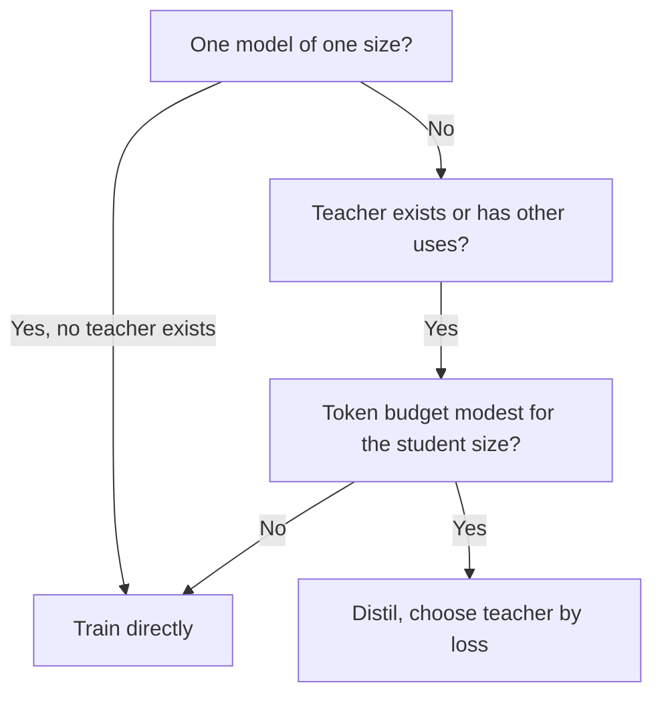

# Dimensionner et mesurer : taille de l'élève, coût de l'enseignant et eval honnête

Les étapes 7 et 8 condensées pour la consultation. La [leçon 20](../lessons/0020-choosing-student-size.md) couvre quand distiller bat l'entraînement direct, la [leçon 21](../lessons/0021-data-volume-and-teacher-cost.md) le coût de l'enseignant et le volume de données, la [leçon 22](../lessons/0022-student-against-teacher.md) l'accord contre la qualité sur la tâche, et la [leçon 23](../lessons/0023-an-honest-distillation-eval.md) les références et les contrôles d'une eval honnête.

## Quand la distillation bat l'entraînement direct de l'élève

Busbridge et al. 2025, les résultats d'un article sur des transformers de 143M à 12.6B de paramètres et jusqu'à 512B tokens, mesurés en entropie croisée.

| Condition | Source |
|---|---|
| La distillation ne peut pas battre l'apprentissage supervisé quand les deux disposent d'assez de données ou de calcul | Section 1 |
| Elle est plus efficace quand le calcul ou les tokens totaux de l'élève restent sous un seuil dépendant de la taille de l'élève | Sections 1 et 5.1 |
| Et qu'un enseignant existe déjà, ou que l'enseignant a des usages au-delà d'une seule distillation | Sections 1 et 5.3 |
| Un élève, l'enseignant doit être entraîné : l'apprentissage supervisé est généralement préférable | Résumé et section 5.3 |
| Distiller une famille, ou l'enseignant sert aussi du trafic : la distillation peut être moins chère | Section 5.3 |

## L'écart de capacité dans la loi

| Constat | Source |
|---|---|
| La loss de l'élève dépend de la taille et des tokens de l'enseignant seulement à travers l'entropie croisée de l'enseignant | Section 1, figure 3b |
| La loss de l'élève baisse à mesure que l'enseignant s'améliore, atteint un optimum, puis remonte | Figure 4 |
| L'écart concerne la capacité d'apprentissage, pas seulement la taille relative | Section 1 |
| Pour un budget de tokens fixe, la loss du meilleur enseignant baisse quand l'élève grandit | Section 5.2 |
| N'emportez pas de l'article un rapport de taille enseignant-élève précis | Conseil de cette fiche |

## Les quatre cadres de calcul

| Cadre | Inférence de l'enseignant | Pré-entraînement de l'enseignant | Convient à |
|---|---|---|---|
| Meilleur cas, entièrement amorti | Non facturée | Non facturé | L'enseignant existe, utilisé ailleurs |
| Inférence de l'enseignant | Facturée | Non facturé | Enseignant existant exécuté sur vos données |
| Pré-entraînement de l'enseignant | Non facturée | Facturé | Entraîner une fois, stocker les logits, de nombreux élèves |
| Pré-entraînement plus inférence | Facturée | Facturé | Entraîner un enseignant pour un seul élève |

Tiré du tableau 2 de l'article. Fondé sur les logits, il chiffre donc la notation et non la génération.

## Arithmétique du coût

Des approximations. Elles ignorent l'attention, qui croît avec la longueur de contexte, et elles comptent chaque paramètre de la même façon. L'article n'utilise pas lui-même 2N pour les petits modèles et les longs contextes (section 5).

| Grandeur | Formule | Notes |
|---|---|---|
| Entraînement de l'élève | 6 × N_student × D | Environ 2 en passe avant plus 4 en passe arrière par paramètre et par token |
| Notation par l'enseignant (logits) | 2 × N_teacher × D | Passe avant seulement, sur les mêmes D tokens |
| Génération par l'enseignant (niveau de la séquence) | 2 × N_teacher × G | G est le nombre de tokens générés. Une extension, pas dans l'article |
| Coût de l'enseignant / coût de l'élève | N_teacher / (3 × N_student) | Même D des deux côtés |

| Cas détaillé | Enseignant | Élève | Rapport |
|---|---|---|---|
| Élève de 1B, 100B tokens, notation par un enseignant de 7B | 1.4e21 | 6.0e20 | 2.3 |
| Idem, notation par un enseignant de 70B | 1.4e22 | 6.0e20 | 23 |
| Élève de 1B, 50B tokens, notation par un enseignant de 8B | 8.0e20 | 3.0e20 | 2.7 |
| Un enseignant de 70B génère 1B tokens, élève de 3B, deux époques | 1.4e20 | 3.6e19 | 3.9 |
| Quatre élèves de 1B partagent une passe de notation d'un enseignant de 7B sur 100B tokens | 1.4e21 une fois | 6.0e20 chacun | 9.5e20 par élève tout compris, contre 2.0e21 pour un seul |

Les FLOPs sous-estiment le coût de la génération, qui utilise mal le matériel. Mesurez les tokens par seconde avant de citer un budget. Le stockage des logits coûte en plus et ne figure pas dans ces nombres.

## Combien de données

| Point | Source |
|---|---|
| Avec un enseignant fixe, l'avantage de la distillation se réduit quand le budget de tokens grandit, et l'apprentissage supervisé finit par rattraper | Article, section 5.1, figure 6 |
| Le seuil à partir duquel l'apprentissage supervisé gagne croît avec la taille de l'élève | Article, section 5.3 |
| Minitron 8B entraîné sur 94B tokens, contre 3.8T pour Nemotron-3 8B, environ 40 fois moins | Article Minitron, tableau 2 |
| Cet élève a été élagué à partir d'un enseignant de 15B, il ne partait donc pas de zéro | Article Minitron |
| Son économie de 1.8 fois pour la famille compte les pas d'entraînement propres à chaque modèle, sans terme de passe avant de l'enseignant dans les phrases qui la décrivent | Article Minitron, section 4.1 |

## Fidélité contre qualité sur la tâche

| Mesure | Définition | Source |
|---|---|---|
| Accord top-1 | Part des entrées où l'élève et l'enseignant choisissent la même meilleure réponse | Stanton et al., section 3.2 |
| KL prédictive moyenne | KL moyenne de la distribution de l'enseignant vers celle de l'élève | Stanton et al., section 3.2 |
| Qualité sur la tâche | Score de l'élève par rapport aux bonnes réponses | N'importe quel benchmark |

| Fait | Conséquence | Source |
|---|---|---|
| Deux modèles à 55 et 95 pour cent de précision peuvent s'accorder sur au plus 60 pour cent | L'accord est plafonné par l'écart de précision, lisez-le donc par rapport à ce plafond | Stanton et al., section 3.2 |
| Comparer avec un élève distillé à partir d'un enseignant indépendant | Montre si l'accord vient de la distillation ou du fait que les deux modèles généralisent | Stanton et al., section 3.2 |
| Un élève auto-distillé peut battre son enseignant en échouant à le copier | Une fidélité plus basse peut signifier une qualité plus haute | Stanton et al., sections 4.1 et 4.2 |
| Un élève sur données non vues s'accordait davantage avec son enseignant et était moins précis | Une fidélité plus haute n'achète pas une précision plus haute | Stanton et al., section 5 |
| Environ 70 pour cent des sorties d'imitation jugées égales ou meilleures que ChatGPT, et pourtant peu d'écart de benchmark comblé | Les évaluations récompensent le style | Gudibande et al., figure 1 |
| NQ à 13B : base 20, imitation large 15, imitation ciblée 27, ChatGPT 31 | Une capacité peut baisser pendant que les évaluations montent | Gudibande et al., tableau 1 |

Stanton et al. étudient surtout des classifieurs d'images. Appliquer leurs métriques à un LLM position par position est l'adaptation de ce parcours.

## La grille des capacités

| Capacité | Accord avec l'enseignant | Qualité sur la tâche, élève | Qualité sur la tâche, enseignant | Qualité sur la tâche, référence de même taille |
|---|---|---|---|---|
| Une ligne par capacité dont vous dépendez | Top-1 ou KL sur des prompts held-out de ce genre | Score par tâche | Score par tâche | Score par tâche |

## Une eval honnête, contrôlée

| Contrôle | Ce qu'il évite |
|---|---|
| Trois modèles : enseignant, élève, modèle de même taille entraîné sans distillation sur les mêmes données ou avec le même calcul | Attribuer à la distillation ce que l'entraînement direct aurait fait |
| Énoncer les données ou le calcul de la référence avant de voir les résultats | Choisir la référence pour qu'elle colle au résultat |
| Des tâches en dehors des prompts de distillation, rapportées séparément | Une moyenne qui cache les tâches que les données ne couvraient pas |
| Source de chaque prompt de distillation consignée, éléments d'évaluation et quasi-doublons retirés des prompts et des générations | Noter l'exposition au lieu de la compétence |
| Même harness, mêmes prompts, même décodage, même notation pour les trois | Un écart qui vient du montage |
| Deltas par tâche avec nombres d'éléments | Une moyenne positive sur des tâches négatives |
| Écart contrôlé par rapport au bruit | Lire comme réel un écart de 6 points sur 100 éléments |

Pour la formule du bruit et la comparaison appariée, utilisez la fiche [Go/No-Go](../../evals/reference/go-no-go.md). Pour la contamination, utilisez la fiche [Données held-out et contamination](../../evals/reference/held-out-data-and-contamination.md). Pour ce qu'il faut garder fixe dans un run, utilisez la fiche [Harness d'eval](../../evals/reference/eval-harness.md).

## Un exemple distillé contre direct

Rapport DeepSeek-R1, tableau 16 (annexe F.1). Base Qwen2.5-32B dans les deux lignes, aucune des deux appariée sur les données ou le calcul.

| Modèle | AIME 2024 pass@1 | MATH-500 pass@1 | GPQA Diamond pass@1 | LiveCodeBench pass@1 |
|---|---|---|---|---|
| Qwen2.5-32B-Zero (RL à grande échelle, plus de 10K pas) | 47.0 | 91.6 | 55.0 | 40.2 |
| DeepSeek-R1-Distill-Qwen-32B (distillé) | 72.6 | 94.3 | 62.1 | 57.2 |

La configuration propre d'un seul rapport. C'est une référence directe d'une autre méthode, pas un run supervisé à ressources appariées.

## Sources

- [Article : "Distillation Scaling Laws", Busbridge et al., 2025](https://arxiv.org/abs/2502.08606)
- [Article : "Compact Language Models via Pruning and Knowledge Distillation", Muralidharan et al., 2024](https://arxiv.org/abs/2407.14679)
- [Article : "Does Knowledge Distillation Really Work?", Stanton et al., 2021](https://arxiv.org/abs/2106.05945)
- [Article : "The False Promise of Imitating Proprietary LLMs", Gudibande et al., 2023](https://arxiv.org/abs/2305.15717)
- [Article : "DeepSeek-R1: Incentivizing Reasoning Capability in LLMs via Reinforcement Learning", DeepSeek-AI, 2025](https://arxiv.org/abs/2501.12948)
- [Pré-entraînement](../../pretraining/) et [Evals](../../evals/), les parcours voisins pour la comptabilité du calcul et la construction d'evals
