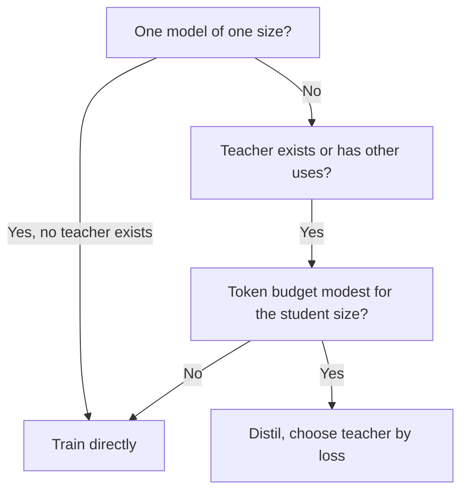

# Sizing और Measuring: Student का आकार, Teacher की लागत और ईमानदार Eval

चरण 7 और 8 का संक्षिप्त रूप, खोजने के लिए। [पाठ 20](../lessons/0020-choosing-student-size.md) कवर करता है कि distilling सीधे train करने से कब बेहतर है, [पाठ 21](../lessons/0021-data-volume-and-teacher-cost.md) teacher की लागत और data की मात्रा, [पाठ 22](../lessons/0022-student-against-teacher.md) task की गुणवत्ता के मुक़ाबले agreement, और [पाठ 23](../lessons/0023-an-honest-distillation-eval.md) ईमानदार eval के baselines और जाँचें।

## Distillation student को सीधे train करने से कब बेहतर है

Busbridge et al. 2025, 143M से 12.6B parameters और 512B tokens तक के transformers पर एक पेपर के नतीजे, cross-entropy में मापे हुए।

| शर्त | स्रोत |
|---|---|
| जब दोनों को पर्याप्त data या compute मिले तो distillation, supervised learning को नहीं हरा सकता | Section 1 |
| वह तब ज़्यादा कुशल है जब student का कुल compute या tokens student-आकार-निर्भर threshold के नीचे रहें | Sections 1 और 5.1 |
| और teacher पहले से मौजूद हो, या teacher के एक distillation से परे उपयोग हों | Sections 1 और 5.3 |
| एक student, teacher को train करना पड़े: supervised learning आम तौर पर बेहतर | Abstract और section 5.3 |
| Models का परिवार distil करना, या teacher traffic भी सँभालता है: distillation सस्ता हो सकता है | Section 5.3 |

## नियम में capacity gap

| खोज | स्रोत |
|---|---|
| Student का loss teacher के आकार और tokens पर सिर्फ़ teacher की cross-entropy के ज़रिए निर्भर करता है | Section 1, Figure 3b |
| Teacher के सुधरने के साथ student का loss गिरता है, एक इष्टतम पर पहुँचता है, फिर बढ़ता है | Figure 4 |
| Gap सीखने की क्षमता के बारे में है, सिर्फ़ सापेक्ष आकार के नहीं | Section 1 |
| तय token बजट के लिए, student के बढ़ने पर सबसे अच्छे teacher का loss गिरता है | Section 5.2 |
| पेपर से teacher-से-student आकार का कोई ख़ास अनुपात बाहर न ले जाएँ | इस शीट की सलाह |

## चार compute settings

| Setting | Teacher inference | Teacher pretraining | कब फ़िट |
|---|---|---|---|
| सबसे अच्छा मामला, पूरी तरह amortized | शुल्क नहीं | शुल्क नहीं | Teacher मौजूद है, कहीं और इस्तेमाल होता है |
| Teacher inference | शुल्क | शुल्क नहीं | मौजूदा teacher आपके data पर चलाया जाता है |
| Teacher pretraining | शुल्क नहीं | शुल्क | एक बार train करें, logits सहेजें, कई students |
| Pretraining और inference | शुल्क | शुल्क | एक student के लिए teacher train करना |

पेपर की Table 2 से। Logit-आधारित है, इसलिए scoring की क़ीमत लगाता है, generation की नहीं।

## लागत का गणित

सन्निकटन। वे attention को नज़रअंदाज़ करते हैं, जो context की लंबाई के साथ बढ़ता है, और हर parameter को बराबर गिनते हैं। पेपर ख़ुद छोटे models और लंबे contexts के लिए 2N इस्तेमाल नहीं करता (section 5)।

| राशि | सूत्र | टिप्पणी |
|---|---|---|
| Student training | 6 × N_student × D | प्रति parameter प्रति token लगभग 2 forward जमा 4 backward |
| Teacher scoring (logits) | 2 × N_teacher × D | सिर्फ़ forward, उन्हीं D tokens पर |
| Teacher generating (sequence-level) | 2 × N_teacher × G | G generate हुए tokens हैं। विस्तार, पेपर में नहीं |
| Teacher लागत / student लागत | N_teacher / (3 × N_student) | दोनों तरफ़ वही D |

| हल किया मामला | Teacher | Student | अनुपात |
|---|---|---|---|
| 1B student, 100B tokens, 7B teacher scoring | 1.4e21 | 6.0e20 | 2.3 |
| वही, 70B teacher scoring | 1.4e22 | 6.0e20 | 23 |
| 1B student, 50B tokens, 8B teacher scoring | 8.0e20 | 3.0e20 | 2.7 |
| 70B teacher 1B tokens generate करता है, 3B student, दो epochs | 1.4e20 | 3.6e19 | 3.9 |
| चार 1B students 100B tokens पर एक 7B scoring pass साझा करते हैं | 1.4e21 एक बार | 6.0e20 हर एक | प्रति student कुल 9.5e20, अकेले के लिए 2.0e21 के मुक़ाबले |

FLOPs, generation की लागत को कम बताते हैं, जो hardware का ख़राब इस्तेमाल करता है। बजट बताने से पहले प्रति सेकंड tokens मापें। Logits सहेजने की अलग लागत है और इन संख्याओं में नहीं है।

## कितना data

| बिंदु | स्रोत |
|---|---|
| Teacher के तय होने पर, token बजट बढ़ने के साथ distillation की बढ़त घटती है, और supervised learning आख़िरकार पकड़ लेती है | पेपर, section 5.1, Figure 6 |
| जिस threshold पर supervised learning जीतती है वह student के आकार के साथ बढ़ता है | पेपर, section 5.3 |
| Minitron 8B 94B tokens पर train हुआ, Nemotron-3 8B के 3.8T के मुक़ाबले, लगभग 40 गुना कम | Minitron पेपर, Table 2 |
| वह student 15B teacher से prune किया गया था, इसलिए वह शून्य से शुरू नहीं हुआ | Minitron पेपर |
| उसकी 1.8 गुना परिवार-बचत हर model के अपने training steps गिनती है, उसका वर्णन करने वाले वाक्यों में teacher forward-pass का कोई term नहीं | Minitron पेपर, section 4.1 |

## Fidelity बनाम task की गुणवत्ता

| माप | परिभाषा | स्रोत |
|---|---|---|
| Top-1 agreement | Inputs का वह हिस्सा जहाँ student और teacher एक ही शीर्ष उत्तर चुनें | Stanton et al., section 3.2 |
| Average predictive KL | Teacher के distribution से student के distribution तक का औसत KL | Stanton et al., section 3.2 |
| Task की गुणवत्ता | सही उत्तरों के विरुद्ध student का score | कोई भी benchmark |

| तथ्य | नतीजा | स्रोत |
|---|---|---|
| 55 और 95 प्रतिशत accuracy वाले दो models अधिकतम 60 प्रतिशत पर सहमत हो सकते हैं | Agreement accuracy के फ़ासले से सीमित है, इसलिए उसे उस सीमा के विरुद्ध पढ़ें | Stanton et al., section 3.2 |
| स्वतंत्र teacher से distil हुए student से तुलना करें | दिखाता है कि agreement distillation से आया या दोनों models के generalize करने से | Stanton et al., section 3.2 |
| Self-distilled student अपने teacher की नक़ल न करके उसे हरा सकता है | कम fidelity का मतलब ऊँची गुणवत्ता हो सकता है | Stanton et al., sections 4.1 और 4.2 |
| अनदेखे data पर student teacher से ज़्यादा सहमत था और कम सटीक | ऊँची fidelity ऊँची accuracy नहीं ख़रीदती | Stanton et al., section 5 |
| लगभग 70 प्रतिशत imitation outputs ChatGPT के बराबर या बेहतर आँके गए, फिर भी benchmark का फ़ासला कम पटा | Ratings style को पुरस्कृत करती हैं | Gudibande et al., Figure 1 |
| 13B पर NQ: base 20, broad imitation 15, targeted imitation 27, ChatGPT 31 | Ratings बढ़ने पर भी एक क्षमता गिर सकती है | Gudibande et al., Table 1 |

Stanton et al. ज़्यादातर image classifiers का अध्ययन करते हैं। उनके metrics को LLM पर position-दर-position लागू करना इस track का रूपांतरण है।

## क्षमता grid

| क्षमता | Teacher से agreement | Task की गुणवत्ता, student | Task की गुणवत्ता, teacher | Task की गुणवत्ता, उसी आकार का baseline |
|---|---|---|---|---|
| हर उस क्षमता के लिए एक पंक्ति जिस पर आप निर्भर हैं | उस तरह के held-out prompts पर Top-1 या KL | प्रति-task score | प्रति-task score | प्रति-task score |

## ईमानदार eval, जाँचा हुआ

| जाँच | यह किससे बचाती है |
|---|---|
| तीन models: teacher, student, उसी data या compute पर बिना distillation के train हुआ उसी आकार का model | Distillation को उस काम का श्रेय देना जो सीधी training कर लेती |
| नतीजे देखने से पहले baseline का data या compute बताएँ | नतीजे के हिसाब से baseline चुनना |
| Distillation prompts से बाहर के tasks, अलग से बताए हुए | ऐसा औसत जो उन tasks को छिपाए जिन्हें data ने कवर नहीं किया |
| हर distillation prompt का स्रोत दर्ज, evaluation items और near-duplicates prompts और generations से हटाए गए | कौशल की जगह exposure को score करना |
| तीनों के लिए वही harness, वही prompts, वही decoding, वही scoring | ऐसा फ़ासला जो setup से आता है |
| Item counts के साथ प्रति-task अंतर | नकारात्मक tasks के ऊपर सकारात्मक औसत |
| फ़ासला noise के विरुद्ध जाँचा गया | 100 items पर 6-अंक के फ़ासले को असली पढ़ना |

Noise के सूत्र और paired comparison के लिए [Go/No-Go शीट](../../evals/reference/go-no-go.md) इस्तेमाल करें। Contamination के लिए [Held-Out Data और Contamination शीट](../../evals/reference/held-out-data-and-contamination.md)। किसी run में क्या तय रखना है, इसके लिए [Eval Harness शीट](../../evals/reference/eval-harness.md)।

## Distilled-बनाम-सीधा का एक उदाहरण

DeepSeek-R1 report, Table 16 (appendix F.1)। दोनों पंक्तियों में Qwen2.5-32B base, कोई भी data या compute पर matched नहीं।

| Model | AIME 2024 pass@1 | MATH-500 pass@1 | GPQA Diamond pass@1 | LiveCodeBench pass@1 |
|---|---|---|---|---|
| Qwen2.5-32B-Zero (बड़े पैमाने का RL, 10K से ज़्यादा steps) | 47.0 | 91.6 | 55.0 | 40.2 |
| DeepSeek-R1-Distill-Qwen-32B (distilled) | 72.6 | 94.3 | 62.1 | 57.2 |

एक report की अपनी setup। यह अलग विधि का सीधा baseline है, matched-संसाधन वाला supervised run नहीं।

## स्रोत

- [पेपर: "Distillation Scaling Laws", Busbridge et al., 2025](https://arxiv.org/abs/2502.08606)
- [पेपर: "Compact Language Models via Pruning and Knowledge Distillation", Muralidharan et al., 2024](https://arxiv.org/abs/2407.14679)
- [पेपर: "Does Knowledge Distillation Really Work?", Stanton et al., 2021](https://arxiv.org/abs/2106.05945)
- [पेपर: "The False Promise of Imitating Proprietary LLMs", Gudibande et al., 2023](https://arxiv.org/abs/2305.15717)
- [पेपर: "DeepSeek-R1: Incentivizing Reasoning Capability in LLMs via Reinforcement Learning", DeepSeek-AI, 2025](https://arxiv.org/abs/2501.12948)
- [Pretraining ट्रैक](../../pretraining/) और [Evals ट्रैक](../../evals/), compute के हिसाब और eval बनाने के लिए पड़ोसी tracks
