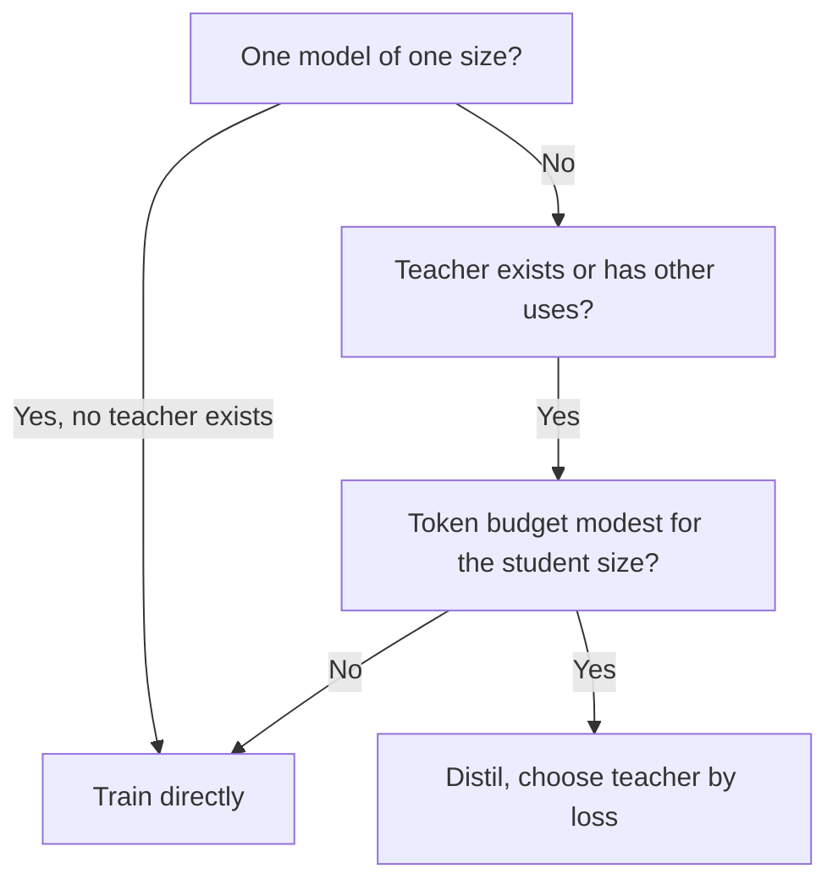

# Sizing and Measuring: Student Size, Teacher Cost and an Honest Eval

Stages 7 and 8 compressed for lookup. [Lesson 20](../lessons/0020-choosing-student-size.md) covers when distilling beats training directly, [lesson 21](../lessons/0021-data-volume-and-teacher-cost.md) the teacher's cost and data volume, [lesson 22](../lessons/0022-student-against-teacher.md) agreement against task quality, and [lesson 23](../lessons/0023-an-honest-distillation-eval.md) the baselines and checks of an honest eval.

## When distillation beats training the student directly

Busbridge et al. 2025, one paper's results on transformers from 143M to 12.6B parameters and up to 512B tokens, measured in cross-entropy.

| Condition | Source |
|---|---|
| Distillation cannot beat supervised learning when both get enough data or compute | Section 1 |
| It is more efficient when the student's total compute or tokens stay under a student-size-dependent threshold | Sections 1 and 5.1 |
| And a teacher already exists, or the teacher has uses beyond one distillation | Sections 1 and 5.3 |
| One student, teacher must be trained: supervised learning is generally preferable | Abstract and section 5.3 |
| Distilling a family, or the teacher also serves traffic: distillation may be cheaper | Section 5.3 |

## The capacity gap in the law

| Finding | Source |
|---|---|
| Student loss depends on teacher size and tokens only through the teacher's cross-entropy | Section 1, Figure 3b |
| Student loss falls as the teacher improves, reaches an optimum, then rises | Figure 4 |
| The gap is about learning capacity, not only relative size | Section 1 |
| For a fixed token budget, the best teacher's loss falls as the student grows | Section 5.2 |
| Do not carry a specific teacher-to-student size ratio out of the paper | This sheet's advice |

## The four compute settings

| Setting | Teacher inference | Teacher pretraining | Fits |
|---|---|---|---|
| Best case, fully amortized | Not charged | Not charged | Teacher exists, used elsewhere |
| Teacher inference | Charged | Not charged | Existing teacher run on your data |
| Teacher pretraining | Not charged | Charged | Train once, store logits, many students |
| Pretraining plus inference | Charged | Charged | Train a teacher for one student |

From the paper's Table 2. Logit-based, so it prices scoring and not generation.

## Cost arithmetic

Approximations. They ignore attention, which grows with context length, and they count every parameter equally. The paper does not use 2N itself for small models and long contexts (section 5).

| Quantity | Formula | Notes |
|---|---|---|
| Student training | 6 × N_student × D | About 2 forward plus 4 backward per parameter per token |
| Teacher scoring (logits) | 2 × N_teacher × D | Forward only, over the same D tokens |
| Teacher generating (sequence-level) | 2 × N_teacher × G | G is tokens generated. An extension, not in the paper |
| Teacher cost / student cost | N_teacher / (3 × N_student) | Same D on both sides |

| Worked case | Teacher | Student | Ratio |
|---|---|---|---|
| 1B student, 100B tokens, 7B teacher scoring | 1.4e21 | 6.0e20 | 2.3 |
| Same, 70B teacher scoring | 1.4e22 | 6.0e20 | 23 |
| 1B student, 50B tokens, 8B teacher scoring | 8.0e20 | 3.0e20 | 2.7 |
| 70B teacher generates 1B tokens, 3B student, two epochs | 1.4e20 | 3.6e19 | 3.9 |
| Four 1B students share one 7B scoring pass over 100B tokens | 1.4e21 once | 6.0e20 each | 9.5e20 per student all-in, against 2.0e21 for one |

FLOPs understate the cost of generation, which keeps hardware poorly utilised. Measure tokens per second before quoting a budget. Storing logits costs extra and is not in these numbers.

## How much data

| Point | Source |
|---|---|
| With a teacher fixed, distillation's edge shrinks as the token budget grows, and supervised learning eventually catches up | Paper, section 5.1, Figure 6 |
| The threshold where supervised learning wins grows with student size | Paper, section 5.3 |
| Minitron 8B trained on 94B tokens, against 3.8T for Nemotron-3 8B, about 40 times fewer | Minitron paper, Table 2 |
| That student was pruned from a 15B teacher, so it did not start from scratch | Minitron paper |
| Its 1.8 times family saving counts each model's own training steps, with no teacher forward-pass term in the sentences describing it | Minitron paper, section 4.1 |

## Fidelity against task quality

| Measure | Definition | Source |
|---|---|---|
| Top-1 agreement | Share of inputs where student and teacher pick the same top answer | Stanton et al., section 3.2 |
| Average predictive KL | Mean KL from the teacher's distribution to the student's | Stanton et al., section 3.2 |
| Task quality | Student's score against the correct answers | Any benchmark |

| Fact | Consequence | Source |
|---|---|---|
| Two models at 55 and 95 percent accuracy can agree on at most 60 percent | Agreement is capped by the accuracy gap, so read it against that cap | Stanton et al., section 3.2 |
| Compare with a student distilled from an independent teacher | Shows whether agreement came from the distillation or from both models generalising | Stanton et al., section 3.2 |
| A self-distilled student can beat its teacher by failing to copy it | Lower fidelity can mean higher quality | Stanton et al., sections 4.1 and 4.2 |
| A student on unseen data agreed more with its teacher and was less accurate | Higher fidelity does not buy higher accuracy | Stanton et al., section 5 |
| About 70 percent of imitation outputs rated equal or better than ChatGPT, yet little benchmark gap closed | Ratings reward style | Gudibande et al., Figure 1 |
| NQ at 13B: base 20, broad imitation 15, targeted imitation 27, ChatGPT 31 | One capability can fall while ratings rise | Gudibande et al., Table 1 |

Stanton et al. study mostly image classifiers. Applying their metrics to an LLM position by position is this track's adaptation.

## The capability grid

| Capability | Agreement with teacher | Task quality, student | Task quality, teacher | Task quality, same-size baseline |
|---|---|---|---|---|
| One row per capability you depend on | Top-1 or KL on held-out prompts of that kind | Per-task score | Per-task score | Per-task score |

## An honest eval, checked

| Check | What it prevents |
|---|---|
| Three models: teacher, student, same-size model trained without distillation on the same data or compute | Crediting distillation for what direct training would have done |
| State the baseline's data or compute before seeing results | Choosing the baseline to fit the result |
| Tasks outside the distillation prompts, reported separately | An average that hides the tasks the data did not cover |
| Source of every distillation prompt recorded, evaluation items and near-duplicates removed from prompts and generations | Scoring exposure instead of skill |
| Same harness, same prompts, same decoding, same scoring for all three | A gap that comes from the setup |
| Per-task deltas with item counts | A positive average over negative tasks |
| Gap checked against noise | Reading a 6-point gap on 100 items as real |

For the noise formula and the paired comparison, use the [go/no-go sheet](../../evals/reference/go-no-go.md). For contamination, use the [held-out data and contamination sheet](../../evals/reference/held-out-data-and-contamination.md). For what to hold fixed in a run, use the [eval harness sheet](../../evals/reference/eval-harness.md).

## A distilled-against-direct example

DeepSeek-R1 report, Table 16 (appendix F.1). Qwen2.5-32B base in both rows, neither matched on data or compute.

| Model | AIME 2024 pass@1 | MATH-500 pass@1 | GPQA Diamond pass@1 | LiveCodeBench pass@1 |
|---|---|---|---|---|
| Qwen2.5-32B-Zero (large-scale RL, over 10K steps) | 47.0 | 91.6 | 55.0 | 40.2 |
| DeepSeek-R1-Distill-Qwen-32B (distilled) | 72.6 | 94.3 | 62.1 | 57.2 |

One report's own setup. It is a direct baseline of a different method, not a matched-resource supervised run.

## Sources

- [Paper: "Distillation Scaling Laws", Busbridge et al., 2025](https://arxiv.org/abs/2502.08606)
- [Paper: "Compact Language Models via Pruning and Knowledge Distillation", Muralidharan et al., 2024](https://arxiv.org/abs/2407.14679)
- [Paper: "Does Knowledge Distillation Really Work?", Stanton et al., 2021](https://arxiv.org/abs/2106.05945)
- [Paper: "The False Promise of Imitating Proprietary LLMs", Gudibande et al., 2023](https://arxiv.org/abs/2305.15717)
- [Paper: "DeepSeek-R1: Incentivizing Reasoning Capability in LLMs via Reinforcement Learning", DeepSeek-AI, 2025](https://arxiv.org/abs/2501.12948)
- [Pretraining](../../pretraining/) and [Evals](../../evals/), the neighbouring tracks for compute accounting and eval building
