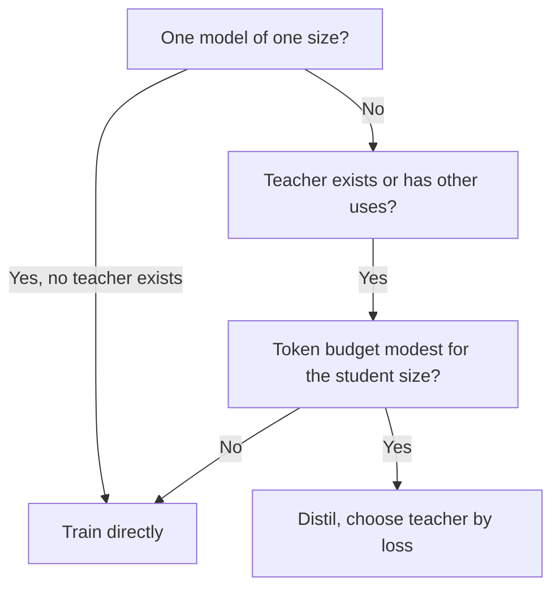

# Dimensionamento e Medição: Tamanho do Aluno, Custo do Professor e um Eval Honesto

As etapas 7 e 8 condensadas para consulta. A [lição 20](../lessons/0020-choosing-student-size.md) cobre quando destilar supera treinar diretamente, a [lição 21](../lessons/0021-data-volume-and-teacher-cost.md) o custo do professor e o volume de dados, a [lição 22](../lessons/0022-student-against-teacher.md) concordância contra qualidade na tarefa, e a [lição 23](../lessons/0023-an-honest-distillation-eval.md) os baselines e as verificações de um eval honesto.

## Quando a destilação supera treinar o aluno diretamente

Busbridge et al. 2025, resultados de um artigo em transformers de 143M a 12,6B de parâmetros e até 512B tokens, medidos em cross-entropy.

| Condição | Fonte |
|---|---|
| A destilação não consegue superar o aprendizado supervisionado quando ambos recebem dados ou compute suficientes | Seção 1 |
| Ela é mais eficiente quando o compute ou os tokens totais do aluno ficam abaixo de um limiar dependente do tamanho do aluno | Seções 1 e 5.1 |
| E já existe um professor, ou o professor tem usos além de uma destilação | Seções 1 e 5.3 |
| Um aluno, o professor precisa ser treinado: o aprendizado supervisionado geralmente é preferível | Resumo e seção 5.3 |
| Destilando uma família, ou o professor também atende tráfego: a destilação pode ser mais barata | Seção 5.3 |

## A lacuna de capacidade na lei

| Achado | Fonte |
|---|---|
| A loss do aluno depende do tamanho e dos tokens do professor apenas pela cross-entropy do professor | Seção 1, Figura 3b |
| A loss do aluno cai conforme o professor melhora, chega a um ótimo e depois sobe | Figura 4 |
| A lacuna é sobre capacidade de aprendizado, não apenas tamanho relativo | Seção 1 |
| Para um orçamento fixo de tokens, a loss do melhor professor cai conforme o aluno cresce | Seção 5.2 |
| Não leve uma razão específica de tamanho entre professor e aluno para fora do artigo | Conselho desta folha |

## Os quatro cenários de compute

| Cenário | Inferência do professor | Pré-treinamento do professor | Se encaixa |
|---|---|---|---|
| Melhor caso, totalmente amortizado | Não cobrada | Não cobrado | O professor existe, usado em outro lugar |
| Inferência do professor | Cobrada | Não cobrado | Professor existente rodado nos seus dados |
| Pré-treinamento do professor | Não cobrada | Cobrado | Treinar uma vez, armazenar logits, muitos alunos |
| Pré-treinamento mais inferência | Cobrada | Cobrado | Treinar um professor para um aluno |

Da Tabela 2 do artigo. Baseado em logits, então precifica a pontuação e não a geração.

## Aritmética do custo

Aproximações. Elas ignoram a atenção, que cresce com o comprimento do contexto, e contam todo parâmetro igualmente. O próprio artigo não usa o 2N para modelos pequenos e contextos longos (seção 5).

| Quantidade | Fórmula | Observações |
|---|---|---|
| Treinamento do aluno | 6 × N_student × D | Cerca de 2 de forward mais 4 de backward por parâmetro por token |
| Pontuação do professor (logits) | 2 × N_teacher × D | Apenas forward, sobre os mesmos D tokens |
| Geração do professor (nível de sequência) | 2 × N_teacher × G | G é o número de tokens gerados. Uma extensão, não está no artigo |
| Custo do professor / custo do aluno | N_teacher / (3 × N_student) | Mesmo D dos dois lados |

| Caso prático | Professor | Aluno | Razão |
|---|---|---|---|
| Aluno de 1B, 100B tokens, pontuação por professor de 7B | 1.4e21 | 6.0e20 | 2,3 |
| O mesmo, pontuação por professor de 70B | 1.4e22 | 6.0e20 | 23 |
| Aluno de 1B, 50B tokens, pontuação por professor de 8B | 8.0e20 | 3.0e20 | 2,7 |
| Professor de 70B gera 1B tokens, aluno de 3B, duas épocas | 1.4e20 | 3.6e19 | 3,9 |
| Quatro alunos de 1B compartilham uma passagem de pontuação de um professor de 7B sobre 100B tokens | 1.4e21 uma vez | 6.0e20 cada | 9.5e20 por aluno no total, contra 2.0e21 para um |

Os FLOPs subestimam o custo da geração, que mantém o hardware mal utilizado. Meça tokens por segundo antes de citar um orçamento. Armazenar logits custa extra e não está nesses números.

## Quantos dados

| Ponto | Fonte |
|---|---|
| Com um professor fixo, a vantagem da destilação encolhe conforme o orçamento de tokens cresce, e o aprendizado supervisionado por fim alcança | Artigo, seção 5.1, Figura 6 |
| O limiar em que o aprendizado supervisionado vence cresce com o tamanho do aluno | Artigo, seção 5.3 |
| Minitron 8B treinado em 94B tokens, contra 3,8T do Nemotron-3 8B, cerca de 40 vezes menos | Artigo do Minitron, Tabela 2 |
| Esse aluno foi podado de um professor de 15B, então não partiu do zero | Artigo do Minitron |
| A sua economia de 1,8 vez em nível de família conta os passos de treinamento de cada modelo, sem termo de forward pass do professor nas frases que a descrevem | Artigo do Minitron, seção 4.1 |

## Fidelidade contra qualidade na tarefa

| Medida | Definição | Fonte |
|---|---|---|
| Concordância top-1 | Fração das entradas em que aluno e professor escolhem a mesma resposta de topo | Stanton et al., seção 3.2 |
| KL preditivo médio | KL médio da distribuição do professor para a do aluno | Stanton et al., seção 3.2 |
| Qualidade na tarefa | Pontuação do aluno contra as respostas corretas | Qualquer benchmark |

| Fato | Consequência | Fonte |
|---|---|---|
| Dois modelos com 55 e 95 por cento de acurácia podem concordar em no máximo 60 por cento | A concordância é limitada pela diferença de acurácia, então leia-a contra esse limite | Stanton et al., seção 3.2 |
| Compare com um aluno destilado de um professor independente | Mostra se a concordância veio da destilação ou de ambos os modelos generalizarem | Stanton et al., seção 3.2 |
| Um aluno autodestilado pode superar o seu professor por falhar em copiá-lo | Menor fidelidade pode significar maior qualidade | Stanton et al., seções 4.1 e 4.2 |
| Um aluno em dados não vistos concordou mais com o seu professor e foi menos acurado | Fidelidade maior não compra acurácia maior | Stanton et al., seção 5 |
| Cerca de 70 por cento das saídas de imitação avaliadas como iguais ou melhores do que o ChatGPT, e ainda assim pouca lacuna de benchmark fechada | As avaliações recompensam o estilo | Gudibande et al., Figura 1 |
| NQ no 13B: base 20, imitação ampla 15, imitação direcionada 27, ChatGPT 31 | Uma capacidade pode cair enquanto as avaliações sobem | Gudibande et al., Tabela 1 |

Stanton et al. estudam principalmente classificadores de imagens. Aplicar as suas métricas a um LLM posição por posição é uma adaptação desta trilha.

## A grade de capacidades

| Capacidade | Concordância com o professor | Qualidade na tarefa, aluno | Qualidade na tarefa, professor | Qualidade na tarefa, baseline do mesmo tamanho |
|---|---|---|---|---|
| Uma linha por capacidade de que você depende | Top-1 ou KL em prompts held-out desse tipo | Pontuação por tarefa | Pontuação por tarefa | Pontuação por tarefa |

## Um eval honesto, verificado

| Verificação | O que previne |
|---|---|
| Três modelos: professor, aluno, modelo do mesmo tamanho treinado sem destilação nos mesmos dados ou compute | Dar à destilação o crédito pelo que o treinamento direto teria feito |
| Declare os dados ou o compute do baseline antes de ver os resultados | Escolher o baseline para caber no resultado |
| Tarefas fora dos prompts de destilação, relatadas separadamente | Uma média que esconde as tarefas que os dados não cobriram |
| Fonte de todo prompt de destilação registrada, itens de avaliação e quase duplicatas removidos dos prompts e das gerações | Pontuar exposição em vez de habilidade |
| Mesmo harness, mesmos prompts, mesma decodificação, mesma pontuação para os três | Uma diferença que vem da configuração |
| Deltas por tarefa com contagens de itens | Uma média positiva sobre tarefas negativas |
| Diferença conferida contra o ruído | Ler uma diferença de 6 pontos em 100 itens como real |

Para a fórmula do ruído e a comparação pareada, use a folha [Go/No-Go](../../evals/reference/go-no-go.md). Para contaminação, use a folha [Dados Held-Out e Contaminação](../../evals/reference/held-out-data-and-contamination.md). Para o que manter fixo em uma execução, use a folha [Harness de Eval](../../evals/reference/eval-harness.md).

## Um exemplo de destilado contra direto

Relatório do DeepSeek-R1, Tabela 16 (apêndice F.1). Base Qwen2.5-32B nas duas linhas, nenhuma casada em dados ou compute.

| Modelo | AIME 2024 pass@1 | MATH-500 pass@1 | GPQA Diamond pass@1 | LiveCodeBench pass@1 |
|---|---|---|---|---|
| Qwen2.5-32B-Zero (RL em larga escala, mais de 10K passos) | 47,0 | 91,6 | 55,0 | 40,2 |
| DeepSeek-R1-Distill-Qwen-32B (destilado) | 72,6 | 94,3 | 62,1 | 57,2 |

A configuração de um relatório. É um baseline direto de um método diferente, não uma execução supervisionada com recursos casados.

## Fontes

- [Artigo científico: "Distillation Scaling Laws", Busbridge et al., 2025](https://arxiv.org/abs/2502.08606)
- [Artigo científico: "Compact Language Models via Pruning and Knowledge Distillation", Muralidharan et al., 2024](https://arxiv.org/abs/2407.14679)
- [Artigo científico: "Does Knowledge Distillation Really Work?", Stanton et al., 2021](https://arxiv.org/abs/2106.05945)
- [Artigo científico: "The False Promise of Imitating Proprietary LLMs", Gudibande et al., 2023](https://arxiv.org/abs/2305.15717)
- [Artigo científico: "DeepSeek-R1: Incentivizing Reasoning Capability in LLMs via Reinforcement Learning", DeepSeek-AI, 2025](https://arxiv.org/abs/2501.12948)
- [Pré-treinamento](../../pretraining/) e [Evals](../../evals/), as trilhas vizinhas para contabilidade de compute e construção de evals
