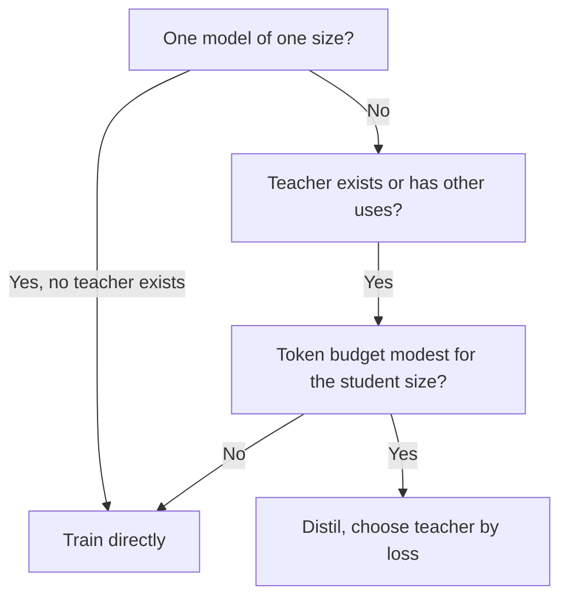

# Размер и измерение: размер ученика, стоимость учителя и честная оценка

Этапы 7 и 8 в сжатом виде для быстрого поиска. [Урок 20](../lessons/0020-choosing-student-size.md) охватывает то, когда дистилляция лучше прямого обучения, [урок 21](../lessons/0021-data-volume-and-teacher-cost.md) стоимость учителя и объём данных, [урок 22](../lessons/0022-student-against-teacher.md) согласие против качества на задаче, а [урок 23](../lessons/0023-an-honest-distillation-eval.md) базовые уровни и проверки честной оценки.

## Когда дистилляция лучше прямого обучения ученика

Busbridge и соавторы, 2025, результаты одной статьи на трансформерах от 143M до 12.6B параметров и до 512B токенов, измеренные в кросс-энтропии.

| Условие | Источник |
|---|---|
| Дистилляция не может превзойти контролируемое обучение, когда обоим дано достаточно данных или вычислений | Раздел 1 |
| Она эффективнее, когда общие вычисления или токены ученика остаются ниже порога, зависящего от размера ученика | Разделы 1 и 5.1 |
| И учитель уже существует, или у учителя есть применения сверх одной дистилляции | Разделы 1 и 5.3 |
| Один ученик, учителя нужно обучать: контролируемое обучение, как правило, предпочтительнее | Аннотация и раздел 5.3 |
| Дистилляция семейства, или учитель ещё и обслуживает трафик: дистилляция может быть дешевле | Раздел 5.3 |

## Разрыв в ёмкости в законе

| Вывод | Источник |
|---|---|
| Потеря ученика зависит от размера учителя и токенов только через кросс-энтропию учителя | Раздел 1, рисунок 3b |
| Потеря ученика падает по мере улучшения учителя, достигает оптимума, затем растёт | Рисунок 4 |
| Разрыв касается способности к обучению, а не только относительного размера | Раздел 1 |
| При фиксированном токенном бюджете потеря лучшего учителя падает по мере роста ученика | Раздел 5.2 |
| Не выносите из статьи конкретное отношение размера учителя к размеру ученика | Совет этого листа |

## Четыре постановки вычислений

| Постановка | Инференс учителя | Предобучение учителя | Подходит |
|---|---|---|---|
| Лучший случай, полностью амортизировано | Не начисляется | Не начисляется | Учитель существует, используется в другом месте |
| Инференс учителя | Начисляется | Не начисляется | Существующий учитель, запущенный на ваших данных |
| Предобучение учителя | Не начисляется | Начисляется | Обучить один раз, сохранить логиты, много учеников |
| Предобучение плюс инференс | Начисляется | Начисляется | Обучить учителя для одного ученика |

Из таблицы 2 статьи. Основано на логитах, так что оценивает стоимость оценки токенов, а не генерации.

## Арифметика стоимости

Приближения. Они игнорируют внимание, которое растёт с длиной контекста, и считают каждый параметр одинаково. Сама статья не использует 2N для малых моделей и длинных контекстов (раздел 5).

| Величина | Формула | Примечания |
|---|---|---|
| Обучение ученика | 6 × N_student × D | Около 2 на прямой плюс 4 на обратный проход на параметр на токен |
| Оценка токенов учителем (логиты) | 2 × N_teacher × D | Только прямой проход, по тем же D токенам |
| Генерация учителем (уровень последовательностей) | 2 × N_teacher × G | G это сгенерированные токены. Расширение, в статье его нет |
| Стоимость учителя / стоимость ученика | N_teacher / (3 × N_student) | Одинаковое D с обеих сторон |

| Разобранный случай | Учитель | Ученик | Отношение |
|---|---|---|---|
| Ученик 1B, 100B токенов, оценка учителем 7B | 1.4e21 | 6.0e20 | 2.3 |
| То же, оценка учителем 70B | 1.4e22 | 6.0e20 | 23 |
| Ученик 1B, 50B токенов, оценка учителем 8B | 8.0e20 | 3.0e20 | 2.7 |
| Учитель 70B генерирует 1B токенов, ученик 3B, две эпохи | 1.4e20 | 3.6e19 | 3.9 |
| Четыре ученика 1B делят один проход оценки учителем 7B по 100B токенов | 1.4e21 один раз | 6.0e20 каждый | 9.5e20 на ученика в сумме, против 2.0e21 для одного |

FLOPs занижают стоимость генерации, которая плохо загружает железо. Измеряйте токены в секунду, прежде чем называть бюджет. Хранение логитов стоит дополнительно и в эти числа не входит.

## Сколько данных

| Пункт | Источник |
|---|---|
| При фиксированном учителе преимущество дистилляции сокращается по мере роста токенного бюджета, и контролируемое обучение в итоге догоняет | Статья, раздел 5.1, рисунок 6 |
| Порог, при котором выигрывает контролируемое обучение, растёт с размером ученика | Статья, раздел 5.3 |
| Minitron 8B обучена на 94B токенов против 3.8T у Nemotron-3 8B, примерно в 40 раз меньше | Статья Minitron, таблица 2 |
| Этот ученик получен прунингом из учителя на 15B, так что начал не с нуля | Статья Minitron |
| Её экономия в 1.8 раза для семейства считает собственные шаги обучения каждой модели, без слагаемого прямого прохода учителя в предложениях, которые её описывают | Статья Minitron, раздел 4.1 |

## Верность против качества на задаче

| Мера | Определение | Источник |
|---|---|---|
| Согласие по top-1 | Доля входов, на которых ученик и учитель выбирают один и тот же верхний ответ | Stanton et al., раздел 3.2 |
| Средняя предсказательная KL | Средняя KL от распределения учителя к распределению ученика | Stanton et al., раздел 3.2 |
| Качество на задаче | Оценка ученика относительно правильных ответов | Любой бенчмарк |

| Факт | Следствие | Источник |
|---|---|---|
| Две модели с точностью 55 и 95 процентов могут согласоваться не более чем на 60 процентов | Согласие ограничено разрывом точности, так что читайте его относительно этого предела | Stanton et al., раздел 3.2 |
| Сравнение с учеником, дистиллированным из независимого учителя | Показывает, пришло ли согласие от дистилляции или от того, что обе модели хорошо обобщают | Stanton et al., раздел 3.2 |
| Самодистиллированный ученик может превзойти учителя, не копируя его | Более низкая верность может означать более высокое качество | Stanton et al., разделы 4.1 и 4.2 |
| Ученик на невиданных данных согласовывался с учителем больше и был менее точен | Более высокая верность не покупает более высокую точность | Stanton et al., раздел 5 |
| Около 70 процентов выходов имитации оценены как равные ChatGPT или лучше, но закрыт малый разрыв на бенчмарках | Оценки вознаграждают стиль | Gudibande et al., рисунок 1 |
| NQ при 13B: база 20, широкая имитация 15, целевая имитация 27, ChatGPT 31 | Одно умение может упасть, пока оценки растут | Gudibande et al., таблица 1 |

Stanton и соавторы изучают в основном классификаторы изображений. Применение их метрик к LLM позиция за позицией это адаптация этого курса.

## Сетка умений

| Умение | Согласие с учителем | Качество на задаче, ученик | Качество на задаче, учитель | Качество на задаче, базовый уровень того же размера |
|---|---|---|---|---|
| Одна строка на каждое умение, от которого вы зависите | Top-1 или KL на отложенных промптах такого вида | Оценка по задаче | Оценка по задаче | Оценка по задаче |

## Честная оценка, проверенная

| Проверка | От чего предотвращает |
|---|---|
| Три модели: учитель, ученик, модель того же размера, обученная без дистилляции на тех же данных или с теми же вычислениями | Приписывания дистилляции того, что сделало бы прямое обучение |
| Укажите данные или вычисления базового уровня до того, как увидите результаты | Выбора базового уровня под результат |
| Задачи вне промптов дистилляции, сообщаемые отдельно | Среднего, которое скрывает задачи, не охваченные данными |
| Записан источник каждого промпта дистилляции, оценочные элементы и почти-дубликаты удалены из промптов и генераций | Оценки знакомства вместо умения |
| Одна обвязка, одни промпты, одно декодирование, одна оценка для всех трёх | Разрыва, происходящего от постановки |
| Дельты по задачам с числом элементов | Положительного среднего над отрицательными задачами |
| Разрыв проверен на шум | Чтения разрыва в 6 пунктов на 100 элементах как реального |

Для формулы шума и парного сравнения используйте лист [Выпускать или нет](../../evals/reference/go-no-go.md). Для загрязнения используйте лист [Отложенные данные и загрязнение](../../evals/reference/held-out-data-and-contamination.md). Для того, что держать фиксированным в запуске, используйте лист [Обвязка эвала](../../evals/reference/eval-harness.md).

## Пример «дистиллированная против прямой»

Отчёт DeepSeek-R1, таблица 16 (приложение F.1). В обеих строках базовая модель Qwen2.5-32B, ни одна не согласована по данным или вычислениям.

| Модель | AIME 2024 pass@1 | MATH-500 pass@1 | GPQA Diamond pass@1 | LiveCodeBench pass@1 |
|---|---|---|---|---|
| Qwen2.5-32B-Zero (масштабное RL, более 10K шагов) | 47.0 | 91.6 | 55.0 | 40.2 |
| DeepSeek-R1-Distill-Qwen-32B (дистиллирована) | 72.6 | 94.3 | 62.1 | 57.2 |

Собственная постановка одного отчёта. Это прямой базовый уровень другого метода, а не контролируемый запуск с согласованными ресурсами.

## Источники

- [Научная статья: "Distillation Scaling Laws", Busbridge et al., 2025](https://arxiv.org/abs/2502.08606)
- [Научная статья: "Compact Language Models via Pruning and Knowledge Distillation", Muralidharan et al., 2024](https://arxiv.org/abs/2407.14679)
- [Научная статья: "Does Knowledge Distillation Really Work?", Stanton et al., 2021](https://arxiv.org/abs/2106.05945)
- [Научная статья: "The False Promise of Imitating Proprietary LLMs", Gudibande et al., 2023](https://arxiv.org/abs/2305.15717)
- [Научная статья: "DeepSeek-R1: Incentivizing Reasoning Capability in LLMs via Reinforcement Learning", DeepSeek-AI, 2025](https://arxiv.org/abs/2501.12948)
- [Предобучение](../../pretraining/) и [Эвалы](../../evals/), соседние курсы по учёту вычислений и построению эвалов
