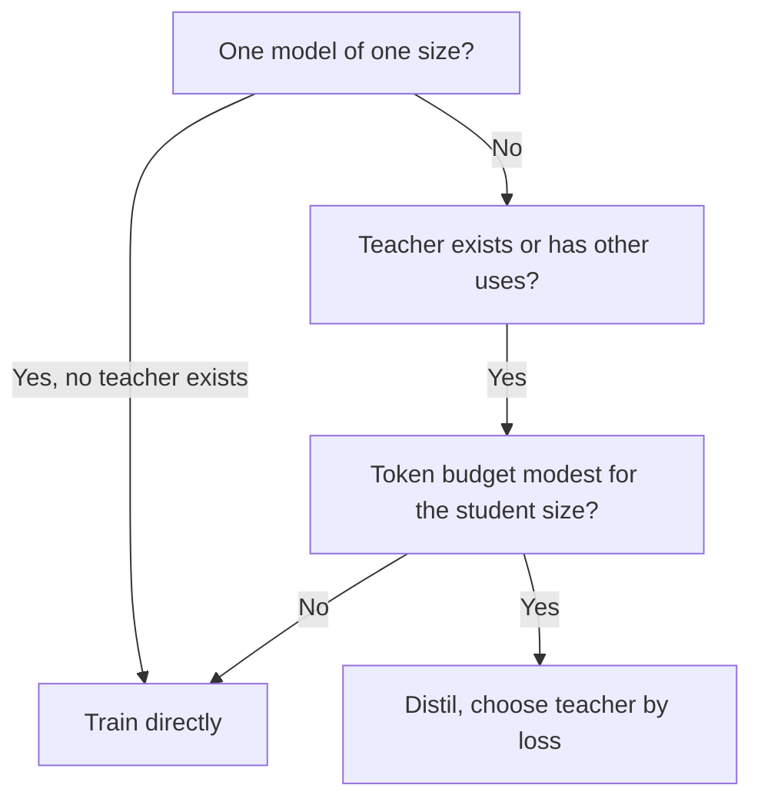

# 确定规模与度量：学生规模、教师成本与诚实的评测

第 7 和第 8 阶段，压缩成便于查阅的形式。[第 20 课](../lessons/0020-choosing-student-size.md)讲蒸馏何时胜过直接训练，[第 21 课](../lessons/0021-data-volume-and-teacher-cost.md)讲教师的成本和数据量，[第 22 课](../lessons/0022-student-against-teacher.md)讲一致率对任务质量，[第 23 课](../lessons/0023-an-honest-distillation-eval.md)讲诚实评测的基线和检查项。

## 蒸馏何时胜过直接训练学生

Busbridge 等，2025，一篇论文在 143M 到 12.6B 参数、最多 512B token 的 Transformer 上的结果，以交叉熵度量。

| 条件 | 出处 |
|---|---|
| 当两者都有足够的数据或算力时，蒸馏无法胜过监督学习 | 第 1 节 |
| 当学生的总算力或 token 数低于一个取决于学生规模的阈值时，它更有效率 | 第 1 和第 5.1 节 |
| 并且已经存在一个教师，或者教师在单次蒸馏之外还有用途 | 第 1 和第 5.3 节 |
| 一个学生，教师必须训练：监督学习通常更可取 | 摘要和第 5.3 节 |
| 蒸馏一整个家族，或者教师还承担线上流量：蒸馏可能更便宜 | 第 5.3 节 |

## 定律中的容量差距

| 发现 | 出处 |
|---|---|
| 学生的损失，只通过教师的交叉熵，才依赖于教师规模和 token 数 | 第 1 节，图 3b |
| 学生损失随教师变好而下降，到达一个最优点，然后上升 | 图 4 |
| 这个差距关乎学习容量，而不只是相对规模 | 第 1 节 |
| token 预算固定时，最佳教师的损失随学生变大而下降 | 第 5.2 节 |
| 不要从论文里带走某个具体的教师与学生规模比 | 本参考表的建议 |

## 四种算力设置

| 设置 | 教师推理 | 教师预训练 | 适合 |
|---|---|---|---|
| 最好情形，完全摊销 | 不计费 | 不计费 | 教师已存在，并用于别处 |
| 教师推理 | 计费 | 不计费 | 现成的教师在你的数据上运行 |
| 教师预训练 | 不计费 | 计费 | 训练一次，存储 logit，供许多个学生使用 |
| 预训练加推理 | 计费 | 计费 | 为一个学生训练一个教师 |

出自论文的表 2。基于 logit，所以它给打分定价，不给生成定价。

## 成本算术

都是近似。它们忽略了随上下文长度增长的注意力，并且把每个参数同等看待。论文自己对小模型和长上下文并不使用 2N（第 5 节）。

| 量 | 公式 | 说明 |
|---|---|---|
| 学生训练 | 6 × N_student × D | 每个参数每个 token 约 2 的前向加 4 的反向 |
| 教师打分（logit） | 2 × N_teacher × D | 只有前向，对同样的 D 个 token |
| 教师生成（序列级） | 2 × N_teacher × G | G 是生成的 token 数。是一种延伸，不在论文里 |
| 教师成本 / 学生成本 | N_teacher / (3 × N_student) | 两边用同样的 D |

| 算例 | 教师 | 学生 | 比值 |
|---|---|---|---|
| 1B 学生，100B token，7B 教师打分 | 1.4e21 | 6.0e20 | 2.3 |
| 同上，70B 教师打分 | 1.4e22 | 6.0e20 | 23 |
| 1B 学生，50B token，8B 教师打分 | 8.0e20 | 3.0e20 | 2.7 |
| 70B 教师生成 1B token，3B 学生，两个轮次 | 1.4e20 | 3.6e19 | 3.9 |
| 四个 1B 学生共用一次 7B 教师对 100B token 的打分 | 一次 1.4e21 | 每个 6.0e20 | 每个学生全部算上 9.5e20，而单个学生是 2.0e21 |

FLOPs 低估了生成的成本，因为生成会让硬件利用率很低。在报出预算之前，先度量每秒的 token 数。存储 logit 还有额外成本，不在这些数字里。

## 多少数据

| 要点 | 出处 |
|---|---|
| 教师固定时，随着 token 预算增大，蒸馏的优势会缩小，监督学习最终会追上来 | 论文，第 5.1 节，图 6 |
| 监督学习获胜的阈值，随学生规模增大 | 论文，第 5.3 节 |
| Minitron 8B 在 94B token 上训练，而 Nemotron-3 8B 是 3.8T，约少了 40 倍 | Minitron 论文，表 2 |
| 那个学生是从 15B 教师剪枝得到的，所以不是从零开始的 | Minitron 论文 |
| 它的 1.8 倍的家族节省，计入的是每个模型自己的训练步数，描述它的句子里没有教师前向传播这一项 | Minitron 论文，第 4.1 节 |

## 保真度对任务质量

| 度量 | 定义 | 出处 |
|---|---|---|
| top-1 一致率 | 学生与教师选出同一个最高答案的输入所占的比例 | Stanton 等，第 3.2 节 |
| 平均预测 KL | 从教师的分布到学生的分布的 KL 均值 | Stanton 等，第 3.2 节 |
| 任务质量 | 学生对照正确答案的得分 | 任何基准 |

| 事实 | 后果 | 出处 |
|---|---|---|
| 准确率为 55% 和 95% 的两个模型，最多能在 60% 上一致 | 一致率受准确率差距的限制，所以要对照这个上限来读它 | Stanton 等，第 3.2 节 |
| 与从独立教师蒸馏出来的学生比较 | 说明一致率来自蒸馏，还是来自两个模型都泛化得好 | Stanton 等，第 3.2 节 |
| 自蒸馏的学生可以通过没能复制教师而胜过它 | 较低的保真度可能意味着较高的质量 | Stanton 等，第 4.1 和第 4.2 节 |
| 在未见过数据上的学生，与教师更一致，却不那么准确 | 更高的保真度并不能换来更高的准确率 | Stanton 等，第 5 节 |
| 约 70% 的模仿输出被评为与 ChatGPT 相当或更好，基准上缩小的差距却很少 | 评分奖励风格 | Gudibande 等，图 1 |
| 13B 上的 NQ：基础模型 20，广泛模仿 15，有针对性的模仿 27，ChatGPT 31 | 一种能力可以下降，而评分却上升 | Gudibande 等，表 1 |

Stanton 等人研究的主要是图像分类器。把他们的指标逐位置地应用到 LLM，是本系列的改编。

## 能力网格

| 能力 | 与教师的一致率 | 任务质量，学生 | 任务质量，教师 | 任务质量，同样大小的基线 |
|---|---|---|---|---|
| 你所依赖的每种能力一行 | 在该类留出提示词上的 top-1 或 KL | 逐任务得分 | 逐任务得分 | 逐任务得分 |

## 诚实的评测，逐项核对

| 检查项 | 它防止什么 |
|---|---|
| 三个模型：教师、学生、在相同数据或算力上不经蒸馏训练的同样大小的模型 | 把直接训练本来也能做到的功劳，算在蒸馏头上 |
| 在看到结果之前，就说明基线的数据或算力 | 为了迎合结果而选择基线 |
| 蒸馏提示词之外的任务，单独报告 | 平均值掩盖了数据没有覆盖的任务 |
| 记录每个蒸馏提示词的来源，从提示词和生成结果中去掉评测条目及近似重复的条目 | 给暴露程度打分，而不是给技能打分 |
| 三者使用同样的运行框架、同样的提示词、同样的解码、同样的打分 | 由设置造成的差距 |
| 带条目数的逐任务差值 | 负的任务上有一个正的平均值 |
| 对照噪声检查差距 | 把 100 个条目上的 6 分差距当成真的 |

噪声公式和成对比较，请使用[上线与否](../../evals/reference/go-no-go.md)参考表。关于污染，请使用[留出数据与数据污染](../../evals/reference/held-out-data-and-contamination.md)参考表。关于一次运行里要保持哪些不变，请使用[评测运行框架](../../evals/reference/eval-harness.md)参考表。

## 一个蒸馏对直接训练的例子

DeepSeek-R1 报告，表 16（附录 F.1）。两行都以 Qwen2.5-32B 为基础，都没有在数据或算力上做匹配。

| 模型 | AIME 2024 pass@1 | MATH-500 pass@1 | GPQA Diamond pass@1 | LiveCodeBench pass@1 |
|---|---|---|---|---|
| Qwen2.5-32B-Zero（大规模强化学习，超过 10K 步） | 47.0 | 91.6 | 55.0 | 40.2 |
| DeepSeek-R1-Distill-Qwen-32B（蒸馏） | 72.6 | 94.3 | 62.1 | 57.2 |

这是一份报告自己的设置。它是另一种方法的直接基线，不是匹配资源的监督运行。

## 来源

- [论文：“Distillation Scaling Laws”，Busbridge 等，2025](https://arxiv.org/abs/2502.08606)
- [论文：“Compact Language Models via Pruning and Knowledge Distillation”，Muralidharan 等，2024](https://arxiv.org/abs/2407.14679)
- [论文：“Does Knowledge Distillation Really Work?”，Stanton 等，2021](https://arxiv.org/abs/2106.05945)
- [论文：“The False Promise of Imitating Proprietary LLMs”，Gudibande 等，2023](https://arxiv.org/abs/2305.15717)
- [论文：“DeepSeek-R1: Incentivizing Reasoning Capability in LLMs via Reinforcement Learning”，DeepSeek-AI，2025](https://arxiv.org/abs/2501.12948)
- [预训练](../../pretraining/)和[评测](../../evals/)，分别是算力核算和搭建评测的相邻系列
