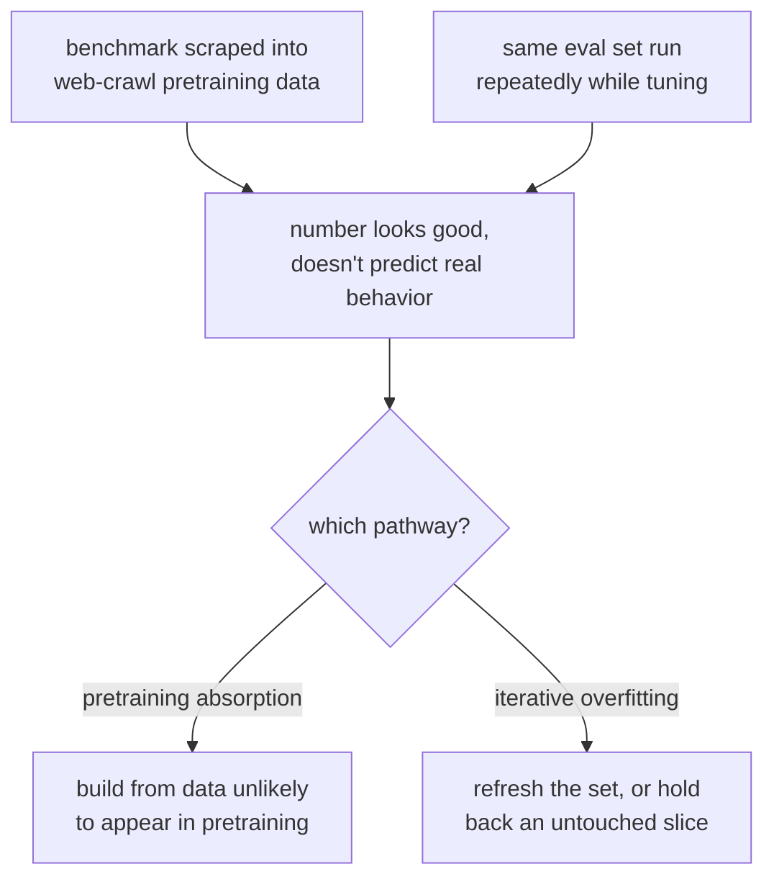

# Lección 1. Datos held-out y contaminación

**Vínculo con la misión:** "Defender el número frente a la contaminación" es la mitad de la misión, y empieza aquí: un número de un conjunto de eval comprometido no es un número que valga la pena defender.
**Fuente principal:** [Docs: "Define success criteria and build evaluations", Claude Platform Docs](https://platform.claude.com/docs/en/test-and-evaluate/develop-tests)
**Requisitos previos:** ninguno

## Qué debes saber

### Qué significa "held-out"

Un conjunto de eval es **held-out** cuando el modelo evaluado nunca vio esos ejemplos exactos, ni paráfrasis cercanas de ellos, durante el entrenamiento o el fine-tuning. Esa única propiedad es la que permite que una buena puntuación signifique "esto generaliza" en lugar de "esto se memorizó". Sin ella, una puntuación alta no informa de nada: no distingue a un modelo que aprendió la habilidad de fondo de uno que simplemente aprendió la hoja de respuestas.

Es la misma disciplina que un conjunto de prueba held-out en cualquier flujo de trabajo de machine learning, y es fácil de enunciar y sorprendentemente fácil de violar en la práctica.

### Contaminación: dos modos de fallo distintos

La **contaminación de datos** ocurre cuando los ejemplos de una eval, o casi duplicados de ellos, acaban dentro de aquello con lo que se entrenó el modelo. La causan dos vías distintas:

1. **Absorción en el preentrenamiento.** Los benchmarks públicos se publican en línea, se rastrean hacia conjuntos de datos de la web y acaban dentro del corpus de preentrenamiento de un modelo base antes de que nadie construya una eval encima. El modelo nunca vio tu conjunto de eval en concreto, pero puede haber visto las preguntas y respuestas exactas de un benchmark en el que te apoyas.
2. **Sobreajuste iterativo a la eval.** No hay una fuga literal de datos, pero un equipo ejecuta el mismo conjunto de eval una y otra vez mientras ajusta un modelo o un prompt, y poco a poco moldea el sistema para pasar los ejemplos concretos que tiene delante en lugar de la capacidad de fondo. Es la ley de Goodhart en forma de eval: el conjunto de eval deja de medir aquello para lo que se construyó en cuanto se convierte en el objetivo de la optimización.

Ambas producen el mismo síntoma: un número que se ve bien y no predice el comportamiento en el mundo real. Necesitan correcciones distintas. La primera se aborda eligiendo o construyendo datos de eval que sea poco probable que aparezcan en un corpus de preentrenamiento (o comprobando su presencia). La segunda se aborda renovando el conjunto de eval, o reservando otra porción de él, para que no se pueda optimizar contra él indefinidamente.

### Comprobar la contaminación del preentrenamiento

A menudo se puede detectar directamente el primer modo de fallo. El método de instrucción guiada de Golchin y Surdeanu le da a un modelo la primera parte de una instancia de un benchmark y le pide completar el resto de forma literal. Un modelo que reproduce la continuación exacta de un elemento del benchmark, más allá de lo que produciría una suposición plausible, es una evidencia sólida de que esa instancia estaba en sus datos de entrenamiento. La misma idea se generaliza: si un modelo puede reconstruir detalles de tu conjunto de eval que una descripción por sí sola no delataría (una redacción poco habitual, un número exacto, un nombre propio raro), sospecha de contaminación.

### Qué exige "defender el número"

Antes de citar una puntuación de eval como evidencia de que un cambio ayudó, necesitas una respuesta a esto: *¿por qué el modelo no pudo haber acertado esto por memorización o por haberse ajustado contra este mismo conjunto?* Si no puedes responderla, el número describe la eval, no el modelo.

## Práctica

1. ▢ Un equipo hace fine-tuning de un modelo y lo evalúa con un benchmark público muy conocido, y luego reporta una puntuación alta como prueba de que el fine-tune ayudó. ¿Qué pregunta deberías hacerte antes de fiarte de esa puntuación?

Comprobación

Si los datos de ese benchmark (o paráfrasis cercanas de ellos) podrían estar presentes de forma plausible en el corpus de preentrenamiento del modelo, ya que los benchmarks públicos se rastrean de forma rutinaria hacia datos de entrenamiento de la web. Una puntuación alta en un benchmark contaminado no dice nada sobre el fine-tune.

2. ▢ Distingue: un modelo nunca se entrenó con el texto exacto de tu conjunto de eval, pero tu equipo ha ejecutado ese mismo conjunto de 50 ejemplos cada semana durante seis meses mientras ajustaba prompts contra él. ¿Sigue siendo fiable esta eval? ¿Por qué sí o por qué no?

Pista

No hace falta una fuga literal de datos para que una eval deje de ser informativa.

Comprobación

No, o al menos ahora es sospechosa. Es la segunda vía de contaminación: el sobreajuste iterativo a la eval. Seis meses de ajuste contra los mismos 50 ejemplos probablemente moldearon el sistema para pasar esos ejemplos concretos en lugar de la tarea de fondo, incluso sin ninguna fuga literal de datos. La corrección es renovar el conjunto o reservar una porción intacta de él.

3. ▢ Quieres comprobar si un benchmark concreto se filtró en los datos de preentrenamiento de un modelo. Describe una prueba que podrías ejecutar, usando la idea de instrucción guiada de esta lección.

Comprobación

Dale al modelo la primera parte de una instancia del benchmark (una pregunta, o el comienzo de un pasaje) y pídele completar el resto de forma literal. Si reproduce la continuación exacta, incluidos detalles que una suposición plausible no recuperaría (redacción precisa, un número poco habitual, un nombre raro), es una evidencia sólida de que la instancia estaba en sus datos de entrenamiento.

4. ▢ ¿Cuál de estas opciones expresa mejor lo que significa "held-out" para un conjunto de eval?

    - a) El conjunto de eval se guarda en un archivo separado de los datos de entrenamiento
    - b) El modelo evaluado nunca vio esos ejemplos, ni paráfrasis cercanas, durante el entrenamiento
    - c) El conjunto de eval lo escribió alguien distinto del desarrollador del modelo
    - d) El conjunto de eval usa un formato distinto al de los datos de entrenamiento

Comprobación

**b)** El modelo evaluado nunca vio esos ejemplos, ni paráfrasis cercanas, durante el entrenamiento. (a), (c) y (d) describen hechos organizativos o de estilo que, por sí solos, no impiden la contaminación.

## Prácticas en el mundo real

- [ ] Elige una eval o un benchmark en el que te apoyes hoy. Pregúntate, por escrito: ¿es plausible que estos datos aparecieran en el corpus de preentrenamiento del modelo que estás evaluando? Escribe tu razonamiento en un sentido o en otro.
- [ ] Para esa misma eval, comprueba si se ha reutilizado tantas veces, o se ha ajustado tanto contra ella, que la ley de Goodhart es un riesgo vivo. Si es así, anota qué reservarías o renovarías.
- [ ] Mañana: prueba con una instancia de un benchmark el test de completado por instrucción guiada de esta lección contra un modelo al que tengas acceso, y registra lo que encuentres.

## Para profundizar

- [Docs: "Define success criteria and build evaluations", Claude Platform Docs](https://platform.claude.com/docs/en/test-and-evaluate/develop-tests)
- [Paper: "Time Travel in LLMs: Tracing Data Contamination in Large Language Models", Golchin and Surdeanu, 2023](https://arxiv.org/abs/2308.08493)
- [Recursos](../RESOURCES.md)

---

¿No termina de quedar claro? Vuelve a leer la fuente primaria de arriba, ya que esta lección la comprime y en la compresión es donde se escapa la comprensión. Consulta el [glosario](../GLOSSARY.md) por si algún término te resultó resbaladizo.

Si lo poco claro es la propia lección y no el material, eso es un defecto: [abre un issue](https://github.com/TokenCemetery/teach/issues).
