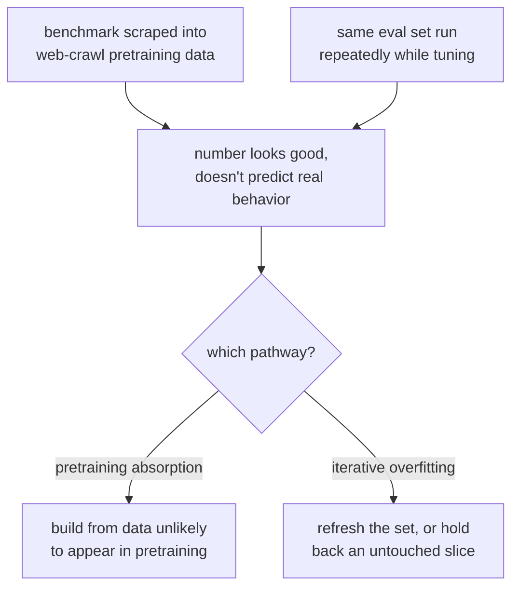

# Leçon 1. Données held-out et contamination

**Lien avec la mission :** « Défendre le chiffre face à la contamination » est la moitié de la mission, et tout commence ici : un chiffre issu d'un jeu d'eval compromis ne mérite pas d'être défendu.
**Source primaire :** [Doc : "Define success criteria and build evaluations", Claude Platform Docs](https://platform.claude.com/docs/en/test-and-evaluate/develop-tests)
**Prérequis :** aucun

## À savoir

### Ce que veut dire « held-out »

Un jeu d'eval est **held-out** quand le modèle jugé n'a jamais vu ces exemples exacts, ni de paraphrases proches, pendant l'entraînement ou le fine-tuning. Cette seule propriété permet à un bon score de vouloir dire « cela généralise » plutôt que « cela a été mémorisé ». Sans elle, un score élevé n'apprend rien : il ne permet pas de distinguer un modèle qui a appris la compétence sous-jacente d'un modèle qui a simplement appris le corrigé.

C'est la même discipline qu'un jeu de test held-out dans n'importe quel workflow de machine learning, facile à énoncer et étonnamment facile à violer en pratique.

### Contamination : deux modes de défaillance différents

La **contamination des données**, c'est quand des exemples d'eval, ou des quasi-doublons, se retrouvent dans ce sur quoi le modèle a été entraîné. Deux voies distinctes la provoquent :

1. **Absorption au pré-entraînement.** Les benchmarks publics sont publiés en ligne, aspirés dans des jeux de données issus du crawl du web, et finissent dans le corpus de pré-entraînement d'un modèle de base avant que quiconque construise une eval dessus. Le modèle n'a pas vu spécifiquement votre jeu d'eval, mais il a peut-être vu les questions et réponses exactes d'un benchmark sur lequel vous vous appuyez.
2. **Surapprentissage itératif sur l'eval.** Il n'y a pas de fuite littérale de données, mais une équipe exécute le même jeu d'eval à répétition en réglant un modèle ou un prompt, et façonne peu à peu le système pour réussir les exemples précis qu'elle a sous les yeux plutôt que la capacité sous-jacente. C'est la loi de Goodhart version eval : le jeu d'eval cesse de mesurer ce pour quoi il a été construit dès qu'il devient la cible de l'optimisation.

Les deux produisent le même symptôme : un chiffre qui a l'air bon et ne prédit pas le comportement en situation réelle. Ils demandent des remèdes différents. Le premier se traite en choisissant ou en construisant des données d'eval peu susceptibles d'apparaître dans un corpus de pré-entraînement (ou en testant leur présence). Le second se traite en renouvelant le jeu d'eval, ou en en gardant une autre tranche en réserve, pour qu'on ne puisse pas l'optimiser indéfiniment.

### Tester la contamination au pré-entraînement

On peut souvent détecter directement le premier mode de défaillance. La méthode d'instruction guidée de Golchin et Surdeanu donne à un modèle le début d'une instance de benchmark et lui demande de compléter le reste mot pour mot. Un modèle qui reproduit la suite exacte d'un élément de benchmark, au-delà de ce qu'une supposition plausible produirait, apporte une forte preuve que cette instance figurait dans ses données d'entraînement. La même idée se généralise : si un modèle sait reconstituer des détails de votre jeu d'eval qu'une simple description ne révélerait pas (une formulation inhabituelle, un nombre exact, un nom propre rare), soupçonnez la contamination.

### Ce qu'exige « défendre le chiffre »

Avant de citer un score d'eval comme preuve qu'un changement a aidé, il vous faut une réponse à : *pourquoi le modèle n'aurait-il pas pu obtenir la bonne réponse par mémorisation ou parce qu'il a été réglé sur ce jeu précis ?* Si vous ne savez pas répondre, le chiffre décrit l'eval, pas le modèle.

## Pratique

1. ▢ Une équipe fine-tune un modèle et l'évalue sur un benchmark public bien connu, puis rapporte un score élevé comme preuve que le fine-tuning a aidé. Quelle question devez-vous poser avant de faire confiance à ce score ?

Vérifier

Si les données de ce benchmark (ou des paraphrases proches) pourraient plausiblement figurer dans le corpus de pré-entraînement du modèle, puisque les benchmarks publics sont couramment aspirés dans des données d'entraînement issues du crawl du web. Un score élevé sur un benchmark contaminé ne dit rien du fine-tuning.

2. ▢ Distinguez : un modèle n'a jamais été entraîné sur le texte exact de votre jeu d'eval, mais votre équipe exécute chaque semaine depuis six mois ce même jeu de 50 exemples en y réglant ses prompts. Cette eval est-elle encore digne de confiance ? Pourquoi ou pourquoi pas ?

Indice

Il n'est pas nécessaire qu'il y ait fuite littérale de données pour qu'une eval cesse d'être informative.

Vérifier

Non, ou du moins elle est désormais suspecte. C'est la seconde voie de contamination : le surapprentissage itératif sur l'eval. Six mois de réglage sur les mêmes 50 exemples ont probablement façonné le système pour réussir ces exemples précis plutôt que la tâche sous-jacente, même sans aucune fuite littérale de données. Le remède est de renouveler le jeu ou d'en garder en réserve une portion intacte.

3. ▢ Vous voulez vérifier si un benchmark précis a fui dans les données de pré-entraînement d'un modèle. Décrivez un test que vous pourriez lancer, en utilisant l'idée d'instruction guidée de cette leçon.

Vérifier

Donnez au modèle le début d'une instance du benchmark (une question, ou l'amorce d'un passage) et demandez-lui de compléter le reste mot pour mot. S'il reproduit la suite exacte, y compris des détails qu'une supposition plausible ne retrouverait pas (formulation précise, nombre inhabituel, nom rare), c'est une forte preuve que l'instance figurait dans ses données d'entraînement.

4. ▢ Laquelle de ces propositions énonce le mieux ce que veut dire « held-out » pour un jeu d'eval ?

    - a) Le jeu d'eval est conservé dans un fichier séparé des données d'entraînement
    - b) Le modèle jugé n'a jamais vu ces exemples, ni de paraphrases proches, pendant l'entraînement
    - c) Le jeu d'eval a été écrit par quelqu'un d'autre que le développeur du modèle
    - d) Le jeu d'eval utilise un format différent de celui des données d'entraînement

Vérifier

**b)** Le modèle jugé n'a jamais vu ces exemples, ni de paraphrases proches, pendant l'entraînement. (a), (c) et (d) décrivent des faits d'organisation ou de style qui n'empêchent pas, à eux seuls, la contamination.

## Exercices en situation réelle

- [ ] Choisissez une eval ou un benchmark sur lequel vous vous appuyez aujourd'hui. Demandez-vous, par écrit : est-il plausible que ces données soient apparues dans le corpus de pré-entraînement du modèle que vous évaluez ? Notez votre raisonnement dans un sens comme dans l'autre.
- [ ] Pour cette même eval, vérifiez si elle a été réutilisée assez de fois, ou si l'on a assez réglé dessus, pour que la loi de Goodhart soit un risque bien réel. Si oui, notez ce que vous garderiez en réserve ou renouvelleriez.
- [ ] Demain : essayez le test de complétion par instruction guidée de cette leçon sur une instance de benchmark, avec un modèle auquel vous avez accès, et notez ce que vous constatez.

## Pour aller plus loin

- [Doc : "Define success criteria and build evaluations", Claude Platform Docs](https://platform.claude.com/docs/en/test-and-evaluate/develop-tests)
- [Article : "Time Travel in LLMs: Tracing Data Contamination in Large Language Models", Golchin and Surdeanu, 2023](https://arxiv.org/abs/2308.08493)
- [Ressources](../RESOURCES.md)

---

Ça ne passe pas ? Relisez la source primaire en haut de page, car cette leçon la condense et c'est dans la condensation que la compréhension s'échappe. Consultez le [glossaire](../GLOSSARY.md) pour tout terme qui vous a paru glissant.

Si c'est la leçon elle-même qui n'est pas claire plutôt que la matière, c'est un défaut : [ouvrez une issue](https://github.com/TokenCemetery/teach/issues).
