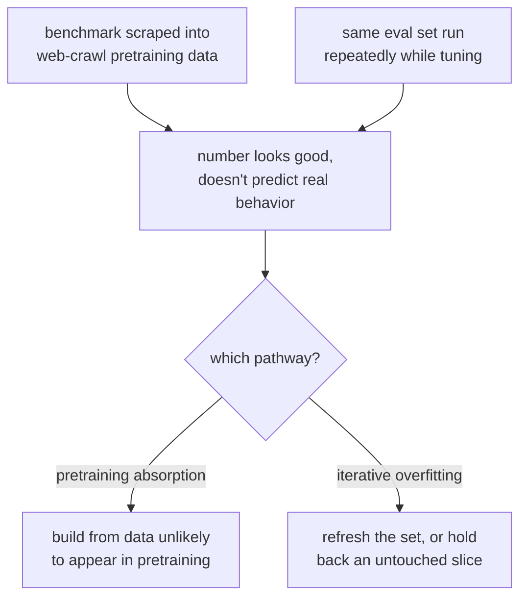

# पाठ 1. Held-out Data और Contamination

**मिशन से संबंध:** "संख्या का contamination के विरुद्ध बचाव करना" मिशन का आधा हिस्सा है, और वह यहीं से शुरू होता है: बिगड़े हुए eval सेट की संख्या ऐसी संख्या नहीं जिसका बचाव करना बनता हो।
**मुख्य स्रोत:** [दस्तावेज़: "Define success criteria and build evaluations", Claude Platform Docs](https://platform.claude.com/docs/en/test-and-evaluate/develop-tests)
**पूर्व-आवश्यकताएँ:** कोई नहीं

## यह जानें

### "Held out" का मतलब

Eval सेट **held out** तब होता है जब परखे जा रहे model ने training या fine-tuning के दौरान वही सटीक examples, या उनके क़रीबी paraphrases, कभी नहीं देखे। यही अकेली ख़ूबी अच्छे score का मतलब "यह generalize करता है" बनाती है, "यह रटा गया था" नहीं। इसके बिना ऊँचा score कोई जानकारी नहीं देता: वह उस model में, जिसने मूल कौशल सीखा, और उसमें, जिसने बस उत्तर-कुंजी सीख ली, फ़र्क़ नहीं कर पाता।

यह वही अनुशासन है जो किसी भी machine learning workflow में held-out test सेट का होता है, और इसे कहना आसान है, पर व्यवहार में इसे तोड़ देना हैरान करने वाली हद तक आसान है।

### Contamination: विफलता के दो अलग तरीक़े

**Data contamination** तब होती है जब eval के examples, या उनके लगभग-दोहरे, उसके भीतर पहुँच जाएँ जिस पर model को train किया गया था। इसके दो अलग रास्ते हैं:

1. **Pretraining में समा जाना।** Public benchmarks online पोस्ट होते हैं, web-crawl datasets में खींच लिए जाते हैं, और किसी के उन पर eval बनाने से पहले ही base model के pretraining corpus के भीतर पहुँच जाते हैं। Model ने आपका eval सेट ख़ास तौर पर कभी नहीं देखा, पर हो सकता है उसने उस benchmark के सटीक सवाल और जवाब देखे हों जिस पर आप भरोसा कर रहे हैं।
2. **Eval के प्रति बार-बार का overfitting।** कोई शाब्दिक data रिसाव नहीं होता, पर टीम model या prompt को tune करते समय वही eval सेट बार-बार चलाती है, और धीरे-धीरे system को मूल क्षमता के बजाय अपने सामने के ख़ास examples को पास करने के आकार में ढाल देती है। यह eval के रूप में Goodhart का नियम है: eval सेट जिस चीज़ को मापने के लिए बना था उसे मापना तब बंद कर देता है जब वह optimization का लक्ष्य बन जाता है।

दोनों एक ही लक्षण पैदा करते हैं: अच्छी दिखने वाली संख्या जो असली दुनिया के व्यवहार की भविष्यवाणी नहीं करती। उन्हें अलग सुधार चाहिए। पहले का हल ऐसा eval data चुनना या बनाना है जिसके pretraining corpus में आने की संभावना कम हो (या उसकी मौजूदगी की जाँच करना)। दूसरे का हल eval सेट को ताज़ा करना है, या उसका एक और हिस्सा अलग रखना, ताकि उसके विरुद्ध अनिश्चित काल तक optimize न किया जा सके।

### Pretraining contamination की जाँच

पहली विफलता को अक्सर सीधे पकड़ा जा सकता है। Golchin और Surdeanu की guided-instruction विधि model को benchmark instance का पहला हिस्सा देती है और उससे बाक़ी हिस्सा ज्यों का त्यों पूरा करने को कहती है। जो model किसी benchmark item की सटीक आगे की पंक्तियाँ दोहरा दे, उससे आगे जितना कोई समझदार अनुमान पैदा करता, वह इस बात का पक्का प्रमाण है कि वह instance उसके training data में था। यही विचार आगे भी लागू होता है: अगर model आपके eval सेट के ऐसे ब्योरे फिर से गढ़ सकता है जो सिर्फ़ वर्णन से ज़ाहिर नहीं होते (कोई असामान्य शब्दावली, कोई सटीक संख्या, कोई दुर्लभ व्यक्तिवाचक संज्ञा), तो contamination पर शक करें।

### "संख्या का बचाव" करने के लिए क्या चाहिए

Eval score को इस बात के प्रमाण के रूप में उद्धृत करने से पहले कि बदलाव काम आया, आपके पास इसका जवाब होना चाहिए: *model यह रटकर, या ठीक इसी सेट के विरुद्ध tune होकर सही क्यों नहीं कर सकता था?* अगर आप जवाब नहीं दे सकते, तो संख्या eval का वर्णन करती है, model का नहीं।

## अभ्यास

1. ▢ एक टीम model को fine-tune करती है और उसे किसी जाने-माने public benchmark पर परखती है, फिर ऊँचा score इस प्रमाण के रूप में बताती है कि fine-tune काम आया। उस score पर भरोसा करने से पहले आपको कौन-सा सवाल पूछना चाहिए?

जाँचें

यह कि क्या उस benchmark का data (या उसके क़रीबी paraphrases) model के pretraining corpus में होना मुमकिन है, क्योंकि public benchmarks आम तौर पर web-crawl training data में खींच लिए जाते हैं। Contaminated benchmark पर ऊँचा score fine-tune के बारे में कुछ नहीं कहता।

2. ▢ फ़र्क़ बताएँ: model को आपके eval सेट के सटीक text पर कभी train नहीं किया गया, पर आपकी टीम वही 50-example वाला eval सेट छह महीने से हर हफ़्ते चला रही है और उसके विरुद्ध prompts tune कर रही है। क्या यह eval अब भी भरोसेमंद है? क्यों या क्यों नहीं?

संकेत

Eval के जानकारीपूर्ण न रहने के लिए शाब्दिक data रिसाव ज़रूरी नहीं है।

जाँचें

नहीं, या कम से कम अब वह संदिग्ध है। यह contamination का दूसरा रास्ता है: eval के प्रति बार-बार का overfitting। उन्हीं 50 examples के विरुद्ध छह महीने की tuning ने शायद system को मूल task के बजाय उन्हीं ख़ास examples को पास करने के आकार में ढाल दिया है, शून्य शाब्दिक data रिसाव के बावजूद। सुधार है सेट को ताज़ा करना या उसका कोई अछूता हिस्सा अलग रखना।

3. ▢ आप जाँचना चाहते हैं कि कोई ख़ास benchmark किसी model के pretraining data में रिसा या नहीं। इस पाठ के guided-instruction विचार का इस्तेमाल करते हुए ऐसा test बताएँ जो आप चला सकते हैं।

जाँचें

Model को benchmark instance का पहला हिस्सा दें (एक सवाल, या किसी अंश की शुरुआत) और उससे बाक़ी हिस्सा ज्यों का त्यों पूरा करने को कहें। अगर वह सटीक आगे की पंक्तियाँ दोहरा दे, उन ब्योरों समेत जिन्हें कोई समझदार अनुमान नहीं पा सकता (सटीक शब्दावली, कोई असामान्य संख्या, कोई दुर्लभ नाम), तो यह पक्का प्रमाण है कि वह instance उसके training data में था।

4. ▢ इनमें से कौन-सा कथन eval सेट के लिए "held out" का मतलब सबसे अच्छी तरह बताता है?

    - a) Eval सेट training data से अलग file में रखा गया है
    - b) परखे जा रहे model ने training के दौरान वे examples, या उनके क़रीबी paraphrases, कभी नहीं देखे
    - c) Eval सेट model के developer के अलावा किसी और ने लिखा था
    - d) Eval सेट का format training data के format से अलग है

जाँचें

**b)** परखे जा रहे model ने training के दौरान वे examples, या उनके क़रीबी paraphrases, कभी नहीं देखे। (a), (c) और (d) संगठन या शैली के ऐसे तथ्य बताते हैं जो अपने-आप contamination नहीं रोकते।

## असली दुनिया का अभ्यास

- [ ] ऐसा कोई eval या benchmark चुनें जिस पर आप अभी भरोसा करते हैं। लिखकर पूछें: क्या यह मुमकिन है कि यह data उस model के pretraining corpus में आया हो जिसे आप परख रहे हैं? जवाब जो भी हो, अपना तर्क लिख लें।
- [ ] उसी eval के लिए जाँचें कि क्या उसे इतनी बार दोबारा इस्तेमाल किया गया है, या उसके विरुद्ध इतना tune किया गया है कि Goodhart का नियम एक असली जोखिम है। अगर हाँ, तो लिखें कि आप क्या अलग रखते या ताज़ा करते।
- [ ] कल: इस पाठ का guided-instruction completion test किसी एक benchmark instance पर उस model के विरुद्ध आज़माएँ जिस तक आपकी पहुँच है, और जो मिले उसे दर्ज करें।

## आगे बढ़ने के लिए

- [दस्तावेज़: "Define success criteria and build evaluations", Claude Platform Docs](https://platform.claude.com/docs/en/test-and-evaluate/develop-tests)
- [पेपर: "Time Travel in LLMs: Tracing Data Contamination in Large Language Models", Golchin and Surdeanu, 2023](https://arxiv.org/abs/2308.08493)
- [संसाधन](../RESOURCES.md)

---

बात नहीं बन रही? ऊपर दिए primary source को दोबारा पढ़ें, क्योंकि यह पाठ उसे संक्षिप्त करता है और समझ संक्षेप में ही रिसती है। जो शब्द फिसलन भरा लगे, उसके लिए [शब्दावली](../GLOSSARY.md) देखें।

अगर दिक़्क़त सामग्री की नहीं बल्कि पाठ की ही है, तो वह एक खोट है: [issue खोलें](https://github.com/TokenCemetery/teach/issues)।
