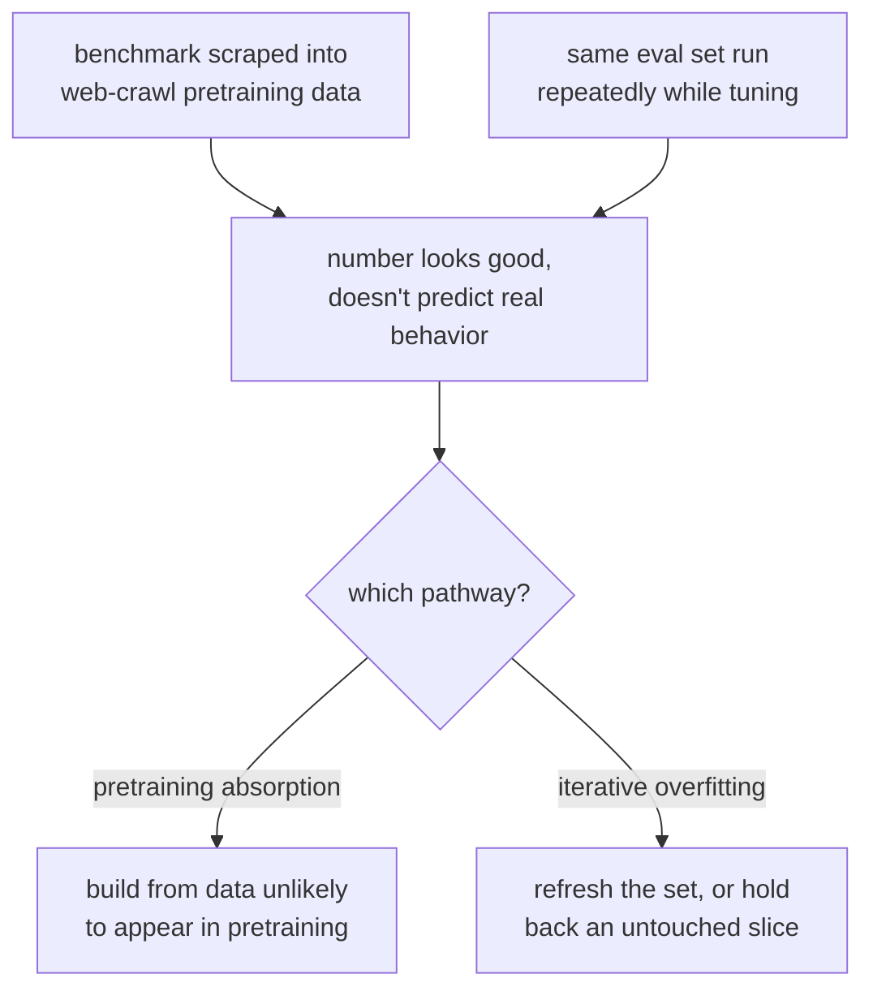

# Lição 1. Dados held-out e contaminação

**Ligação com a missão:** "Defender o número contra a contaminação" é metade da missão, e ela começa aqui: um número de um conjunto de eval comprometido não é um número que valha a pena defender.
**Fonte principal:** [Docs: "Define success criteria and build evaluations", Claude Platform Docs](https://platform.claude.com/docs/en/test-and-evaluate/develop-tests)
**Pré-requisitos:** nenhum

## Saiba isto

### O que "held-out" significa

Um conjunto de eval é **held-out** quando o modelo sendo avaliado nunca viu esses exemplos exatos, nem paráfrases próximas deles, durante o treinamento ou o fine-tuning. Essa única propriedade é o que permite que uma boa pontuação signifique "isto generaliza" em vez de "isto foi memorizado". Sem ela, uma pontuação alta não informa nada: não distingue um modelo que aprendeu a habilidade de fundo de um que simplesmente aprendeu o gabarito.

É a mesma disciplina de um conjunto de teste held-out em qualquer fluxo de trabalho de machine learning, e é fácil de enunciar e surpreendentemente fácil de violar na prática.

### Contaminação: dois modos de falha diferentes

**Contaminação de dados** é quando exemplos de eval, ou quase duplicatas deles, acabam dentro daquilo com que o modelo foi treinado. Dois caminhos distintos a causam:

1. **Absorção no pré-treinamento.** Benchmarks públicos são postados online, raspados para dentro de datasets de web-crawl e acabam dentro do corpus de pré-treinamento de um modelo base antes que alguém construa um eval em cima dele. O modelo nunca viu especificamente o seu conjunto de eval, mas pode ter visto as perguntas e respostas exatas de um benchmark em que você se apoia.
2. **Overfitting iterativo ao eval.** Não ocorre vazamento literal de dados, mas uma equipe executa o mesmo conjunto de eval repetidamente enquanto ajusta um modelo ou um prompt, e vai moldando o sistema aos poucos para passar nos exemplos específicos que tem diante de si, e não na capacidade de fundo. É a lei de Goodhart em forma de eval: o conjunto de eval deixa de medir aquilo que foi construído para medir quando se torna o alvo da otimização.

Os dois produzem o mesmo sintoma: um número que parece bom e não prevê o comportamento no mundo real. Eles precisam de correções diferentes. O primeiro se resolve escolhendo ou construindo dados de eval que dificilmente apareçam em um corpus de pré-treinamento (ou testando a presença deles). O segundo se resolve renovando o conjunto de eval, ou reservando uma fatia adicional dele, para que não possa ser otimizado contra indefinidamente.

### Testando a contaminação no pré-treinamento

Muitas vezes é possível detectar o primeiro modo de falha diretamente. O método de instrução guiada de Golchin e Surdeanu dá a um modelo a primeira parte de uma instância de benchmark e pede que ele complete o resto literalmente. Um modelo que reproduz a continuação exata de um item de benchmark, além do que um palpite plausível produziria, é forte evidência de que aquela instância estava em seus dados de treinamento. A mesma ideia se generaliza: se um modelo consegue reconstruir detalhes do seu conjunto de eval que uma descrição sozinha não revelaria (uma formulação incomum, um número exato, um nome próprio raro), suspeite de contaminação.

### O que "defender o número" exige

Antes de citar uma pontuação de eval como evidência de que uma mudança ajudou, você precisa ter uma resposta para: *por que o modelo não poderia ter acertado isto por memorização ou por ter sido ajustado contra este exato conjunto?* Se você não consegue responder, o número descreve o eval, não o modelo.

## Prática

1. ▢ Uma equipe faz fine-tuning de um modelo e o avalia em um benchmark público conhecido, e então reporta uma pontuação alta como prova de que o fine-tuning ajudou. Que pergunta você deve fazer antes de confiar nessa pontuação?

Verificação

Se os dados daquele benchmark (ou paráfrases próximas deles) poderiam plausivelmente estar presentes no corpus de pré-treinamento do modelo, já que benchmarks públicos são rotineiramente raspados para dentro de dados de treinamento de web-crawl. Uma pontuação alta em um benchmark contaminado não diz nada sobre o fine-tuning.

2. ▢ Distinga: um modelo nunca foi treinado com o texto exato do seu conjunto de eval, mas sua equipe executa esse mesmo conjunto de 50 exemplos toda semana há seis meses enquanto ajusta prompts contra ele. Esse eval ainda é confiável? Por que sim ou por que não?

Dica

Não é preciso vazamento literal de dados para um eval deixar de ser informativo.

Verificação

Não, ou pelo menos agora ele é suspeito. Este é o segundo caminho de contaminação: o overfitting iterativo ao eval. Seis meses de ajuste contra os mesmos 50 exemplos provavelmente moldaram o sistema para passar nesses exemplos específicos, e não na tarefa de fundo, mesmo sem nenhum vazamento literal de dados. A correção é renovar o conjunto ou reservar uma parte dele que nunca tenha sido tocada.

3. ▢ Você quer verificar se um benchmark específico vazou para os dados de pré-treinamento de um modelo. Descreva um teste que você poderia executar, usando a ideia de instrução guiada desta lição.

Verificação

Dê ao modelo a primeira parte de uma instância do benchmark (uma pergunta, ou o início de uma passagem) e peça que ele complete o resto literalmente. Se ele reproduzir a continuação exata, incluindo detalhes que um palpite plausível não recuperaria (formulação precisa, um número incomum, um nome raro), isso é forte evidência de que a instância estava em seus dados de treinamento.

4. ▢ Qual destas afirmações melhor expressa o que "held-out" significa para um conjunto de eval?

    - a) O conjunto de eval é mantido em um arquivo separado dos dados de treinamento
    - b) O modelo sendo avaliado nunca viu esses exemplos, nem paráfrases próximas, durante o treinamento
    - c) O conjunto de eval foi escrito por alguém que não é o desenvolvedor do modelo
    - d) O conjunto de eval usa um formato diferente do dos dados de treinamento

Verificação

**b)** O modelo sendo avaliado nunca viu esses exemplos, nem paráfrases próximas, durante o treinamento. (a), (c) e (d) descrevem fatos organizacionais ou de estilo que, por si sós, não impedem a contaminação.

## Prática no mundo real

- [ ] Escolha um eval ou benchmark em que você se apoia hoje. Pergunte, por escrito: é plausível que esses dados tenham aparecido no corpus de pré-treinamento do modelo que você está avaliando? Anote seu raciocínio, seja qual for a resposta.
- [ ] Para esse mesmo eval, verifique se ele foi reutilizado vezes demais, ou ajustado contra vezes demais, de modo que a lei de Goodhart seja um risco real. Se for, anote o que você reservaria ou renovaria.
- [ ] Amanhã: tente o teste de completar por instrução guiada desta lição em uma instância de benchmark contra um modelo a que você tenha acesso, e registre o que encontrar.

## Para ir além

- [Docs: "Define success criteria and build evaluations", Claude Platform Docs](https://platform.claude.com/docs/en/test-and-evaluate/develop-tests)
- [Artigo científico: "Time Travel in LLMs: Tracing Data Contamination in Large Language Models", Golchin e Surdeanu, 2023](https://arxiv.org/abs/2308.08493)
- [Recursos](../RESOURCES.md)

---

Não ficou claro? Releia a fonte principal no topo, já que esta lição a comprime e é na compressão que o entendimento escapa. Consulte o [glossário](../GLOSSARY.md) para qualquer termo que pareceu escorregadio.

Se o problema é a lição em si, e não o material, isso é um defeito: [abra uma issue](https://github.com/TokenCemetery/teach/issues).
