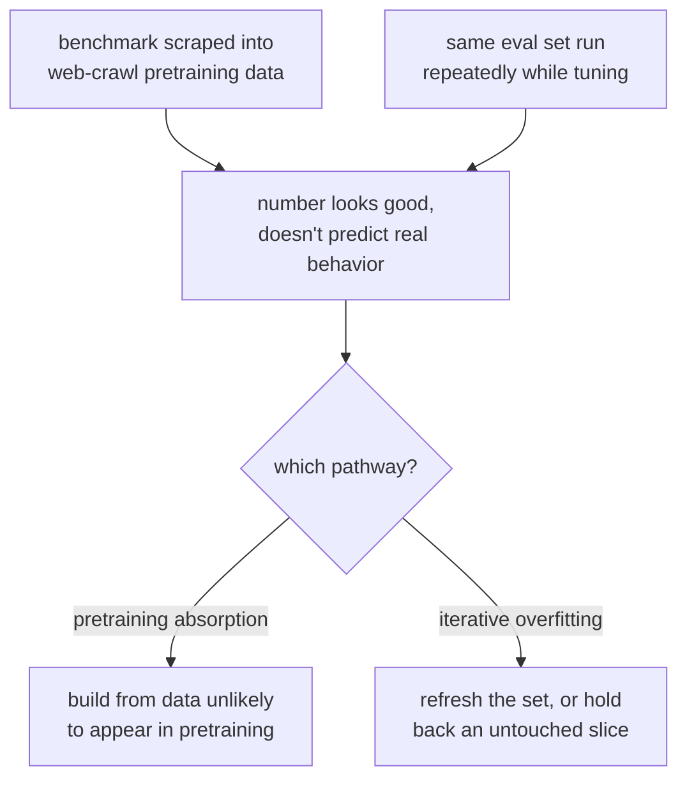

# Урок 1. Отложенные данные и загрязнение

**Связь с целью курса:** «Защитить число от загрязнения» это половина цели курса, и она начинается здесь: число из скомпрометированного набора для эвала не то число, которое стоит защищать.
**Первоисточник:** [Документация: "Define success criteria and build evaluations", Claude Platform Docs](https://platform.claude.com/docs/en/test-and-evaluate/develop-tests)
**Предварительные требования:** нет

## Что нужно знать

### Что значит «отложенные данные»

Набор для эвала **отложен**, когда оцениваемая модель ни при обучении, ни при дообучении не видела именно эти примеры или их близкие пересказы. Это единственное свойство позволяет хорошей оценке означать «это обобщается», а не «это заучено». Без него высокая оценка ничего не говорит: она не отличает модель, выучившую исходное умение, от той, что просто выучила ключ ответов.

Это та же дисциплина, что и отложенный тестовый набор в любом процессе машинного обучения: её легко сформулировать и на удивление легко нарушить на практике.

### Загрязнение: два разных вида сбоя

**Загрязнение данных** это когда примеры эвала или их почти дубликаты оказываются внутри того, на чём обучали модель. К этому ведут два разных пути:

1. **Поглощение при претрейнинге.** Публичные бенчмарки выкладывают в сеть, их собирают в наборы данных веб-краулинга, и они попадают в корпус претрейнинга базовой модели до того, как кто-либо построит на них эвал. Ваш конкретный набор для эвала модель не видела, но вполне могла видеть точные вопросы и ответы бенчмарка, на который вы опираетесь.
2. **Итеративное переобучение под эвал.** Буквальной утечки данных нет, но команда раз за разом прогоняет один и тот же набор для эвала, настраивая модель или промпт, и постепенно подгоняет систему под конкретные примеры перед глазами, а не под саму способность. Это закон Гудхарта в форме эвала: набор перестаёт измерять то, ради чего его построили, как только становится целью оптимизации.

Оба дают один симптом: число выглядит хорошо и не предсказывает поведение в реальном мире. Исправления нужны разные. Первый путь закрывают выбором или построением данных для эвала, которые вряд ли встретятся в корпусе претрейнинга (или проверкой их наличия). Второй закрывают обновлением набора или тем, что придерживают ещё одну его часть, чтобы под него нельзя было оптимизироваться бесконечно.

### Проверка на загрязнение при претрейнинге

Первый вид сбоя часто можно обнаружить напрямую. Метод направляющей инструкции Голчина и Сурдеану даёт модели первую часть примера из бенчмарка и просит дословно дополнить остальное. Если модель воспроизводит точное продолжение элемента бенчмарка сверх того, что дала бы правдоподобная догадка, это сильное свидетельство, что пример был в её обучающих данных. Та же идея обобщается: если модель может восстановить детали вашего набора для эвала, которые одно лишь описание не выдало бы (необычную формулировку, точное число, редкое имя собственное), подозревайте загрязнение.

### Чего требует «защитить число»

Прежде чем приводить оценку эвала как свидетельство, что изменение помогло, нужен ответ на вопрос: *почему модель не могла получить верный ответ заучиванием или тем, что её настраивали под этот самый набор?* Если ответить нечего, число описывает эвал, а не модель.

## Практика

1. ▢ Команда дообучает модель и оценивает её на известном публичном бенчмарке, а затем сообщает высокую оценку как доказательство, что дообучение помогло. Какой вопрос стоит задать, прежде чем доверять этой оценке?

Проверка

Могли ли данные этого бенчмарка (или их близкие пересказы) попасть в корпус претрейнинга модели, поскольку публичные бенчмарки регулярно попадают в обучающие данные веб-краулинга. Высокая оценка на загрязнённом бенчмарке ничего не говорит о дообучении.

2. ▢ Различите: модель никогда не обучали на точном тексте вашего набора для эвала, но ваша команда каждую неделю на протяжении полугода прогоняла этот набор из 50 примеров, настраивая под него промпты. Заслуживает ли этот эвал по-прежнему доверия? Почему да или нет?

Подсказка

Чтобы эвал перестал быть информативным, буквальная утечка данных не требуется.

Проверка

Нет, или по крайней мере теперь он под подозрением. Это второй путь загрязнения: итеративное переобучение под эвал. Полгода настройки под одни и те же 50 примеров, скорее всего, подогнали систему под эти конкретные примеры, а не под саму задачу, даже при нулевой буквальной утечке данных. Исправление: обновить набор или придержать нетронутую его часть.

3. ▢ Вы хотите проверить, не утёк ли конкретный бенчмарк в данные претрейнинга модели. Опишите тест, который можно запустить, используя идею направляющей инструкции из этого урока.

Проверка

Дайте модели первую часть примера из бенчмарка (вопрос или начало фрагмента) и попросите дословно дополнить остальное. Если она воспроизводит точное продолжение, включая детали, которые правдоподобная догадка не восстановила бы (точную формулировку, необычное число, редкое имя), это сильное свидетельство, что пример был в её обучающих данных.

4. ▢ Какое из этих утверждений лучше всего передаёт, что значит «отложенные данные» для набора эвала?

    - a) Набор для эвала хранится в отдельном файле от обучающих данных
    - b) Оцениваемая модель никогда не видела эти примеры или их близкие пересказы при обучении
    - c) Набор для эвала написал не разработчик модели
    - d) Набор для эвала использует другой формат, чем обучающие данные

Проверка

**b)** Оцениваемая модель никогда не видела эти примеры или их близкие пересказы при обучении. Варианты (a), (c) и (d) описывают организационные или стилистические факты, которые сами по себе загрязнению не мешают.

## Практика в реальной работе

- [ ] Выберите эвал или бенчмарк, на который вы сейчас опираетесь. Задайте письменно вопрос: правдоподобно ли, что эти данные попали в корпус претрейнинга оцениваемой вами модели? Запишите рассуждение в любом случае.
- [ ] Для того же эвала проверьте, не использовали ли его столько раз или не настраивались ли под него так часто, что закон Гудхарта стал реальным риском. Если да, отметьте, что вы бы придержали или обновили.
- [ ] Завтра: попробуйте тест на дополнение с направляющей инструкцией из этого урока на одном примере из бенчмарка против доступной вам модели и запишите, что нашли.

## Что почитать дальше

- [Документация: "Define success criteria and build evaluations", Claude Platform Docs](https://platform.claude.com/docs/en/test-and-evaluate/develop-tests)
- [Научная статья: "Time Travel in LLMs: Tracing Data Contamination in Large Language Models", Golchin and Surdeanu, 2023](https://arxiv.org/abs/2308.08493)
- [Ресурсы](../RESOURCES.md)

---

Не доходит? Перечитайте первоисточник в начале: этот урок его сжимает, а при сжатии понимание как раз и теряется. Загляните в [глоссарий](../GLOSSARY.md), если какой-то термин показался скользким.

Если неясен сам урок, а не материал, это дефект: [откройте issue](https://github.com/TokenCemetery/teach/issues).
