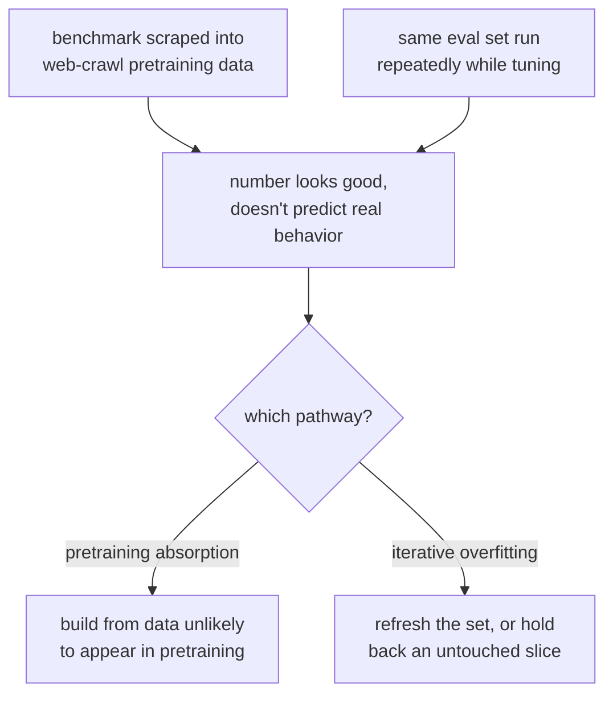

# 第 1 课：留出数据与数据污染

**使命关联:** “为这个数字抵御数据污染辩护”占了使命的一半，而它从这里开始：一个来自受损评测集的数字，不值得为之辩护。
**主要来源:** [文档：“Define success criteria and build evaluations”，Claude Platform Docs](https://platform.claude.com/docs/en/test-and-evaluate/develop-tests)
**前置知识:** 无

## 要点

### “留出”是什么意思

评测集是**留出**的，指的是被评判的模型在训练或微调期间，从未见过这些确切的样本，也没见过它们的近似改写。正是这一个性质，让一个好分数意味着“它能泛化”，而不是“它是背下来的”。没有这个性质，高分就没有参考价值：它分不清一个学会了底层能力的模型，和一个只是学会了标准答案的模型。

这和任何机器学习工作流中的留出测试集是同一条纪律，说起来容易，实际中却出奇地容易违反。

### 数据污染：两种不同的失败模式

**数据污染**指评测样本或它们的近似重复，进入了模型的训练数据。有两条不同的途径会造成它：

1. **预训练吸收**。公开基准被发布到网上，被抓取进网页爬取的数据集，在有人基于它搭建评测之前，就已进入基础模型的预训练语料。模型也许从未专门见过你的评测集，却可能见过你所依赖的某个基准的确切题目和答案。
2. **对评测的迭代式过拟合**。并没有发生字面意义上的数据泄漏，而是团队在调优模型或提示词时，反复运行同一个评测集，逐渐把系统塑造成能通过眼前这些具体的样本，而不是具备底层的能力。这是评测形式的古德哈特定律：评测集一旦成为优化的目标，就不再度量它当初要度量的东西。

两者产生的症状相同：一个看起来不错、却不能预测真实世界行为的数字。但它们需要不同的补救办法。第一种要靠选择或构建不太可能出现在预训练语料中的评测数据（或者检测它是否存在）。第二种要靠刷新评测集，或者再留出一部分，使它不能被无限期地针对着优化。

### 检测预训练污染

第一种失败模式往往可以直接检测出来。Golchin 和 Surdeanu 的引导式指令方法，把基准中某个样本的前半部分给模型，让它逐字补全其余部分。模型如果复现了基准样本确切的后续内容，而且超出了合理猜测所能产生的程度，就有力地说明这个样本曾在它的训练数据中。这个思路可以推广：如果模型能重构出你的评测集中、仅凭描述无法泄露的细节（不寻常的措辞、确切的数字、罕见的专有名词），就要怀疑存在污染。

### “为这个数字辩护”要求什么

在引用评测分数，作为某项改动有效的证据之前，你需要回答：*模型为什么不可能靠背诵，或靠针对这套确切的评测集调优，就答对这些题？* 如果回答不出来，这个数字描述的就是评测，而不是模型。

## 练习

1. ▢ 某团队微调了一个模型，并在一个著名的公开基准上评测，然后报告一个高分，作为微调有效的证明。在相信这个分数之前，你应该问什么问题？

检查

要问这个基准的数据（或它的近似改写），是否有可能出现在模型的预训练语料中，因为公开基准经常被抓取进网页爬取的训练数据。在被污染的基准上拿高分，对这次微调什么也说明不了。

2. ▢ 请区分：模型从未在你的评测集的确切文本上训练过，但你的团队六个月来每周都运行同一个 50 个样本的评测集，并针对它调优提示词。这个评测还可信吗？为什么可信或不可信？

提示

评测不再有参考价值，并不一定要发生字面意义上的数据泄漏。

检查

不可信，或者至少现在已经可疑。这是第二条污染途径：对评测的迭代式过拟合。六个月针对同样的 50 个样本调优，很可能把系统塑造成能通过这些具体的样本，而不是底层的任务，即便没有任何字面意义上的数据泄漏。补救办法是刷新评测集，或者留出一份未被动过的部分。

3. ▢ 你想检查某个特定的基准是否泄漏进了模型的预训练数据。请用本课的引导式指令思路，描述一个你可以运行的测试。

检查

把基准中某个样本的前半部分（一个问题，或一段文字的开头）交给模型，让它逐字补全其余部分。如果它复现了确切的后续内容，包括合理猜测无法恢复的细节（精确的措辞、不寻常的数字、罕见的名字），就有力地说明这个样本曾在它的训练数据中。

4. ▢ 下列哪一项最准确地说明了评测集“留出”的含义？

    - a) 评测集与训练数据放在不同的文件中
    - b) 被评判的模型在训练期间从未见过这些样本，或它们的近似改写
    - c) 评测集是由模型开发者之外的人编写的
    - d) 评测集使用与训练数据不同的格式

检查

**b)** 被评判的模型在训练期间从未见过这些样本，或它们的近似改写。（a）、（c）和（d）描述的是组织上或风格上的事实，它们本身并不能防止污染。

## 实战练习

- [ ] 挑一个你目前依赖的评测或基准。以书面形式问自己：这些数据有没有可能出现在你正在评测的模型的预训练语料中？无论答案如何，都把你的理由写下来。
- [ ] 对同一个评测，检查它是否已被重复使用或被针对着调优了太多次，以至于古德哈特定律成了现实的风险。如果是，记下你会留出或刷新什么。
- [ ] 明天：对你能访问的一个模型，在一个基准样本上试一试本课的引导式补全测试，并记录你的发现。

## 延伸阅读

- [文档：“Define success criteria and build evaluations”，Claude Platform Docs](https://platform.claude.com/docs/en/test-and-evaluate/develop-tests)
- [论文：“Time Travel in LLMs: Tracing Data Contamination in Large Language Models”，Golchin 和 Surdeanu，2023](https://arxiv.org/abs/2308.08493)
- [资源](../RESOURCES.md)

---

没学明白？请重读顶部的主要来源，因为本课是对它的压缩，而理解正是在压缩中流失的。如果有哪个术语觉得含糊，可以查看[术语表](../GLOSSARY.md)。

如果问题出在课程本身，而不是学习材料，那就是一个缺陷：[提交 issue](https://github.com/TokenCemetery/teach/issues)。
