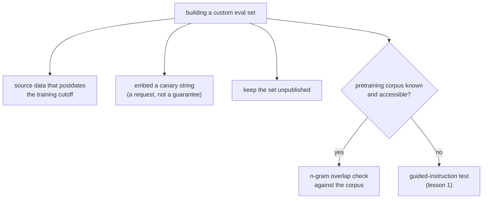

# Lección 2. Diseñar resistencia a la contaminación

**Vínculo con la misión:** La prueba de instrucción guiada de la lección 1 detecta la contaminación en una eval que no construiste, después de los hechos. Construir tu propio conjunto de eval significa que puedes diseñar para que la contaminación no ocurra en absoluto, lo cual es más barato que detectarla más tarde.
**Fuente principal:** [Paper: "Beyond the Imitation Game: Quantifying and Extrapolating the Capabilities of Language Models" (BIG-bench), Srivastava et al., 2022](https://arxiv.org/abs/2206.04615)
**Requisitos previos:** [Lección 1](0001-held-out-and-contamination.md), [Contaminación de datos](../GLOSSARY.md)

## Calentamiento

1. ▢ ¿Cuáles son las dos vías distintas que la lección 1 nombró para la contaminación de datos?

Comprobación

Absorción en el preentrenamiento: un benchmark se rastrea hacia datos de entrenamiento de la web antes de que nadie construya una eval sobre él. Sobreajuste iterativo a la eval: no hay fuga literal de datos, pero un equipo ajusta de forma repetida contra el mismo conjunto de eval hasta que deja de medir la habilidad de fondo.

2. ▢ ¿Qué comprueba realmente la prueba de instrucción guiada de la lección 1, y cómo funciona?

Comprobación

Comprueba si una instancia concreta de un benchmark estaba en los datos de entrenamiento de un modelo, dándole al modelo la primera parte de la instancia y pidiéndole completar el resto de forma literal. Reproducir detalles que una suposición plausible no recuperaría es una evidencia sólida de contaminación.

## Qué debes saber

### Detectar la contaminación no es el mismo trabajo que prevenirla

La prueba de instrucción guiada de la lección 1 es una herramienta de detección: te dice, después de los hechos, si probablemente ya ocurrió contaminación en un benchmark que no controlabas. Cuando construyes tu propio conjunto de eval en lugar de tomar prestado el de otra persona, la mejor posición es evitar que la contaminación llegue a ocurrir, ya que eso es mucho más barato que descubrirla más tarde y tener que reconstruir el conjunto.

### Usa datos posteriores al corte de entrenamiento del modelo

La prevención más directa: construye los ejemplos de eval a partir de material que no existía antes de que se recopilaran los datos de entrenamiento del modelo. La absorción en el preentrenamiento exige que los datos hayan existido y sido rastreables antes de que ocurriera el entrenamiento; los datos creados después de ese corte no pueden estar en él. Esto requiere conocer, u obtener una declaración fiable de, la fecha real del corte de entrenamiento del modelo, sin adivinarla, ya que la técnica solo funciona si la afirmación sobre el corte es exacta.

### Las canary strings señalan "no entrenar con esto"

BIG-bench introdujo la convención de la **canary string**: una frase marcadora única y distintiva incrustada junto a los datos del benchmark, que pide de forma explícita a cualquier rastreador que arme un corpus de entrenamiento que excluya el contenido que la contenga. Esto hace dos cosas. Primero, es una señal preventiva: los rastreadores y curadores de conjuntos de datos que respetan la convención excluyen los datos marcados antes de que el entrenamiento llegue a ocurrir, y no después. Segundo, sirve también como herramienta de detección de último recurso: si una canary string aparece más tarde en la salida de un modelo o en un corpus de entrenamiento accesible, es evidencia directa de que la petición de exclusión no se respetó, sin necesitar la inferencia a partir de una completación que hace la prueba de instrucción guiada. Una canary string es una petición, no un mecanismo de cumplimiento: depende de que los rastreadores elijan respetarla, así que reduce el riesgo en lugar de eliminarlo.

### Comprobar contra un corpus conocido, cuando se pueda

Cuando el corpus de preentrenamiento de un modelo es conocido o accesible (un corpus abierto, como un conjunto de datos público de la web), una **comprobación de solapamiento de n-gramas** directa entre tus datos de eval y ese corpus puede medir el riesgo de contaminación antes de que la eval llegue a usarse, en lugar de inferirlo del comportamiento del modelo como hace la prueba de instrucción guiada de la lección 1. Esto solo funciona cuando el corpus está realmente disponible para comprobar; para un modelo cerrado cuyos datos de entrenamiento no se divulgan, la prueba de instrucción guiada sigue siendo la herramienta disponible.

### Mantener el conjunto privado es la prevención más simple de todas

La absorción en el preentrenamiento ocurre porque los benchmarks se publican y luego se rastrean. Un conjunto de eval que nunca se publica, que se mantiene interno al equipo que lo usa, no puede rastrearse hacia el futuro corpus de preentrenamiento de nadie. Es la prevención más fuerte disponible y la razón de que un conjunto held-out digno de confianza durante mucho tiempo sea a menudo uno que nadie fuera del equipo ha visto jamás, a costa de perder la reproducibilidad y el escrutinio externo que ofrece un benchmark publicado.

## Práctica

1. ▢ Un equipo quiere construir una eval resistente a la absorción en el preentrenamiento. Considera sacar las preguntas de artículos publicados después del corte de entrenamiento declarado del modelo. ¿Por qué funciona esto, y qué necesitan verificar primero?

Comprobación

Funciona porque la absorción en el preentrenamiento exige que los datos hayan existido y sido rastreables antes de que ocurriera el entrenamiento; los datos creados después del corte no pueden estar en un corpus recopilado antes de que existieran. Necesitan verificar que el corte de entrenamiento real del modelo sea exacto y no solo una afirmación aproximada o de marketing, ya que la técnica solo protege contra la contaminación si la fecha del corte es fiable.

2. ▢ ¿Contra qué protege realmente incrustar una canary string en un conjunto de eval propio, y qué no garantiza?

Pista

Piensa si una canary string es una petición o un mecanismo de cumplimiento.

Comprobación

Señala a cualquier rastreador que arme un corpus de entrenamiento que el contenido marcado debe excluirse, lo que previene la contaminación antes de que ocurra el entrenamiento si se respeta la convención, y da una forma directa de detectar una fuga más tarde si la cadena aparece en la salida de un modelo o en un corpus accesible. No garantiza la exclusión: depende de que los rastreadores elijan respetar la convención, así que reduce el riesgo en lugar de eliminarlo.

3. ▢ ¿Cuándo es una comprobación de solapamiento de n-gramas contra un corpus conocido una herramienta mejor que la prueba de instrucción guiada de la lección 1, y cuándo deja de poder usarse por completo?

Comprobación

Es mejor cuando el corpus de preentrenamiento es conocido y accesible, ya que mide el solapamiento directamente en lugar de inferir la contaminación del comportamiento del modelo, y puede ejecutarse antes de que la eval llegue a usarse. Deja de poder usarse cuando el corpus no se divulga o es inaccesible, que es el caso normal de un modelo cerrado, y ahí la prueba de instrucción guiada sigue siendo la opción disponible.

4. ▢ Un equipo mantiene su conjunto de eval propio totalmente privado, sin publicarlo nunca. ¿Qué vía de contaminación previene esto de la forma más directa, y qué les cuesta a cambio?

Comprobación

Previene de la forma más directa la absorción en el preentrenamiento, ya que esa vía depende de que un benchmark se publique y luego se rastree; un conjunto sin publicar no puede rastrearse. El costo es perder la reproducibilidad y el escrutinio externo que ofrece un benchmark publicado, ya que nadie fuera del equipo puede verificarlo ni reutilizarlo.

5. ▢ ¿Qué afirmación es cierta sobre las canary strings y las comprobaciones de solapamiento de n-gramas en comparación con la prueba de instrucción guiada de la lección 1?

    - a) Ambas son métodos de detección idénticos en mecanismo a la prueba de instrucción guiada
    - b) Son técnicas preventivas o dependientes del corpus, utilizables al construir una eval propia o cuando el corpus de entrenamiento es accesible, a diferencia de la prueba de instrucción guiada, que funciona sobre el comportamiento de cualquier modelo
    - c) Solo se aplican a evals de ejecución de código, no a las basadas en texto
    - d) Las canary strings garantizan que un benchmark nunca se usará para entrenar

Comprobación

**b)** Una canary string es preventiva (una petición de exclusión, que se comprueba antes o después de los hechos), y una comprobación de solapamiento de n-gramas requiere un corpus accesible; la prueba de instrucción guiada, en cambio, infiere la contaminación de las completaciones de cualquier modelo, sin necesitar acceso al corpus. (a) es falsa: los mecanismos difieren, como describe la lección. (c) es falsa: nada en ninguna de las dos técnicas las restringe al código. (d) es falsa: una canary string es una petición que depende de la cooperación de los rastreadores, no una garantía.

## Prácticas en el mundo real

- [ ] Para un conjunto de eval propio que estés construyendo o manteniendo, comprueba si alguna vez se ha publicado, y si es así, trata cualquier puntuación alta en él con la misma sospecha que la lección 1 aplicó a los benchmarks públicos contaminados.
- [ ] Redacta una canary string para un conjunto de eval que controles, siguiendo la convención de BIG-bench, y añádela a los datos del conjunto.
- [ ] Mañana: averigua la fecha real del corte de entrenamiento de un modelo que evalúes con regularidad, a partir de su documentación y no de suposiciones, y anota si alguno de tus datos de eval es anterior a ella.

## Para profundizar

- [Paper: "Beyond the Imitation Game: Quantifying and Extrapolating the Capabilities of Language Models" (BIG-bench), Srivastava et al., 2022](https://arxiv.org/abs/2206.04615)
- [Paper: "Time Travel in LLMs: Tracing Data Contamination in Large Language Models", Golchin and Surdeanu, 2023](https://arxiv.org/abs/2308.08493)
- [Recursos](../RESOURCES.md)

---

¿No termina de quedar claro? Vuelve a leer la fuente primaria de arriba, ya que esta lección la comprime y en la compresión es donde se escapa la comprensión. Consulta el [glosario](../GLOSSARY.md) por si algún término te resultó resbaladizo.

Si lo poco claro es la propia lección y no el material, eso es un defecto: [abre un issue](https://github.com/TokenCemetery/teach/issues).
