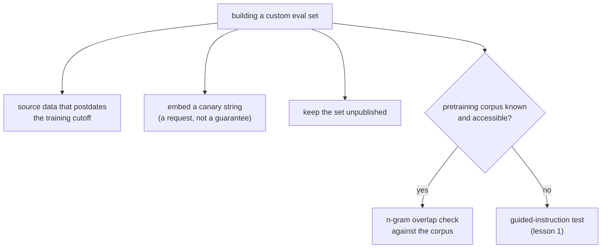

# Leçon 2. Concevoir la résistance à la contamination

**Lien avec la mission :** Le test d'instruction guidée de la leçon 1 détecte, après coup, la contamination d'une eval que vous n'avez pas construite. Construire votre propre jeu d'eval signifie que vous pouvez concevoir de quoi empêcher la contamination de se produire, ce qui coûte moins cher que de l'attraper plus tard.
**Source primaire :** [Article : "Beyond the Imitation Game: Quantifying and Extrapolating the Capabilities of Language Models" (BIG-bench), Srivastava et al., 2022](https://arxiv.org/abs/2206.04615)
**Prérequis :** [Leçon 1](0001-held-out-and-contamination.md), [Contamination des données](../GLOSSARY.md)

## Échauffement

1. ▢ Quelles sont les deux voies distinctes que la leçon 1 a nommées pour la contamination des données ?

Vérifier

Absorption au pré-entraînement : un benchmark est aspiré dans des données d'entraînement issues du crawl du web avant que quiconque construise une eval dessus. Surapprentissage itératif sur l'eval : pas de fuite littérale de données, mais une équipe règle à répétition sur le même jeu d'eval jusqu'à ce qu'il cesse de mesurer la compétence sous-jacente.

2. ▢ Que vérifie réellement le test d'instruction guidée de la leçon 1, et comment fonctionne-t-il ?

Vérifier

Il vérifie si une instance précise d'un benchmark figurait dans les données d'entraînement d'un modèle, en donnant au modèle le début de l'instance et en lui demandant de compléter le reste mot pour mot. Reproduire des détails qu'une supposition plausible ne retrouverait pas est une forte preuve de contamination.

## À savoir

### Détecter la contamination n'est pas le même travail que la prévenir

Le test d'instruction guidée de la leçon 1 est un outil de détection : il vous dit, après coup, si la contamination s'est probablement déjà produite sur un benchmark que vous ne contrôliez pas. Quand vous construisez votre propre jeu d'eval au lieu d'emprunter celui de quelqu'un d'autre, la meilleure position consiste à empêcher la contamination de jamais se produire, car c'est bien moins cher que de la découvrir plus tard et de devoir reconstruire le jeu.

### Utiliser des données postérieures à la date limite d'entraînement du modèle

La prévention la plus directe : construire les exemples d'eval à partir de contenus qui n'existaient pas avant la collecte des données d'entraînement du modèle. L'absorption au pré-entraînement exige que les données aient existé et été explorables avant l'entraînement ; des données créées après cette date limite ne peuvent pas y figurer. Cela suppose de connaître, ou d'obtenir une déclaration fiable de, la vraie date limite d'entraînement du modèle, sans la deviner, puisque la technique ne fonctionne que si l'affirmation sur cette date est exacte.

### Les chaînes canari signalent « ne pas entraîner sur ceci »

BIG-bench a introduit la convention de la **chaîne canari** : une phrase-marqueur unique et distinctive, intégrée à côté des données d'un benchmark, qui demande explicitement à tout crawler qui assemble un corpus d'entraînement d'exclure le contenu qui la contient. Cela fait deux choses. D'abord, c'est un signal préventif : les crawlers et les curateurs de jeux de données qui respectent la convention excluent les données marquées avant même que l'entraînement ait lieu, plutôt qu'après. Ensuite, c'est aussi un outil de détection de dernier recours : si une chaîne canari apparaît plus tard dans la sortie d'un modèle ou dans un corpus d'entraînement accessible, c'est la preuve directe que la demande d'exclusion n'a pas été honorée, sans avoir besoin de l'inférence à partir d'une complétion du test d'instruction guidée. Une chaîne canari est une demande, pas un mécanisme d'application : elle dépend du choix des crawlers de la respecter, donc elle réduit le risque sans l'éliminer.

### Vérifier face à un corpus connu, quand c'est possible

Quand le corpus de pré-entraînement d'un modèle est connu ou accessible (un corpus ouvert comme un jeu de données public issu du crawl du web), un **contrôle direct de recouvrement de n-grammes** entre vos données d'eval et ce corpus peut mesurer le risque de contamination avant même que l'eval serve, au lieu de l'inférer du comportement du modèle comme le fait le test d'instruction guidée de la leçon 1. Cela ne fonctionne que si le corpus est réellement disponible pour la comparaison ; pour un modèle fermé dont les données d'entraînement ne sont pas divulguées, le test d'instruction guidée reste l'outil disponible.

### Garder le jeu privé est la prévention la plus simple de toutes

L'absorption au pré-entraînement se produit parce que les benchmarks sont publiés, puis aspirés. Un jeu d'eval qui n'est jamais publié, gardé en interne par l'équipe qui l'utilise, ne peut être aspiré dans le futur corpus de pré-entraînement de personne. C'est la prévention la plus forte disponible, et la raison pour laquelle un jeu held-out digne de confiance sur la durée est souvent un jeu que personne en dehors de l'équipe n'a jamais vu, au prix de la perte de la reproductibilité et du regard extérieur qu'offre un benchmark publié.

## Pratique

1. ▢ Une équipe veut construire une eval résistante à l'absorption au pré-entraînement. Elle envisage de tirer des questions d'articles publiés après la date limite d'entraînement déclarée du modèle. Pourquoi cela fonctionne-t-il, et que doit-elle vérifier d'abord ?

Vérifier

Cela fonctionne parce que l'absorption au pré-entraînement exige que les données aient existé et été explorables avant l'entraînement ; des données créées après la date limite ne peuvent pas figurer dans un corpus collecté avant leur existence. Elle doit vérifier que la vraie date limite d'entraînement du modèle est exacte et pas seulement une affirmation approximative ou marketing, puisque la technique ne protège de la contamination que si la date limite est fiable.

2. ▢ Contre quoi l'intégration d'une chaîne canari dans un jeu d'eval sur mesure protège-t-elle réellement, et que ne garantit-elle pas ?

Indice

Demandez-vous si une chaîne canari est une demande ou un mécanisme d'application.

Vérifier

Elle signale à tout crawler qui assemble un corpus d'entraînement que le contenu marqué doit être exclu, ce qui prévient la contamination avant l'entraînement si la convention est respectée, et elle offre un moyen direct de détecter une fuite plus tard si la chaîne apparaît dans la sortie d'un modèle ou dans un corpus accessible. Elle ne garantit pas l'exclusion : elle dépend du choix des crawlers d'honorer la convention, donc elle réduit le risque sans l'éliminer.

3. ▢ Quand un contrôle de recouvrement de n-grammes face à un corpus connu est-il un meilleur outil que le test d'instruction guidée de la leçon 1, et quand cesse-t-il d'être utilisable ?

Vérifier

Il est meilleur quand le corpus de pré-entraînement est connu et accessible, puisqu'il mesure le recouvrement directement au lieu d'inférer la contamination du comportement du modèle, et qu'il peut être exécuté avant même que l'eval serve. Il cesse d'être utilisable quand le corpus n'est pas divulgué ou pas accessible, ce qui est le cas normal d'un modèle fermé, et le test d'instruction guidée reste alors l'option disponible.

4. ▢ Une équipe garde son jeu d'eval sur mesure entièrement privé, sans jamais le publier. Quelle voie de contamination cela prévient-il le plus directement, et que lui en coûte-t-il en échange ?

Vérifier

Cela prévient le plus directement l'absorption au pré-entraînement, puisque cette voie dépend d'un benchmark publié puis aspiré ; un jeu non publié ne peut pas être aspiré. Le coût est la perte de la reproductibilité et du regard extérieur qu'offre un benchmark publié, puisque personne en dehors de l'équipe ne peut le vérifier ni le réutiliser.

5. ▢ Laquelle de ces affirmations est vraie des chaînes canari et des contrôles de recouvrement de n-grammes par rapport au test d'instruction guidée de la leçon 1 ?

    - a) Les deux sont des méthodes de détection identiques par leur mécanisme au test d'instruction guidée
    - b) Ce sont des techniques préventives ou dépendantes d'un corpus, utilisables quand on construit une eval sur mesure ou quand le corpus d'entraînement est accessible, contrairement au test d'instruction guidée qui fonctionne sur le comportement de n'importe quel modèle
    - c) Elles ne s'appliquent qu'aux evals par exécution de code, pas aux evals textuelles
    - d) Les chaînes canari garantissent qu'un benchmark ne sera jamais utilisé pour l'entraînement

Vérifier

**b)** Une chaîne canari est préventive (une demande d'exclusion, vérifiable avant ou après coup), et un contrôle de recouvrement de n-grammes exige un corpus accessible ; le test d'instruction guidée infère au contraire la contamination des complétions de n'importe quel modèle, sans exiger d'accès au corpus. (a) est faux : les mécanismes diffèrent, comme le décrit la leçon. (c) est faux : rien dans l'une ou l'autre technique ne la limite au code. (d) est faux : une chaîne canari est une demande qui dépend de la coopération des crawlers, pas une garantie.

## Exercices en situation réelle

- [ ] Pour un jeu d'eval sur mesure que vous construisez ou maintenez, vérifiez s'il a déjà été publié, et si oui, traitez tout score élevé qu'il produit avec la même méfiance que la leçon 1 a appliquée aux benchmarks publics contaminés.
- [ ] Rédigez une chaîne canari pour un jeu d'eval que vous contrôlez, en suivant la convention de BIG-bench, et ajoutez-la aux données du jeu.
- [ ] Demain : trouvez la vraie date limite d'entraînement d'un modèle que vous évaluez régulièrement, dans sa documentation plutôt que par supposition, et notez si certaines de vos données d'eval la précèdent.

## Pour aller plus loin

- [Article : "Beyond the Imitation Game: Quantifying and Extrapolating the Capabilities of Language Models" (BIG-bench), Srivastava et al., 2022](https://arxiv.org/abs/2206.04615)
- [Article : "Time Travel in LLMs: Tracing Data Contamination in Large Language Models", Golchin and Surdeanu, 2023](https://arxiv.org/abs/2308.08493)
- [Ressources](../RESOURCES.md)

---

Ça ne passe pas ? Relisez la source primaire en haut de page, car cette leçon la condense et c'est dans la condensation que la compréhension s'échappe. Consultez le [glossaire](../GLOSSARY.md) pour tout terme qui vous a paru glissant.

Si c'est la leçon elle-même qui n'est pas claire plutôt que la matière, c'est un défaut : [ouvrez une issue](https://github.com/TokenCemetery/teach/issues).
