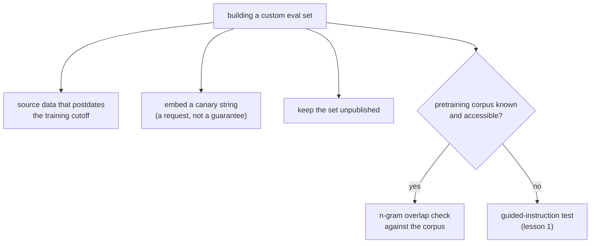

# पाठ 2. Contamination-Resistance को Design करना

**मिशन से संबंध:** पाठ 1 का guided-instruction test उस eval में contamination को बाद में पकड़ता है जो आपने नहीं बनाया। अपना eval सेट बनाने का मतलब है कि आप contamination होने के ख़िलाफ़ ही डिज़ाइन कर सकते हैं, जो उसे बाद में पकड़ने से सस्ता है।
**मुख्य स्रोत:** [पेपर: "Beyond the Imitation Game: Quantifying and Extrapolating the Capabilities of Language Models" (BIG-bench), Srivastava et al., 2022](https://arxiv.org/abs/2206.04615)
**पूर्व-आवश्यकताएँ:** [पाठ 1](0001-held-out-and-contamination.md), [Data contamination](../GLOSSARY.md)

## वार्म-अप

1. ▢ पाठ 1 ने data contamination के जो दो अलग रास्ते बताए थे, वे क्या हैं?

जाँचें

Pretraining में समा जाना: किसी के उस पर eval बनाने से पहले benchmark web-crawl training data में खींच लिया जाता है। Eval के प्रति बार-बार का overfitting: कोई शाब्दिक data रिसाव नहीं, पर टीम उसी eval सेट के विरुद्ध बार-बार tune करती है, जब तक कि वह मूल कौशल को मापना बंद न कर दे।

2. ▢ पाठ 1 का guided-instruction test असल में किस चीज़ की जाँच करता है, और वह कैसे काम करता है?

जाँचें

वह जाँचता है कि कोई ख़ास benchmark instance model के training data में था या नहीं, model को instance का पहला हिस्सा देकर और उससे बाक़ी हिस्सा ज्यों का त्यों पूरा करने को कहकर। ऐसे ब्योरे दोहराना जिन्हें कोई समझदार अनुमान नहीं पा सकता, contamination का पक्का प्रमाण है।

## यह जानें

### Contamination को पकड़ना और उसे रोकना एक ही काम नहीं हैं

पाठ 1 का guided-instruction test पकड़ने का औज़ार है: वह बाद में बताता है कि जिस benchmark पर आपका नियंत्रण नहीं था, उसमें contamination शायद पहले ही हो चुकी है। जब आप किसी और का सेट उधार लेने के बजाय अपना eval सेट बना रहे हों, तो बेहतर स्थिति यह है कि contamination कभी हो ही न, क्योंकि उसे बाद में खोजने और सेट दोबारा बनाने से यह कहीं सस्ता है।

### ऐसा data इस्तेमाल करें जो model के training cutoff के बाद का हो

सबसे सीधी रोकथाम: eval examples को उस सामग्री से बनाएँ जो model का training data इकट्ठा होने से पहले मौजूद ही नहीं थी। Pretraining में समाने के लिए ज़रूरी है कि data training होने से पहले मौजूद रहा हो और crawl हो सकता हो; उस cutoff के बाद बना data उसमें हो ही नहीं सकता। इसके लिए model की असली training cutoff तारीख़ जाननी होगी, या उसका भरोसेमंद बयान लेना होगा, अंदाज़ा नहीं लगाना होगा, क्योंकि technique तभी काम करती है जब cutoff का दावा सटीक हो।

### Canary strings संकेत देती हैं "इस पर train मत करो"

BIG-bench ने **canary string** की परंपरा शुरू की: benchmark data के साथ डाला गया एक अनोखा, अलग पहचान वाला चिह्न-वाक्यांश, जो training corpus जोड़ने वाले किसी भी crawler से साफ़ कहता है कि उसे रखने वाली सामग्री बाहर रखे। इससे दो काम होते हैं। पहला, यह रोकथाम का संकेत है: जो crawlers और dataset curators इस परंपरा का सम्मान करते हैं, वे चिह्नित data को training होने से पहले ही बाहर कर देते हैं, बाद में नहीं। दूसरा, यह आख़िरी सहारे के पकड़ने वाले औज़ार का भी काम करता है: अगर canary string बाद में किसी model के output या पहुँच-योग्य training corpus में दिखे, तो यह सीधा प्रमाण है कि बाहर रखने का अनुरोध नहीं माना गया, और इसके लिए guided-instruction test की तरह completion से अनुमान लगाने की ज़रूरत नहीं पड़ती। Canary string अनुरोध है, लागू करवाने की व्यवस्था नहीं: वह crawlers के उसका सम्मान करने के चुनाव पर निर्भर है, इसलिए वह जोखिम घटाती है, मिटाती नहीं।

### जब हो सके, ज्ञात corpus के सामने जाँचें

जब किसी model के पीछे का pretraining corpus ज्ञात या पहुँच-योग्य हो (public web-crawl dataset जैसा कोई खुला corpus), तो आपके eval data और उस corpus के बीच सीधी **n-gram overlap जाँच** eval के इस्तेमाल होने से पहले ही contamination का जोखिम माप सकती है, model के व्यवहार से अनुमान लगाने के बजाय, जैसा पाठ 1 का guided-instruction test करता है। यह तभी काम करता है जब corpus असल में जाँचने के लिए उपलब्ध हो; ऐसे closed model के लिए जिसका training data बताया नहीं गया, guided-instruction test ही उपलब्ध औज़ार रहता है।

### सेट को निजी रखना सबसे सरल रोकथाम है

Pretraining में समाना इसलिए होता है कि benchmarks प्रकाशित होते हैं, फिर scrape होते हैं। जो eval सेट कभी सार्वजनिक रूप से पोस्ट नहीं किया गया, और उसे इस्तेमाल करने वाली टीम के भीतर ही रहा, वह किसी के भी भावी pretraining corpus में scrape नहीं हो सकता। यह उपलब्ध सबसे मज़बूत रोकथाम है, और यही कारण है कि लंबे समय तक भरोसे लायक held-out सेट अक्सर वह होता है जिसे टीम के बाहर किसी ने कभी देखा ही नहीं, इस क़ीमत पर कि प्रकाशित benchmark जो reproducibility और बाहरी जाँच देता है वह खो जाती है।

## अभ्यास

1. ▢ एक टीम pretraining में समाने का सामना करने वाला eval बनाना चाहती है। वह model के बताए training cutoff के बाद प्रकाशित लेखों से सवाल लेने पर विचार करती है। यह क्यों काम करता है, और उन्हें पहले क्या जाँचना होगा?

जाँचें

यह इसलिए काम करता है कि pretraining में समाने के लिए ज़रूरी है कि data training होने से पहले मौजूद रहा हो और crawl हो सकता हो; cutoff के बाद बना data उस corpus में नहीं हो सकता जो उसके बनने से पहले इकट्ठा किया गया था। उन्हें जाँचना होगा कि model का असली training cutoff सटीक है, महज़ अनुमानित या marketing का दावा नहीं, क्योंकि technique contamination से तभी बचाती है जब cutoff की तारीख़ भरोसेमंद हो।

2. ▢ Custom eval सेट में canary string डालना असल में किस चीज़ से बचाता है, और किसकी गारंटी नहीं देता?

संकेत

सोचें कि canary string अनुरोध है या लागू करवाने की व्यवस्था।

जाँचें

वह training corpus जोड़ने वाले किसी भी crawler को संकेत देती है कि चिह्नित सामग्री बाहर रखी जाए, जिससे परंपरा का सम्मान होने पर training होने से पहले ही contamination रुक जाती है, और अगर string बाद में किसी model के output या पहुँच-योग्य corpus में दिखे तो रिसाव पकड़ने का सीधा तरीक़ा देती है। वह बाहर रखे जाने की गारंटी नहीं देती: वह crawlers के परंपरा निभाने के चुनाव पर निर्भर है, इसलिए जोखिम घटाती है, मिटाती नहीं।

3. ▢ ज्ञात corpus के सामने n-gram overlap जाँच कब पाठ 1 के guided-instruction test से बेहतर औज़ार है, और कब वह इस्तेमाल लायक ही नहीं रहती?

जाँचें

वह तब बेहतर है जब pretraining corpus ज्ञात और पहुँच-योग्य हो, क्योंकि वह model के व्यवहार से contamination का अनुमान लगाने के बजाय overlap सीधे मापती है, और eval के इस्तेमाल होने से पहले ही चलाई जा सकती है। वह तब इस्तेमाल लायक नहीं रहती जब corpus बताया नहीं गया या पहुँच से बाहर हो, जो closed model का आम मामला है, और वहाँ guided-instruction test ही उपलब्ध विकल्प रहता है।

4. ▢ एक टीम अपना custom eval सेट पूरी तरह निजी रखती है, उसे कभी सार्वजनिक रूप से पोस्ट नहीं करती। यह contamination के किस रास्ते को सबसे सीधे रोकता है, और बदले में उन्हें क्या देना पड़ता है?

जाँचें

यह pretraining में समाने को सबसे सीधे रोकता है, क्योंकि वह रास्ता benchmark के प्रकाशित होने और फिर scrape होने पर निर्भर है; अप्रकाशित सेट scrape नहीं हो सकता। क़ीमत यह है कि प्रकाशित benchmark जो reproducibility और बाहरी जाँच देता है वह खो जाती है, क्योंकि टीम के बाहर कोई उसे सत्यापित या दोबारा इस्तेमाल नहीं कर सकता।

5. ▢ पाठ 1 के guided-instruction test की तुलना में canary strings और n-gram overlap जाँचों के बारे में कौन-सा दावा सही है?

    - a) दोनों पकड़ने के तरीक़े हैं जो guided-instruction test से क्रियाविधि में बिल्कुल एक जैसे हैं
    - b) वे रोकथाम वाली या corpus पर निर्भर techniques हैं, जो custom eval बनाते समय या training corpus पहुँच-योग्य होने पर इस्तेमाल हो सकती हैं, guided-instruction test के उलट, जो किसी भी model के व्यवहार पर काम करता है
    - c) वे सिर्फ़ code-execution evals पर लागू होती हैं, text-आधारित पर नहीं
    - d) Canary strings गारंटी देती हैं कि benchmark पर कभी train नहीं होगा

जाँचें

**b)** Canary string रोकथाम वाली है (बाहर रखने का अनुरोध, जो बाद में या पहले जाँचा जाता है), और n-gram overlap जाँच के लिए पहुँच-योग्य corpus चाहिए; guided-instruction test इसके बजाय किसी भी model की completions से contamination का अनुमान लगाता है, और corpus तक पहुँच नहीं माँगता। (a) ग़लत है: क्रियाविधियाँ अलग हैं, जैसा पाठ बताता है। (c) ग़लत है: दोनों में से किसी technique को code तक सीमित करने वाली कोई बात नहीं है। (d) ग़लत है: canary string crawler के सहयोग पर निर्भर अनुरोध है, गारंटी नहीं।

## असली दुनिया का अभ्यास

- [ ] जो custom eval सेट आप बना रहे हैं या सँभाल रहे हैं, उसके लिए जाँचें कि क्या वह कभी सार्वजनिक रूप से पोस्ट हुआ है, और अगर हाँ, तो उस पर किसी भी ऊँचे score को उसी शक की नज़र से देखें जो पाठ 1 ने contaminated public benchmarks पर लगाई थी।
- [ ] अपने नियंत्रण वाले eval सेट के लिए BIG-bench की परंपरा के अनुसार canary string का मसौदा बनाएँ, और उसे सेट के data में जोड़ें।
- [ ] कल: जिस model को आप नियमित रूप से परखते हैं उसकी असली training cutoff तारीख़ अंदाज़े से नहीं बल्कि उसके दस्तावेज़ों से पता करें, और लिखें कि आपका कोई eval data उससे पहले का है या नहीं।

## आगे बढ़ने के लिए

- [पेपर: "Beyond the Imitation Game: Quantifying and Extrapolating the Capabilities of Language Models" (BIG-bench), Srivastava et al., 2022](https://arxiv.org/abs/2206.04615)
- [पेपर: "Time Travel in LLMs: Tracing Data Contamination in Large Language Models", Golchin and Surdeanu, 2023](https://arxiv.org/abs/2308.08493)
- [संसाधन](../RESOURCES.md)

---

बात नहीं बन रही? ऊपर दिए primary source को दोबारा पढ़ें, क्योंकि यह पाठ उसे संक्षिप्त करता है और समझ संक्षेप में ही रिसती है। जो शब्द फिसलन भरा लगे, उसके लिए [शब्दावली](../GLOSSARY.md) देखें।

अगर दिक़्क़त सामग्री की नहीं बल्कि पाठ की ही है, तो वह एक खोट है: [issue खोलें](https://github.com/TokenCemetery/teach/issues)।
