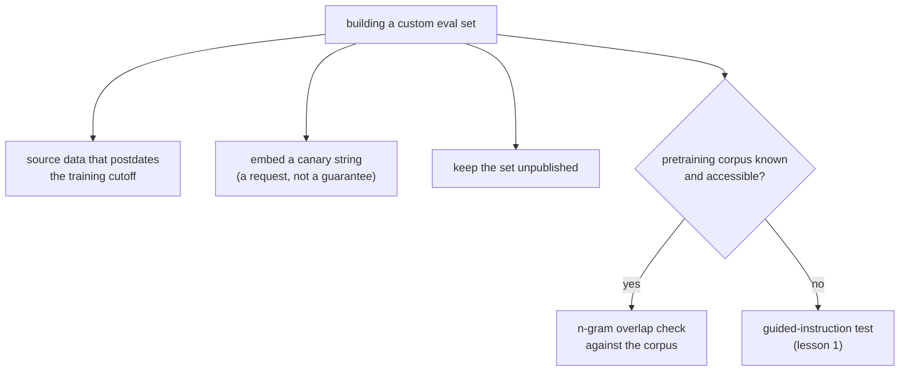

# Lição 2. Projetando resistência à contaminação

**Ligação com a missão:** O teste de instrução guiada da lição 1 detecta, depois do fato, a contaminação em um eval que você não construiu. Construir o seu próprio conjunto de eval significa poder se proteger para que a contaminação nem chegue a acontecer, o que é mais barato do que pegá-la depois.
**Fonte principal:** [Artigo científico: "Beyond the Imitation Game: Quantifying and Extrapolating the Capabilities of Language Models" (BIG-bench), Srivastava et al., 2022](https://arxiv.org/abs/2206.04615)
**Pré-requisitos:** [Lição 1](0001-held-out-and-contamination.md), [Contaminação de dados](../GLOSSARY.md)

## Aquecimento

1. ▢ Quais são os dois caminhos distintos que a lição 1 nomeou para a contaminação de dados?

Verificação

Absorção no pré-treinamento: um benchmark é raspado para dentro de dados de treinamento de web-crawl antes que alguém construa um eval sobre ele. Overfitting iterativo ao eval: sem vazamento literal de dados, mas uma equipe ajusta repetidamente contra o mesmo conjunto de eval até ele deixar de medir a habilidade de fundo.

2. ▢ O que o teste de instrução guiada da lição 1 de fato verifica, e como ele funciona?

Verificação

Ele verifica se uma instância específica de um benchmark estava nos dados de treinamento de um modelo, dando ao modelo a primeira parte da instância e pedindo que complete o resto literalmente. Reproduzir detalhes que um palpite plausível não recuperaria é forte evidência de contaminação.

## Saiba isto

### Detectar a contaminação não é o mesmo trabalho que preveni-la

O teste de instrução guiada da lição 1 é uma ferramenta de detecção: ele diz, depois do fato, se a contaminação provavelmente já aconteceu com um benchmark que você não controlava. Quando você está construindo o seu próprio conjunto de eval, em vez de pegar emprestado o de outra pessoa, a melhor posição é prevenir que a contaminação aconteça, já que isso é muito mais barato do que descobri-la depois e ter de reconstruir o conjunto.

### Use dados posteriores ao corte de treinamento do modelo

A prevenção mais direta: construir os exemplos de eval a partir de material que não existia antes de os dados de treinamento do modelo serem coletados. A absorção no pré-treinamento exige que os dados tenham existido e sido rastreáveis antes de o treinamento acontecer; dados criados depois desse corte não têm como estar nele. Isso exige conhecer, ou obter uma declaração confiável de, a data real de corte de treinamento do modelo, e não chutá-la, já que a técnica só funciona se a afirmação sobre o corte for exata.

### Canary strings sinalizam "não treine com isto"

O BIG-bench introduziu a convenção da **canary string**: uma frase marcadora única e distintiva embutida junto aos dados de um benchmark, pedindo explicitamente a qualquer crawler que monte um corpus de treinamento que exclua o conteúdo que a contenha. Isso faz duas coisas. Primeiro, é um sinal preventivo: crawlers e curadores de datasets que respeitam a convenção excluem os dados marcados antes de o treinamento sequer acontecer, e não depois. Segundo, serve também como ferramenta de detecção de último recurso: se uma canary string aparecer depois na saída de um modelo ou em um corpus de treinamento acessível, isso é evidência direta de que o pedido de exclusão não foi respeitado, sem precisar da inferência a partir de uma completion que o teste de instrução guiada faz. Uma canary string é um pedido, não um mecanismo de imposição: ela depende de os crawlers escolherem respeitá-la, então reduz o risco em vez de eliminá-lo.

### Verificando contra um corpus conhecido, quando dá

Quando o corpus de pré-treinamento por trás de um modelo é conhecido ou acessível (um corpus aberto, como um dataset público de web-crawl), uma **verificação de sobreposição de n-gramas** direta entre os seus dados de eval e esse corpus pode medir o risco de contaminação antes mesmo de o eval ser usado, em vez de inferi-lo do comportamento do modelo como faz o teste de instrução guiada da lição 1. Isso só funciona quando o corpus está de fato disponível para checagem; para um modelo fechado, cujos dados de treinamento não são divulgados, o teste de instrução guiada continua sendo a ferramenta disponível.

### Manter o conjunto privado é a prevenção mais simples de todas

A absorção no pré-treinamento acontece porque benchmarks são publicados e depois raspados. Um conjunto de eval que nunca é postado publicamente, mantido interno à equipe que o usa, não tem como ser raspado para dentro do corpus de pré-treinamento futuro de ninguém. Esta é a prevenção mais forte disponível e a razão de um conjunto held-out digno de confiança por muito tempo ser, muitas vezes, um que ninguém fora da equipe jamais viu, ao custo de perder a reprodutibilidade e o escrutínio externo que um benchmark publicado oferece.

## Prática

1. ▢ Uma equipe quer construir um eval resistente à absorção no pré-treinamento. Ela considera obter perguntas de artigos publicados depois do corte de treinamento declarado do modelo. Por que isso funciona, e o que ela precisa verificar primeiro?

Verificação

Funciona porque a absorção no pré-treinamento exige que os dados tenham existido e sido rastreáveis antes de o treinamento acontecer; dados criados depois do corte não podem estar em um corpus coletado antes de existirem. Ela precisa verificar se o corte de treinamento real do modelo é exato, e não apenas uma afirmação aproximada ou de marketing, já que a técnica só protege contra a contaminação se a data de corte for confiável.

2. ▢ Contra o que embutir uma canary string em um conjunto de eval customizado de fato protege, e o que ela não garante?

Dica

Pense se uma canary string é um pedido ou um mecanismo de imposição.

Verificação

Ela sinaliza a qualquer crawler que monte um corpus de treinamento que o conteúdo marcado deve ser excluído, prevenindo a contaminação antes de o treinamento acontecer se a convenção for respeitada, e dá uma forma direta de detectar um vazamento depois, se a string aparecer na saída de um modelo ou em um corpus acessível. Ela não garante a exclusão: depende de os crawlers escolherem honrar a convenção, então reduz o risco em vez de eliminá-lo.

3. ▢ Quando uma verificação de sobreposição de n-gramas contra um corpus conhecido é uma ferramenta melhor que o teste de instrução guiada da lição 1, e quando ela deixa de ser utilizável?

Verificação

Ela é melhor quando o corpus de pré-treinamento é conhecido e acessível, já que mede a sobreposição diretamente em vez de inferir a contaminação do comportamento do modelo, e pode ser executada antes de o eval ser usado. Deixa de ser utilizável quando o corpus não é divulgado ou não é acessível, que é o caso normal de um modelo fechado, e o teste de instrução guiada continua sendo a opção disponível ali.

4. ▢ Uma equipe mantém seu conjunto de eval customizado inteiramente privado, sem nunca postá-lo publicamente. Que caminho de contaminação isso previne de forma mais direta, e o que isso custa a ela em troca?

Verificação

Previne de forma mais direta a absorção no pré-treinamento, já que esse caminho depende de um benchmark ser publicado e depois raspado; um conjunto não publicado não tem como ser raspado. O custo é perder a reprodutibilidade e o escrutínio externo que um benchmark publicado oferece, já que ninguém fora da equipe pode verificá-lo ou reutilizá-lo.

5. ▢ Qual afirmação é verdadeira sobre canary strings e verificações de sobreposição de n-gramas em comparação com o teste de instrução guiada da lição 1?

    - a) Ambas são métodos de detecção idênticos em mecanismo ao teste de instrução guiada
    - b) São técnicas preventivas ou dependentes de corpus, utilizáveis ao construir um eval customizado ou quando o corpus de treinamento é acessível, ao contrário do teste de instrução guiada, que funciona sobre o comportamento de qualquer modelo
    - c) Aplicam-se apenas a evals de execução de código, não a evals baseados em texto
    - d) Canary strings garantem que um benchmark nunca será usado em treinamento

Verificação

**b)** Uma canary string é preventiva (um pedido de exclusão, verificado antes ou depois do fato), e uma verificação de sobreposição de n-gramas exige um corpus acessível; o teste de instrução guiada, em vez disso, infere a contaminação a partir das completions de qualquer modelo, sem precisar de acesso a corpus. (a) é falsa: os mecanismos diferem, como a lição descreve. (c) é falsa: nada em nenhuma das duas técnicas a restringe a código. (d) é falsa: uma canary string é um pedido que depende da cooperação dos crawlers, não uma garantia.

## Prática no mundo real

- [ ] Para um conjunto de eval customizado que você está construindo ou mantendo, verifique se ele já foi postado publicamente alguma vez e, se sim, trate qualquer pontuação alta nele com a mesma suspeita que a lição 1 aplicou a benchmarks públicos contaminados.
- [ ] Redija uma canary string para um conjunto de eval que você controla, seguindo a convenção do BIG-bench, e adicione-a aos dados do conjunto.
- [ ] Amanhã: descubra a data real de corte de treinamento de um modelo que você avalia com regularidade, a partir da documentação dele e não de suposição, e anote se algum dos seus dados de eval é anterior a ela.

## Para ir além

- [Artigo científico: "Beyond the Imitation Game: Quantifying and Extrapolating the Capabilities of Language Models" (BIG-bench), Srivastava et al., 2022](https://arxiv.org/abs/2206.04615)
- [Artigo científico: "Time Travel in LLMs: Tracing Data Contamination in Large Language Models", Golchin e Surdeanu, 2023](https://arxiv.org/abs/2308.08493)
- [Recursos](../RESOURCES.md)

---

Não ficou claro? Releia a fonte principal no topo, já que esta lição a comprime e é na compressão que o entendimento escapa. Consulte o [glossário](../GLOSSARY.md) para qualquer termo que pareceu escorregadio.

Se o problema é a lição em si, e não o material, isso é um defeito: [abra uma issue](https://github.com/TokenCemetery/teach/issues).
