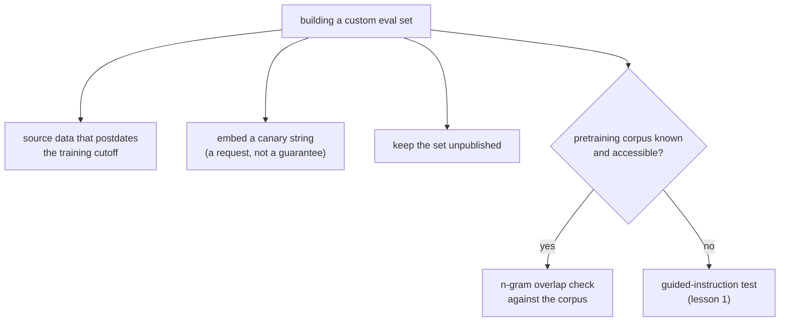

# Урок 2. Проектирование устойчивости к загрязнению

**Связь с целью курса:** Тест с направляющей инструкцией из урока 1 обнаруживает загрязнение в эвале, который вы не строили, постфактум. Когда вы строите собственный набор для эвала, можно проектировать его так, чтобы загрязнения не случилось вовсе, а это дешевле, чем ловить его потом.
**Первоисточник:** [Научная статья: "Beyond the Imitation Game: Quantifying and Extrapolating the Capabilities of Language Models" (BIG-bench), Srivastava et al., 2022](https://arxiv.org/abs/2206.04615)
**Предварительные требования:** [Урок 1](0001-held-out-and-contamination.md), [Загрязнение данных](../GLOSSARY.md)

## Разминка

1. ▢ Какие два разных пути загрязнения данных назвал урок 1?

Проверка

Поглощение при претрейнинге: бенчмарк попадает в обучающие данные веб-краулинга до того, как кто-либо построил на нём эвал. Итеративное переобучение под эвал: буквальной утечки данных нет, но команда раз за разом настраивается под один и тот же набор для эвала, пока он не перестанет измерять исходное умение.

2. ▢ Что на самом деле проверяет тест с направляющей инструкцией из урока 1 и как он работает?

Проверка

Он проверяет, был ли конкретный пример из бенчмарка в обучающих данных модели: модели дают первую часть примера и просят дословно дополнить остальное. Воспроизведение деталей, которые правдоподобная догадка не восстановила бы, сильное свидетельство загрязнения.

## Что нужно знать

### Обнаружить загрязнение и предотвратить его это разные задачи

Тест с направляющей инструкцией из урока 1 это инструмент обнаружения: он постфактум говорит, вероятно ли, что загрязнение уже случилось с бенчмарком, который вы не контролировали. Когда вы строите собственный набор для эвала, а не берёте чужой, лучшая позиция в том, чтобы загрязнение не произошло вовсе, поскольку это намного дешевле, чем обнаружить его позже и пересобирать набор.

### Используйте данные, появившиеся позже даты отсечения обучения модели

Самая прямая мера предотвращения: строить примеры для эвала из материала, которого не существовало до сбора обучающих данных модели. Поглощение при претрейнинге требует, чтобы данные существовали и были доступны краулеру до обучения; данные, созданные после этой даты отсечения, никак не могут в них оказаться. Для этого нужно знать, или получить достоверное заявление, фактическую дату отсечения обучения модели, а не гадать, поскольку приём работает, только если утверждение о дате отсечения точно.

### Строки-канарейки сигнализируют «не обучайтесь на этом»

BIG-bench ввёл конвенцию **строки-канарейки**: уникальной, отличительной фразы-маркера, встроенной рядом с данными бенчмарка, с явной просьбой к любому краулеру, собирающему обучающий корпус, исключить содержимое, в котором она встречается. Это делает две вещи. Во-первых, это превентивный сигнал: краулеры и составители наборов данных, соблюдающие конвенцию, исключают помеченные данные до обучения, а не после. Во-вторых, это инструмент обнаружения на крайний случай: если строка-канарейка потом всплывает в выводе модели или в доступном обучающем корпусе, это прямое свидетельство, что просьбу об исключении не выполнили, и выводить это из дополнения, как в тесте с направляющей инструкцией, не нужно. Строка-канарейка это просьба, а не механизм принуждения: она зависит от того, решит ли краулер её уважать, поэтому снижает риск, но не устраняет его.

### Проверка по известному корпусу, когда это возможно

Когда корпус претрейнинга, стоящий за моделью, известен или доступен (открытый корпус вроде публичного набора данных веб-краулинга), прямая **проверка перекрытия n-грамм** между вашими данными для эвала и этим корпусом позволяет измерить риск загрязнения до того, как эвал вообще будет использован, а не выводить его из поведения модели, как делает тест с направляющей инструкцией из урока 1. Это работает, только когда корпус действительно доступен для проверки; для закрытой модели с нераскрытыми обучающими данными остаётся доступным тест с направляющей инструкцией.

### Хранить набор закрытым самая простая мера предотвращения

Поглощение при претрейнинге происходит потому, что бенчмарки публикуют, а затем собирают краулером. Набор для эвала, который никогда не выкладывают публично и держат внутри использующей его команды, нельзя собрать ни в чей будущий корпус претрейнинга. Это самая сильная доступная мера, и именно поэтому набор отложенных данных, которому можно доверять долго, нередко тот, которого никто вне команды никогда не видел, ценой потери воспроизводимости и внешней проверки, которые даёт опубликованный бенчмарк.

## Практика

1. ▢ Команда хочет построить эвал, устойчивый к поглощению при претрейнинге. Она рассматривает вариант брать вопросы из статей, опубликованных после заявленной даты отсечения обучения модели. Почему это работает и что им нужно сначала проверить?

Проверка

Это работает, потому что поглощение при претрейнинге требует, чтобы данные существовали и были доступны краулеру до обучения; данные, созданные после даты отсечения, не могут быть в корпусе, собранном до их появления. Нужно проверить, что фактическая дата отсечения обучения модели точна, а не приблизительное или маркетинговое заявление, поскольку приём защищает от загрязнения, только если дате отсечения можно верить.

2. ▢ От чего на самом деле защищает встраивание строки-канарейки в собственный набор для эвала и чего она не гарантирует?

Подсказка

Подумайте, строка-канарейка это просьба или механизм принуждения.

Проверка

Она сигнализирует любому краулеру, собирающему обучающий корпус, что помеченное содержимое следует исключить, предотвращая загрязнение до обучения, если конвенцию соблюдают, и даёт прямой способ обнаружить утечку позже, если строка всплывёт в выводе модели или в доступном корпусе. Исключения она не гарантирует: она зависит от того, решат ли краулеры соблюдать конвенцию, поэтому снижает риск, но не устраняет его.

3. ▢ Когда проверка перекрытия n-грамм по известному корпусу лучше теста с направляющей инструкцией из урока 1 и когда она перестаёт быть пригодной совсем?

Проверка

Она лучше, когда корпус претрейнинга известен и доступен, поскольку измеряет перекрытие напрямую, а не выводит загрязнение из поведения модели, и её можно запустить до того, как эвал вообще использован. Она перестаёт быть пригодной, когда корпус не раскрыт или недоступен, а это обычный случай закрытой модели, и тогда остаётся тест с направляющей инструкцией.

4. ▢ Команда держит собственный набор для эвала полностью закрытым и никогда не публикует его. Какой путь загрязнения это предотвращает прямее всего и чем они за это платят?

Проверка

Прямее всего это предотвращает поглощение при претрейнинге, поскольку этот путь зависит от того, что бенчмарк опубликован, а затем собран краулером; неопубликованный набор собрать нельзя. Цена: потеря воспроизводимости и внешней проверки, которые даёт опубликованный бенчмарк, поскольку никто вне команды не может его проверить или переиспользовать.

5. ▢ Какое утверждение верно для строк-канареек и проверок перекрытия n-грамм по сравнению с тестом с направляющей инструкцией из урока 1?

    - a) Оба это методы обнаружения, по механизму идентичные тесту с направляющей инструкцией
    - b) Это превентивные или зависящие от корпуса приёмы, применимые при построении собственного эвала или когда обучающий корпус доступен, в отличие от теста с направляющей инструкцией, который работает по поведению любой модели
    - c) Они применимы только к эвалам по исполнению кода, а не к текстовым
    - d) Строки-канарейки гарантируют, что на бенчмарке никогда не будут обучаться

Проверка

**b)** Строка-канарейка превентивна (просьба об исключении, проверяемая до или после события), а проверка перекрытия n-грамм требует доступного корпуса; тест с направляющей инструкцией же выводит загрязнение из дополнений любой модели и доступа к корпусу не требует. Вариант (a) неверен: механизмы различаются, как описывает урок. Вариант (c) неверен: ничто в этих приёмах не ограничивает их кодом. Вариант (d) неверен: строка-канарейка это просьба, зависящая от сотрудничества краулера, а не гарантия.

## Практика в реальной работе

- [ ] Для собственного набора для эвала, который вы строите или поддерживаете, проверьте, публиковался ли он когда-нибудь публично, и если да, относитесь к любой высокой оценке на нём с тем же подозрением, с каким урок 1 относился к загрязнённым публичным бенчмаркам.
- [ ] Составьте строку-канарейку для набора для эвала, который вы контролируете, по конвенции BIG-bench и добавьте её в данные набора.
- [ ] Завтра: выясните фактическую дату отсечения обучения для модели, которую вы регулярно оцениваете, по её документации, а не по предположению, и отметьте, не предшествуют ли ей какие-то из ваших данных для эвала.

## Что почитать дальше

- [Научная статья: "Beyond the Imitation Game: Quantifying and Extrapolating the Capabilities of Language Models" (BIG-bench), Srivastava et al., 2022](https://arxiv.org/abs/2206.04615)
- [Научная статья: "Time Travel in LLMs: Tracing Data Contamination in Large Language Models", Golchin and Surdeanu, 2023](https://arxiv.org/abs/2308.08493)
- [Ресурсы](../RESOURCES.md)

---

Не доходит? Перечитайте первоисточник в начале: этот урок его сжимает, а при сжатии понимание как раз и теряется. Загляните в [глоссарий](../GLOSSARY.md), если какой-то термин показался скользким.

Если неясен сам урок, а не материал, это дефект: [откройте issue](https://github.com/TokenCemetery/teach/issues).
