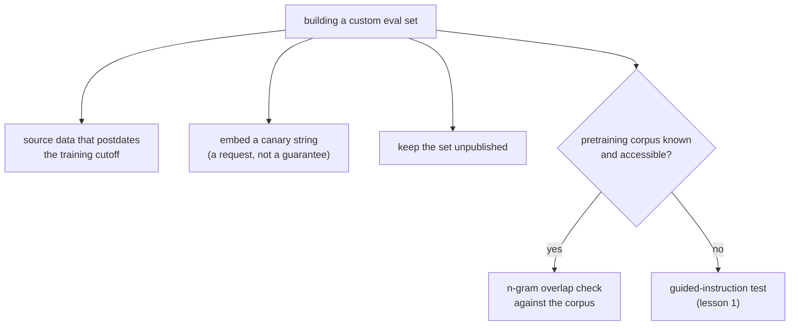

# 第 2 课：设计抗污染能力

**使命关联:** 第 1 课的引导式指令测试，是在事后检测一个并非你所建的评测中的污染。自己搭建评测集，意味着你可以从设计上就防止污染发生，这比事后再去发现要便宜。
**主要来源:** [论文：“Beyond the Imitation Game: Quantifying and Extrapolating the Capabilities of Language Models”（BIG-bench），Srivastava 等，2022](https://arxiv.org/abs/2206.04615)
**前置知识:** [第 1 课](0001-held-out-and-contamination.md)、[数据污染](../GLOSSARY.md)

## 热身

1. ▢ 第 1 课为数据污染点出的两条不同途径是什么？

检查

预训练吸收：基准在有人基于它搭建评测之前，就被抓取进了网页爬取的训练数据。对评测的迭代式过拟合：没有字面意义上的数据泄漏，而是团队反复针对同一个评测集调优，直到它不再度量底层的能力。

2. ▢ 第 1 课的引导式指令测试究竟检查什么，它是怎么做的？

检查

它检查某个特定的基准样本是否曾在模型的训练数据中：把样本的前半部分交给模型，让它逐字补全其余部分。复现了合理猜测无法恢复的细节，就有力地说明存在污染。

## 要点

### 检测污染与防止污染，不是同一项工作

第 1 课的引导式指令测试是一种检测工具：它在事后告诉你，一个你无法控制的基准是否很可能已经遭到污染。当你自己搭建评测集，而不是借用别人的时候，更好的位置是从一开始就防止污染发生，因为这比事后发现、不得不重建评测集要便宜得多。

### 使用晚于模型训练截止日期的数据

最直接的预防：用在模型的训练数据被收集之前并不存在的材料，来构建评测样本。预训练吸收要求数据在训练发生之前就已存在并且可被爬取；截止日期之后产生的数据，不可能出现在其中。这要求你知道，或者能拿到一份可靠的说明，指明模型真正的训练截止日期，而不是靠猜，因为这项技术只有在截止日期的说法准确时才有效。

### 金丝雀字符串发出“不要用它来训练”的信号

BIG-bench 引入了**金丝雀字符串**的约定：在基准数据旁边嵌入一个独一无二、特征鲜明的标记短语，明确请求任何在组装训练语料的爬虫，排除含有它的内容。这起两个作用。第一，它是预防性的信号：遵守这一约定的爬虫和数据集整理者，会在训练发生之前，而不是之后，就排除带标记的数据。第二，它还是最后一道的检测手段：如果金丝雀字符串后来出现在模型的输出中，或出现在可访问的训练语料里，就直接证明排除的请求没有得到遵守，而不需要靠引导式指令测试，从补全结果去推断。金丝雀字符串只是请求，不是强制手段：它取决于爬虫是否选择遵守，所以它降低风险，而不是消除风险。

### 在可能的时候，对照已知的语料来检查

当模型背后的预训练语料是已知或可访问的（比如公开的网页爬取数据集这样的开放语料），你可以在评测被用到之前，就对评测数据与该语料做直接的 **n-gram 重叠检查**，来度量污染风险，而不是像第 1 课的引导式指令测试那样，从模型的行为去推断。这只有在语料真的可以拿来对照时才行得通；对于训练数据未公开的闭源模型，能用的仍然是引导式指令测试。

### 保持评测集私有，是最简单的预防

预训练吸收的发生，是因为基准先被发布，再被抓取。一个从不公开发布、只在使用它的团队内部保存的评测集，不可能被抓取进任何人未来的预训练语料。这是能做到的最强的预防，也是为什么一个值得长期信任的留出集，往往是团队之外从没有人见过的评测集，代价是失去了公开基准所提供的可复现性和外部审视。

## 练习

1. ▢ 某团队想建一个能抵御预训练吸收的评测。他们考虑从模型声明的训练截止日期之后发表的文章中取题。为什么这行得通，他们首先需要核实什么？

检查

这行得通，因为预训练吸收要求数据在训练发生之前就已存在并且可被爬取；截止日期之后产生的数据，不可能出现在一个在它存在之前就收集完成的语料中。他们需要核实，模型真正的训练截止日期是准确的，而不只是一个大概的或宣传口径的说法，因为只有截止日期可信，这项技术才能防住污染。

2. ▢ 在自建的评测集中嵌入金丝雀字符串，究竟能防住什么，又不能保证什么？

提示

想一想，金丝雀字符串是请求，还是强制手段。

检查

它向任何在组装训练语料的爬虫发出信号，说明带标记的内容应当被排除：如果这一约定得到遵守，就能在训练发生之前防止污染；而且如果这个字符串之后出现在模型的输出或可访问的语料中，它还提供了一种直接检测泄漏的办法。它不能保证内容被排除：这取决于爬虫是否选择遵守这一约定，所以它降低风险，而不是消除风险。

3. ▢ 在什么情况下，对照已知语料做 n-gram 重叠检查，是比第 1 课的引导式指令测试更好的工具？什么时候它根本无法使用？

检查

当预训练语料已知且可访问时它更好，因为它直接度量重叠，而不是从模型的行为去推断污染，而且可以在评测被用到之前就运行。当语料未公开或无法访问时，它就无法使用，这是闭源模型的常态，此时能用的仍然是引导式指令测试。

4. ▢ 某团队把他们的自建评测集完全保持私有，从不公开发布。这最直接地防住了哪条污染途径，作为交换，他们付出了什么代价？

检查

它最直接地防住了预训练吸收，因为这条途径取决于基准被发布、然后被抓取；未发布的评测集不可能被抓取。代价是失去了公开基准所提供的可复现性和外部审视，因为团队之外没有人能核实或复用它。

5. ▢ 与第 1 课的引导式指令测试相比，关于金丝雀字符串和 n-gram 重叠检查，下列哪项说法是对的？

    - a) 两者都是检测方法，机制与引导式指令测试完全相同
    - b) 它们是预防性的或依赖语料的技术，在自建评测或训练语料可访问时可用，不像引导式指令测试那样可以针对任何模型的行为使用
    - c) 它们只适用于代码执行类的评测，不适用于基于文本的评测
    - d) 金丝雀字符串保证基准绝不会被用来训练

检查

**b)** 金丝雀字符串是预防性的（排除的请求，在事前或事后都可检查），n-gram 重叠检查则需要可访问的语料；引导式指令测试则是从任何模型的补全结果推断污染，不需要访问语料。（a）错误：二者的机制不同，正如本课所述。（c）错误：这两种技术都没有限定只用于代码。（d）错误：金丝雀字符串是依赖爬虫配合的请求，而不是保证。

## 实战练习

- [ ] 对于你正在搭建或维护的一个自建评测集，检查它是否曾经公开发布过；如果是，对它上面的任何高分，都要抱有第 1 课对被污染的公开基准所抱有的那种怀疑。
- [ ] 按照 BIG-bench 的约定，为你掌控的一个评测集起草一个金丝雀字符串，并把它加进该评测集的数据中。
- [ ] 明天：通过文档而不是想当然，查明你经常评测的某个模型的实际训练截止日期，并记下你的评测数据中是否有哪些早于它。

## 延伸阅读

- [论文：“Beyond the Imitation Game: Quantifying and Extrapolating the Capabilities of Language Models”（BIG-bench），Srivastava 等，2022](https://arxiv.org/abs/2206.04615)
- [论文：“Time Travel in LLMs: Tracing Data Contamination in Large Language Models”，Golchin 和 Surdeanu，2023](https://arxiv.org/abs/2308.08493)
- [资源](../RESOURCES.md)

---

没学明白？请重读顶部的主要来源，因为本课是对它的压缩，而理解正是在压缩中流失的。如果有哪个术语觉得含糊，可以查看[术语表](../GLOSSARY.md)。

如果问题出在课程本身，而不是学习材料，那就是一个缺陷：[提交 issue](https://github.com/TokenCemetery/teach/issues)。
