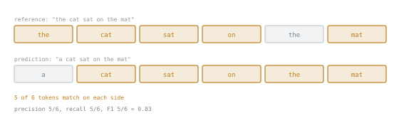

# 第 3 课：针对具体任务的指标

**使命关联:** 第 2 阶段开启使命中“构建评测”的那一半：针对具体任务的指标，把留出集（第 1 阶段）变成一个真正的数字，而本课涉及的每种指标，都很适合某些任务，同时又对另一些任务悄悄地撒谎。
**主要来源:** [文档：Evaluate，Hugging Face](https://huggingface.co/docs/evaluate/index)
**前置知识:** [第 2 课](0002-designing-contamination-resistance.md)、[数据污染](../GLOSSARY.md)

## 热身

1. ▢ 在自建的评测集中嵌入金丝雀字符串，究竟能防住什么？

检查

它向在组装训练语料的爬虫发出信号，说明带标记的内容应当被排除，而且如果这个字符串之后出现在模型的输出或可访问的语料中，它还提供了一种事后检测泄漏的办法。它是请求，不是保证：它取决于爬虫是否遵守这一约定。

2. ▢ 对照已知语料做 n-gram 重叠检查，什么时候可用，什么时候不再是一个选项？

检查

预训练语料已知且可访问时可用。对于训练数据未公开的闭源模型，它就不再是选项，能用的仍然是引导式指令测试。

## 要点

### 精确匹配：严格，对任何表面上的差异都很脆弱

**精确匹配**只有在预测与某个参考答案逐字符完全一致时（通常经过转成小写、去掉空白之类的轻度归一化），才判为正确。它适合只有一个明确正确答案的任务：选择题、片段抽取、数学结果。它的失败模式恰恰是它的严格所带来的：措辞不同的正确答案（预测 `"Paris"`，而参考答案是 `"Paris, France"`）会被判为错误，这是在惩罚正确性，而不是度量它，除非所用的归一化足够宽松，能吸收这种差异，同时又不会把真正错误的答案也吸收进去。

### token 级 F1：给部分分，代价是顾不上顺序

**F1**（用于基于片段的问答这类抽取式任务）把预测和参考答案各看作 token 的集合，而不要求字符串完全一致，先计算精确率（预测的 token 中有多大比例是正确的）和召回率（参考答案的 token 中有多大比例被产生出来了），再取二者的调和平均。参考答案 “the cat sat on the mat”（token：`the, cat, sat, on, the, mat`）与预测 “a cat sat on the mat”（token：`a, cat, sat, on, the, mat`）共有五个 token（`cat, sat, on, the, mat`），各占各自六个中的五个：精确率 `5/6`，召回率 `5/6`，F1 为 `5/6 ≈ 0.83`。这比精确匹配宽容，精确匹配会把这一对直接判为错误。它的失败模式，就是这份宽容的代价：基于 token 集合的 F1 看不见顺序，也看不见重叠的词合在一起是否真的构成正确的答案，所以把正确的词打乱成错误论断的预测，仍然可能得到高分。

### BLEU 和 ROUGE：对照参考文本的 n-gram 重叠，为翻译和摘要而生

**BLEU**（最初用于机器翻译）和 **ROUGE**（最初用于摘要）都根据生成文本的 n-gram（长度为 n 的连续 token 序列）与一个或多个参考文本重叠了多少来打分，而不要求完全一致，也不孤立地给单个 token 打分。它们的失败模式在开放式生成上最明显：一个用不同的词说了同样意思的有效改写，比如 “Critics praised the show” 对照参考答案 “The show received positive reviews from critics”，尽管同样是好答案，却与参考答案几乎没有共有的 n-gram，因而得分很低。每个样本使用多个参考文本可以缓和这一点，但很少有足够多的参考文本，能涵盖每一种有效的措辞，这在很大程度上就是这些指标对开放式文本只与人类判断松散相关的原因，也是第 3 阶段的 LLM-as-judge 正是为这种情形而存在的替代方案的原因。

### 选择指标，就是让它与任务中“正确”的含义相匹配

精确匹配和 F1 适合正确性是一个小而明确的答案集合的任务：分类、抽取、算术。BLEU 和 ROUGE 适合与参考文本的表面重叠和质量松散相关的任务，适合作为粗略、廉价的初筛，而不是最终的裁定。这两类指标都不适合正确性是行为上而不是文本上的任务（生成的代码是否真的能运行并产出正确的输出），那是第 4 课的主题；也不适合含义比措辞更重要的开放式生成，那是第 3 阶段的主题。

## 练习

1. ▢ 模型对一道地理题回答 “Paris”，而参考答案是 “Paris, France”。精确匹配判它为错误。这是正确的评分结果吗？为什么是或不是？

检查

并不是：答案是对的，只是比参考答案措辞更简短。这正是精确匹配对表面差异的脆弱。补救办法，要么是在比较之前，先对两个字符串做归一化（只有当归一化是专门设计来吸收这一类差异时，才有帮助），要么是对措辞变化这么大的任务，选择更宽容的指标。

2. ▢ 参考答案：“a fast red fox jumps”。预测：“a red fox jumps fast”。使用 token 集合的 F1（忽略词序），精确率、召回率和 F1 分数各是多少？

提示

把两边的 token 各列成一个集合，数一数共有多少个，不管它们的位置。

检查

两边的 5 个 token 相同（`a, fast, red, fox, jumps` 与 `a, red, fox, jumps, fast`），只是顺序不同，所以 5 个全部共有。精确率 `5/5 = 1.0`，召回率 `5/5 = 1.0`，F1 为 `1.0`。这也说明了 F1 看不见顺序：词序被打乱的预测，与保持词序的预测得分完全相同，尽管词序可能以 F1 检测不到的方式改变含义。

3. ▢ 摘要模型为参考摘要 “The show received positive reviews from critics.” 产出了 “Critics praised the show”。ROUGE 对这一对很可能打高分还是低分，这个结果能公平地反映预测的质量吗？

检查

低分，因为两个句子尽管说的基本是同一件事，却几乎没有共有的连续 n-gram。这不能公平地反映质量：预测是一个有效的改写，但 ROUGE 度量的是表面的 n-gram 重叠，而不是含义，所以措辞与参考答案不同的正确答案，会和错误答案受到同样的惩罚。

4. ▢ 某团队在一个选择题基准上评测模型，每题有一个正确的字母。本课的哪种指标最合适，为什么？

检查

精确匹配。这个任务每题恰好有一个正确答案，没有需要吸收的有意义的表面差异（答案只是一个字母），这正是精确匹配所适合的任务形态，完全用不着 F1 或 BLEU/ROUGE 对部分重叠或改写的宽容。

5. ▢ 与精确匹配和 F1 相比，关于 BLEU 和 ROUGE，下列哪项说法是对的？

    - a) 它们和精确匹配一样，需要单一、明确的正确答案
    - b) 它们在 n-gram 层面，对照参考文本给重叠打分，对开放式生成的质量只有松散的相关性
    - c) 它们不受影响精确匹配的改写问题的影响
    - d) 对任何生成任务，它们最适合作为最终裁定，取代人工或 LLM 的判断

检查

**b)** n-gram 重叠只是质量的一个松散代理，尤其是在有效答案可以有许多种不同措辞的地方。（a）错误：它们是为开放式文本的任务而设计的，而不是为单一固定答案。（c）错误：有效的改写在 BLEU/ROUGE 上得分可能很低，其根本原因和它在精确匹配上失败的原因相同，即表面措辞不同。（d）错误：它们对开放式文本与人类判断的相关性很弱，这正是第 3 阶段引入 LLM-as-judge 作为替代方案的原因。

## 实战练习

- [ ] 挑一个你评测（或打算评测）的任务，判断精确匹配、F1 或 BLEU/ROUGE 中，哪个适合它所谓的“正确”，并写下理由。
- [ ] 对于目前使用 BLEU 或 ROUGE 的某个评测，找出一个例子，其中一个明明正确、但措辞不同的答案会得低分，并把它记下来。
- [ ] 明天：读一段 Hugging Face Evaluate 文档中关于某个你没用过的指标的内容，并记下它所说明的失败模式。

## 延伸阅读

- [文档：Evaluate，Hugging Face](https://huggingface.co/docs/evaluate/index)
- [文档：“Define success criteria and build evaluations”，Claude Platform Docs](https://platform.claude.com/docs/en/test-and-evaluate/develop-tests)
- [资源](../RESOURCES.md)

---

没学明白？请重读顶部的主要来源，因为本课是对它的压缩，而理解正是在压缩中流失的。如果有哪个术语觉得含糊，可以查看[术语表](../GLOSSARY.md)。

如果问题出在课程本身，而不是学习材料，那就是一个缺陷：[提交 issue](https://github.com/TokenCemetery/teach/issues)。
