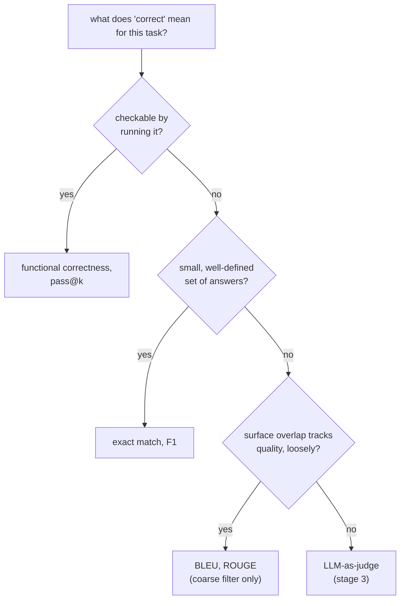

# Lección 4. Métricas de ejecución de código y elegir una métrica

**Vínculo con la misión:** Esta es la lección que cierra la etapa 2: el código es el único tipo de tarea donde la corrección puede comprobarse ejecutándolo en lugar de compararlo con texto, y elegir la familia de métricas adecuada, a lo largo de esta lección y la lección 3, es lo que hace que un número de eval signifique lo que afirma significar.
**Fuente principal:** [Paper: "Evaluating Large Language Models Trained on Code" (Codex), Chen et al., 2021](https://arxiv.org/abs/2107.03374)
**Requisitos previos:** [Lección 3](0003-task-specific-metrics.md), [Contaminación de datos](../GLOSSARY.md)

## Calentamiento

1. ▢ Referencia: "a fast red fox jumps". Predicción: "a red fox jumps fast". ¿Por qué el F1 de bolsa de tokens puntúa este par como una coincidencia perfecta, y qué revela eso sobre el punto ciego del F1?

<details markdown="1"><summary>Comprobación</summary>

Ambas comparten los mismos cinco tokens, solo que reordenados, así que el F1 lo puntúa con 1.0. Esto revela que el F1 es ciego al orden de las palabras: una predicción que mezcla las palabras correctas en una afirmación distinta, posiblemente errónea, puede puntuar igual que una que conserva el orden y el significado correctos.

</details>

2. ▢ ¿Por qué ROUGE probablemente puntuaría bajo "Critics praised the show" frente a una referencia de "The show received positive reviews from critics," aunque ambas dicen lo mismo?

<details markdown="1"><summary>Comprobación</summary>

Las dos oraciones comparten muy pocos n-gramas contiguos pese a coincidir en significado, y ROUGE mide el solapamiento de n-gramas, no el significado. Una paráfrasis válida se penaliza igual que una respuesta errónea.

</details>

## Qué debes saber

### Corrección funcional: ejecuta el código en lugar de compararlo con texto

El código tiene una enorme cantidad de formas textualmente distintas de ser correcto: dos soluciones al mismo problema pueden diferir en los nombres de variables, la estructura y el enfoque y aun así ser ambas exactamente correctas. Aplicar coincidencia exacta, F1 o BLEU/ROUGE (lección 3) al código generado penalizaría una solución correcta pero escrita de otra manera justo como la lección 3 mostró que esas métricas penalizan una paráfrasis válida, solo que peor, ya que el código tiene muchas más formas equivalentes que la prosa. La **corrección funcional** esquiva esto por completo: ejecuta el código generado contra un conjunto held-out de casos de prueba y comprueba si realmente produce el comportamiento correcto. La corrección pasa a ser un hecho sobre lo que hace el código, no sobre cuánto se parece su texto a una solución de referencia.

### pass@k: corrección bajo muestreo

La generación de código de un LLM es estocástica: hacer la misma pregunta dos veces puede producir una solución que funciona una vez y una rota otra. **pass@k** hace una pregunta más afilada que "¿funcionó la única muestra?": de *k* soluciones muestreadas para un problema, ¿cuál es la probabilidad de que al menos una pase todas las pruebas? De forma ingenua, esto podría estimarse generando exactamente *k* muestras por problema y comprobando si alguna pasa, pero esa estimación es ruidosa, sobre todo con *k* pequeño, ya que importa mucho cuáles *k* muestras concretas salieron.

La corrección del paper de Codex: generar un número mayor *n* de muestras por problema, contar cuántas, *c*, son correctas, y calcular de forma analítica la probabilidad de que al menos una de una extracción hipotética de *k* muestras de esas *n* fuera correcta, sin necesidad de extraer realmente menos:

```text
pass@k = 1 − C(n−c, k) / C(n, k)
```

`C(n−c, k) / C(n, k)` es la probabilidad de que una extracción aleatoria de *k* soluciones, sin reemplazo, de las *n* generadas, no incluya ninguna de las *c* correctas; restarla de 1 da la probabilidad de que se incluya al menos una solución correcta. Esto usa cada muestra generada para calcular pass@k con cualquier valor de *k* hasta *n*, en lugar de volver a muestrear y ejecutar el modelo para cada *k* por separado, lo cual es más barato y de menor varianza.

### Elegir una métrica según la tarea, atando la etapa 2

La elección sigue el orden de lo que "correcto" significa realmente para la tarea. Cuando la corrección es de comportamiento y comprobable ejecutando algo, ejecútalo: corrección funcional y pass@k, el tema de esta lección. Cuando la corrección es una de un conjunto pequeño y bien definido de respuestas, encajan la coincidencia exacta o el F1 (lección 3). Cuando la corrección es texto abierto donde el solapamiento superficial con una referencia solo sigue la calidad de forma laxa, BLEU o ROUGE (lección 3) sirven como filtro grueso y barato de primera pasada, no como veredicto final, ya que ninguna se puede comprobar estructuralmente ni ejecutar. Cuando una tarea es abierta y nada de lo anterior puede comprobarla, lo que queda es la siguiente etapa de la misión, LLM-as-judge.



## Práctica

1. ▢ ¿Por qué usar coincidencia exacta o BLEU para puntuar código generado penalizaría una solución correcta con más frecuencia que en el caso de la prosa?

<details markdown="1"><summary>Comprobación</summary>

El código tiene una cantidad especialmente grande de formas textualmente distintas de ser correcto (distintos nombres de variables, estructura o enfoque que resuelven el mismo problema), así que una solución correcta escrita de forma distinta a una referencia tiene aún más probabilidad de ser penalizada por una métrica de comparación de texto que una paráfrasis correcta en prosa, ya que el espacio de formulaciones alternativas válidas es mayor.

</details>

2. ▢ Un modelo genera 10 muestras para un problema de código (n = 10), 3 de las cuales pasan todas las pruebas (c = 3). Calcula pass@1 y pass@5 con la fórmula de esta lección.

<details markdown="1"><summary>Pista</summary>

`C(n−c, k)` y `C(n, k)` son combinaciones: `C(a, b) = a! / (b! × (a−b)!)`. Para pass@1, esto debería reducirse a algo familiar.

</details>

<details markdown="1"><summary>Comprobación</summary>

pass@1: `1 − C(7,1)/C(10,1) = 1 − 7/10 = 0.3`, lo mismo que simplemente `c/n`, como cabe esperar cuando k = 1. pass@5: `C(7,5) = 21`, `C(10,5) = 252`, así que `1 − 21/252 ≈ 1 − 0.083 = 0.917`. pass@5 es mucho más alto que pass@1, ya que extraer 5 muestras da muchas más oportunidades de incluir al menos una de las 3 correctas.

</details>

3. ▢ ¿Por qué el estimador del paper de Codex genera un `n` grande y calcula pass@k de forma analítica sobre combinaciones, en lugar de generar exactamente `k` muestras por problema y comprobar si alguna pasa?

<details markdown="1"><summary>Comprobación</summary>

Generar exactamente k muestras y comprobarlas directamente es una única extracción ruidosa, sobre todo cuando k es pequeño: cuáles k muestras concretas se generan varía mucho entre ejecuciones. Generar una vez un n mayor y calcular el estimador combinatorio reutiliza las n muestras para producir una estimación insesgada y de menor varianza de pass@k para cualquier k hasta n, sin necesidad de volver a muestrear ni a ejecutar el modelo por separado para cada k.

</details>

4. ▢ Empareja cada tarea con la familia de métricas de las lecciones 3 y 4 que mejor le encaja: (a) un cuestionario de opción múltiple con una letra correcta por pregunta, (b) generar una función de Python que debe pasar un conjunto de pruebas, (c) generar un resumen corto de un artículo de noticias.

<details markdown="1"><summary>Comprobación</summary>

(a) Coincidencia exacta: una única respuesta claramente correcta, sin variación superficial relevante que absorber. (b) Corrección funcional / pass@k: la corrección es de comportamiento y se puede comprobar directamente ejecutando el código. (c) BLEU o ROUGE, como filtro grueso de primera pasada, ya que la calidad de un resumen es texto abierto donde el solapamiento superficial solo sigue la corrección de forma laxa; un juicio más completo necesitaría algo más cercano a una evaluación humana o con LLM-as-judge.

</details>

5. ▢ ¿Qué afirmación es cierta sobre la corrección funcional en comparación con las métricas de comparación de texto para código?

    - a) Exige que el código generado coincida con el texto exacto de una solución de referencia
    - b) Comprueba si el comportamiento real del código, ejecutado contra casos de prueba, es correcto, sin importar cómo esté escrito
    - c) No se puede combinar con el muestreo de varias completaciones por problema
    - d) Es una variante de BLEU adaptada a los lenguajes de programación

<details markdown="1"><summary>Comprobación</summary>

**b)** Ese es todo el punto: el comportamiento, no el texto, determina la corrección. (a) es falsa: eso describe la coincidencia exacta, que la corrección funcional evita específicamente. (c) es falsa: pass@k es exactamente la corrección funcional combinada con el muestreo. (d) es falsa: la corrección funcional ejecuta el código en lugar de comparar n-gramas en absoluto.

</details>

## Prácticas en el mundo real

- [ ] Para una tarea de generación de código que evalúes o planees evaluar, busca o escribe un pequeño conjunto de pruebas que compruebe el comportamiento en lugar de comparar el código generado con el texto de una única solución de referencia.
- [ ] Si tienes acceso a un modelo de código, genera varias muestras para un problema y calcula a mano pass@1 y pass@3 a partir de cuántas pasan, con la fórmula de esta lección.
- [ ] Mañana: para tres tareas que te importen, escribe qué familia de métricas (coincidencia exacta/F1, BLEU/ROUGE o corrección funcional) encaja con la noción de "correcto" de cada una, y por qué.

## Para profundizar

- [Paper: "Evaluating Large Language Models Trained on Code" (Codex), Chen et al., 2021](https://arxiv.org/abs/2107.03374)
- [Docs: Evaluate, Hugging Face](https://huggingface.co/docs/evaluate/index)
- [Recursos](../RESOURCES.md)

---

¿No termina de quedar claro? Vuelve a leer la fuente primaria de arriba, ya que esta lección la comprime y en la compresión es donde se escapa la comprensión. Consulta el [glosario](../GLOSSARY.md) por si algún término te resultó resbaladizo.

Si lo poco claro es la propia lección y no el material, eso es un defecto: [abre un issue](https://github.com/TokenCemetery/teach/issues).
