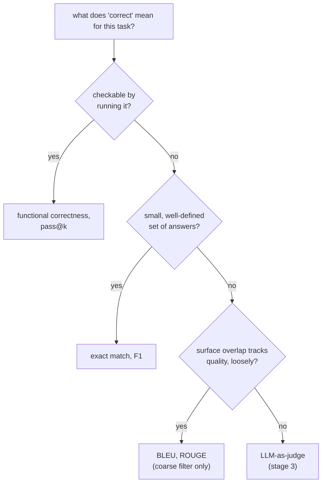

# Leçon 4. Métriques par exécution de code et choix d'une métrique

**Lien avec la mission :** C'est le point d'orgue de l'étape 2 : le code est le seul type de tâche dont on peut vérifier la justesse en l'exécutant plutôt qu'en le comparant à du texte, et choisir la bonne famille de métriques, à travers cette leçon et la leçon 3, est ce qui fait qu'un chiffre d'eval veut dire ce qu'il prétend dire.
**Source primaire :** [Article : "Evaluating Large Language Models Trained on Code" (Codex), Chen et al., 2021](https://arxiv.org/abs/2107.03374)
**Prérequis :** [Leçon 3](0003-task-specific-metrics.md), [Contamination des données](../GLOSSARY.md)

## Échauffement

1. ▢ Référence : "a fast red fox jumps". Prédiction : "a red fox jumps fast". Pourquoi le F1 en sac de tokens note-t-il cette paire comme une correspondance parfaite, et que révèle cela de l'angle mort du F1 ?

<details markdown="1"><summary>Vérifier</summary>

Les deux partagent les mêmes cinq tokens, simplement réordonnés, donc le F1 donne 1,0. Cela révèle que le F1 est aveugle à l'ordre des mots : une prédiction qui brouille les bons mots en une affirmation différente, peut-être fausse, peut obtenir le même score que celle qui préserve l'ordre et le sens corrects.

</details>

2. ▢ Pourquoi ROUGE noterait-il probablement "Critics praised the show" bas face à une référence "The show received positive reviews from critics," alors que les deux disent la même chose ?

<details markdown="1"><summary>Vérifier</summary>

Les deux phrases partagent très peu de n-grammes contigus bien qu'elles concordent par le sens, et ROUGE mesure le recouvrement de n-grammes, pas le sens. Une paraphrase valide est pénalisée comme le serait une réponse fausse.

</details>

## À savoir

### Correction fonctionnelle : exécuter le code au lieu de le comparer à du texte

Le code admet un nombre énorme de manières textuellement différentes d'être correct : deux solutions au même problème peuvent différer par les noms de variables, la structure et l'approche tout en étant exactement justes. Appliquer l'exact match, le F1 ou BLEU/ROUGE (leçon 3) au code généré pénaliserait une solution correcte mais écrite autrement exactement comme la leçon 3 a montré ces métriques pénaliser une paraphrase valide, en pire, puisque le code a bien plus de formes équivalentes que la prose n'en a d'ordinaire. La **correction fonctionnelle** contourne tout cela : exécutez le code généré sur une suite held-out de cas de test et vérifiez s'il produit réellement le bon comportement. La justesse devient un fait sur ce que fait le code, et non sur la ressemblance de son texte avec une solution de référence.

### pass@k : la justesse sous échantillonnage

La génération de code d'un LLM est stochastique : poser deux fois la même question peut produire une solution qui marche une fois et une solution cassée l'autre. **pass@k** pose une question plus précise que « le seul échantillon a-t-il marché » : sur *k* solutions échantillonnées à un problème, quelle est la probabilité qu'au moins une passe tous les tests ? Naïvement, on pourrait l'estimer en générant exactement *k* échantillons par problème et en vérifiant si l'un passe, mais cette estimation est bruitée, surtout pour un *k* petit, puisque la composition précise des *k* échantillons tirés compte beaucoup.

La solution du papier Codex : générer un nombre *n* plus grand d'échantillons par problème, compter combien, *c*, sont corrects, et calculer analytiquement la probabilité qu'au moins un d'un tirage hypothétique de *k* échantillons parmi ces *n* soit correct, sans avoir besoin d'en tirer réellement moins :

```text
pass@k = 1 − C(n−c, k) / C(n, k)
```

`C(n−c, k) / C(n, k)` est la probabilité qu'un tirage aléatoire de *k* solutions, sans remise, parmi les *n* générées, rate les *c* solutions correctes ; la soustraire de 1 donne la probabilité qu'au moins une solution correcte soit incluse. Cela utilise chaque échantillon généré pour calculer pass@k pour toute valeur de *k* jusqu'à *n*, plutôt que de rééchantillonner et de relancer le modèle pour chaque *k* séparément, ce qui est à la fois moins coûteux et de variance plus faible.

### Choisir une métrique par tâche, pour relier l'étape 2

Le choix suit l'ordre de ce que « correct » veut réellement dire pour la tâche. Quand la justesse est comportementale et vérifiable en exécutant quelque chose, on l'exécute : correction fonctionnelle et pass@k, sujet de cette leçon. Quand la justesse est l'une d'un petit ensemble de réponses bien défini, l'exact match ou le F1 conviennent (leçon 3). Quand la justesse est du texte ouvert où le recouvrement de surface avec une référence ne suit que vaguement la qualité, BLEU ou ROUGE (leçon 3) servent de filtre grossier et peu coûteux en première passe, pas de verdict final, puisqu'aucun des deux ne peut être vérifié structurellement ou exécuté. Quand une tâche est ouverte et que rien ici ne peut la vérifier, la prochaine étape de la mission, le LLM-as-judge, est ce qui reste.



## Pratique

1. ▢ Pourquoi utiliser l'exact match ou BLEU pour noter du code généré pénaliserait-il une solution correcte plus souvent que pour de la prose ?

<details markdown="1"><summary>Vérifier</summary>

Le code a un nombre particulièrement grand de manières textuellement différentes d'être correct (noms de variables, structure ou approche différents pour résoudre le même problème), donc une solution correcte écrite autrement qu'une référence a encore plus de chances d'être pénalisée par une métrique de comparaison de texte qu'une paraphrase correcte en prose, puisque l'espace des formulations alternatives valables est plus grand.

</details>

2. ▢ Un modèle génère 10 échantillons pour un problème de code (n = 10), dont 3 passent tous les tests (c = 3). Calculez pass@1 et pass@5 avec la formule de cette leçon.

<details markdown="1"><summary>Indice</summary>

`C(n−c, k)` et `C(n, k)` sont des combinaisons : `C(a, b) = a! / (b! × (a−b)!)`. Pour pass@1, cela devrait se ramener à quelque chose de familier.

</details>

<details markdown="1"><summary>Vérifier</summary>

pass@1 : `1 − C(7,1)/C(10,1) = 1 − 7/10 = 0.3`, soit simplement `c/n`, comme attendu quand k = 1. pass@5 : `C(7,5) = 21`, `C(10,5) = 252`, donc `1 − 21/252 ≈ 1 − 0.083 = 0.917`. pass@5 est bien plus élevé que pass@1, puisque tirer 5 échantillons donne bien plus de chances d'inclure au moins une des 3 solutions correctes.

</details>

3. ▢ Pourquoi l'estimateur du papier Codex génère-t-il un grand `n` et calcule-t-il pass@k analytiquement sur des combinaisons, plutôt que de générer exactement `k` échantillons par problème et de vérifier si l'un passe ?

<details markdown="1"><summary>Vérifier</summary>

Générer exactement k échantillons et les vérifier directement est un tirage unique et bruité, surtout quand k est petit : la composition précise des k échantillons générés varie beaucoup d'une exécution à l'autre. Générer une fois un n plus grand et calculer l'estimateur combinatoire réutilise les n échantillons pour produire une estimation non biaisée et de variance plus faible de pass@k pour tout k jusqu'à n, sans avoir à rééchantillonner ou à relancer le modèle séparément pour chaque k.

</details>

4. ▢ Associez chaque tâche à la famille de métriques des leçons 3 et 4 qui lui convient le mieux : (a) un quiz à choix multiple avec une seule lettre correcte par question, (b) la génération d'une fonction Python qui doit passer une suite de tests, (c) la génération d'un court résumé d'un article de presse.

<details markdown="1"><summary>Vérifier</summary>

(a) Exact match : une seule réponse clairement correcte, aucune variation de surface significative à absorber. (b) Correction fonctionnelle / pass@k : la justesse est comportementale et directement vérifiable en exécutant le code. (c) BLEU ou ROUGE, comme filtre grossier de première passe, puisque la qualité d'un résumé relève du texte ouvert où le recouvrement de surface ne suit que vaguement la justesse ; un jugement plus complet demanderait quelque chose de plus proche d'une évaluation humaine ou par LLM-as-judge.

</details>

5. ▢ Laquelle de ces affirmations est vraie de la correction fonctionnelle par rapport aux métriques de comparaison de texte pour le code ?

    - a) Elle exige que le code généré corresponde au texte exact d'une solution de référence
    - b) Elle vérifie si le comportement réel du code, exécuté sur des cas de test, est correct, quelle que soit la façon dont il est écrit
    - c) Elle ne peut pas être combinée à l'échantillonnage de plusieurs complétions par problème
    - d) C'est une variante de BLEU adaptée aux langages de programmation

<details markdown="1"><summary>Vérifier</summary>

**b)** C'est tout le propos : le comportement, et non le texte, détermine la justesse. (a) est faux : cela décrit l'exact match, que la correction fonctionnelle évite précisément. (c) est faux : pass@k est exactement la correction fonctionnelle combinée à l'échantillonnage. (d) est faux : la correction fonctionnelle exécute le code au lieu de comparer des n-grammes.

</details>

## Exercices en situation réelle

- [ ] Pour une tâche de génération de code que vous évaluez ou prévoyez d'évaluer, trouvez ou écrivez une petite suite de tests qui vérifie le comportement plutôt que de comparer le code généré au texte d'une seule solution de référence.
- [ ] Si vous avez accès à un modèle de code, générez plusieurs échantillons pour un problème et calculez à la main pass@1 et pass@3 d'après le nombre de ceux qui passent, avec la formule de cette leçon.
- [ ] Demain : pour trois tâches qui vous importent, notez quelle famille de métriques (exact match/F1, BLEU/ROUGE ou correction fonctionnelle) correspond à la notion de « correct » de chacune, et pourquoi.

## Pour aller plus loin

- [Article : "Evaluating Large Language Models Trained on Code" (Codex), Chen et al., 2021](https://arxiv.org/abs/2107.03374)
- [Doc : Evaluate, Hugging Face](https://huggingface.co/docs/evaluate/index)
- [Ressources](../RESOURCES.md)

---

Ça ne passe pas ? Relisez la source primaire en haut de page, car cette leçon la condense et c'est dans la condensation que la compréhension s'échappe. Consultez le [glossaire](../GLOSSARY.md) pour tout terme qui vous a paru glissant.

Si c'est la leçon elle-même qui n'est pas claire plutôt que la matière, c'est un défaut : [ouvrez une issue](https://github.com/TokenCemetery/teach/issues).
