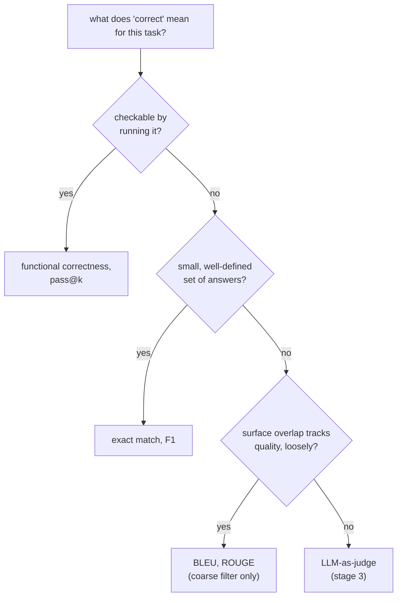

# पाठ 4. Code-Execution Metrics और Metric चुनना

**मिशन से संबंध:** यह चरण 2 का समापन है: code अकेला ऐसा task-प्रकार है जिसकी correctness text से मिलाने के बजाय उसे चलाकर जाँची जा सकती है, और इस पाठ तथा पाठ 3 में सही metric परिवार चुनना ही वह चीज़ है जो eval की संख्या को वही मतलब देती है जो वह दावा करती है।
**मुख्य स्रोत:** [पेपर: "Evaluating Large Language Models Trained on Code" (Codex), Chen et al., 2021](https://arxiv.org/abs/2107.03374)
**पूर्व-आवश्यकताएँ:** [पाठ 3](0003-task-specific-metrics.md), [Data contamination](../GLOSSARY.md)

## वार्म-अप

1. ▢ Reference: "a fast red fox jumps"। Prediction: "a red fox jumps fast"। Bag-of-tokens F1 इस जोड़ी को पूरा मेल क्यों गिनता है, और यह F1 के अंधे बिंदु के बारे में क्या बताता है?

<details markdown="1"><summary>जाँचें</summary>

दोनों में वही पाँच tokens हैं, बस क्रम बदला है, इसलिए F1 इसे 1.0 देता है। यह दिखाता है कि F1 शब्द-क्रम के प्रति अंधा है: जो prediction सही शब्दों को उलट-पलटकर अलग, संभवतः ग़लत, दावा बना दे, वह सही क्रम और अर्थ बचाए रखने वाली prediction के बराबर score पा सकती है।

</details>

2. ▢ ROUGE "Critics praised the show" को reference "The show received positive reviews from critics" के सामने कम score क्यों देता, जबकि दोनों एक ही बात कहते हैं?

<details markdown="1"><summary>जाँचें</summary>

अर्थ में मेल खाने के बावजूद दोनों वाक्य बहुत कम लगातार n-grams साझा करते हैं, और ROUGE n-gram overlap मापता है, अर्थ नहीं। वैध paraphrase को वैसे ही दंडित किया जाता है जैसे ग़लत उत्तर को।

</details>

## यह जानें

### Functional correctness: code को text से मिलाने के बजाय चलाएँ

Code के सही होने के text के स्तर पर अलग-अलग तरीक़ों की संख्या बहुत बड़ी है: एक ही समस्या के दो हल variable नामों, संरचना और तरीक़े में अलग हो सकते हैं और फिर भी दोनों बिल्कुल सही हो सकते हैं। Generate किए code पर exact match, F1 या BLEU/ROUGE (पाठ 3) लगाना सही-पर-अलग-लिखे हल को ठीक वैसे ही दंडित करेगा जैसे पाठ 3 ने इन metrics को वैध paraphrase को दंडित करते दिखाया, बस ज़्यादा बुरी तरह, क्योंकि code के समतुल्य रूप आम तौर पर गद्य से कहीं ज़्यादा होते हैं। **Functional correctness** इसे पूरी तरह दरकिनार कर देती है: generate किए code को test cases के held-out suite पर चलाएँ और जाँचें कि वह असल में सही व्यवहार पैदा करता है या नहीं। Correctness इस बात का तथ्य बन जाती है कि code क्या करता है, इस बात का नहीं कि उसका text reference हल से कितना मिलता है।

### pass@k: sampling के तहत correctness

LLM की code generation stochastic है: एक ही सवाल दो बार पूछने पर एक बार चलने वाला हल मिल सकता है और दूसरी बार टूटा हुआ। **pass@k** "क्या वह एक sample चला" से ज़्यादा तीखा सवाल पूछता है: किसी समस्या के *k* sample किए हलों में से, कम से कम एक के सारे tests पास करने की संभावना क्या है? सीधे-सीधे इसका अनुमान हर समस्या के लिए ठीक *k* samples बनाकर और जाँचकर लगाया जा सकता था कि कोई पास हुआ या नहीं, पर वह अनुमान noisy है, ख़ास तौर पर छोटे *k* के लिए, क्योंकि कौन-से ख़ास *k* samples निकले यह बहुत मायने रखता है।

Codex पेपर का सुधार: हर समस्या के लिए बड़ी संख्या *n* में samples बनाएँ, गिनें कि उनमें से कितने, *c*, सही हैं, और विश्लेषणात्मक रूप से संभावना निकालें कि उन *n* में से *k*-sample के काल्पनिक चुनाव में कम से कम एक सही होता, असल में कम निकालने की ज़रूरत के बिना:

```text
pass@k = 1 − C(n−c, k) / C(n, k)
```

`C(n−c, k) / C(n, k)` इस बात की संभावना है कि बनाए गए *n* में से बिना प्रतिस्थापन के *k* हलों का यादृच्छिक चुनाव सभी *c* सही हलों को चूक जाए; उसे 1 में से घटाने पर संभावना मिलती है कि कम से कम एक सही हल शामिल है। यह *n* तक के *k* के किसी भी मान के लिए pass@k निकालने में बनाए गए हर sample का इस्तेमाल करता है, हर *k* के लिए अलग से दोबारा sample करने और model चलाने के बजाय, जो सस्ता भी है और कम variance वाला भी।

### हर task के लिए metric चुनना, चरण 2 को जोड़ते हुए

चुनाव इस क्रम में चलता है कि task के लिए "सही" का असल में क्या मतलब है। जब correctness व्यवहार की हो और कुछ चलाकर जाँची जा सकती हो, तो उसे चलाएँ: functional correctness और pass@k, इस पाठ का विषय। जब correctness उत्तरों के छोटे, साफ़-परिभाषित सेट में से एक हो, तो exact match या F1 ठीक बैठते हैं (पाठ 3)। जब correctness खुले-सिरे वाला text हो जिसमें reference के साथ ऊपरी overlap गुणवत्ता का सिर्फ़ ढीला पीछा करता हो, तो BLEU या ROUGE (पाठ 3) मोटे, सस्ते पहले छन्ने का काम करते हैं, अंतिम फ़ैसले का नहीं, क्योंकि इनमें से किसी को संरचना के आधार पर जाँचा या चलाया नहीं जा सकता। जहाँ task खुले-सिरे वाला हो और यहाँ की कोई चीज़ उसे जाँच न सके, वहाँ मिशन का अगला चरण, LLM-as-judge, ही बचता है।



## अभ्यास

1. ▢ Generate किए code को score करने के लिए exact match या BLEU इस्तेमाल करना गद्य के मुक़ाबले सही हल को ज़्यादा बार क्यों दंडित करेगा?

<details markdown="1"><summary>जाँचें</summary>

Code के सही होने के text के स्तर पर अलग-अलग तरीक़े ख़ास तौर पर बहुत ज़्यादा हैं (अलग variable नाम, संरचना या तरीक़ा, जो वही समस्या हल करता हो), इसलिए reference से अलग लिखे गए सही हल को text-तुलना वाली metric द्वारा दंडित किए जाने की संभावना सही गद्य paraphrase के मुक़ाबले और ज़्यादा है, क्योंकि वैध वैकल्पिक शब्दावलियों का दायरा बड़ा है।

</details>

2. ▢ एक model किसी coding समस्या के लिए 10 samples बनाता है (n = 10), जिनमें से 3 सारे tests पास करते हैं (c = 3)। इस पाठ के सूत्र से pass@1 और pass@5 निकालें।

<details markdown="1"><summary>संकेत</summary>

`C(n−c, k)` और `C(n, k)` combinations हैं: `C(a, b) = a! / (b! × (a−b)!)`। pass@1 के लिए, यह किसी जानी-पहचानी चीज़ पर सिमट जाना चाहिए।

</details>

<details markdown="1"><summary>जाँचें</summary>

pass@1: `1 − C(7,1)/C(10,1) = 1 − 7/10 = 0.3`, जो सीधे `c/n` के बराबर है, जैसा k = 1 पर अपेक्षित है। pass@5: `C(7,5) = 21`, `C(10,5) = 252`, इसलिए `1 − 21/252 ≈ 1 − 0.083 = 0.917`। pass@5, pass@1 से बहुत ऊँचा है, क्योंकि 5 samples निकालने से 3 सही में से कम से कम एक को शामिल करने के कहीं ज़्यादा मौक़े मिलते हैं।

</details>

3. ▢ Codex पेपर का estimator बड़ा `n` क्यों बनाता है और combinations पर pass@k विश्लेषणात्मक रूप से क्यों निकालता है, हर समस्या के लिए ठीक `k` samples बनाकर और जाँचकर कि कोई पास हुआ या नहीं, के बजाय?

<details markdown="1"><summary>जाँचें</summary>

ठीक k samples बनाकर उन्हें सीधे जाँचना एक अकेला noisy चुनाव है, ख़ास तौर पर जब k छोटा हो: कौन-से ख़ास k samples बन जाते हैं यह runs के बीच बहुत बदलता है। बड़ा n एक बार बनाकर combinatorial estimator निकालना सभी n samples का फिर से इस्तेमाल करके n तक के किसी भी k के लिए pass@k का कम-variance, unbiased अनुमान देता है, हर k के लिए अलग से दोबारा sample करने या model चलाने की ज़रूरत के बिना।

</details>

4. ▢ हर task को पाठ 3 और 4 के उस metric परिवार से मिलाएँ जो उस पर सबसे अच्छा बैठता है: (a) हर सवाल का एक सही अक्षर वाली multiple-choice quiz, (b) ऐसा Python function generate करना जो test suite पास करे, (c) किसी समाचार लेख का छोटा सारांश generate करना।

<details markdown="1"><summary>जाँचें</summary>

(a) Exact match: एक साफ़ सही उत्तर, सोखने लायक कोई सार्थक ऊपरी भिन्नता नहीं। (b) Functional correctness / pass@k: correctness व्यवहार की है और code चलाकर सीधे जाँची जा सकती है। (c) BLEU या ROUGE, मोटे पहले छन्ने के रूप में, क्योंकि सारांश की गुणवत्ता खुले-सिरे वाला text है जहाँ ऊपरी overlap correctness का सिर्फ़ ढीला पीछा करता है; पूरे निर्णय के लिए मानव या LLM-as-judge evaluation के क़रीब की कोई चीज़ चाहिए होगी।

</details>

5. ▢ Code के लिए text-तुलना वाली metrics की तुलना में functional correctness के बारे में कौन-सा दावा सही है?

    - a) उसे चाहिए कि generate किया गया code reference हल के सटीक text से मेल खाए
    - b) वह जाँचती है कि code का असल व्यवहार, test cases पर चलाने पर, सही है या नहीं, चाहे वह कैसे भी लिखा गया हो
    - c) उसे हर समस्या के लिए कई completions sample करने के साथ मिलाया नहीं जा सकता
    - d) वह BLEU का ऐसा रूप है जो programming languages के लिए ढाला गया है

<details markdown="1"><summary>जाँचें</summary>

**b)** पूरा मक़सद यही है: correctness व्यवहार से तय होती है, text से नहीं। (a) ग़लत है: यह exact match का वर्णन है, जिसे functional correctness ख़ास तौर पर टालती है। (c) ग़लत है: pass@k ठीक functional correctness को sampling के साथ मिलाना ही है। (d) ग़लत है: functional correctness code को चलाती है, n-grams की तुलना बिल्कुल नहीं करती।

</details>

## असली दुनिया का अभ्यास

- [ ] जिस code-generation task को आप परखते हैं या परखने की योजना है, उसके लिए छोटा test suite खोजें या लिखें जो generate किए code को किसी एक reference हल के text से मिलाने के बजाय व्यवहार जाँचे।
- [ ] अगर आपकी code model तक पहुँच है, तो एक समस्या के लिए कई samples बनाएँ, और कितने पास हुए इससे इस पाठ के सूत्र द्वारा हाथ से pass@1 और pass@3 निकालें।
- [ ] कल: अपनी पसंद के तीन tasks के लिए लिखें कि कौन-सा metric परिवार (exact match/F1, BLEU/ROUGE, या functional correctness) हर एक के "सही" के विचार पर बैठता है, और क्यों।

## आगे बढ़ने के लिए

- [पेपर: "Evaluating Large Language Models Trained on Code" (Codex), Chen et al., 2021](https://arxiv.org/abs/2107.03374)
- [दस्तावेज़: Evaluate, Hugging Face](https://huggingface.co/docs/evaluate/index)
- [संसाधन](../RESOURCES.md)

---

बात नहीं बन रही? ऊपर दिए primary source को दोबारा पढ़ें, क्योंकि यह पाठ उसे संक्षिप्त करता है और समझ संक्षेप में ही रिसती है। जो शब्द फिसलन भरा लगे, उसके लिए [शब्दावली](../GLOSSARY.md) देखें।

अगर दिक़्क़त सामग्री की नहीं बल्कि पाठ की ही है, तो वह एक खोट है: [issue खोलें](https://github.com/TokenCemetery/teach/issues)।
