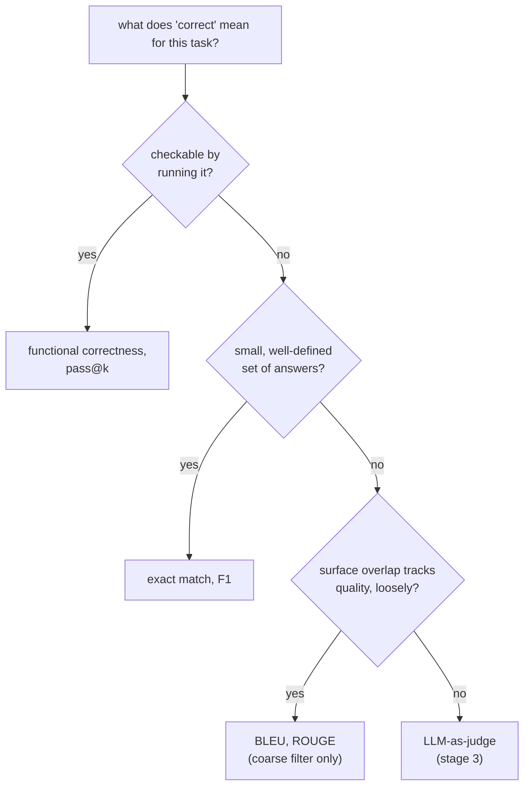

# Lição 4. Métricas de execução de código e a escolha de uma métrica

**Ligação com a missão:** Este é o ponto culminante da etapa 2: código é o único tipo de tarefa em que a correção pode ser verificada executando-o em vez de comparando-o com texto, e escolher a família de métricas certa, entre esta lição e a lição 3, é o que faz um número de eval significar o que afirma significar.
**Fonte principal:** [Artigo científico: "Evaluating Large Language Models Trained on Code" (Codex), Chen et al., 2021](https://arxiv.org/abs/2107.03374)
**Pré-requisitos:** [Lição 3](0003-task-specific-metrics.md), [Contaminação de dados](../GLOSSARY.md)

## Aquecimento

1. ▢ Referência: "a fast red fox jumps". Predição: "a red fox jumps fast". Por que o F1 sobre saco de tokens pontua esse par como uma correspondência perfeita, e o que isso revela sobre o ponto cego do F1?

<details markdown="1"><summary>Verificação</summary>

Os dois compartilham os mesmos cinco tokens, apenas reordenados, então o F1 dá 1,0. Isso revela que o F1 é cego à ordem das palavras: uma predição que embaralha as palavras certas em uma afirmação diferente, possivelmente errada, pode pontuar igual a uma que preserva a ordem e o significado corretos.

</details>

2. ▢ Por que o ROUGE provavelmente pontuaria "Critics praised the show" baixo contra uma referência "The show received positive reviews from critics," ainda que as duas digam a mesma coisa?

<details markdown="1"><summary>Verificação</summary>

As duas frases compartilham pouquíssimos n-gramas contíguos apesar de coincidirem em significado, e o ROUGE mede a sobreposição de n-gramas, não o significado. Uma paráfrase válida é penalizada do mesmo jeito que uma resposta errada seria.

</details>

## Saiba isto

### Correção funcional: execute o código em vez de compará-lo com texto

O código tem um número enorme de maneiras textualmente diferentes de estar correto: duas soluções para o mesmo problema podem diferir em nomes de variáveis, estrutura e abordagem e ainda assim estar ambas exatamente certas. Aplicar exact match, F1 ou BLEU/ROUGE (lição 3) a código gerado penalizaria uma solução correta, mas escrita de outro jeito, exatamente como a lição 3 mostrou essas métricas penalizando uma paráfrase válida, só que pior, já que o código tem muito mais formas equivalentes do que a prosa costuma ter. A **correção funcional** contorna isso por completo: execute o código gerado contra uma suíte held-out de casos de teste e verifique se ele de fato produz o comportamento certo. A correção passa a ser um fato sobre o que o código faz, e não sobre o quanto seu texto se parece com uma solução de referência.

### pass@k: correção sob amostragem

A geração de código de um LLM é estocástica: fazer a mesma pergunta duas vezes pode produzir uma solução que funciona numa vez e uma quebrada na outra. O **pass@k** faz uma pergunta mais precisa do que "a única amostra funcionou?": entre *k* soluções amostradas para um problema, qual é a probabilidade de que pelo menos uma delas passe em todos os testes? De forma ingênua, isso poderia ser estimado gerando exatamente *k* amostras por problema e verificando se alguma passa, mas essa estimativa é ruidosa, especialmente para *k* pequeno, já que importa muito quais *k* amostras específicas foram sorteadas.

A correção do artigo do Codex: gerar um número maior *n* de amostras por problema, contar quantas delas, *c*, estão corretas, e calcular analiticamente a probabilidade de que pelo menos uma de uma retirada hipotética de *k* amostras dessas *n* estivesse correta, sem precisar de fato retirar menos:

```text
pass@k = 1 − C(n−c, k) / C(n, k)
```

`C(n−c, k) / C(n, k)` é a probabilidade de que uma retirada aleatória de *k* soluções, sem reposição, entre as *n* geradas, perca todas as *c* corretas; subtrair isso de 1 dá a probabilidade de que pelo menos uma solução correta seja incluída. Isso usa todas as amostras geradas para calcular o pass@k para qualquer valor de *k* até *n*, em vez de reamostrar e reexecutar o modelo para cada *k* separadamente, o que é ao mesmo tempo mais barato e de menor variância.

### Escolhendo uma métrica por tarefa, amarrando a etapa 2

A escolha segue a ordem do que "correto" de fato significa para a tarefa. Quando a correção é comportamental e verificável executando algo, execute: correção funcional e pass@k, o assunto desta lição. Quando a correção é um de um conjunto pequeno e bem definido de respostas, exact match ou F1 servem (lição 3). Quando a correção é texto aberto, em que a sobreposição superficial com uma referência só acompanha a qualidade de forma frouxa, BLEU ou ROUGE (lição 3) servem como um filtro grosseiro e barato de primeira passada, e não como veredito final, já que nenhum dos dois pode ser verificado estruturalmente nem executado. Onde uma tarefa é aberta e nada disto consegue verificá-la, o que sobra é a próxima etapa da missão, o LLM-as-judge.



## Prática

1. ▢ Por que usar exact match ou BLEU para pontuar código gerado penalizaria uma solução correta com mais frequência do que faria com prosa?

<details markdown="1"><summary>Verificação</summary>

O código tem um número especialmente grande de maneiras textualmente diferentes de estar correto (nomes de variáveis, estrutura ou abordagem diferentes resolvendo o mesmo problema), então uma solução correta escrita de modo diferente de uma referência tem ainda mais chance de ser penalizada por uma métrica de comparação de texto do que uma paráfrase correta em prosa, já que o espaço de formulações alternativas válidas é maior.

</details>

2. ▢ Um modelo gera 10 amostras para um problema de programação (n = 10), 3 das quais passam em todos os testes (c = 3). Calcule o pass@1 e o pass@5 usando a fórmula desta lição.

<details markdown="1"><summary>Dica</summary>

`C(n−c, k)` e `C(n, k)` são combinações: `C(a, b) = a! / (b! × (a−b)!)`. Para o pass@1, isso deve se reduzir a algo familiar.

</details>

<details markdown="1"><summary>Verificação</summary>

pass@1: `1 − C(7,1)/C(10,1) = 1 − 7/10 = 0.3`, o mesmo que simplesmente `c/n`, como esperado quando k = 1. pass@5: `C(7,5) = 21`, `C(10,5) = 252`, então `1 − 21/252 ≈ 1 − 0.083 = 0.917`. O pass@5 é muito maior que o pass@1, já que retirar 5 amostras dá muito mais chances de incluir pelo menos uma das 3 corretas.

</details>

3. ▢ Por que o estimador do artigo do Codex gera um `n` grande e calcula o pass@k analiticamente sobre combinações, em vez de apenas gerar exatamente `k` amostras por problema e verificar se alguma passa?

<details markdown="1"><summary>Verificação</summary>

Gerar exatamente k amostras e verificá-las diretamente é um único sorteio ruidoso, especialmente quando k é pequeno: quais k amostras específicas acabam sendo geradas varia muito entre execuções. Gerar um n maior uma vez e calcular o estimador combinatório reaproveita todas as n amostras para produzir uma estimativa não enviesada e de menor variância do pass@k para qualquer k até n, sem precisar reamostrar nem reexecutar o modelo separadamente para cada k.

</details>

4. ▢ Case cada tarefa com a família de métricas das lições 3 e 4 que melhor se encaixa: (a) um quiz de múltipla escolha com uma letra correta por pergunta, (b) gerar uma função Python que precisa passar em uma suíte de testes, (c) gerar um resumo curto de um artigo de notícias.

<details markdown="1"><summary>Verificação</summary>

(a) Exact match: uma única resposta claramente correta, sem variação superficial relevante a absorver. (b) Correção funcional / pass@k: a correção é comportamental e diretamente verificável executando o código. (c) BLEU ou ROUGE, como filtro grosseiro de primeira passada, já que a qualidade de um resumo é texto aberto em que a sobreposição superficial só acompanha a correção de forma frouxa; um julgamento mais completo precisaria de algo mais próximo de uma avaliação humana ou por LLM-as-judge.

</details>

5. ▢ Qual afirmação é verdadeira sobre a correção funcional em comparação com métricas de comparação de texto para código?

    - a) Exige que o código gerado coincida com o texto exato de uma solução de referência
    - b) Verifica se o comportamento real do código, executado contra casos de teste, está correto, independentemente de como ele foi escrito
    - c) Não pode ser combinada com a amostragem de várias completions por problema
    - d) É uma variante do BLEU adaptada para linguagens de programação

<details markdown="1"><summary>Verificação</summary>

**b)** Esse é todo o ponto: o comportamento, e não o texto, determina a correção. (a) é falsa: isso descreve o exact match, que a correção funcional evita especificamente. (c) é falsa: o pass@k é exatamente a correção funcional combinada com amostragem. (d) é falsa: a correção funcional executa o código em vez de comparar n-gramas.

</details>

## Prática no mundo real

- [ ] Para uma tarefa de geração de código que você avalia ou planeja avaliar, encontre ou escreva uma pequena suíte de testes que verifique o comportamento, em vez de comparar o código gerado com o texto de uma única solução de referência.
- [ ] Se você tiver acesso a um modelo de código, gere várias amostras para um problema e calcule à mão o pass@1 e o pass@3 a partir de quantas passam, usando a fórmula desta lição.
- [ ] Amanhã: para três tarefas que importam para você, anote qual família de métricas (exact match/F1, BLEU/ROUGE ou correção funcional) se encaixa na noção de "correto" de cada uma, e por quê.

## Para ir além

- [Artigo científico: "Evaluating Large Language Models Trained on Code" (Codex), Chen et al., 2021](https://arxiv.org/abs/2107.03374)
- [Docs: Evaluate, Hugging Face](https://huggingface.co/docs/evaluate/index)
- [Recursos](../RESOURCES.md)

---

Não ficou claro? Releia a fonte principal no topo, já que esta lição a comprime e é na compressão que o entendimento escapa. Consulte o [glossário](../GLOSSARY.md) para qualquer termo que pareceu escorregadio.

Se o problema é a lição em si, e não o material, isso é um defeito: [abra uma issue](https://github.com/TokenCemetery/teach/issues).
