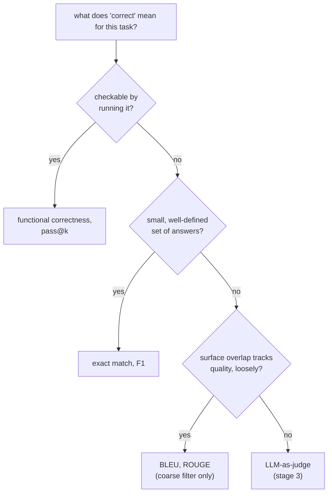

# Урок 4. Метрики по исполнению кода и выбор метрики

**Связь с целью курса:** Это итог этапа 2: код единственный вид задач, где корректность можно проверить, запустив его, а не сравнивая с текстом, и выбор верного семейства метрик, в этом уроке и в уроке 3, делает так, чтобы число эвала значило то, что заявляет.
**Первоисточник:** [Научная статья: "Evaluating Large Language Models Trained on Code" (Codex), Chen et al., 2021](https://arxiv.org/abs/2107.03374)
**Предварительные требования:** [Урок 3](0003-task-specific-metrics.md), [Загрязнение данных](../GLOSSARY.md)

## Разминка

1. ▢ Эталон: «a fast red fox jumps». Предсказание: «a red fox jumps fast». Почему F1 по мешку токенов засчитывает эту пару как идеальное совпадение и что это говорит о слепом пятне F1?

<details markdown="1"><summary>Проверка</summary>

Обе стороны делят одни и те же пять токенов, просто в другом порядке, поэтому F1 даёт 1,0. Это показывает, что F1 слепа к порядку слов: предсказание, в котором верные слова перемешаны в другое, возможно неверное утверждение, может получить такую же оценку, как сохраняющее верный порядок и смысл.

</details>

2. ▢ Почему ROUGE, скорее всего, поставит «Critics praised the show» низкую оценку относительно эталона «The show received positive reviews from critics», хотя обе фразы говорят одно и то же?

<details markdown="1"><summary>Проверка</summary>

У двух предложений очень мало общих непрерывных n-грамм, хотя по смыслу они совпадают, а ROUGE измеряет перекрытие n-грамм, а не смысл. Верный пересказ штрафуется так же, как штрафовался бы неверный ответ.

</details>

## Что нужно знать

### Функциональная корректность: исполняйте код, а не сравнивайте его с текстом

У кода огромное число текстуально различных способов быть верным: два решения одной задачи могут отличаться именами переменных, структурой и подходом и при этом оба быть абсолютно верными. Применение точного совпадения, F1 или BLEU/ROUGE (урок 3) к сгенерированному коду оштрафовало бы верное, но иначе написанное решение ровно так же, как урок 3 показал штраф таких метрик за верный пересказ, только хуже, поскольку у кода гораздо больше эквивалентных форм, чем обычно у прозы. **Функциональная корректность** обходит это целиком: запустите сгенерированный код на отложенном наборе тестов и проверьте, даёт ли он действительно верное поведение. Корректность становится фактом о том, что код делает, а не о том, насколько его текст похож на эталонное решение.

### pass@k: корректность при сэмплировании

Генерация кода LLM стохастична: если задать тот же вопрос дважды, можно получить рабочее решение один раз и сломанное другой. **pass@k** задаёт более острый вопрос, чем «сработал ли единственный образец»: если взять *k* сгенерированных решений задачи, какова вероятность, что хотя бы одно из них проходит все тесты? Наивно это можно оценить, сгенерировав ровно *k* образцов на задачу и проверив, прошёл ли хоть один, но такая оценка шумна, особенно при малых *k*, поскольку очень важно, какие именно *k* образцов попались.

Решение из статьи о Codex: сгенерировать на задачу большее число *n* образцов, посчитать, сколько из них, *c*, верны, и вычислить аналитически вероятность того, что хотя бы один из гипотетической выборки *k* образцов из этих *n* окажется верным, не выбирая на самом деле меньше:

```text
pass@k = 1 − C(n−c, k) / C(n, k)
```

`C(n−c, k) / C(n, k)` это вероятность того, что случайная выборка *k* решений без возвращения из *n* сгенерированных обойдёт все *c* верных; вычитая её из 1, получаем вероятность того, что хотя бы одно верное решение попадёт в выборку. Так каждый сгенерированный образец используется для вычисления pass@k при любом *k* вплоть до *n*, а не генерируется и прогоняется заново для каждого *k* отдельно, что дешевле и даёт меньшую дисперсию.

### Выбор метрики под задачу, связывающий этап 2

Выбор идёт в порядке того, что «верно» на самом деле значит для задачи. Когда корректность поведенческая и проверяется запуском, исполняйте: функциональная корректность и pass@k, тема этого урока. Когда корректность это один из небольшого, чётко определённого набора ответов, подходят точное совпадение или F1 (урок 3). Когда корректность это открытый текст, где поверхностное перекрытие с эталоном лишь слабо отслеживает качество, BLEU или ROUGE (урок 3) служат грубым дешёвым первичным фильтром, а не окончательным вердиктом, поскольку ни одну из них нельзя проверить структурно или исполнить. Где задача открытая и ничто из этого проверить её не может, остаётся следующий этап курса, LLM-судья.



## Практика

1. ▢ Почему оценка сгенерированного кода точным совпадением или BLEU штрафует верное решение чаще, чем штрафовала бы для прозы?

<details markdown="1"><summary>Проверка</summary>

У кода особенно много текстуально различных способов быть верным (разные имена переменных, структура или подход к решению одной и той же задачи), поэтому верное решение, написанное иначе, чем эталон, ещё вероятнее будет оштрафовано метрикой сравнения текстов, чем верный пересказ прозы, ведь пространство допустимых альтернативных формулировок шире.

</details>

2. ▢ Модель генерирует 10 образцов для задачи по программированию (n = 10), 3 из которых проходят все тесты (c = 3). Вычислите pass@1 и pass@5 по формуле из этого урока.

<details markdown="1"><summary>Подсказка</summary>

`C(n−c, k)` и `C(n, k)` это сочетания: `C(a, b) = a! / (b! × (a−b)!)`. Для pass@1 это должно свестись к чему-то знакомому.

</details>

<details markdown="1"><summary>Проверка</summary>

pass@1: `1 − C(7,1)/C(10,1) = 1 − 7/10 = 0.3`, то же самое, что просто `c/n`, как и ожидается при k = 1. pass@5: `C(7,5) = 21`, `C(10,5) = 252`, поэтому `1 − 21/252 ≈ 1 − 0.083 = 0.917`. pass@5 намного выше pass@1, поскольку выборка из 5 образцов даёт куда больше шансов захватить хотя бы один из 3 верных.

</details>

3. ▢ Почему оценка из статьи о Codex генерирует большое `n` и вычисляет pass@k аналитически по сочетаниям, а не просто генерирует ровно `k` образцов на задачу и проверяет, прошёл ли хоть один?

<details markdown="1"><summary>Проверка</summary>

Генерация ровно k образцов и прямая их проверка это единственная шумная выборка, особенно при малом k: какие именно k образцов случайно сгенерированы, сильно меняется от запуска к запуску. Если один раз сгенерировать большее n и вычислить комбинаторную оценку, все n образцов используются для несмещённой оценки pass@k с меньшей дисперсией для любого k вплоть до n, без повторной выборки и повторного прогона модели для каждого k отдельно.

</details>

4. ▢ Сопоставьте каждую задачу с семейством метрик из уроков 3 и 4, которое подходит ей лучше всего: (a) викторина с выбором из вариантов, по одной верной букве на вопрос, (b) генерация функции на Python, которая должна проходить набор тестов, (c) генерация краткого резюме новостной статьи.

<details markdown="1"><summary>Проверка</summary>

(a) Точное совпадение: один явно верный ответ, нет значимых поверхностных различий, которые нужно поглощать. (b) Функциональная корректность / pass@k: корректность поведенческая и напрямую проверяется запуском кода. (c) BLEU или ROUGE как грубый первичный фильтр, поскольку качество резюме это открытый текст, где поверхностное перекрытие лишь слабо отслеживает корректность; для более полной оценки нужно что-то ближе к оценке человеком или LLM-судьёй.

</details>

5. ▢ Какое утверждение верно для функциональной корректности по сравнению с метриками сравнения текстов для кода?

    - a) Она требует, чтобы сгенерированный код совпадал с текстом эталонного решения дословно
    - b) Она проверяет, верно ли фактическое поведение кода, запущенного на тестах, независимо от того, как он написан
    - c) Её нельзя сочетать с сэмплированием нескольких завершений на задачу
    - d) Это вариант BLEU, адаптированный для языков программирования

<details markdown="1"><summary>Проверка</summary>

**b)** В этом весь смысл: корректность определяет поведение, а не текст. Вариант (a) неверен: так описывается точное совпадение, которого функциональная корректность как раз избегает. Вариант (c) неверен: pass@k это именно функциональная корректность в сочетании с сэмплированием. Вариант (d) неверен: функциональная корректность исполняет код, а не сравнивает n-граммы вовсе.

</details>

## Практика в реальной работе

- [ ] Для задачи генерации кода, которую вы оцениваете или планируете оценивать, найдите или напишите небольшой набор тестов, проверяющий поведение, а не сравнивающий сгенерированный код с текстом единственного эталонного решения.
- [ ] Если у вас есть доступ к модели для кода, сгенерируйте несколько образцов для одной задачи и вычислите вручную pass@1 и pass@3 по числу прошедших, используя формулу из этого урока.
- [ ] Завтра: для трёх задач, которые вам важны, запишите, какое семейство метрик (точное совпадение/F1, BLEU/ROUGE или функциональная корректность) подходит понятию «верно» каждой из них, и почему.

## Что почитать дальше

- [Научная статья: "Evaluating Large Language Models Trained on Code" (Codex), Chen et al., 2021](https://arxiv.org/abs/2107.03374)
- [Документация: Evaluate, Hugging Face](https://huggingface.co/docs/evaluate/index)
- [Ресурсы](../RESOURCES.md)

---

Не доходит? Перечитайте первоисточник в начале: этот урок его сжимает, а при сжатии понимание как раз и теряется. Загляните в [глоссарий](../GLOSSARY.md), если какой-то термин показался скользким.

Если неясен сам урок, а не материал, это дефект: [откройте issue](https://github.com/TokenCemetery/teach/issues).
