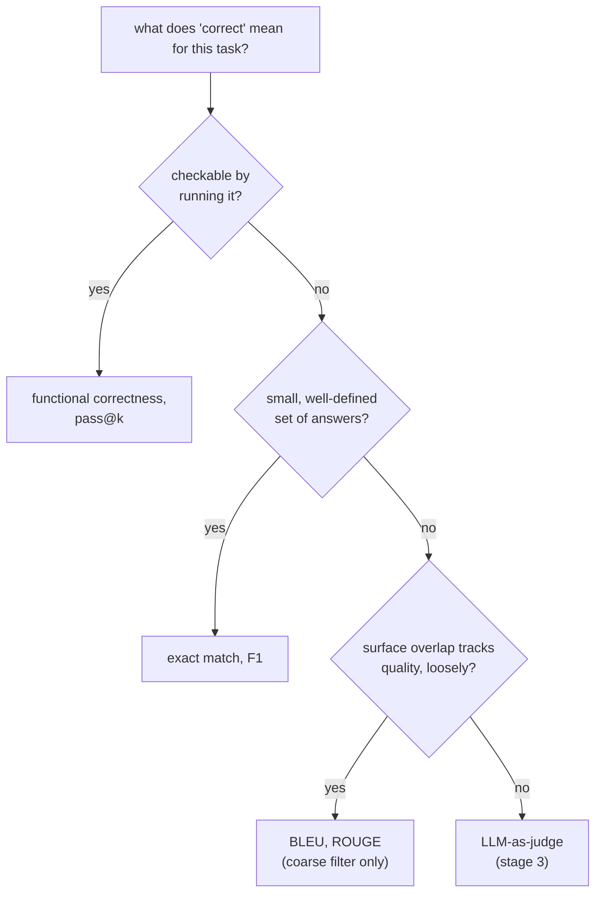

# 第 4 课：代码执行指标与指标的选择

**使命关联:** 这是第 2 阶段的收官：代码是唯一一种可以通过运行来检查正确性、而不必与文本作比较的任务类型，而选对指标的类别（涵盖本课和第 3 课），正是让评测数字所表达的含义名副其实的关键。
**主要来源:** [论文：“Evaluating Large Language Models Trained on Code”（Codex），Chen 等，2021](https://arxiv.org/abs/2107.03374)
**前置知识:** [第 3 课](0003-task-specific-metrics.md)、[数据污染](../GLOSSARY.md)

## 热身

1. ▢ 参考答案：“a fast red fox jumps”。预测：“a red fox jumps fast”。为什么 token 集合的 F1 把这一对判为完全匹配，这暴露了 F1 的什么盲区？

<details markdown="1"><summary>检查</summary>

两者共有同样的五个 token，只是顺序不同，所以 F1 给出 1.0。这暴露出 F1 看不见词序：把正确的词打乱成另一个、可能是错误的论断的预测，得分可以与保持了正确顺序和含义的预测完全相同。

</details>

2. ▢ 为什么对于参考答案 “The show received positive reviews from critics,” ROUGE 很可能给 “Critics praised the show” 打低分，尽管两者说的是同一件事？

<details markdown="1"><summary>检查</summary>

尽管含义一致，这两个句子却几乎没有共有的连续 n-gram，而 ROUGE 度量的是 n-gram 重叠，而不是含义。有效的改写，会和错误答案受到同样的惩罚。

</details>

## 要点

### 功能正确性：执行代码，而不是把它与文本作比较

代码在文本上有数量庞大的不同写法都是正确的：同一个问题的两个解答，可以在变量名、结构和思路上各不相同，却都完全正确。把精确匹配、F1 或 BLEU/ROUGE（第 3 课）用于生成的代码，会惩罚那个正确却写法不同的解答，就像第 3 课展示的这些指标惩罚有效的改写一样，而且更糟，因为代码的等价形式通常比散文多得多。**功能正确性**完全绕开了这个问题：让生成的代码对一套留出的测试用例运行，检查它是否真的产生了正确的行为。于是正确性成了关于代码做了什么的事实，而不是关于它的文本与某个参考解答有多像。

### pass@k：采样之下的正确性

LLM 的代码生成是随机的：同一个问题问两次，可能一次得到可运行的解答，另一次得到有缺陷的。**pass@k** 提出了比“这一个样本行不行”更尖锐的问题：在一个问题的 *k* 个采样解答中，至少有一个通过全部测试的概率是多少？朴素的做法，是对每个问题恰好生成 *k* 个样本，检查有没有通过的，但这个估计噪声很大，尤其是 *k* 较小的时候，因为具体抽到了哪 *k* 个样本影响很大。

Codex 论文的解决办法：对每个问题生成数量更大的 *n* 个样本，数出其中正确的有 *c* 个，然后用解析的方式，算出从这 *n* 个样本中假想地抽取 *k* 个时，其中至少有一个正确的概率，而不必真的去抽更少的样本：

```text
pass@k = 1 − C(n−c, k) / C(n, k)
```

`C(n−c, k) / C(n, k)` 是从生成的 *n* 个解答中，不放回地随机抽取 *k* 个，却把 *c* 个正确解答全部漏掉的概率；用 1 减去它，就是至少包含一个正确解答的概率。这样，对不超过 *n* 的任何 *k* 值，都能用到每一个生成的样本来计算 pass@k，而不必为每个 *k* 分别重新采样、重新运行模型，既更便宜，方差也更低。

### 按任务选择指标，把第 2 阶段串起来

选择的顺序，取决于任务中“正确”究竟是什么意思。当正确性是行为上的、可以通过运行某个东西来检查时，就去执行它：功能正确性和 pass@k，也就是本课的主题。当正确性是一个小而明确的答案集合中的某一个时，精确匹配或 F1 适合（第 3 课）。当正确性是开放式文本，而与参考文本的表面重叠只与质量松散相关时，BLEU 或 ROUGE（第 3 课）可作为粗略、廉价的初筛，而不是最终的裁定，因为两者都无法通过结构检查或执行来检验。当任务是开放式的，这里的任何办法都检查不了它，就只剩下使命的下一个阶段，LLM-as-judge。



## 练习

1. ▢ 为什么用精确匹配或 BLEU 给生成的代码打分，比给散文打分更常惩罚正确的解答？

<details markdown="1"><summary>检查</summary>

代码在文本上有特别多种不同的写法都是正确的（用不同的变量名、结构或思路解决同一个问题），所以一个写法与参考解答不同的正确解答，比一个正确的散文改写，更有可能被文本比较类的指标惩罚，因为有效的替代措辞的空间更大。

</details>

2. ▢ 某模型为一个编程问题生成了 10 个样本（n = 10），其中 3 个通过全部测试（c = 3）。用本课的公式，计算 pass@1 和 pass@5。

<details markdown="1"><summary>提示</summary>

`C(n−c, k)` 和 `C(n, k)` 是组合数：`C(a, b) = a! / (b! × (a−b)!)`。对于 pass@1，它应该化简成某个熟悉的东西。

</details>

<details markdown="1"><summary>检查</summary>

pass@1：`1 − C(7,1)/C(10,1) = 1 − 7/10 = 0.3`，与直接取 `c/n` 相同，k = 1 时本该如此。pass@5：`C(7,5) = 21`，`C(10,5) = 252`，所以 `1 − 21/252 ≈ 1 − 0.083 = 0.917`。pass@5 比 pass@1 高得多，因为抽 5 个样本，有多得多的机会至少抽中 3 个正确解答中的一个。

</details>

3. ▢ 为什么 Codex 论文的估计量要生成较大的 `n`，再对组合做解析计算 pass@k，而不是对每个问题恰好生成 `k` 个样本，看有没有通过的？

<details markdown="1"><summary>检查</summary>

恰好生成 k 个样本并直接检查，只是一次带噪声的抽取，尤其是 k 很小的时候：具体生成了哪 k 个样本，在不同次运行之间变化很大。一次性生成较大的 n，再计算组合估计量，是重复利用全部 n 个样本，对不超过 n 的任何 k，给出方差更低的、无偏的 pass@k 估计，而不必为每个 k 分别重新采样或重新运行模型。

</details>

4. ▢ 把每个任务与第 3 课和第 4 课中最适合它的指标类别配对：（a）每题有一个正确字母的选择题测验，（b）生成一个必须通过测试套件的 Python 函数，（c）为一篇新闻文章生成简短的摘要。

<details markdown="1"><summary>检查</summary>

（a）精确匹配：有一个明确的正确答案，没有需要吸收的有意义的表面差异。（b）功能正确性 / pass@k：正确性是行为上的，可以通过运行代码直接检查。（c）BLEU 或 ROUGE，作为粗略的初筛，因为摘要的质量是开放式文本，表面重叠只与正确性松散相关；更完整的判断，需要更接近人工或 LLM-as-judge 的评测。

</details>

5. ▢ 与针对代码的文本比较类指标相比，关于功能正确性，下列哪项说法是对的？

    - a) 它要求生成的代码与参考解答的文本完全一致
    - b) 它检查代码的实际行为，对测试用例运行后是否正确，而不管它是怎么写的
    - c) 它不能与每个问题采样多个补全结合使用
    - d) 它是针对编程语言改编的 BLEU 变体

<details markdown="1"><summary>检查</summary>

**b)** 这正是关键所在：决定正确性的是行为，而不是文本。（a）错误：那说的是精确匹配，功能正确性恰恰避开了它。（c）错误：pass@k 正是功能正确性与采样的结合。（d）错误：功能正确性是执行代码，根本不是比较 n-gram。

</details>

## 实战练习

- [ ] 对于你评测或打算评测的一个代码生成任务，找一套或写一套小型测试套件，检查行为，而不是把生成的代码与某个参考解答的文本作比较。
- [ ] 如果你能用到某个代码模型，为一个问题生成几个样本，并根据有几个通过，用本课的公式手算 pass@1 和 pass@3。
- [ ] 明天：对你关心的三个任务，写下精确匹配/F1、BLEU/ROUGE 和功能正确性这几类指标中，哪一类适合各自所谓的“正确”，以及为什么。

## 延伸阅读

- [论文：“Evaluating Large Language Models Trained on Code”（Codex），Chen 等，2021](https://arxiv.org/abs/2107.03374)
- [文档：Evaluate，Hugging Face](https://huggingface.co/docs/evaluate/index)
- [资源](../RESOURCES.md)

---

没学明白？请重读顶部的主要来源，因为本课是对它的压缩，而理解正是在压缩中流失的。如果有哪个术语觉得含糊，可以查看[术语表](../GLOSSARY.md)。

如果问题出在课程本身，而不是学习材料，那就是一个缺陷：[提交 issue](https://github.com/TokenCemetery/teach/issues)。
