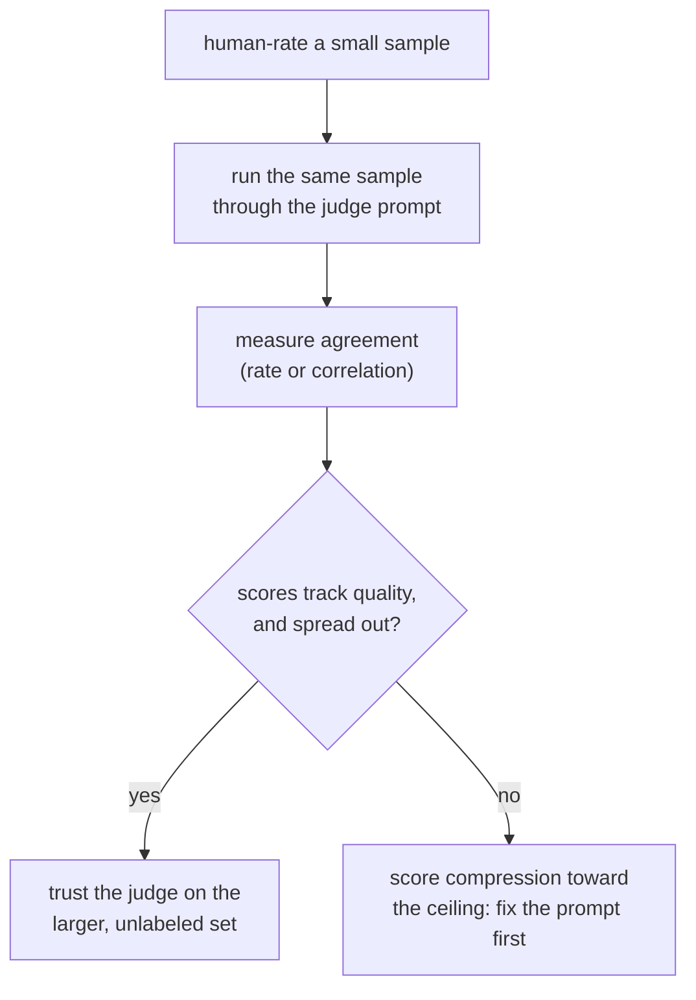

# Lección 5. Diseño y calibración del prompt de un juez

**Vínculo con la misión:** La etapa 3 cubre la herramienta hacia la que construyeron las etapas 1 y 2 para el texto abierto: ni una métrica de respuesta fija ni el solapamiento de n-gramas siguen bien la calidad aquí, así que un juez LLM llena el hueco, pero solo una vez que su prompt y su calibración se han comprobado, no supuesto.
**Fuente principal:** [Paper: "Judging LLM-as-a-Judge with MT-Bench and Chatbot Arena", Zheng et al., 2023](https://arxiv.org/abs/2306.05685)
**Requisitos previos:** [Lección 4](0004-code-execution-metrics.md), [Contaminación de datos](../GLOSSARY.md)

## Calentamiento

1. ▢ ¿Por qué la corrección funcional evita el modo de fallo que afecta a la coincidencia exacta, al F1 y a BLEU/ROUGE en el código?

Comprobación

Ejecuta el código generado contra casos de prueba y comprueba su comportamiento real, en lugar de comparar su texto con una solución de referencia. El código tiene una cantidad especialmente grande de formas textualmente distintas de ser correcto, así que una métrica de comparación de texto penalizaría una solución correcta pero escrita de otra manera.

2. ▢ ¿Qué principio de decisión de la lección 4 determina qué familia de métricas encaja con una tarea dada?

Comprobación

Ajustar la métrica a lo que "correcto" significa para la tarea: ejecutar la salida cuando la corrección es de comportamiento y comprobable, usar coincidencia exacta o F1 cuando la corrección es un pequeño conjunto fijo de respuestas, y usar BLEU/ROUGE como filtro grueso para texto abierto donde el solapamiento superficial solo sigue la calidad de forma laxa.

## Qué debes saber

### Por qué existe siquiera un juez LLM

La generación abierta, una respuesta de chat, una respuesta larga, un texto creativo o explicativo, es justo donde BLEU y ROUGE de la lección 3 se correlacionan débilmente con la calidad y la corrección funcional de la lección 4 no tiene nada que ejecutar. Un **LLM-as-judge** le pide a un modelo capaz que califique o compare salidas directamente, y se correlaciona con la preferencia humana mucho mejor que el solapamiento de n-gramas en este tipo de texto. Esa ventaja no es automática, sin embargo: hay que comprobar tanto el prompt de un juez como su acuerdo medido con evaluadores humanos antes de confiar en sus puntuaciones, que es el tema de esta lección.

### Diseñar un prompt de juez

Unas pocas decisiones concretas separan un prompt de juez que califica de forma consistente de uno que no:

- **Criterios explícitos, no una petición vaga.** "¿Qué respuesta es mejor?" deja al juez inventar su propia rúbrica, de forma distinta en cada llamada. Nombrar las dimensiones que importan para la tarea (corrección, completitud, tono, las que apliquen) da a cada juicio la misma vara de medir.
- **Una respuesta de referencia, cuando exista.** Calificar guiado por una referencia le da al juez algo con qué comparar en lugar de juzgar en el vacío, lo que importa sobre todo en tareas como las matemáticas o el razonamiento de varios pasos, donde una respuesta errónea aún puede leerse fluida y convincente si no hay algo correcto contra lo que revisarla.
- **Razonamiento antes de la puntuación.** Pedirle al juez que explique primero su razonamiento y después dé una calificación produce puntuaciones más consistentes que pedir un número a secas, ya que obliga a justificar el juicio en lugar de emitirlo directamente, igual que pedirle a una persona que explique una calificación tiende a hacer que la propia calificación sea más meditada.
- **Una salida estructurada y analizable.** Una escala forzada (por ejemplo, de 1 a 10) o una elección pareada forzada (A, B o empate) es más fácil de agregar y auditar que una calificación en prosa libre, y es lo que permite que muchos ejemplos juzgados se conviertan en un único número resumen.

### Calibración: ¿significa lo mismo la puntuación del juez en todos los ejemplos?

Un juez está **calibrado** cuando sus puntuaciones siguen la calidad real de forma consistente: un 8 sobre 10 en un ejemplo debería reflejar aproximadamente el mismo nivel de calidad que un 8 sobre 10 en otro ejemplo distinto, y los rankings relativos del juez deberían coincidir con lo que dirían los evaluadores humanos. Un juez puede fallar en esto de una forma específica y común: la **compresión de las puntuaciones hacia el techo**, donde el juez califica casi todo con un 8 o un 9 sin importar las diferencias reales de calidad, lo que borra justo las distinciones que una eval existe para detectar. Un juez cuyas puntuaciones no se dispersan como lo hace la calidad genuina no está midiendo calidad; está midiendo su propia indulgencia.

La calibración no es algo que se deba suponer; es algo que se debe comprobar, igual que la lección 1 insistió en que la honestidad de un conjunto held-out se comprobara en lugar de suponerse. La comprobación: ejecutar el juez contra un pequeño conjunto de ejemplos que una persona ya ha calificado y medir el acuerdo, ya sea con una tasa de acuerdo simple o con un estadístico de correlación, antes de confiar en el juez sobre el conjunto más grande y sin etiquetar para el que la eval realmente lo necesita.

## Práctica

1. ▢ ¿Por qué darle a un modelo juez una respuesta de referencia, cuando hay una disponible, tiende a mejorar la exactitud de su calificación frente a juzgar sin ninguna referencia?

Comprobación

Sin una referencia, el juez no tiene nada con qué contrastar una respuesta más allá de su propio sentido de la plausibilidad, y una respuesta fluida pero errónea, sobre todo en matemáticas o razonamiento de varios pasos, puede leerse convincente si no hay algo correcto con qué compararla. Una respuesta de referencia le da al juez un ancla, y detecta errores que de otro modo se colarían en un juicio hecho en el vacío.

2. ▢ ¿Por qué pedirle a un juez que explique su razonamiento antes de dar una puntuación numérica tiende a producir una calificación más consistente que pedir solo la puntuación a secas?

Comprobación

Producir primero el razonamiento obliga a justificar el juicio en lugar de emitirlo directamente desde una impresión rápida, lo que tiende a hacer que la puntuación resultante sea más meditada y menos arbitraria, el mismo efecto que tiene sobre una calificación pedirle a una persona que la explique.

3. ▢ El modelo juez de un equipo puntúa casi todas las respuestas con 8 o 9 sobre 10, incluidas varias que un evaluador humano calificó de forma independiente como mediocres. ¿Qué fallo de calibración describe esto, y por qué importa para una decisión posterior de go/no-go?

Pista

Piensa en lo que se supone que hace una puntuación: distinguir niveles de calidad entre sí.

Comprobación

Es la compresión de las puntuaciones hacia el techo: las puntuaciones del juez ya no se dispersan como lo hacen las diferencias reales de calidad, así que sus calificaciones dejan de distinguir una respuesta genuinamente buena de una mediocre. Esto importa para una decisión de go/no-go porque un rango de puntuaciones comprimido puede hacer que un cambio parezca una mejora, o volver invisible una regresión, cuando el juez simplemente ya no discrimina entre niveles de calidad.

4. ▢ ¿Cuál es una forma concreta de comprobar si un juez está calibrado antes de confiar en él sobre un conjunto de eval completo y sin etiquetar?

Comprobación

Ejecutar el juez contra un conjunto más pequeño de ejemplos que una persona ya ha calificado, y medir qué tan bien coinciden las puntuaciones o los rankings del juez con las calificaciones humanas, antes de apoyarse en el juez para el conjunto más grande donde no existen calificaciones humanas con las que contrastar.

5. ▢ ¿Qué afirmación es cierta sobre un prompt de juez bien diseñado?

    - a) Debería hacer una única pregunta vaga ("¿cuál es mejor?") para no sesgar al juez con criterios específicos
    - b) Debería nombrar criterios de calificación explícitos, incluir una respuesta de referencia cuando la haya y pedir el razonamiento antes de una puntuación
    - c) Un juez nunca necesita una respuesta de referencia, ya que siempre puede distinguir por sí solo una respuesta correcta de una incorrecta
    - d) La calibración está garantizada siempre que el modelo juez sea lo bastante capaz

Comprobación

**b)** Cada una de esas decisiones es lo que esta lección mostró que mejora la consistencia y la exactitud. (a) es falsa: una petición vaga deja que el juez invente su propia rúbrica de forma distinta cada vez. (c) es falsa: una respuesta fluida pero errónea, sobre todo en tareas de razonamiento, puede engañar a un juez que no tiene nada con qué contrastarla. (d) es falsa: la calibración hay que medirla contra calificaciones humanas, sin importar lo capaz que sea el modelo subyacente.

## Prácticas en el mundo real

- [ ] Busca o escribe un prompt de juez para una tarea que evalúes y contrástalo con los cuatro puntos de diseño de esta lección: criterios explícitos, una respuesta de referencia cuando la haya, razonamiento antes de puntuar y una salida estructurada.
- [ ] Califica tú mismo a mano una muestra pequeña (10 a 20 ejemplos), pasa los mismos ejemplos por tu prompt de juez y mide con qué frecuencia coinciden.
- [ ] Mañana: mira la distribución de puntuaciones de tu juez en un lote de ejemplos calificados y comprueba si está dispersa como esperarías que lo estuvieran las diferencias reales de calidad, o comprimida hacia un extremo.

## Para profundizar

- [Paper: "Judging LLM-as-a-Judge with MT-Bench and Chatbot Arena", Zheng et al., 2023](https://arxiv.org/abs/2306.05685)
- [Docs: "Define success criteria and build evaluations", Claude Platform Docs](https://platform.claude.com/docs/en/test-and-evaluate/develop-tests)
- [Recursos](../RESOURCES.md)

---

¿No termina de quedar claro? Vuelve a leer la fuente primaria de arriba, ya que esta lección la comprime y en la compresión es donde se escapa la comprensión. Consulta el [glosario](../GLOSSARY.md) por si algún término te resultó resbaladizo.

Si lo poco claro es la propia lección y no el material, eso es un defecto: [abre un issue](https://github.com/TokenCemetery/teach/issues).
