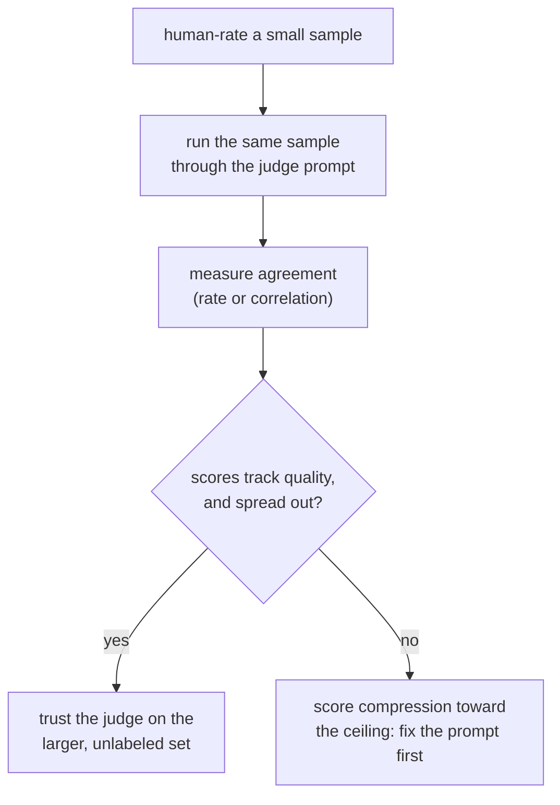

# Leçon 5. Conception du prompt de juge et calibration

**Lien avec la mission :** L'étape 3 couvre l'outil vers lequel les étapes 1 et 2 menaient pour le texte ouvert : ni une métrique à réponse fixe ni le recouvrement de n-grammes ne suivent bien la qualité ici, donc un juge LLM comble le manque, mais seulement une fois son prompt et sa calibration vérifiés, et non supposés.
**Source primaire :** [Article : "Judging LLM-as-a-Judge with MT-Bench and Chatbot Arena", Zheng et al., 2023](https://arxiv.org/abs/2306.05685)
**Prérequis :** [Leçon 4](0004-code-execution-metrics.md), [Contamination des données](../GLOSSARY.md)

## Échauffement

1. ▢ Pourquoi la correction fonctionnelle évite-t-elle le mode de défaillance qui touche l'exact match, le F1 et BLEU/ROUGE sur le code ?

Vérifier

Elle exécute le code généré sur des cas de test et vérifie son comportement réel, au lieu de comparer son texte à une solution de référence. Le code a un nombre particulièrement grand de manières textuellement différentes d'être correct, donc une métrique de comparaison de texte pénaliserait une solution correcte mais écrite autrement.

2. ▢ Quel principe de décision de la leçon 4 détermine quelle famille de métriques convient à une tâche donnée ?

Vérifier

Faire correspondre la métrique à ce que « correct » veut dire pour la tâche : exécuter la sortie quand la justesse est comportementale et vérifiable, utiliser l'exact match ou le F1 quand la justesse est un petit ensemble fixe de réponses, et utiliser BLEU/ROUGE comme filtre grossier pour du texte ouvert où le recouvrement de surface ne suit que vaguement la qualité.

## À savoir

### Pourquoi un juge LLM existe

La génération ouverte, une réponse de chat, une réponse longue, un texte créatif ou explicatif, est exactement l'endroit où BLEU et ROUGE (leçon 3) corrèlent faiblement avec la qualité et où la correction fonctionnelle (leçon 4) n'a rien à exécuter. Un **LLM-as-judge** demande à un modèle capable de noter ou de comparer directement des sorties, et il corrèle bien mieux avec la préférence humaine que le recouvrement de n-grammes sur ce genre de texte. Cet avantage n'est pourtant pas automatique : le prompt d'un juge et son accord mesuré avec des annotateurs humains doivent tous deux être vérifiés avant de faire confiance à ses scores, ce qui est le sujet de cette leçon.

### Concevoir un prompt de juge

Quelques choix concrets séparent un prompt de juge qui note de façon cohérente d'un prompt qui ne le fait pas :

- **Des critères explicites, pas une demande vague.** « Quelle réponse est meilleure ? » laisse le juge inventer sa propre grille, différemment à chaque appel. Nommer les dimensions qui comptent pour la tâche (justesse, exhaustivité, ton, selon ce qui s'applique) donne à chaque jugement le même étalon.
- **Une réponse de référence, quand il en existe une.** La notation guidée par une référence donne au juge de quoi comparer au lieu de juger dans le vide, ce qui compte surtout pour des tâches comme les mathématiques ou le raisonnement à plusieurs étapes, où une réponse fausse peut quand même paraître fluide et convaincante faute de quelque chose de correct pour la vérifier.
- **Le raisonnement avant le score.** Demander au juge d'expliquer d'abord son raisonnement, puis de donner une note, produit des scores plus cohérents que demander un chiffre nu, puisque cela force le jugement à être justifié plutôt qu'émis directement, de la même manière que demander à une personne d'expliquer une note tend à rendre la note elle-même plus réfléchie.
- **Une sortie structurée et analysable.** Une échelle imposée (disons de 1 à 10) ou un choix par paires imposé (A, B ou égalité) est plus facile à agréger et à auditer qu'une notation en prose libre, et c'est ce qui permet de transformer de nombreux exemples jugés en un seul chiffre de synthèse.

### Calibration : le score du juge veut-il dire la même chose d'un exemple à l'autre

Un juge est **calibré** quand ses scores suivent la qualité réelle de façon cohérente : un 8 sur 10 sur un exemple devrait refléter à peu près le même niveau de qualité qu'un 8 sur 10 sur un autre, et les classements relatifs du juge devraient concorder avec ce que diraient des annotateurs humains. Un juge peut échouer ici d'une façon précise et courante : la **compression des scores vers le plafond**, où le juge note presque tout 8 ou 9 quelles que soient les vraies différences de qualité, ce qui efface les distinctions mêmes qu'une eval existe pour repérer. Un juge dont les scores ne s'étalent pas comme le fait la vraie qualité ne mesure pas la qualité ; il mesure sa propre indulgence.

La calibration n'est pas à supposer ; elle est à vérifier, comme la leçon 1 a insisté pour qu'on vérifie l'honnêteté d'un jeu held-out au lieu de la supposer. La vérification : faire passer le juge sur un petit ensemble d'exemples qu'un humain a déjà notés, et mesurer l'accord, par un simple taux d'accord ou une statistique de corrélation, avant de faire confiance au juge sur l'ensemble plus grand, non étiqueté, pour lequel l'eval a réellement besoin de lui.

## Pratique

1. ▢ Pourquoi donner à un modèle juge une réponse de référence, quand il y en a une, tend-il à améliorer la précision de sa notation par rapport à un jugement sans aucune référence ?

Vérifier

Sans référence, le juge n'a rien pour vérifier une réponse au-delà de son propre sens de la plausibilité, et une réponse fluide mais fausse, surtout en mathématiques ou en raisonnement à plusieurs étapes, peut paraître convaincante faute de quelque chose de correct à lui comparer. Une réponse de référence donne au juge un point d'ancrage, qui attrape des erreurs qui passeraient sinon sous un jugement rendu dans le vide.

2. ▢ Pourquoi demander à un juge d'expliquer son raisonnement avant de donner un score numérique tend-il à produire une notation plus cohérente que de demander un score nu seul ?

Vérifier

Produire d'abord le raisonnement force le jugement à être justifié plutôt qu'émis directement d'après une impression instantanée, ce qui tend à rendre le score obtenu plus réfléchi et moins arbitraire, le même effet que demander à une personne d'expliquer une note a sur la note elle-même.

3. ▢ Le modèle juge d'une équipe note presque toutes les réponses 8 ou 9 sur 10, dont plusieurs qu'un annotateur humain a indépendamment jugées médiocres. Quelle défaillance de calibration cela décrit-il, et pourquoi est-ce important pour une décision go/no-go ultérieure ?

Indice

Pensez à ce qu'un score est censé faire : distinguer les niveaux de qualité les uns des autres.

Vérifier

C'est la compression des scores vers le plafond : les scores du juge ne s'étalent plus comme le font les vraies différences de qualité, donc ses notes cessent de distinguer une réponse réellement bonne d'une réponse médiocre. C'est important pour un go/no-go parce qu'une plage de scores comprimée peut faire passer un changement pour une amélioration, ou rendre une régression invisible, alors que le juge ne discrimine tout simplement plus entre les niveaux de qualité.

4. ▢ Quelle est une façon concrète de vérifier qu'un juge est calibré avant de lui faire confiance sur un jeu d'eval complet et non étiqueté ?

Vérifier

Faire passer le juge sur un plus petit ensemble d'exemples qu'un humain a déjà notés, et mesurer dans quelle mesure les scores ou les classements du juge concordent avec les notes humaines, avant de s'appuyer sur le juge pour l'ensemble plus grand où il n'existe aucune note humaine pour vérifier.

5. ▢ Laquelle de ces affirmations est vraie d'un prompt de juge bien conçu ?

    - a) Il devrait poser une seule question vague (« lequel est meilleur ? ») pour éviter de biaiser le juge avec des critères précis
    - b) Il devrait nommer des critères de notation explicites, inclure une réponse de référence quand il y en a une, et demander le raisonnement avant un score
    - c) Un juge n'a jamais besoin d'une réponse de référence, puisqu'il sait toujours distinguer une réponse correcte d'une réponse incorrecte sans aide
    - d) La calibration est garantie tant que le modèle juge est assez capable

Vérifier

**b)** Chacun de ces choix est ce que cette leçon a montré améliorer la cohérence et la précision. (a) est faux : une demande vague laisse le juge inventer sa propre grille différemment à chaque fois. (c) est faux : une réponse fluide mais fausse, surtout sur des tâches de raisonnement, peut tromper un juge qui n'a rien pour la vérifier. (d) est faux : la calibration doit être mesurée face à des notes humaines, quelle que soit la capacité du modèle sous-jacent.

## Exercices en situation réelle

- [ ] Trouvez ou écrivez un prompt de juge pour une tâche que vous évaluez, et confrontez-le aux quatre points de conception de cette leçon : critères explicites, réponse de référence quand il y en a une, raisonnement avant la notation, et sortie structurée.
- [ ] Notez vous-même à la main un petit échantillon (10 à 20 exemples), faites passer les mêmes exemples dans votre prompt de juge, et mesurez à quelle fréquence vos notes concordent.
- [ ] Demain : regardez la distribution des scores de votre juge sur un lot d'exemples notés et vérifiez si elle s'étale comme vous vous attendriez que le fassent de vraies différences de qualité, ou si elle est comprimée vers une extrémité.

## Pour aller plus loin

- [Article : "Judging LLM-as-a-Judge with MT-Bench and Chatbot Arena", Zheng et al., 2023](https://arxiv.org/abs/2306.05685)
- [Doc : "Define success criteria and build evaluations", Claude Platform Docs](https://platform.claude.com/docs/en/test-and-evaluate/develop-tests)
- [Ressources](../RESOURCES.md)

---

Ça ne passe pas ? Relisez la source primaire en haut de page, car cette leçon la condense et c'est dans la condensation que la compréhension s'échappe. Consultez le [glossaire](../GLOSSARY.md) pour tout terme qui vous a paru glissant.

Si c'est la leçon elle-même qui n'est pas claire plutôt que la matière, c'est un défaut : [ouvrez une issue](https://github.com/TokenCemetery/teach/issues).
