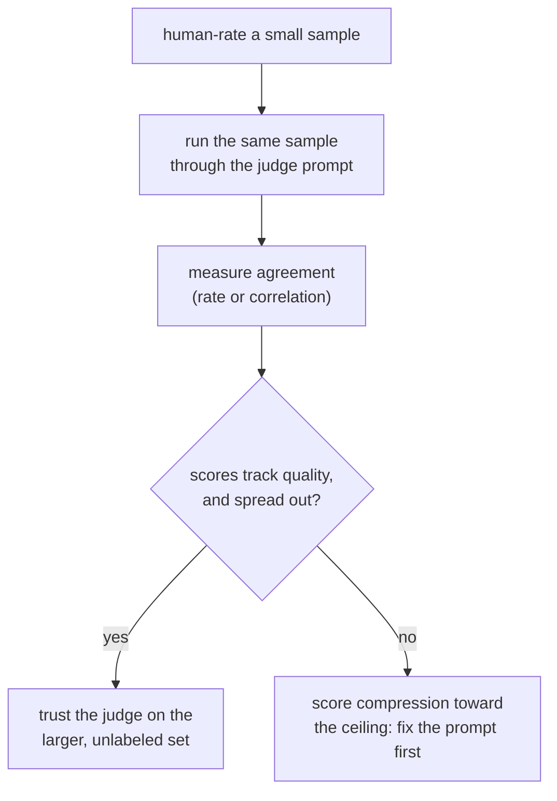

# पाठ 5. Judge-Prompt Design और Calibration

**मिशन से संबंध:** चरण 3 वह औज़ार कवर करता है जिसकी ओर चरण 1 और 2 खुले-सिरे वाले text के लिए बढ़ रहे थे: यहाँ न तय-उत्तर वाली metric और न n-gram overlap गुणवत्ता को ठीक से पकड़ता है, इसलिए LLM judge यह ख़ाली जगह भरता है, पर तभी जब उसका prompt और उसकी calibration जाँची गई हों, मानी नहीं गई हों।
**मुख्य स्रोत:** [पेपर: "Judging LLM-as-a-Judge with MT-Bench and Chatbot Arena", Zheng et al., 2023](https://arxiv.org/abs/2306.05685)
**पूर्व-आवश्यकताएँ:** [पाठ 4](0004-code-execution-metrics.md), [Data contamination](../GLOSSARY.md)

## वार्म-अप

1. ▢ Functional correctness उस विफलता से क्यों बच जाती है जो code पर exact match, F1 और BLEU/ROUGE को प्रभावित करती है?

जाँचें

वह generate किए code को test cases पर चलाती है और उसके असल व्यवहार को जाँचती है, उसके text की reference हल से तुलना करने के बजाय। Code के सही होने के text के स्तर पर अलग-अलग तरीक़े ख़ास तौर पर बहुत ज़्यादा हैं, इसलिए text-तुलना वाली metric सही-पर-अलग-लिखे हल को दंडित करती।

2. ▢ पाठ 4 का कौन-सा निर्णय-सिद्धांत तय करता है कि किसी दिए task पर कौन-सा metric परिवार बैठता है?

जाँचें

Metric को उससे मिलाएँ जो task के लिए "सही" का मतलब है: जब correctness व्यवहार की हो और जाँची जा सकती हो तो output को चलाएँ, जब correctness उत्तरों का छोटा तय सेट हो तो exact match या F1 इस्तेमाल करें, और खुले-सिरे वाले text के लिए, जहाँ ऊपरी overlap गुणवत्ता का सिर्फ़ ढीला पीछा करता है, BLEU/ROUGE को मोटे छन्ने के रूप में इस्तेमाल करें।

## यह जानें

### LLM judge होता ही क्यों है

खुले-सिरे वाली generation, यानी chat response, लंबा उत्तर, रचनात्मक या समझाने वाला लेखन, ठीक वही जगह है जहाँ पाठ 3 के BLEU और ROUGE गुणवत्ता से कमज़ोर correlate करते हैं और पाठ 4 की functional correctness के पास चलाने को कुछ नहीं होता। **LLM-as-judge** किसी सक्षम model से outputs को सीधे grade करने या तुलना करने को कहता है, और इस तरह के text पर वह मानव पसंद से n-gram overlap के मुक़ाबले कहीं बेहतर correlate करता है। यह फ़ायदा अपने-आप नहीं मिलता: judge के scores पर भरोसा करने से पहले उसके prompt और मानव raters से उसकी मापी गई सहमति, दोनों को जाँचना पड़ता है, जो इस पाठ का विषय है।

### Judge prompt डिज़ाइन करना

कुछ ठोस चुनाव एकसार grade करने वाले judge prompt को वैसा न करने वाले से अलग करते हैं:

- **साफ़ कसौटियाँ, धुँधला अनुरोध नहीं।** "कौन-सा response बेहतर है?" judge को अपना rubric ख़ुद गढ़ने के लिए छोड़ देता है, हर call पर अलग। Task के लिए मायने रखने वाले आयामों का नाम लेना (correctness, completeness, tone, जो भी लागू हों) हर निर्णय को एक ही पैमाना देता है।
- **Reference उत्तर, जब कोई हो।** Reference-निर्देशित grading judge को शून्य में निर्णय देने के बजाय तुलना के लिए कुछ देती है, जो ख़ास तौर पर math या बहु-चरणीय reasoning जैसे tasks में मायने रखता है, जहाँ ग़लत उत्तर भी, बिना किसी सही चीज़ के सामने जाँचे, धाराप्रवाह और क़ायल करने वाला लग सकता है।
- **Score से पहले reasoning।** Judge से पहले अपनी reasoning समझाने और फिर rating देने को कहना खाली संख्या माँगने से ज़्यादा एकसार scores पैदा करता है, क्योंकि वह निर्णय को सीधे निकाल देने के बजाय सही ठहराने पर मजबूर करता है, ठीक वैसे ही जैसे किसी व्यक्ति से rating समझाने को कहना rating को ख़ुद ज़्यादा सोचा-समझा बना देता है।
- **संरचित, parse होने लायक output।** तय scale (मान लें 1 से 10) या तय pairwise चुनाव (A, B या tie) मुक्त-रूप गद्य grading से aggregate और audit करने में आसान है, और यही कई judged examples को एक सारांश संख्या में बदलने देता है।

### Calibration: क्या judge के score का मतलब examples भर में एक ही है

Judge **calibrated** तब है जब उसके scores असली गुणवत्ता का लगातार पीछा करते हैं: एक example पर 10 में से 8 का मतलब लगभग वही गुणवत्ता-स्तर होना चाहिए जो दूसरे example पर 10 में से 8 का है, और judge की सापेक्ष rankings उससे मेल खानी चाहिए जो मानव raters कहते। Judge इसमें एक ख़ास, आम तरीक़े से विफल हो सकता है: **छत की ओर score compression**, जहाँ judge असली गुणवत्ता के फ़र्क़ की परवाह किए बिना लगभग हर चीज़ को 8 या 9 देता है, जो उन्हीं भेदों को मिटा देता है जिन्हें पकड़ने के लिए eval होता है। जिस judge के scores असली गुणवत्ता की तरह फैलते नहीं, वह गुणवत्ता नहीं माप रहा; वह अपनी उदारता माप रहा है।

Calibration मान लेने की चीज़ नहीं है; जाँचने की चीज़ है, ठीक वैसे ही जैसे पाठ 1 ने ज़ोर दिया था कि held-out सेट की ईमानदारी जाँची जाए, मानी न जाए। जाँच यह है: judge को उन examples के छोटे सेट पर चलाएँ जिन्हें किसी इंसान ने पहले ही rate किया है, और सहमति मापें, चाहे सरल agreement दर से या correlation statistic से, उससे पहले कि judge पर उस बड़े, बिना label वाले सेट पर भरोसा करें जिसके लिए eval को उसकी ज़रूरत है।

## अभ्यास

1. ▢ जब reference उत्तर उपलब्ध हो, तो judge model को देना उसकी grading की सटीकता को बिना किसी reference के निर्णय देने की तुलना में बेहतर क्यों करता है?

जाँचें

Reference के बिना, judge के पास response को जाँचने के लिए अपनी संभाव्यता की समझ के सिवा कुछ नहीं होता, और धाराप्रवाह पर ग़लत उत्तर, ख़ास तौर पर math या बहु-चरणीय reasoning में, किसी सही चीज़ से तुलना किए बिना क़ायल करने वाला लग सकता है। Reference उत्तर judge को एक लंगर देता है, और उन त्रुटियों को पकड़ता है जो शून्य में दिए निर्णय से निकल जातीं।

2. ▢ Judge से संख्यात्मक score देने से पहले अपनी reasoning समझाने को कहना खाली score माँगने से ज़्यादा एकसार grading क्यों पैदा करता है?

जाँचें

पहले reasoning पैदा करना निर्णय को तुरंत की धारणा से सीधे निकाल देने के बजाय सही ठहराने पर मजबूर करता है, जिससे नतीजे का score ज़्यादा सोचा-समझा और कम मनमाना बनता है, वही असर जो किसी व्यक्ति से rating समझाने को कहने का rating पर होता है।

3. ▢ एक टीम का judge model लगभग हर response को 10 में से 8 या 9 देता है, जिनमें कई ऐसे भी हैं जिन्हें मानव rater ने स्वतंत्र रूप से औसत कहा। यह calibration की कौन-सी विफलता है, और बाद के go/no-go फ़ैसले के लिए यह क्यों मायने रखती है?

संकेत

सोचें कि score का काम क्या होना चाहिए: गुणवत्ता के स्तरों को एक-दूसरे से अलग करना।

जाँचें

यह छत की ओर score compression है: judge के scores अब वैसे नहीं फैलते जैसे असली गुणवत्ता के फ़र्क़ फैलते हैं, इसलिए उसकी ratings सचमुच अच्छे response और औसत response में फ़र्क़ करना बंद कर देती हैं। Go/no-go फ़ैसले के लिए यह मायने रखता है क्योंकि सिमटी हुई score सीमा किसी बदलाव को सुधार जैसा दिखा सकती है, या regression को अदृश्य बना सकती है, जब judge बस गुणवत्ता के स्तरों के बीच भेद करना बंद कर चुका हो।

4. ▢ पूरे, बिना label वाले eval सेट पर भरोसा करने से पहले यह जाँचने का ठोस तरीक़ा क्या है कि judge calibrated है या नहीं?

जाँचें

Judge को उन examples के छोटे सेट पर चलाएँ जिन्हें किसी इंसान ने पहले ही rate किया है, और मापें कि judge के scores या rankings मानव ratings से कितनी अच्छी तरह मेल खाते हैं, उससे पहले कि उस बड़े सेट के लिए judge पर निर्भर हों जहाँ जाँचने के लिए कोई मानव ratings नहीं हैं।

5. ▢ अच्छे से डिज़ाइन किए गए judge prompt के बारे में कौन-सा दावा सही है?

    - a) उसे judge को ख़ास कसौटियों से प्रभावित न करने के लिए एक अकेला धुँधला सवाल ("कौन बेहतर है?") पूछना चाहिए
    - b) उसे साफ़ grading कसौटियों का नाम लेना चाहिए, उपलब्ध होने पर reference उत्तर शामिल करना चाहिए, और score से पहले reasoning माँगनी चाहिए
    - c) Judge को कभी reference उत्तर की ज़रूरत नहीं होती, क्योंकि वह बिना मदद के हमेशा सही उत्तर को ग़लत से अलग पहचान सकता है
    - d) जब तक judge model काफ़ी सक्षम है, calibration की गारंटी है

जाँचें

**b)** इनमें से हर चुनाव वही है जिसे इस पाठ ने एकरूपता और सटीकता सुधारते दिखाया। (a) ग़लत है: धुँधला अनुरोध judge को हर बार अलग ढंग से अपना rubric गढ़ने देता है। (c) ग़लत है: धाराप्रवाह पर ग़लत उत्तर, ख़ास तौर पर reasoning tasks में, ऐसे judge को चकमा दे सकता है जिसके पास उसे जाँचने के लिए कुछ नहीं है। (d) ग़लत है: calibration को मानव ratings के सामने मापना पड़ता है, चाहे अंतर्निहित model कितना भी सक्षम हो।

## असली दुनिया का अभ्यास

- [ ] जिस task को आप परखते हैं उसके लिए judge prompt खोजें या लिखें, और उसे इस पाठ के चार डिज़ाइन बिंदुओं के सामने जाँचें: साफ़ कसौटियाँ, उपलब्ध होने पर reference उत्तर, scoring से पहले reasoning, और संरचित output।
- [ ] ख़ुद एक छोटा नमूना (10 से 20 examples) हाथ से rate करें, वही examples अपने judge prompt से चलाएँ, और मापें कि दोनों कितनी बार सहमत होते हैं।
- [ ] कल: grade किए examples के एक batch पर अपने judge का score वितरण देखें और जाँचें कि वह वैसे फैला है जैसे असली गुणवत्ता के फ़र्क़ से आप उम्मीद करते, या किसी एक सिरे की ओर सिमटा है।

## आगे बढ़ने के लिए

- [पेपर: "Judging LLM-as-a-Judge with MT-Bench and Chatbot Arena", Zheng et al., 2023](https://arxiv.org/abs/2306.05685)
- [दस्तावेज़: "Define success criteria and build evaluations", Claude Platform Docs](https://platform.claude.com/docs/en/test-and-evaluate/develop-tests)
- [संसाधन](../RESOURCES.md)

---

बात नहीं बन रही? ऊपर दिए primary source को दोबारा पढ़ें, क्योंकि यह पाठ उसे संक्षिप्त करता है और समझ संक्षेप में ही रिसती है। जो शब्द फिसलन भरा लगे, उसके लिए [शब्दावली](../GLOSSARY.md) देखें।

अगर दिक़्क़त सामग्री की नहीं बल्कि पाठ की ही है, तो वह एक खोट है: [issue खोलें](https://github.com/TokenCemetery/teach/issues)।
