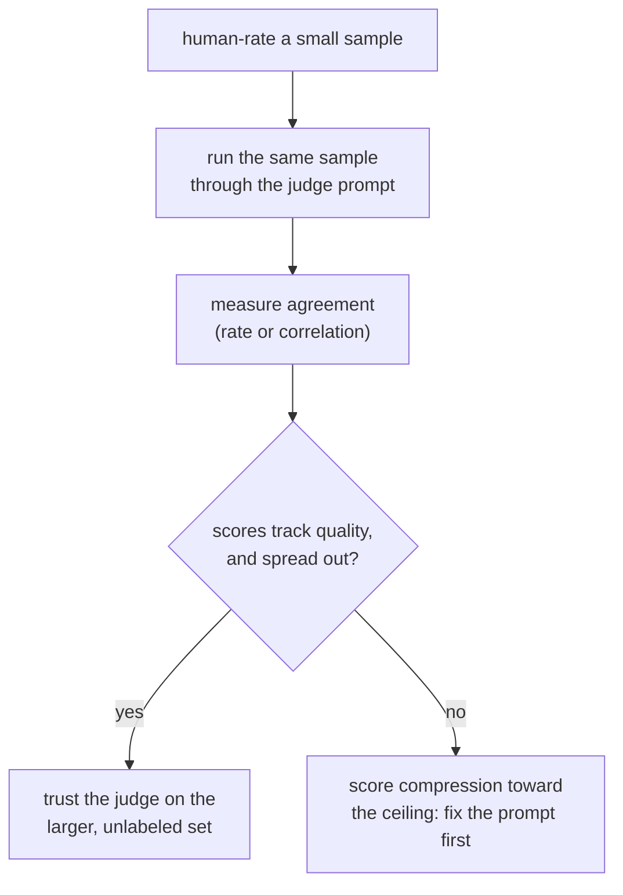

# Lição 5. Design e calibração de prompt de juiz

**Ligação com a missão:** A etapa 3 cobre a ferramenta para a qual as etapas 1 e 2 apontavam no caso de texto aberto: nem uma métrica de resposta fixa nem a sobreposição de n-gramas acompanham bem a qualidade aqui, então um juiz LLM preenche a lacuna, mas só depois que seu prompt e sua calibração são verificados, e não presumidos.
**Fonte principal:** [Artigo científico: "Judging LLM-as-a-Judge with MT-Bench and Chatbot Arena", Zheng et al., 2023](https://arxiv.org/abs/2306.05685)
**Pré-requisitos:** [Lição 4](0004-code-execution-metrics.md), [Contaminação de dados](../GLOSSARY.md)

## Aquecimento

1. ▢ Por que a correção funcional evita o modo de falha que afeta o exact match, o F1 e o BLEU/ROUGE em código?

Verificação

Ela executa o código gerado contra casos de teste e verifica seu comportamento real, em vez de comparar seu texto com uma solução de referência. O código tem um número especialmente grande de maneiras textualmente diferentes de estar correto, então uma métrica de comparação de texto penalizaria uma solução correta, mas escrita de outro jeito.

2. ▢ Que princípio de decisão da lição 4 determina qual família de métricas serve a uma dada tarefa?

Verificação

Casar a métrica com o que "correto" significa para a tarefa: executar a saída quando a correção é comportamental e verificável, usar exact match ou F1 quando a correção é um pequeno conjunto fixo de respostas, e usar BLEU/ROUGE como filtro grosseiro para texto aberto em que a sobreposição superficial só acompanha a qualidade de forma frouxa.

## Saiba isto

### Por que existe um juiz LLM

A geração aberta, uma resposta de chat, uma resposta longa, um texto criativo ou explicativo, é exatamente onde o BLEU e o ROUGE da lição 3 se correlacionam fracamente com a qualidade e a correção funcional da lição 4 não tem nada para executar. Um **LLM-as-judge** pede a um modelo capaz que avalie ou compare saídas diretamente, e ele se correlaciona com a preferência humana muito melhor que a sobreposição de n-gramas nesse tipo de texto. Essa vantagem não é automática, porém: o prompt de um juiz e sua concordância medida com avaliadores humanos precisam ser verificados antes de suas pontuações merecerem confiança, o que é o assunto desta lição.

### Projetando um prompt de juiz

Algumas escolhas concretas separam um prompt de juiz que avalia de forma consistente de um que não avalia:

- **Critérios explícitos, não um pedido vago.** "Qual resposta é melhor?" deixa o juiz inventar a própria rubrica, de forma diferente a cada chamada. Nomear as dimensões que importam para a tarefa (correção, completude, tom, as que se aplicarem) dá a cada julgamento a mesma régua.
- **Uma resposta de referência, quando existe uma.** A avaliação guiada por referência dá ao juiz algo com que comparar em vez de julgar no vácuo, o que importa especialmente em tarefas como matemática ou raciocínio em vários passos, em que uma resposta errada ainda pode soar fluente e convincente sem algo correto contra o qual conferi-la.
- **Raciocínio antes da pontuação.** Pedir ao juiz que explique seu raciocínio primeiro e só depois dê uma nota produz pontuações mais consistentes do que pedir um número solto, já que obriga o julgamento a ser justificado em vez de emitido direto, do mesmo modo que pedir a uma pessoa que explique uma nota tende a tornar a própria nota mais ponderada.
- **Uma saída estruturada e interpretável.** Uma escala forçada (digamos, de 1 a 10) ou uma escolha pairwise forçada (A, B ou empate) é mais fácil de agregar e auditar do que uma avaliação em prosa livre, e é o que permite que muitos exemplos julgados virem um único número-resumo.

### Calibração: a pontuação do juiz significa a mesma coisa entre os exemplos

Um juiz é **calibrado** quando suas pontuações acompanham a qualidade real de forma consistente: um 8 de 10 em um exemplo deve refletir aproximadamente o mesmo nível de qualidade que um 8 de 10 em outro exemplo, e os rankings relativos do juiz devem concordar com o que avaliadores humanos diriam. Um juiz pode falhar nisso de um jeito específico e comum: a **compressão da pontuação em direção ao teto**, em que o juiz dá 8 ou 9 para quase tudo, independentemente das diferenças reais de qualidade, o que apaga justamente as distinções que um eval existe para pegar. Um juiz cujas pontuações não se espalham do jeito que a qualidade genuína se espalha não está medindo qualidade; está medindo a própria leniência.

Calibração não é algo a presumir; é algo a verificar, do mesmo modo que a lição 1 insistiu em que a honestidade de um conjunto held-out fosse verificada e não presumida. A verificação: execute o juiz sobre um pequeno conjunto de exemplos que um humano já avaliou e meça a concordância, seja por taxa de concordância simples ou por uma estatística de correlação, antes de confiar no juiz sobre o conjunto maior, sem rótulos, para o qual o eval de fato precisa dele.

## Prática

1. ▢ Por que dar a um modelo juiz uma resposta de referência, quando há uma disponível, tende a melhorar a acurácia da sua avaliação em comparação com julgar sem nenhuma referência?

Verificação

Sem uma referência, o juiz não tem nada contra o que conferir uma resposta além do seu próprio senso de plausibilidade, e uma resposta fluente porém errada, especialmente em matemática ou raciocínio em vários passos, pode soar convincente sem algo correto com que compará-la. Uma resposta de referência dá ao juiz um ponto de ancoragem, pegando erros que de outro modo escapariam de um julgamento feito no vácuo.

2. ▢ Por que pedir a um juiz que explique seu raciocínio antes de dar uma pontuação numérica tende a produzir uma avaliação mais consistente do que pedir apenas uma nota solta?

Verificação

Produzir o raciocínio primeiro obriga o julgamento a ser justificado em vez de emitido direto de uma impressão rápida, o que tende a tornar a pontuação resultante mais ponderada e menos arbitrária, o mesmo efeito que pedir a uma pessoa que explique uma nota tem sobre a própria nota.

3. ▢ O modelo juiz de uma equipe dá 8 ou 9 de 10 para quase toda resposta, incluindo várias que um avaliador humano chamou independentemente de medíocres. Que falha de calibração isso descreve, e por que importa para uma decisão de go/no-go posterior?

Dica

Pense no que uma pontuação deve fazer: distinguir níveis de qualidade uns dos outros.

Verificação

É a compressão da pontuação em direção ao teto: as pontuações do juiz já não se espalham do jeito que as diferenças reais de qualidade se espalham, então suas notas deixam de distinguir uma resposta genuinamente boa de uma medíocre. Isso importa para uma decisão de go/no-go porque uma faixa de pontuação comprimida pode fazer uma mudança parecer uma melhoria, ou tornar uma regressão invisível, quando o juiz simplesmente não está mais discriminando entre níveis de qualidade.

4. ▢ Qual é uma forma concreta de verificar se um juiz está calibrado antes de confiar nele em um conjunto de eval completo e sem rótulos?

Verificação

Execute o juiz sobre um conjunto menor de exemplos que um humano já avaliou e meça o quanto as pontuações ou rankings do juiz concordam com as avaliações humanas, antes de depender do juiz para o conjunto maior, em que não existem avaliações humanas para conferir.

5. ▢ Qual afirmação é verdadeira sobre um prompt de juiz bem projetado?

    - a) Deve fazer uma única pergunta vaga ("qual é melhor?") para evitar enviesar o juiz com critérios específicos
    - b) Deve nomear critérios de avaliação explícitos, incluir uma resposta de referência quando disponível e pedir o raciocínio antes de uma pontuação
    - c) Um juiz nunca precisa de uma resposta de referência, já que sempre consegue distinguir sozinho uma resposta correta de uma incorreta
    - d) A calibração é garantida desde que o modelo juiz seja capaz o bastante

Verificação

**b)** Cada uma dessas escolhas é o que esta lição mostrou melhorar a consistência e a acurácia. (a) é falsa: um pedido vago deixa o juiz inventar a própria rubrica de modo diferente a cada vez. (c) é falsa: uma resposta fluente porém errada, especialmente em tarefas de raciocínio, pode enganar um juiz que não tem nada contra o que conferi-la. (d) é falsa: a calibração precisa ser medida contra avaliações humanas, não importa quão capaz seja o modelo subjacente.

## Prática no mundo real

- [ ] Encontre ou escreva um prompt de juiz para uma tarefa que você avalia e confira-o contra os quatro pontos de design desta lição: critérios explícitos, uma resposta de referência quando disponível, raciocínio antes da pontuação e uma saída estruturada.
- [ ] Avalie você mesmo, à mão, uma pequena amostra (10 a 20 exemplos), execute os mesmos exemplos pelo seu prompt de juiz e meça com que frequência eles concordam.
- [ ] Amanhã: olhe a distribuição de pontuações do seu juiz em um lote de exemplos avaliados e verifique se ela se espalha do jeito que você esperaria de diferenças reais de qualidade, ou se está comprimida para uma das pontas.

## Para ir além

- [Artigo científico: "Judging LLM-as-a-Judge with MT-Bench and Chatbot Arena", Zheng et al., 2023](https://arxiv.org/abs/2306.05685)
- [Docs: "Define success criteria and build evaluations", Claude Platform Docs](https://platform.claude.com/docs/en/test-and-evaluate/develop-tests)
- [Recursos](../RESOURCES.md)

---

Não ficou claro? Releia a fonte principal no topo, já que esta lição a comprime e é na compressão que o entendimento escapa. Consulte o [glossário](../GLOSSARY.md) para qualquer termo que pareceu escorregadio.

Se o problema é a lição em si, e não o material, isso é um defeito: [abra uma issue](https://github.com/TokenCemetery/teach/issues).
