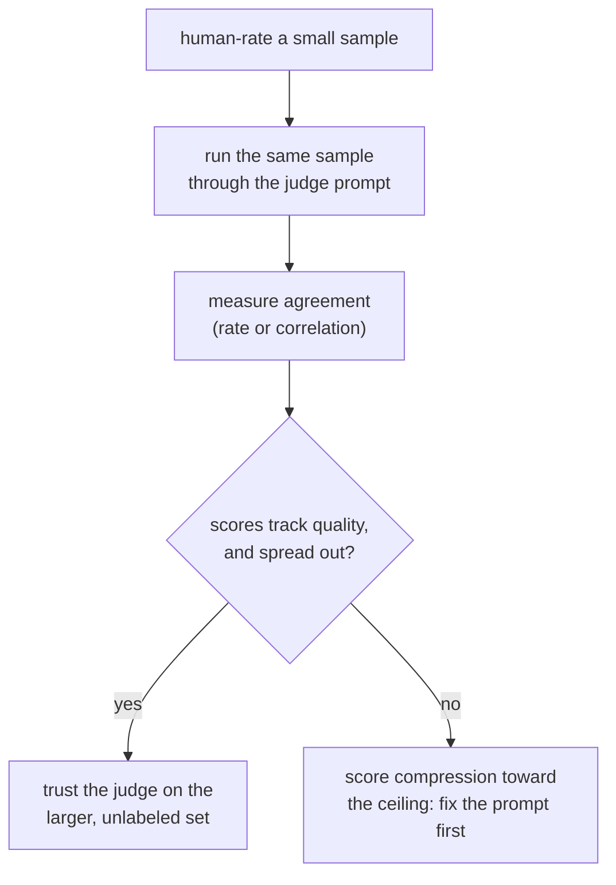

# Урок 5. Дизайн промпта судьи и калибровка

**Связь с целью курса:** Этап 3 охватывает инструмент, к которому вели этапы 1 и 2, для открытого текста: ни метрика с фиксированным ответом, ни перекрытие n-грамм хорошо не отслеживают здесь качество, поэтому пробел заполняет LLM-судья, но лишь после того, как проверены, а не предположены, его промпт и его калибровка.
**Первоисточник:** [Научная статья: "Judging LLM-as-a-Judge with MT-Bench and Chatbot Arena", Zheng et al., 2023](https://arxiv.org/abs/2306.05685)
**Предварительные требования:** [Урок 4](0004-code-execution-metrics.md), [Загрязнение данных](../GLOSSARY.md)

## Разминка

1. ▢ Почему функциональная корректность избегает вида сбоя, затрагивающего точное совпадение, F1 и BLEU/ROUGE на коде?

Проверка

Она исполняет сгенерированный код на тестах и проверяет его фактическое поведение, а не сравнивает его текст с эталонным решением. У кода особенно много текстуально различных способов быть верным, поэтому метрика сравнения текстов оштрафовала бы верное, но иначе написанное решение.

2. ▢ Какой принцип выбора из урока 4 определяет, какое семейство метрик подходит данной задаче?

Проверка

Подбирать метрику под то, что значит «верно» для задачи: исполнять вывод, когда корректность поведенческая и проверяемая, использовать точное совпадение или F1, когда корректность это небольшой фиксированный набор ответов, и использовать BLEU/ROUGE как грубый фильтр для открытого текста, где поверхностное перекрытие лишь слабо отслеживает качество.

## Что нужно знать

### Зачем вообще нужен LLM-судья

Открытая генерация (ответ в чате, развёрнутый ответ, творческий или объяснительный текст) как раз то место, где BLEU и ROUGE из урока 3 слабо коррелируют с качеством, а функциональной корректности из урока 4 нечего исполнять. **LLM-судья** просит способную модель напрямую оценить или сравнить выводы, и на таком тексте он коррелирует с человеческими предпочтениями куда лучше, чем перекрытие n-грамм. Это преимущество, впрочем, не автоматическое: промпт судьи и его измеренное согласие с асессорами-людьми нужно проверить, прежде чем доверять его оценкам, и это тема урока.

### Дизайн промпта судьи

Несколько конкретных решений отличают промпт судьи, оценивающий последовательно, от того, который так не делает:

- **Явные критерии, а не расплывчатая просьба.** «Какой ответ лучше?» оставляет судье самому изобретать рубрику, каждый раз другую. Если назвать измерения, важные для задачи (корректность, полнота, тон, что применимо), у каждого суждения будет одна и та же мерка.
- **Эталонный ответ, если он есть.** Оценка с опорой на эталон даёт судье, с чем сравнивать, а не заставляет судить в вакууме, что особенно важно для задач вроде математики или многошаговых рассуждений, где неверный ответ всё равно может звучать гладко и убедительно, если нечем проверить его правильным.
- **Рассуждение перед оценкой.** Если попросить судью сначала объяснить рассуждение, а потом поставить оценку, оценки получаются последовательнее, чем при просьбе о голом числе, поскольку суждение приходится обосновать, а не выдать напрямую, так же как просьба объяснить оценку обычно делает человека более взвешенным.
- **Структурированный, разбираемый вывод.** Принудительная шкала (скажем, от 1 до 10) или принудительный парный выбор (A, B или ничья) проще агрегировать и проверять, чем оценку свободной прозой, и именно это позволяет превратить много оценённых примеров в одно итоговое число.

### Калибровка: означает ли оценка судьи одно и то же на разных примерах

Судья **откалиброван**, когда его оценки последовательно отслеживают фактическое качество: 8 из 10 на одном примере должно отражать примерно тот же уровень качества, что и 8 из 10 на другом, а относительные рейтинги судьи должны согласовываться с тем, что сказали бы асессоры-люди. Судья может провалить это особым распространённым способом: **сжатие оценок к потолку**, когда он ставит почти всему 8 или 9 независимо от реальных различий в качестве, что стирает те самые различия, ради которых эвал существует. Судья, чьи оценки не расходятся так, как расходится подлинное качество, не измеряет качество, он измеряет собственную снисходительность.

Калибровку не стоит предполагать, её нужно проверять, так же как урок 1 настаивал, что честность набора отложенных данных нужно проверять, а не предполагать. Проверка: прогоните судью на небольшом наборе примеров, которые человек уже оценил, и измерьте согласие, простой долей согласия или статистикой корреляции, прежде чем доверять судье на большем неразмеченном наборе, ради которого он эвалу и нужен.

## Практика

1. ▢ Почему эталонный ответ для модели-судьи, когда он доступен, как правило, повышает точность оценки по сравнению с суждением вообще без эталона?

Проверка

Без эталона судье нечем проверить ответ, кроме собственного ощущения правдоподобности, а гладкий, но неверный ответ, особенно в математике или многошаговых рассуждениях, может выглядеть убедительно, если нечего с ним сравнить. Эталонный ответ даёт судье опору и ловит ошибки, которые иначе проскользнули бы мимо суждения в вакууме.

2. ▢ Почему просьба к судье объяснить рассуждение перед числовой оценкой, как правило, даёт более последовательную оценку, чем просьба только об оценке?

Проверка

Если рассуждение идёт первым, суждение приходится обосновать, а не выдать сразу из сиюминутного впечатления, и итоговая оценка обычно получается более взвешенной и менее произвольной, так же как просьба объяснить оценку влияет на саму оценку человека.

3. ▢ Модель-судья команды ставит почти каждому ответу 8 или 9 из 10, включая несколько ответов, которые асессор-человек независимо назвал посредственными. Какой сбой калибровки это описывает и почему он важен для последующего решения «выпускать или нет»?

Подсказка

Подумайте, что должна делать оценка: отличать уровни качества друг от друга.

Проверка

Это сжатие оценок к потолку: оценки судьи больше не расходятся так, как расходятся реальные различия в качестве, поэтому его рейтинги перестают отличать действительно хороший ответ от посредственного. Это важно для решения «выпускать или нет», потому что сжатый диапазон оценок может сделать изменение похожим на улучшение или сделать регрессию невидимой, когда судья просто больше не различает уровни качества.

4. ▢ Какой конкретный способ проверить, откалиброван ли судья, прежде чем доверять ему на полном неразмеченном наборе для эвала?

Проверка

Прогнать судью на меньшем наборе примеров, которые человек уже оценил, и измерить, насколько оценки или рейтинги судьи согласуются с человеческими, прежде чем полагаться на судью на большем наборе, где проверять не по чему, поскольку человеческих оценок нет.

5. ▢ Какое утверждение верно для хорошо спроектированного промпта судьи?

    - a) Он должен задавать один расплывчатый вопрос («что лучше?»), чтобы не смещать судью конкретными критериями
    - b) Он должен называть явные критерии оценки, включать эталонный ответ, когда он доступен, и просить рассуждение перед оценкой
    - c) Судье никогда не нужен эталонный ответ, поскольку он всегда без посторонней помощи отличает верный ответ от неверного
    - d) Калибровка гарантирована, пока модель-судья достаточно способна

Проверка

**b)** Каждое из этих решений, как показал урок, повышает последовательность и точность. Вариант (a) неверен: расплывчатая просьба позволяет судье изобретать рубрику, каждый раз другую. Вариант (c) неверен: гладкий, но неверный ответ, особенно в задачах на рассуждение, может обмануть судью, которому не с чем его сверить. Вариант (d) неверен: калибровку нужно измерять относительно человеческих оценок независимо от того, насколько способна лежащая в основе модель.

## Практика в реальной работе

- [ ] Найдите или напишите промпт судьи для задачи, которую вы оцениваете, и проверьте его по четырём пунктам дизайна из этого урока: явные критерии, эталонный ответ там, где он есть, рассуждение перед оценкой и структурированный вывод.
- [ ] Сами вручную оцените небольшую выборку (10-20 примеров), прогоните те же примеры через промпт судьи и измерьте, как часто оценки совпадают.
- [ ] Завтра: посмотрите на распределение оценок вашего судьи по пачке оценённых примеров и проверьте, расходятся ли они так, как вы ожидали бы от реальных различий в качестве, или сжаты к одному краю.

## Что почитать дальше

- [Научная статья: "Judging LLM-as-a-Judge with MT-Bench and Chatbot Arena", Zheng et al., 2023](https://arxiv.org/abs/2306.05685)
- [Документация: "Define success criteria and build evaluations", Claude Platform Docs](https://platform.claude.com/docs/en/test-and-evaluate/develop-tests)
- [Ресурсы](../RESOURCES.md)

---

Не доходит? Перечитайте первоисточник в начале: этот урок его сжимает, а при сжатии понимание как раз и теряется. Загляните в [глоссарий](../GLOSSARY.md), если какой-то термин показался скользким.

Если неясен сам урок, а не материал, это дефект: [откройте issue](https://github.com/TokenCemetery/teach/issues).
